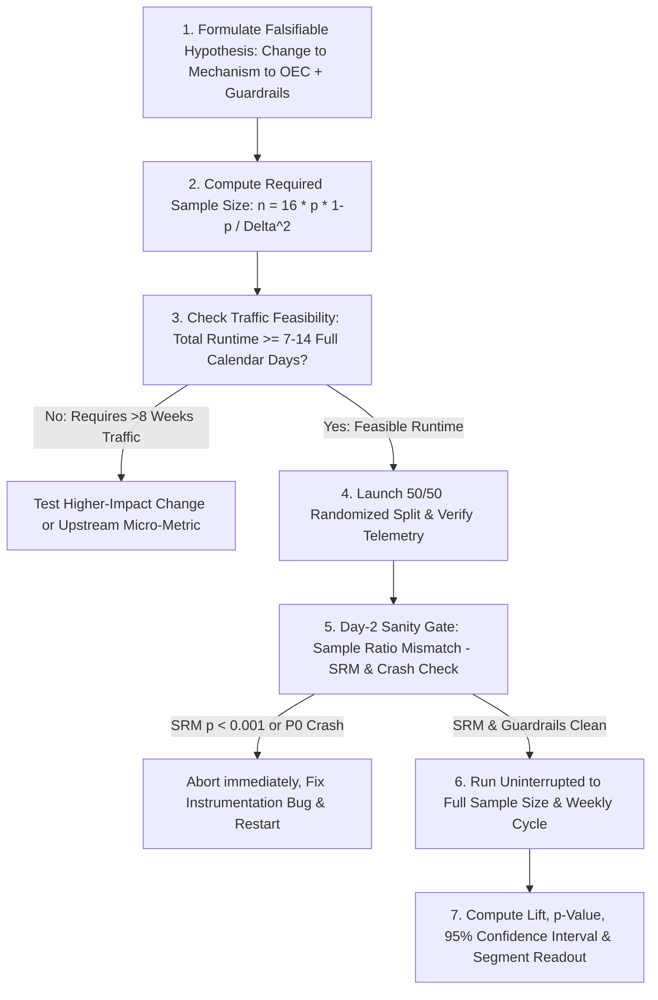

Correlation in observational product data is almost never causation. If you notice in your analytics dashboard that users who enable dark mode have $2.4\times$ higher 90-day retention than users on light mode, forcing 100% of new signups into dark mode will not magically double your retention—because power users self-selected into customizing their settings (**confounding selection bias**). The gold standard for establishing **causal truth** in digital products is the **Online Controlled Experiment (A/B Test)**.

Yet as Ron Kohavi, Diane Tang, and Ya Xu document in the definitive industry reference [*Trustworthy Online Controlled Experiments: A Practical Guide to A/B Testing*](https://www.researchgate.net/publication/339914315_Trustworthy_Online_Controlled_Experiments_A_Practical_Guide_to_AB_Testing) (drawing on tens of thousands of experiments at Microsoft, Google, LinkedIn, and Amazon), even among well-researched ideas at top technology companies, **only 10% to 33% of A/B tests actually improve the primary metric**, while another third have flat/neutral impact and a full third actively *degrade* the user experience! Worse, teams routinely invalidate their own experiments by "peeking" at $p$-values on Day 2 and stopping the test early, ignoring **Sample Ratio Mismatch (SRM)** bugs, or choosing the wrong randomization unit. This guide provides the end-to-end statistical and operational playbook every Product Manager needs to design hypotheses, calculate sample sizes and runtimes, verify guardrails, and make trustworthy launch decisions.

## 1. Structuring a Falsifiable Hypothesis and Selecting the Metric Trio

Never run an A/B test just to "see what happens when we move this banner." Every experiment must begin with a structured, falsifiable hypothesis that connects a discovery insight (**Article 11**, **Article 14**) to a specific mechanism:
> **Because we observed** *[empirical telemetry or usability research evidence]*, **we believe that changing** *[specific independent variable X for segment Y]* **will cause** *[Primary Metric Z to move by at least $\pm \text{MDE}\%$]*, **without degrading** *[Guardrail Metrics G1 and G2]*.

To evaluate an experiment holistically (per Kohavi et al., [Trustworthy Online Controlled Experiments](https://www.researchgate.net/publication/339914315_Trustworthy_Online_Controlled_Experiments_A_Practical_Guide_to_AB_Testing)), pre-register three classes of metrics before starting traffic allocation:
1. **Primary Metric / Overall Evaluation Criterion (OEC):** A **single** north-star decision metric (or weighted index) that determines whether the treatment wins (e.g., *7-day checkout conversion rate per randomized user*). Why only one primary metric? Because if you test 20 metrics at $\alpha = 0.05$ and declare victory if *any* one turns green, the probability of at least one false positive jumps to $1 - (0.95)^{20} = \mathbf{64.2\%}$ (**Multiple Testing / Family-Wise Error Trap**)!
2. **Secondary / Diagnostic Metrics:** Local micro-conversion steps (e.g., *click-through rate on the new button*, *time spent on step 2*) that explain *why* the primary metric moved or failed to move.
3. **Guardrail / Invariant Metrics:** Health metrics that must **not degrade beyond a pre-defined non-inferiority threshold**—including p95/p99 client latency, app crash rate, refund/cancellation rate, support ticket volume, and **Sample Ratio Mismatch (SRM)**.

## 2. Sample Size, Minimum Detectable Effect (MDE), $\alpha$, and Power ($1 - \beta$)

Before launching an experiment, you must calculate how many users per branch ($n$) are required so you do not mistake random noise for a winner (**Type I Error**) or throw away a real winner due to an underpowered sample (**Type II Error**):

- **Significance Level ($\alpha$, Type I False-Positive Rate — Standard = $0.05$ / $5\%$ two-tailed):** The probability of declaring a difference when the true effect is zero ($H_0$ is true). At $\alpha = 0.05$, we require $|Z| \ge 1.96$ (or $p < 0.05$).
- **Statistical Power ($1 - \beta$, True-Positive Sensitivity — Standard = $0.80$ / $80\%$):** The probability of detecting a real effect of size $\text{MDE}$ when $H_1$ is true (meaning $\beta = 0.20$ Type II False-Negative rate, corresponding to $Z_{1-\beta} = 0.84$).
- **Baseline Conversion Rate ($p_0$) and Variance ($\sigma^2$):** For a binary conversion metric (such as conversion rate $p_0$), the Bernoulli variance is $\sigma^2 = p_0(1 - p_0)$.
- **Minimum Detectable Effect ($\Delta_{\text{abs}}$ or $\text{MDE}_{\text{rel}}$):** The smallest improvement worth detecting given business and engineering value. If baseline conversion is $p_0 = 10.0\%$ and you want to detect a **$10\%$ relative lift** (to $p_1 = 11.0\%$), the **absolute delta** is $\Delta_{\text{abs}} = 0.11 - 0.10 = \mathbf{0.01\ (1.0\text{ percentage point})}$.

### The Standard Two-Sample Sample-Size Approximation Formula (at $\alpha = 0.05$ Two-Tailed, Power $= 80\%$)
Since $(Z_{1-\alpha/2} + Z_{1-\beta})^2 = (1.96 + 0.84)^2 = (2.80)^2 = 7.84 \approx 8$, and comparing two independent branches (Control vs. Treatment) doubles the variance ($2 \times 7.84 = 15.68 \approx \mathbf{16}$), the required sample size **per branch ($n$)** is:
$$n_{\text{per branch}} \approx \frac{16 \cdot \sigma^2}{\Delta_{\text{abs}}^2} = \frac{16 \cdot p_0(1 - p_0)}{\Delta_{\text{abs}}^2}$$
*(Notice the inverse-square law in the denominator: cutting your Minimum Detectable Effect $\Delta_{\text{abs}}$ in half requires **$4\times$ as many users**!)*

## 3. Critical Validity Threats That Corrupt Product Experiments

Even when the sample-size math is right, five operational threats can invalidate an A/B test:

1. **The Peeking Problem (Continuous $p$-Value Monitoring):** If you check a standard fixed-horizon $p$-value every morning for 14 days and stop the test the first moment $p < 0.05$, your true False-Positive rate ($\alpha$) balloons from **$5\%$ to $25\%\text{–}30\%+$**. *Fix:* Never stop a fixed-horizon test before reaching the pre-calculated sample size **AND at least 1–2 full weekly business cycles (7 or 14 days)** to capture weekday vs. weekend behavior (or use sequential testing / Always-Valid $p$-values via mSPRT).
2. **Sample Ratio Mismatch (SRM — The #1 Sign of an Instrumentation Bug):** If you configure a $50.0\% / 50.0\%$ split across $100,000$ users, and Control receives $50,850$ users while Treatment receives $49,150$ users (Chi-square $p < 0.001$), **the experiment is invalid**. SRM happens when slow treatment code causes browser redirects to drop, ad-blockers block a script, or bot traffic skews one bucket. Never analyze conversion metrics on a test that fails its SRM check!
3. **Network Interference / Spillover (SUTVA Violations):** In two-sided marketplaces (Uber, Airbnb) or social networks (LinkedIn, WhatsApp), randomizing at the individual user level causes **Treatment users to steal supply from or message Control users**, biasing the result. In networked products, use **geo-cluster randomization**, **time-slice switchbacks**, or **ego-cluster randomization**.
4. **Novelty Effect vs. Primacy Effect:** When you change a prominent UI button, curious users may click it more on Day 1 simply because it is new (**Novelty Effect**—which decays after 2 weeks), or habitual power users may perform worse initially while adjusting their muscle memory (**Primacy Effect**). Compare Day-1 vs. Day-14 cohorts to isolate novelty decay.

## Frameworks and Comparison Tables

### Table 18.1: The Statistical Decision & Error Matrix ($\alpha = 0.05$, Power $1 - \beta = 0.80$)

| Ground Truth in Reality | Experiment Result: **Not Statistically Significant ($p \ge 0.05$)** | Experiment Result: **Statistically Significant ($p < 0.05$)** |
| :--- | :--- | :--- |
| **$H_0$ Is True** *(Feature has zero real impact)* | **True Negative (Correct Rejection)** Probability $= 1 - \alpha = \mathbf{95\%}$ | **Type I Error (False Positive / "Fool's Gold")** Probability $= \alpha = \mathbf{5\%}$ *(Inflated to >25% if peeking!)* |
| **$H_1$ Is True** *(Feature truly lifts metric by $\ge \text{MDE}$)* | **Type II Error (False Negative / Missed Winner)** Probability $= \beta = \mathbf{20\%}$ *(Caused by small sample size)* | **True Positive (Valid Causal Discovery)** Probability $= 1 - \beta = \mathbf{80\%}$ *(Statistical Power)* |

### Table 18.2: Post-Experiment Ship / Rollback Decision Matrix (Combining OEC, Confidence Intervals & Guardrails)

| Primary Metric (OEC) Result | 95% Confidence Interval ($\text{CI}$) | Guardrail Metrics Status | Product Manager Action & Rationale |
| :--- | :--- | :--- | :--- |
| **Statistically Significant Lift ($p < 0.05$)** | Entire 95% CI is $> 0$ (e.g., $[+0.8\%, +2.4\%]$) | All Guardrails & SRM **PASS** | **SHIP TO 100% GA** — Clear causal win with zero collateral damage. |
| **Statistically Significant Lift ($p < 0.05$)** | Positive OEC lift, **BUT** Guardrail degrades | **FAIL** (e.g., p99 latency $+600\text{ms}$ or refunds $+35\%$) | **HOLD / DO NOT SHIP** — Fix the engineering latency or refund flaw and re-test before launching. |
| **Flat / Neutral ($p = 0.42$)** | Tight CI centered near $0$ (e.g., $[-0.3\%, +0.4\%]$) | All Guardrails **PASS** | **DEFAULT TO SIMPLER CODE** — Do not ship complex new code for zero lift; only ship if it deletes legacy tech debt. |
| **Underpowered / Inconclusive ($p = 0.14$)** | Wide CI spanning bad hurt to huge win ($[-1.5\%, +4.2\%]$) | SRM **PASS**, sample too small | **EXTEND PRE-PLANNED RUNTIME OR REDESIGN** — Sample had insufficient power to rule out noise. |
| **Sample Ratio Mismatch (SRM $p < 0.001$)** | *(Corrupted by uneven traffic split)* | **SRM FAIL** (e.g., $51.2\% / 48.8\%$ split) | **DISCARD RESULTS IMMEDIATELY** — Debug telemetry/redirect pipeline with engineering and restart cleanly. |

## Visualizing the Framework

The following architecture diagram illustrates the workflow and decision criteria:

## Practical Worked Example

**Scenario (Hypothetical B2B SaaS Self-Serve Upgrade Flow — *CloudStack*):**  
Currently, **$10,000$ unique qualified users per week** visit the *CloudStack* pricing upgrade checkout page. Your historical **Baseline Checkout Conversion Rate is $p_0 = 5.0\%$ ($0.05$)**.  
Following usability testing (**Article 14**), your squad hypothesizes that replacing the 9-field billing address form with **1-Click Stripe Link / UPI Express Auto-Fill (Treatment)** will increase checkout conversion by at least a **$15\%$ relative lift** (our Minimum Detectable Effect, $\text{MDE}_{\text{rel}} = +15\%$), while keeping our guardrail metric (**7-day payment refund rate**) $\le 1.0\%$.

## Step 1: Calculate Required Sample Size ($n_{\text{per branch}}$) and Total Runtime Before Launch
1. **Target Conversion Rate ($p_1$) and Absolute Delta ($\Delta_{\text{abs}}$):**
   $$p_1 = 0.05 \times (1 + 0.15) = 0.0575\ (5.75\%)$$
   $$\Delta_{\text{abs}} = p_1 - p_0 = 0.0575 - 0.0500 = \mathbf{0.0075\ (0.75\text{ percentage points})}$$
2. **Baseline Variance ($\sigma^2$):**
   $$\sigma^2 = p_0(1 - p_0) = 0.05 \times 0.95 = \mathbf{0.0475}$$
3. **Sample Size per Branch ($\alpha = 0.05$ Two-Tailed, Power $= 80\%$):**
   $$n_{\text{per branch}} \approx \frac{16 \times 0.0475}{(0.0075)^2} = \frac{0.76}{0.00005625} = \mathbf{13,511\text{ users per branch}}$$
   *(Note: Using exact pooled variance $\bar{p} = 0.05375$ yields $n = 14,190$ per branch; let us lock **$n = 14,000\text{ users per branch}$** = **$28,000\text{ total users}$** across Control + Treatment).*
4. **Required Experiment Duration:**  
   At $10,000\text{ qualified visitors/week}$, reaching $28,000\text{ total users}$ requires $2.8\text{ weeks}$. To land on a clean full-week cycle (avoiding day-of-week skew), we lock the pre-registered runtime at **exactly 3 full weeks (21 calendar days $\approx 30,000$ total users)**.

## Step 2: Analyze the 21-Day Experiment Results
After 21 uninterrupted days, we pull the final telemetry:
- **Sample Ratio Mismatch (SRM) Check:** Control received $n_C = 15,040\text{ users}$ ($50.07\%$); Treatment received $n_T = 14,990\text{ users}$ ($49.93\%$). Chi-square $p = 0.77 \gg 0.001 \rightarrow$ **SRM Check PASSES**.
- **Observed Conversions:**
  - **Control ($C$):** $752\text{ conversions} / 15,040\text{ users} \rightarrow \hat{p}_C = \mathbf{5.00\%}$ ($0.0500$).
  - **Treatment ($T$):** $884\text{ conversions} / 14,990\text{ users} \rightarrow \hat{p}_T = \mathbf{5.897\% \approx 5.90\%}$ ($0.05897$).
- **Observed Lift:**
  - **Absolute Lift ($\hat{\Delta}$):** $5.897\% - 5.000\% = \mathbf{+0.897\text{ percentage points}}$ ($+0.00897$).
  - **Relative Lift:** $\frac{0.05897 - 0.05000}{0.05000} = \mathbf{+17.95\%}$.
- **Computing Standard Error ($\text{SE}$), $Z$-Statistic, and $95\%$ Confidence Interval:**
  $$\text{SE} = \sqrt{\frac{\hat{p}_C(1-\hat{p}_C)}{n_C} + \frac{\hat{p}_T(1-\hat{p}_T)}{n_T}} = \sqrt{\frac{0.05(0.95)}{15,040} + \frac{0.05897(0.94103)}{14,990}}$$
  $$\text{SE} = \sqrt{0.000003158 + 0.000003702} = \sqrt{0.00000686} = \mathbf{0.002619\ (0.262\%)}$$
  $$Z = \frac{\hat{\Delta}}{\text{SE}} = \frac{0.00897}{0.002619} = \mathbf{3.425}\quad (\text{Since } |Z| = 3.425 > 1.96,\ \mathbf{p = 0.0006 < 0.05 \rightarrow \text{Statistically Significant!}})$$
  $$\text{95\% Confidence Interval for Absolute Lift} = 0.897\% \pm (1.96 \times 0.262\%) = \mathbf{[+0.38\%, +1.41\%]}$$
- **Guardrail Check:** 7-day refund rate was $0.62\%$ in Control vs. $0.64\%$ in Treatment ($p = 0.82$, well below the $1.0\%$ ceiling).
- **Final Decision:** **SHIP Treatment to 100% GA**, capturing an expected $+17.95\%$ relative lift in self-serve paid conversions.

## Common Mistakes and Limitations

1. **Running A/B Tests on Low-Traffic Surfaces Where Sample Size Takes 6 Months:** If your enterprise B2B feature gets only 300 visitors per month, a standard conversion A/B test to detect a 10% relative lift would take **3.5 years** to reach statistical power! When traffic is small, do **not** run underpowered A/B tests—use **qualitative 5-user usability testing (**Article 14**)**, **session replay analysis**, or test a **high-frequency upstream micro-metric** (such as step-1 click initiation).
2. **Changing the Experiment Mid-Flight:** Modifying the Treatment UI or shifting the traffic allocation from $20\%/80\%$ to $50\%/50\%$ halfway through a test introduces **Simpson's Paradox** (**Article 21**) if conversion rates vary across weeks. If you must change a live experiment, start a fresh experiment ID and analyze the new period cleanly.
3. **Local Maxima Trap:** A/B testing is a hill-climbing optimization tool—it tells you which of two nearby designs is higher on the current hill, but it cannot tell you if there is a $10\times$ taller mountain across the valley. Never replace bold strategic product vision (**Article 06**) and zero-to-one discovery with incremental button-color testing.

## Practical Implementation Checklist

- [ ] **Written Falsifiable Hypothesis:** Does our experiment brief state the observation, the single variable changed, the mechanism, and the single Primary Metric (OEC)?
- [ ] **Pre-Calculated Sample Size & Runtime:** Have we calculated $n_{\text{per branch}}$ for $\alpha = 0.05$ and $80\%$ power, and confirmed that the required traffic finishes within 2 to 4 full weekly cycles?
- [ ] **Guardrail Metrics Pre-Registered:** Have we defined at least two invariant guardrails (e.g., p95 latency, error rate, refund/churn rate) that can veto a false win?
- [ ] **Correct Randomization Unit:** Are we randomizing by persistent `user_id` or `workspace_id` (rather than ephemeral session cookies) and checking for two-sided marketplace spillover?
- [ ] **Day-2 SRM Sanity Check Scheduled:** Do we have an automated check 48 hours after launch to verify a clean $50.0\% / 50.0\%$ traffic split (Chi-square $p > 0.001$)?

## Frequently Asked Questions

### 1. Why can't I stop an A/B test on Day 3 if the dashboard already shows "99% Statistical Significance ($p = 0.01$)"?
Classical fixed-sample $p$-values assume you look at the data **exactly once** after collecting the full pre-calculated sample size $n$. Early in an experiment when sample size is small ($n = 400$), random clustering of 5 extra conversions in Treatment causes wild variance spikes that temporarily cross $p < 0.05$ before regressing to the mean by Day 10. Stopping whenever the curve happens to cross the line biases your results entirely toward early lucky noise and misses weekend user cohorts.

### 2. What is an A/A Test, and why do engineering teams run them?
An **A/A Test** splits traffic $50\% / 50\%$ between two identical versions of the existing control experience. Teams run an A/A test when setting up a new experimentation platform (like GrowthBook, PostHog, or an internal router) to verify that (1) traffic splits evenly without Sample Ratio Mismatch, (2) telemetry events record identically across buckets, and (3) false-positive $p < 0.05$ triggers occur no more than $5\%$ of the time.

### 3. How do variance-reduction techniques like CUPED speed up A/B testing?
Popularized by researchers at Microsoft ([Kohavi, Tang & Xu](https://www.researchgate.net/publication/339914315_Trustworthy_Online_Controlled_Experiments_A_Practical_Guide_to_AB_Testing)), **CUPED (Controlled-experiment Using Pre-Experiment Data)** uses each user's **pre-experiment baseline behavior** (from the 14 days *before* the test started) as a covariate to subtract out pre-existing user-to-user variance ($\sigma^2$). Because required sample size $n$ is directly proportional to $\sigma^2$, reducing variance by $40\%$ via CUPED allows you to run the exact same experiment in **$40\%$ less time (or with $40\%$ fewer users)** at identical statistical power!

### 4. What is the difference between a Two-Tailed Test and a One-Tailed Test, and which should PMs use?
A **One-Tailed Test** only tests whether Treatment is *better* than Control, mathematically ignoring the possibility that your new feature actually *hurts* conversion. Because roughly one-third of product experiments inadvertently degrade metrics in production, industry standard best practice (at Google, Microsoft, Meta, and Airbnb) is to default to **Two-Tailed Tests ($\alpha = 0.05$, split $2.5\%$ in each tail, $|Z| \ge 1.96$)** so you can detect statistically significant regressions with equal rigor.

### 5. Should we run Multivariate Tests (A/B/C/D/n) or simple two-branch A/B Tests?
Keep most product experiments as clean **two-branch (A/B) or three-branch (A/B/C)** tests. Every additional branch dilutes traffic per bucket (a 5-branch test splits traffic $20\%$ each, increasing required runtime by $2.5\times$) and triggers the **Multiple Comparisons penalty** (requiring Bonferroni or Benjamini-Hochberg false-discovery rate adjustments that demand even larger samples).

### 6. How do you run A/B experiments on LLM / AI model changes (e.g., comparing Claude vs. OpenAI vs. an open-source distilled model)?
As detailed in modern AI experimentation guides ([GrowthBook LLM Experimentation Guide](https://www.growthbook.io/insights/experimenting-different-llm-providers-openai-vs-anthropic-vs-oss)), offline benchmark evals (**Article 23**) must be paired with **online A/B testing** because offline benchmarks cannot predict how real users react to changes in tone, formatting, and latency. Randomize at the **conversation or user level**, set your Primary Metric to **Task Resolution / Acceptance Rate**, and track **Time-to-First-Token (TTFT) latency** and **Token Cost per Resolved Session** as strict guardrail metrics.

## Next Steps and Recommended Reading

A/B testing is the ultimate humility engine in product management: it replaces political arguments in conference rooms with the empirical verdict of real user behavior. By calculating sample sizes before launch, checking Sample Ratio Mismatch on Day 2, holding discipline across full weekly cycles, and protecting your product with strict guardrail metrics, you ensure that every feature you ship to 100% GA is a verified causal improvement.

**Practical Next Step:** Before your squad launches its next feature experiment, plug your baseline conversion rate $p_0$ and minimum meaningful lift $\Delta_{\text{abs}}$ into the formula $n = \frac{16 \cdot p_0(1-p_0)}{\Delta_{\text{abs}}^2}$ from Section D.2 to verify whether your traffic volume supports a valid 2-to-3 week test.

**Recommended Follow-Up Reading:** Once your feature passes experimentation and is ready for full market release, proceed to **Article 19: Go-to-Market Strategy for Product Managers: From Launch to Adoption** (`/blog/product/go-to-market-strategy-for-product-managers/` — *Planned Destination*) to orchestrate a high-impact launch.

## About this guide

Aniket Thakur prepared this comprehensive Product Management guide based on continuous discovery frameworks, operational research, and practitioner benchmarks checked on 24 October 2026. All quantitative scenarios in Section G are explicitly labelled hypothetical worked examples illustrating decision math.
