Walk into many self-described "Agile" enterprises and you will witness a masterclass in theatrical bureaucracy: teams spend four hours every Monday debating whether a ticket is 3 story points or 5 story points, hold 45-minute daily status interrogations, and still require nine months to ship a customer-facing change because requirements are locked a year in advance. Industry practitioners call this anti-pattern **Water-Scrum-Fall**—wrapping a rigid waterfall feature factory inside two-week Scrum vocabulary.

True **Agile Product Management**—rooted in the 2001 *Agile Manifesto* and codified in Ken Schwaber and Jeff Sutherland's official [*2020 Scrum Guide*](https://scrumguides.org/scrum-guide.html) alongside Lean Kanban flow theory—exists for one purpose: **maximizing empirical learning and customer value delivery under conditions of high uncertainty**. Rather than treating Agile as a rigid checklist of rituals, an effective Product Manager understands how to choose between time-boxed **Scrum** and continuous-flow **Kanban**, how to synchronize **Dual-Track Agile** (so discovery stays 1–2 sprints ahead of engineering delivery), and how to govern **Product Backlog Refinement**, **Sprint Goals**, and **Work-in-Progress (WIP) limits**. This guide breaks down the official Scrum accountabilities and artifacts, compares Scrum vs. Kanban vs. Scrumban, and walks through a quantitative sprint capacity and Little's Law cycle-time calculation.

## 1. Scrum Fundamentals for Product Managers (Grounded in *The 2020 Scrum Guide*)

As defined by Scrum co-creators Ken Schwaber and Jeff Sutherland on [ScrumGuides.org](https://scrumguides.org/scrum-guide.html) (and summarized in [Learnsignal's 2020 Scrum Guide Analysis](https://www.learnsignal.com/blog/scrum-guide-roles-events-artifacts-explained-guide/)), Scrum is built on **empiricism** (transparency, inspection, and adaptation) and organizes work around three specific accountabilities, three artifacts (each paired with a formal commitment), and five time-boxed events:

### The Three Accountabilities in a Scrum Team (Typically $\le 10$ People)
1. **Product Owner (Typically fulfilled by the Product Manager in tech companies):** Accountable for maximizing the value of the product resulting from the work of the Scrum Team and for effective **Product Backlog management**—including articulating the Product Goal, ordering backlog items clearly, and ensuring backlog transparency. Crucially, the Product Owner is **one person, not a committee**.
2. **Scrum Master:** Accountable for establishing Scrum as defined in the Scrum Guide and improving the Scrum Team's effectiveness by removing organizational impediments and coaching flow (often fulfilled by a rotating Tech Lead, Engineering Manager, or agile coach in modern software squads).
3. **Developers:** The cross-functional professionals (software engineers, UX designers, QA specialists) committed to creating any aspect of a usable Increment each Sprint.

### The Three Scrum Artifacts and Their Official 2020 Commitments
- **Artifact 1: Product Backlog $\rightarrow$ Commitment: *Product Goal*:** An emergent, ordered list of what is needed to improve the product, anchored by a long-term **Product Goal** (which aligns directly with your quarterly OKR, **Article 10**).
- **Artifact 2: Sprint Backlog $\rightarrow$ Commitment: *Sprint Goal*:** Composed of the **Sprint Goal** (the *why*—a single coherent outcome objective for the Sprint), the set of Product Backlog items selected for the Sprint (the *what*), and an actionable plan for delivering them (the *how*).
- **Artifact 3: Increment $\rightarrow$ Commitment: *Definition of Done (DoD)*:** A concrete, verified stepping stone toward the Product Goal. The moment a Product Backlog item meets the formal **Definition of Done** (e.g., unit/integration tests passing, security checks green, telemetry events verified, staged behind a feature flag), an Increment is born.

## 2. Kanban and Little's Law: Managing Continuous Flow via WIP Limits

While Scrum organizes work into fixed time-boxes (typically 2-week Sprints, or *Cycles* in [Linear](https://linear.app/pricing)), **Kanban** (adapted for software by David J. Anderson from Toyota's Lean production system) manages work as a **continuous, pull-based flow** without fixed sprint boundaries.

Kanban is governed by **Little's Law** from queueing theory:
$$\text{Average Cycle Time} = \frac{\text{Average Work in Progress (WIP)}}{\text{Average Throughput}}$$
For example, if a 6-engineer squad has a steady throughput of **6 completed stories per week**, and they allow **24 stories to sit "In Progress" simultaneously ($\text{WIP} = 24$)** because every developer is multitasking across 4 half-finished tickets, the average time required for any single story to finish (**Cycle Time**) balloons to $\frac{24}{6} = \mathbf{4.0\text{ weeks}}$. If the team enforces a strict **WIP Limit of 6 items in progress at once ($\text{WIP} = 6$)**, developers finish and code-review active items before pulling new ones, slashing **Average Cycle Time** from $4.0\text{ weeks}$ down to $\frac{6}{6} = \mathbf{1.0\text{ week}}$ without anyone working longer hours!

## 3. Dual-Track Agile: Preventing "Sprint Starvation" and "Design-on-the-Fly"

The single biggest failure mode in Agile product management occurs when a PM tries to run customer discovery (**Article 11**) and UX usability testing (**Article 14**) *inside* the exact same 2-week sprint in which engineers are expected to code the feature. By Day 3 of the sprint, engineers are sitting idle waiting for [Figma](https://uichemy.com/blog/figma-pricing/) screens; by Day 8, the designer rushes an untested mockup into code just to "make the sprint."

**Dual-Track Agile** solves this by running two parallel, continuously synchronized tracks within the same Product Trio:
- **The Discovery Track (Looking 1–2 Sprints Ahead — Sprints $N+1$ and $N+2$):** The PM, Product Designer, and Tech Lead spend 20%–30% of their weekly capacity interviewing users, testing Figma prototypes, running 1-day technical spikes, and authoring the PRD (**Article 09**).
- **The Delivery Track (Current Sprint $N$):** Only items that meet the **Definition of Ready (DoR)**—validated problem, usability-tested design, clear Gherkin acceptance criteria, and sized by engineers during **Backlog Refinement**—enter Sprint Planning for production coding.

## Frameworks and Comparison Tables

### Table 16.1: Choosing Your Execution Cadence — Scrum vs. Kanban vs. Scrumban

| Dimension | Scrum ([2020 Scrum Guide](https://scrumguides.org/scrum-guide.html)) | Kanban (Continuous Flow) | Scrumban (Hybrid Model) |
| :--- | :--- | :--- | :--- |
| **Planning Cadence** | Fixed time-boxes (1–4 week Sprints; 2 weeks standard) | Continuous pull-based replenishment whenever WIP drops below limit | Fixed 2-week planning & review cadence + Kanban WIP limits |
| **Scope Changes Mid-Cycle** | No changes allowed that endanger the committed **Sprint Goal** | New top-priority item can be pulled into the next open WIP slot immediately | Protected Sprint Goal + small reserved buffer lane for urgent bugs |
| **Primary Flow Metric** | **Sprint Velocity** (Story points or stories completed per Sprint) & Sprint Goal hit rate | **Cycle Time**, **Lead Time**, **Throughput**, and **Cumulative Flow Diagram (CFD)** | Both **Cycle Time** (for flow speed) and **Sprint Goal completion** |
| **Estimation Requirement** | Relative sizing (Story Points: $1, 2, 3, 5, 8$ or Engineering Days) | Optional; often uses right-sized uniform items (Throughput counting) | Lightweight sizing to ensure stories fit inside a 2–3 day cycle time |
| **Best Product Fit** | Core product feature squads building multi-week roadmap initiatives | Platform/SRE teams, production bug-triage squads, and rapid Growth experiment teams | Scale-up product squads (e.g., teams using [Linear Cycles](https://linear.app/pricing)) balancing roadmap bets with live customer issues |

### Table 16.2: Definition of Ready (DoR) vs. Definition of Done (DoD) Governance Checklist

| Gate | Entry Gate: **Definition of Ready (DoR)** *(Required Before Pulling Into Sprint)* | Exit Gate: **Definition of Done (DoD)** *(Required Before Closing Story as Complete)* |
| :--- | :--- | :--- |
| **1. Problem & Value** | User story clearly states persona, action, and expected outcome; linked to parent PRD | Feature verified by PM in staging environment against all PRD acceptance criteria |
| **2. UX & Design States** | Final [Figma](https://uichemy.com/blog/figma-pricing/) frames attached covering Empty, Loading, Ideal, Edge, and Error states | UI implementation reviewed by Product Designer (Design QA passed across mobile/desktop) |
| **3. Technical & Sizing** | Dependencies resolved; story sized by engineers at $\le 3\text{–}5$ days of work (split if larger) | Peer code review approved; automated unit, integration, and regression tests passing ($\ge 85\%$ coverage) |
| **4. Testability & QA** | Deterministic Gherkin (`Given / When / Then`) acceptance criteria written | Zero P0/P1 defects open; p95 latency and security/RBAC permission checks verified |
| **5. Telemetry & Release** | Exact analytics event names and properties specified in ticket | Telemetry events verified firing in staging; wrapped in production feature flag with rollback switch |

## Visualizing the Framework

The following architecture diagram illustrates the workflow and decision criteria:

```mermaid
flowchart LR
    subgraph Discovery_Track["Discovery Track: Sprints N+1 & N+2"]
        D1["Opportunity Tree & User Interviews"] --> D2["Figma Prototype & 5-User Usability Test"]
        D2 --> D3["Tech Lead Feasibility Spike & Draft PRD"]
    end
    subgraph Refinement_Gate[Mid-Sprint Backlog Refinement]
        D3 --> R1["Meets Definition of Ready - DoR?"]
        R1 -->|No: Missing Edge Cases or Too Large| D2
        R1 -->|Yes: Split into <=3-Day Stories with Gherkin ACs| R2[Top of Ordered Product Backlog]
    end
    subgraph Delivery_Track[Delivery Track: Current Sprint N]
        R2 --> S1[Sprint Planning: Commit to Cohesive Sprint Goal]
        S1 --> S2["Daily Execution with WIP Limits & Code Review"]
        S2 --> S3["Meets Definition of Done - DoD?"]
        S3 -->|Yes| S4[Shipped Increment + Telemetry Feedback to Discovery]
    end
```

## Practical Worked Example

**Scenario (Hypothetical B2B SaaS Squad — *CloudInvoice Sprint 22 Planning*):**  
Your squad uses 2-week sprints (10 working days per sprint) and consists of **6 Software Engineers**. Over the past 4 sprints, the team repeatedly committed to **60 story points** per sprint, finished only **38 story points**, and carried 22 half-finished points over to the next sprint, while average story **Cycle Time** ballooned to **9.5 working days**.

## Part 1: Calculating Focus-Adjusted Sprint Capacity (Preventing Overcommitment)
1. **Historical Rolling Velocity (Empirical Baseline):** Over Sprints 18, 19, 20, and 21, completed velocities were $36, 40, 38,\text{ and }38\text{ points}$ across $60\text{ available engineer-days per sprint}$.
   - **Empirical Velocity per Engineer-Day:** $\frac{38\text{ avg points}}{60\text{ engineer-days}} = \mathbf{0.633\text{ points/engineer-day}}$.
2. **Accounting for Real-World Availability in Sprint 22:**
   - **Gross Engineer-Days:** $6\text{ engineers} \times 10\text{ days} = 60\text{ days}$.
   - **Subtract Planned PTO & Public Holiday:** 1 Diwali/Regional holiday for all 6 engineers ($-6\text{ days}$) + Engineer B taking 3 days vacation ($-3\text{ days}$) = $-9\text{ days}$.
   - **Subtract Rotating On-Call / Production Bug Triage (1 Engineer at 50% capacity):** $-4.5\text{ days}$.
   - **Net Available Feature Engineering Days for Sprint 22:** $60 - 9 - 4.5 = \mathbf{46.5\text{ net engineer-days}}$.
3. **Focus-Adjusted Sprint 22 Commitment:**
   $$\text{Sprint 22 Target Capacity} = 46.5\text{ net days} \times 0.633\text{ pts/day} = \mathbf{29.4 \approx 30\text{ story points}}$$
   Instead of blindly committing to 60 points (which guarantees a 50% failure rate during a holiday sprint), the PM and Tech Lead scope a cohesive **30-point Sprint Goal** (*"Enable self-serve multi-currency invoice PDF generation for USD/EUR accounts"*).

## Part 2: Applying Little's Law & WIP Limits to Slash Cycle Time
Why was average story Cycle Time previously stuck at **9.5 working days**? Auditing the [Jira](https://www.atlassian.com/software/jira/pricing) / [Linear](https://linear.app/pricing) board revealed that all 6 developers started 2 stories each on Day 1 ($\text{Active WIP} = 12\text{ stories}$), leaving 8 stories bottlenecked in the `Awaiting Code Review & QA` column on Day 9 of the sprint.
- **Baseline State (No WIP Limit):** $\text{Throughput} = 1.2\text{ stories/day}$ ($12\text{ stories per 10-day sprint}$); $\text{Average WIP} = 11.4\text{ stories} \rightarrow \text{Cycle Time} = \frac{11.4}{1.2} = \mathbf{9.5\text{ days}}$.
- **Intervention (Enforcing a Strict Column WIP Limit of $\text{Max WIP} = 4\text{ stories in Code}$ and $\text{Max WIP} = 2\text{ in Review}$):** Developers pair on code reviews before pulling new tickets, keeping total active $\text{WIP} = 4.5\text{ stories}$ while Throughput rises slightly to $1.3\text{ stories/day}$ due to zero context-switching penalty:
  $$\text{New Average Cycle Time} = \frac{\text{WIP}}{\text{Throughput}} = \frac{4.5\text{ stories}}{1.3\text{ stories/day}} = \mathbf{3.46\text{ working days}}\ (-63.6\%\text{ faster delivery})$$

## Common Mistakes and Limitations

1. **Weaponizing Story Points as an Individual Developer Performance Metric:** Story points are an internal squad capacity-planning guesstimate of relative effort and uncertainty—never a measure of developer productivity or customer value. The moment management compares "Story Points per Engineer" across squads, developers simply inflate every 2-point ticket to 8 points, destroying planning accuracy.
2. **Turning the Sprint Review into an Internal Box-Checking Demo:** Per [The 2020 Scrum Guide](https://scrumguides.org/scrum-guide.html), the Sprint Review is a working inspection session with stakeholders to adapt the Product Backlog based on real market feedback, not a passive theatre presentation where nobody asks questions.
3. **Skipping Backlog Refinement:** When a PM cancels the mid-sprint 60-minute Backlog Refinement session, Sprint Planning on Monday morning drags on for 3 exhausting hours because engineers are seeing the requirements for the very first time.

## Practical Implementation Checklist

- [ ] **Cohesive Sprint Goal:** Does our current Sprint have a single, outcome-oriented **Sprint Goal** sentence (rather than *"Finish these 14 random unrelated Jira tickets"*)?
- [ ] **1.5-Sprint Refined Buffer:** Are the top stories in our Product Backlog refined, sized ($\le 3\text{–}5$ days of work each), and meeting the **Definition of Ready** at least 1.5 sprints ahead?
- [ ] **WIP Limit Enforcement:** Have we set an explicit Work-in-Progress (WIP) limit on our `In Progress` and `In Code Review` columns ($\le 1.0\times$ the number of active engineers) to prevent Day-9 QA bottlenecks?
- [ ] **Telemetry Inside Definition of Done:** Does our squad's **Definition of Done** explicitly forbid closing a user story until its analytics events are verified firing in staging?
- [ ] **Protected Discovery Track:** Are the PM, Designer, and Tech Lead dedicating weekly time to Sprints $N+1 / N+2$ discovery so engineers never build unvalidated specs?

## Frequently Asked Questions

### 1. Should a Product Manager attend the Daily Standup (Daily Scrum) every day, and what should they say?
Per [The 2020 Scrum Guide](https://scrumguides.org/scrum-guide.html), the Daily Scrum is a 15-minute event **for the Developers** to inspect progress toward the Sprint Goal and adapt their plan for the next 24 hours; if the Product Owner/PM is actively working on items in the Sprint Backlog, they participate as a Developer. In practice, PMs should attend to **listen, unblock edge-case questions immediately after standup ("in the parking lot"), and share urgent customer/experiment context**—never to interrogate engineers like a micromanager asking *"Why did you only write 50 lines of code yesterday?"*

### 2. Story Points vs. NoEstimates (Counting Stories or Engineering Days): Which is better in 2026?
Both work when applied consistently, and many modern high-velocity teams using [Linear](https://linear.app/pricing) have moved away from abstract Fibonacci debates toward **right-sizing every story to 1–3 engineering days** and tracking **Throughput (count of completed issues per cycle) and Cycle Time**. If your team uses Fibonacci story points ($1, 2, 3, 5, 8$), cap any single sprint story at **8 points max** (anything rated $13+$ is an Epic that must be split during Backlog Refinement).

### 3. What should a Product Manager do when a stakeholder demands adding an urgent feature in the middle of an active 2-week Sprint?
First, evaluate whether it is a true **P0 Production Outage / Regulatory Blocker** or merely an impatient feature request. If it is a routine feature request, protect the squad: explain that the current Sprint closes in $X$ days and offer to prioritize it at the top of the very next Sprint Planning session. If it is a genuine emergency that cannot wait 5 days, invoke the **1-for-1 Swap Rule** with the Tech Lead: pull an equivalent number of unstarted story points out of the active Sprint so the team does not fail its core commitment.

### 4. How should bugs and technical debt be prioritized alongside new features in the Product Backlog?
Separate bugs into two buckets: (1) **In-Sprint Defects** discovered on a story currently being built (these must be fixed immediately *before* that story can pass the Definition of Done—never log them as separate backlog items to artificially inflate velocity); and (2) **Escaped Production Bugs & Tech Debt**, which are mitigated by reserving a fixed **15% KTLO + 20% Tech Debt capacity allocation** every sprint (**Article 07**) rather than letting minor bugs pile up for two years.

### 5. What happens when a squad finishes only 80% of a user story by the last day of the Sprint?
In Scrum, **partially done work receives zero velocity credit** for the closing Sprint because it does not meet the [Definition of Done](https://scrumguides.org/scrum-guide.html). Do not artificially split a story into "Part A (Code written — 3 pts)" and "Part B (Tested — 2 pts)" just to make a burndown chart look pretty. Move the unfinished story into the next Sprint, re-estimate the remaining effort, and use the **Sprint Retrospective** to diagnose why it spilled over (usually because the story was too large or started on Day 8 of the sprint).

### 6. How does Agile Product Management work when building hardware or AI models with long training cycles?
When working with long-duration physical validation cycles (as discussed in Aniket Thakur's [Physical AI & Heavy Industry note](https://aniket.app/learnings.html)) or multi-day foundation model training runs, **decouple the research/hardware cadence from the software integration cadence**: run evaluation dataset creation, prompt/guardrail engineering, and simulation testing in rapid 1-to-2 week Agile iterations while long-lead hardware or base-model training milestones are governed on a synchronized program timeline.

## Next Steps and Recommended Reading

Agile Product Management is not about worshiping story points or sitting in endless ceremonies—it is about establishing a fast, predictable rhythm of **Dual-Track Discovery and WIP-Limited Delivery** that turns validated customer insights into working software every single week.

**Practical Next Step:** Open your squad's active [Jira](https://www.atlassian.com/software/jira/pricing) or [Linear](https://linear.app/pricing) board right now and count the total number of tickets sitting in `In Progress` + `In Review`. If that number exceeds $1.5\times$ the number of engineers on your squad, propose a 2-sprint experiment enforcing a strict WIP limit and measure the resulting drop in Average Cycle Time.

**Recommended Follow-Up Reading:** Once your Agile delivery engine is shipping increments smoothly, read **Article 17: Product Metrics Explained: North Star Metric, KPIs, DAU, MAU and Retention** (`/blog/product/product-metrics-explained-north-star-kpis-retention/` — *Planned Destination*) to measure whether those shipped increments actually move customer behavior.

## About this guide

Aniket Thakur prepared this comprehensive Product Management guide based on continuous discovery frameworks, operational research, and practitioner benchmarks checked on 24 October 2026. All quantitative scenarios in Section G are explicitly labelled hypothetical worked examples illustrating decision math.
