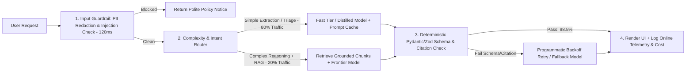

Anyone can wrap a foundation model API inside a chat textbox in an afternoon and call it an "AI feature." Yet why do so many flashy generative AI demos collapse the moment they encounter 10,000 production users? Because traditional software is **deterministic, near-zero marginal cost, and low-latency** (`2 + 2` always returns `4` in under a millisecond for \$0.0000001), whereas Large Language Models (LLMs) are **probabilistic, non-zero marginal cost per token, and latency-bound**. Without rigorous engineering and product discipline, an LLM feature can hallucinate ungrounded financial advice, fail downstream JSON parsing 8% of the time, stall a user interface for 9 seconds, and silently burn \$18 of API token compute on a customer paying a \$15/month subscription!

Building directly on the production AI architectures documented across Aniket Thakur's portfolio—specifically [*Designing Deterministic Validation Schemas for Multi-LLM Pipelines*](https://07anishu12.github.io/learnings.html), [*AI Agents vs Workflow Automation: When Should You Use Each?*](https://07anishu12.github.io/blog/), [*AI Memory Explained: Context Windows, Conversation History and Persistent Storage*](https://07anishu12.github.io/blog/), and [*Distilled Video Models & Regional AI Production Economics*](https://07anishu12.github.io/learnings.html)—alongside official technical guidance from [OpenAI Evaluation Best Practices](https://developers.openai.com/api/docs/guides/evaluation-best-practices), [OpenAI Latency Optimization](https://developers.openai.com/api/docs/guides/latency-optimization), and [Anthropic's Research on Building Effective Agents & Evals](https://www.anthropic.com/research/demystifying-evals-for-ai-agents), this guide defines the core competencies of an **AI Product Manager**: architectural selection (Workflows vs. Agents, Prompting vs. RAG vs. Fine-Tuning), evaluation-driven development (Evals as the new PRD), latency & token unit economics, and multi-layered safety guardrails.

## 1. Architectural Decision 1: Fixed Workflow Automation vs. Autonomous AI Agents

The first mistake novice AI PMs make is throwing an unconstrained, multi-step autonomous agent at a task that should be a deterministic state machine. As both [Anthropic's *Building Effective Agents* research](https://www.anthropic.com/research/building-effective-agents) and Aniket Thakur's [*AI Agents vs Workflow Automation* explainer](https://07anishu12.github.io/blog/) emphasize:
- **Workflow Automation / Prompt Chaining:** Systems where LLMs and tools are orchestrated through **pre-defined, deterministic code paths** (Step A $\rightarrow$ Schema Check $\rightarrow$ Step B). Use workflows whenever the sequence of steps is known ahead of time—they deliver vastly lower latency, predictable token cost, and auditability.
- **Autonomous AI Agents:** Systems where an LLM **dynamically directs its own control flow and tool usage** across open-ended loops to achieve a goal. Agents trade higher latency and compounding token costs for flexibility on unstructured problems (such as coding agents or open-ended research). Even when deploying agents, bound consequential mutations (like issuing refunds or deleting records) behind deterministic confirmation gates.

## 2. Architectural Decision 2: Context Engineering & RAG vs. Fine-Tuning vs. Model Tiering

When an off-the-shelf foundation model lacks domain accuracy or style consistency, AI PMs choose across four escalating levers:
1. **System Prompting & Structured Few-Shot Examples:** Fastest iteration cycle (minutes); zero training cost; ideal for formatting and reasoning scaffolding, though long few-shot prompts increase input token cost on every call.
2. **Retrieval-Augmented Generation (RAG) & Memory Architecture:** Injects fresh, permission-scoped external documents or user records dynamically into the model's context window at runtime, separating ephemeral context-window state from persistent vector/relational storage (as detailed in [*AI Memory Explained: Context Windows, Conversation History and Persistent Storage*](https://07anishu12.github.io/blog/)). RAG is mandatory when facts change daily, when **strict source citations** are required, or when row-level access permissions apply.
3. **Fine-Tuning / Model Distillation:** Trains a smaller, specialized open-weight or hosted model on thousands of curated input-output pairs produced by a frontier teacher model. Fine-tuning is **not** for injecting rapidly changing facts; it is for teaching a small, fast model a specialized domain syntax, classification schema, or latency/cost profile ([*Distilled Video Models & Regional AI Production Economics*](https://07anishu12.github.io/learnings.html)).
4. **Multi-Model Tiering & Routing:** Rather than routing 100% of user traffic to the largest, slowest frontier reasoning model, route 75%–85% of routine classification, extraction, and summarization calls to a **fast, low-cost flash/mini/distilled model**, and escalate only the 15%–25% complex edge cases to the frontier model ([Topical Knowledge Hubs — Multi-Model Tiering](https://07anishu12.github.io/topics/index.html)).

## 3. Evals Are the New PRD: Offline Golden Datasets, LLM-as-a-Judge & Online Telemetry

In probabilistic AI products, changing three words in a system prompt to fix one edge case can silently break 12 other use cases (**Prompt Regression**). Therefore, per [OpenAI Evaluation Best Practices](https://developers.openai.com/api/docs/guides/evaluation-best-practices) and [Anthropic's Claude Evaluation Docs](https://platform.claude.com/docs/en/test-and-evaluate/develop-tests), an AI PM cannot approve a model or prompt change by "vibe-checking" 5 examples in a playground. You must build a **Three-Tier Evaluation Pipeline**:

1. **Tier 1 — Deterministic Code & Schema Evals (Run on Every Commit in CI/CD):** Automated assertions verifying JSON/Zod/Pydantic schema validity, regex format rules, zero PII leakage, exact citation URL existence, and latency bounds.
2. **Tier 2 — Offline Golden Dataset + Calibrated LLM-as-a-Judge Evals (100 to 1,000+ Real Scenarios):** A curated dataset of representative user inputs, adversarial edge cases, and expert-verified reference criteria. Pair human grading on a calibration subset with a rubric-guided **LLM-as-a-Judge** (scoring binary pass/fail criteria like *Faithfulness to Retrieved Context* and *Answer Completeness* rather than vague 1–10 scales).
3. **Tier 3 — Online Production Telemetry & Implicit Behavioral Signals:** Track explicit feedback (thumbs up/down) alongside **implicit user acceptance signals**—such as whether the user copied/accepted the generated output, edited <10% of the text, or immediately re-prompted in frustration (**Acceptance Rate vs. Retry/Revert Rate**).

## 4. Latency Budgets (TTFT vs. TPOT) and Deterministic Safety Guardrails

Users abandon synchronous UI workflows when screens freeze. Manage two distinct latency metrics ([OpenAI Latency Optimization](https://developers.openai.com/api/docs/guides/latency-optimization)):
- **TTFT (Time to First Token):** The delay from user action until the first streamed token appears (target **$< 400\text{ms}\text{–}800\text{ms}$** for interactive chat/autocomplete).
- **TPOT (Time Per Output Token) & Total Generation Latency:** Governed largely by the **number of output tokens generated**. Because output tokens are both $3\times\text{ to }5\times$ more expensive and the primary driver of latency, use concise structured outputs, prompt caching, and specialized lightweight guardrail classifiers (which can execute safety checks in $90\text{ms}\text{–}250\text{ms}$ vs. multi-second generative checks, per [Arize AI Guardrail Latency Benchmarks](https://arize.com/blog/llm-guardrails-jev/)).

Finally, wrap every production LLM call in a **3-Layer Guardrail Sandwich**:
1. **Input Guardrails:** Prompt-injection / jailbreak detection, PII redaction, and topic-scope filtering *before* calling the expensive model.
2. **Deterministic Output Schema Validation:** Strict Pydantic / Zod JSON schema enforcement with programmatic retry backoff and model fallback if malformed output occurs ([*Designing Deterministic Validation Schemas for Multi-LLM Pipelines*](https://07anishu12.github.io/learnings.html)).
3. **Graceful Degradation / Fallback UX:** If the primary LLM API times out or fails validation twice, fall back seamlessly to a secondary model provider or a deterministic non-AI search/template experience rather than throwing an unhandled `500 Internal Server Error`.

## Frameworks and Comparison Tables

### Table 23.1: Architectural Selection Matrix — Prompt Engineering vs. RAG vs. Fine-Tuning

| Dimension | Prompt Engineering + Caching | Retrieval-Augmented Generation (RAG) | Fine-Tuning / Distillation |
| :--- | :--- | :--- | :--- |
| **Primary Problem Solved** | Task instructions, reasoning structure, output schema formatting | Grounding responses in fresh, proprietary, or user-specific data with citations | Teaching specialized domain style, compact syntax, or slashing latency/cost via a smaller model |
| **Data Freshness** | Static instructions (dynamic variables injected per call) | **Real-Time / Continuous** (updates instantly when vector/SQL index updates) | **Static at training cutoff** (requires re-training to learn new facts) |
| **Hallucination & Citation Control** | Moderate (relies on base model memory unless context is passed) | **High** (can enforce strict rule: *"Answer ONLY from retrieved chunks and cite chunk ID"*) | **Low for new facts** (fine-tuning does not reliably stop factual hallucination on unseen data) |
| **Upfront Engineering Effort** | Hours to Days | 1–3 Weeks (chunking, hybrid BM25 + vector search, reranking, permissions) | 2–4 Weeks (curating 1,000–10,000 clean golden training pairs + eval loop) |
| **PM Rule of Thumb** | **Always start here** to establish baseline eval score | **Add second** whenever external knowledge or dynamic user memory is needed | **Use third** to optimize unit economics, p95 latency, or strict formatting at scale |

### Table 23.2: The 4-Layer Production AI Evaluation & Guardrail Matrix

| Layer | Evaluation / Guardrail Dimension | Core Metrics Tracked | Production SLA / Pass Gate |
| :--- | :--- | :--- | :--- |
| **1. Deterministic Reliability** | Schema validity & API availability | JSON/Pydantic parse success rate (1st attempt vs. post-retry), fallback rate | $\ge 99.8\%$ post-retry schema validity ([Multi-LLM Schemas](https://07anishu12.github.io/learnings.html)) |
| **2. Quality & Groundedness** | Faithfulness, relevance & task accuracy | Context faithfulness % (zero unsupported claims), Golden Eval pass rate, User Acceptance % | $\ge 95\%$ faithfulness; $\ge 85\%$ Golden Eval pass before deploy |
| **3. Latency & Performance** | Responsiveness under load | Time to First Token (TTFT), p50/p95 End-to-End Latency, tokens/sec | p95 TTFT $\le 800\text{ms}$; p95 total response $\le 3.5\text{s}$ (streaming) |
| **4. Safety, Privacy & Cost** | Security & unit economics | Prompt-injection block rate, PII leak rate ($0.0\%$), Token Cost per Resolved Task | $0\%$ PII leak; AI COGS $\le 15\%\text{–}25\%$ of subscription revenue |

## Visualizing the Framework

The following architecture diagram illustrates the workflow and decision criteria:

## Practical Worked Example

**Scenario (Hypothetical B2B SaaS Customer Support Platform — *DeskPilot AI*):**  
You are the AI Product Manager launching an automated **AI Ticket Resolution & CRM Field Extractor** bundled into *DeskPilot*'s **\$40/seat/month** plan. Each active support agent handles **$50\text{ tickets per workday} \times 20\text{ workdays} = \mathbf{1,000\text{ AI-assisted tickets per seat per month}}$**.
- Each ticket passes: **4,000 Input Tokens** (system instructions + retrieved RAG help-center chunks + conversation history) and generates **500 Output Tokens** (structured JSON field extraction + drafted customer reply).

## Architecture A (Naive Unoptimized Baseline — 100% Frontier Model, Zero Caching, Unbounded Retries)
Suppose the engineering team routes 100% of all 1,000 monthly calls per seat to a large Frontier Model priced at **\$3.00 per 1M Input Tokens** and **\$15.00 per 1M Output Tokens**, with an 8% JSON formatting failure rate that triggers a full second retry ($1.08\times$ call multiplier):
1. **Cost per Single Call (Before Retries):**
   $$\text{Input Cost} = \frac{4,000}{1,000,000} \times \$3.00 = \$0.0120$$
   $$\text{Output Cost} = \frac{500}{1,000,000} \times \$15.00 = \$0.0075$$
   $$\text{Base Cost per Ticket} = \$0.0120 + \$0.0075 = \mathbf{\$0.0195\ (1.95\text{ cents/ticket})}$$
2. **Monthly AI Inference COGS per Seat (Including 8% Retry Multiplier + \$2.00 Vector/Cloud Hosting):**
   $$\text{Monthly LLM Cost per Seat} = 1,000\text{ tickets} \times 1.08 \times \$0.0195 = \mathbf{\$21.06/\text{seat/month}}$$
   $$\text{Total Monthly COGS per Seat} = \$21.06 + \$2.00 = \mathbf{\$23.06/\text{seat/month}}$$
3. **Resulting Gross Margin on the \$40/Seat Plan:**
   $$\text{Gross Margin}_A = \frac{\$40.00 - \$23.06}{\$40.00} = \frac{\$16.94}{\$40.00} = \mathbf{42.35\%}$$
   *Crisis:* A **$42.35\%$ gross margin** (down from the company's $82\%$ SaaS baseline) destroys enterprise valuation multiples (see [*Public Market Listings as the Ultimate Stress Test for AI Valuations*](https://07anishu12.github.io/learnings.html)), and heavy power users processing 2,500 tickets/month become **gross-margin negative (losing \$10.70/month per seat)**!

## Architecture B (AI PM Optimization — Multi-Model Tiering + Prompt Caching + Constrained Schema Decoding)
Using your offline 500-ticket Golden Evaluation Dataset, you verify three architectural optimizations that maintain **identical $96.2\%$ resolution accuracy** while slashing p95 latency from $4.8\text{s}$ to **$1.1\text{s}$**:
1. **Multi-Model Tiering (80% Fast/Mini Model / 20% Frontier Model):** 80% of tickets are routine order-status, refund-policy, and FAQ queries routed to a Fast/Mini model (**\$0.25 / 1M Input**, **\$1.25 / 1M Output**), while only 20% complex escalations route to the Frontier model.
2. **Prompt Caching on System & Static RAG Prefix (50% Discount on 2,500 Static Input Tokens):** Drops effective Frontier input cost per ticket from $\$0.0120$ to **$\$0.00825$** (and Fast model input cost to **$\$0.00069$**).
3. **Constrained Structured Outputs (Zod/Pydantic Schema Enforcement):** Reduces retry multiplier from $1.08\times$ to **$1.01\times$**.
4. **Recalculating Monthly AI COGS per Seat (1,000 Tickets):**
   - **800 Fast-Tier Tickets ($80\%$):** $800 \times 1.01 \times (\$0.00069\text{ in} + \$0.000625\text{ out}) = 808 \times \$0.001315 = \mathbf{\$1.06/\text{month}}$.
   - **200 Frontier-Tier Tickets ($20\%$):** $200 \times 1.01 \times (\$0.00825\text{ in} + \$0.0075\text{ out}) = 202 \times \$0.01575 = \mathbf{\$3.18/\text{month}}$.
   - **Total Monthly LLM Cost per Seat:** $\$1.06 + \$3.18 = \mathbf{\$4.24/\text{seat/month}}$ (**$-79.9\%$ cost reduction** from $\$21.06$!).
   - **Total COGS (Including \$2.00 Cloud/Vector Hosting):** $\$4.24 + \$2.00 = \mathbf{\$6.24/\text{seat/month}}$.
5. **Restored Gross Margin:**
   $$\text{Gross Margin}_B = \frac{\$40.00 - \$6.24}{\$40.00} = \frac{\$33.76}{\$40.00} = \mathbf{84.40\%}$$
   Plus, to protect against extreme outlier accounts, you package the \$40 plan with **1,500 included resolutions/seat/month** and sell overflow resolutions via transparent usage credit packs (mirroring [Notion](https://www.notion.com/pricing) and [Atlassian Rovo](https://www.atlassian.com/software/jira/pricing) credit models).

## Common Mistakes and Limitations

1. **Shipping AI Features Without an Offline Evaluation Suite ("Vibe-Driven Development"):** If your team does not have an automated evaluation script scoring at least 100 representative test cases, every prompt edit or model upgrade is a roll of the dice in production. Build the eval harness in Week 1 before scaling features.
2. **Offering "Unlimited" Unmetered Frontier Agent Usage on a Cheap Flat-Rate Plan:** Unlike traditional CRUD database rows, every agentic loop consumes real GPU compute tokens. Always include fair-use rate limits, multi-model routing, or credit tiers so a single automated script cannot rack up \$4,000 in API bills on a \$20 seat.
3. **Forcing Everything into a Chatbox UI:** A blank chat prompt forces the user to remember what to type (**violating Jakob Nielsen's Heuristic #6: Recognition Rather Than Recall, Article 14**). Often, the best AI UX has **zero chatbox**—it is an inline 1-click button, an auto-populated form field with confidence highlights, or a background classification pipeline.

## Practical Implementation Checklist

- [ ] **Right Architecture Chosen:** Did we verify whether a deterministic workflow or RAG pipeline solves this better than an open-ended autonomous agent ([AI Agents vs Workflow Automation](https://07anishu12.github.io/blog/))?
- [ ] **Golden Evaluation Dataset ($N \ge 100$):** Do we have a version-controlled evaluation dataset covering happy paths, noisy inputs, and adversarial prompt injections?
- [ ] **Deterministic Schema Guardrails:** Are model outputs validated against a strict JSON/Pydantic/Zod schema with exponential retry backoff and fallback handling ([Multi-LLM Validation Schemas](https://07anishu12.github.io/learnings.html))?
- [ ] **Token & Margin Unit Economics Modeled:** Have we calculated the p50 and p95 monthly token cost per active user and verified that gross margin remains $\ge 75\%\text{–}80\%$?
- [ ] **Human Control & Citation Transparency:** Does the UI display verifiable source citations for factual claims and provide a 1-click `Edit / Undo / Revert` escape hatch?

## Frequently Asked Questions

### 1. How is an AI Product Manager's role different from a traditional Software Product Manager's role?
While core discovery (**Article 11**) and prioritization (**Article 08**) remain foundational, an **AI Product Manager** manages three non-traditional realities: (1) **Probabilistic Quality** (defining accuracy thresholds, precision/recall trade-offs, and evaluation datasets rather than purely binary `Given / When / Then` logic); (2) **Dynamic Variable COGS** (optimizing input/output token budgets, prompt caching, and model routing to protect gross margins); and (3) **Trust & Safety UX** (designing confidence indicators, citation grounding, and human-in-the-loop review flows).

### 2. When should an AI PM choose RAG (Retrieval-Augmented Generation) vs. Long-Context Windows (e.g., 1M+ tokens)?
Even when a model supports a 1-million-token context window, stuffing 800,000 tokens of raw documentation into every single user prompt is ruinously expensive and slow: at \$2.00 per 1M input tokens, **a single un-cached 800k-token query costs \$1.60 and adds several seconds of prefill TTFT latency**! Use **RAG** ([*AI Memory Explained*](https://07anishu12.github.io/blog/)) to retrieve the top 5–10 relevant chunks (3,000 tokens = \$0.006, $250\times$ cheaper and $10\times$ faster), and reserve massive long-context calls for deep, whole-repository or whole-book synthesis tasks where caching amortizes the prefill cost.

### 3. How do you prevent LLM hallucinations in high-stakes enterprise domains like Fintech, Healthcare, or Legal?
Combine four engineering controls: (1) **Strict RAG Context Grounding** (system prompt and post-generation verifier enforce that every claim maps to a retrieved source document ID); (2) **Structured Citation Extraction** (requiring the JSON output schema to return `{"claim": "...", "exact_source_quote": "...", "doc_id": "..."}` so the backend can verify substring match deterministically); (3) **Deterministic Tool / Code Execution** (never ask an LLM to calculate compound interest or NSFR ratios in raw text—have the LLM call a deterministic Python/SQL calculator function); and (4) **Calibrated Abstention** (explicitly instructing and rewarding the model to reply *"Insufficient information in provided records"* rather than guessing).

### 4. What is "LLM-as-a-Judge," and what are its limitations when evaluating AI products?
**LLM-as-a-Judge** ([OpenAI Eval Docs](https://developers.openai.com/api/docs/guides/evaluation-best-practices) and [Anthropic Evals](https://www.anthropic.com/research/demystifying-evals-for-ai-agents)) uses a strong frontier model with a structured grading rubric to evaluate thousands of outputs generated by your production pipeline. To make an LLM judge reliable, avoid asking it to assign subjective 1–10 scores (which suffer from verbosity bias and self-preference bias); instead, decompose the rubric into **binary (`Pass / Fail`) factual checklists** and calibrate the judge's agreement rate against 50–100 human-labeled examples ($\text{Cohen's }\kappa \ge 0.80$).

### 5. How should AI Product Managers handle customer data privacy and "Zero Data Retention" requirements?
Enterprise B2B buyers (especially in banking, healthcare, and legal) will block adoption if their proprietary data is used to train public foundation models. Ensure your API agreements with model providers enforce **Zero Data Retention (ZDR) and zero model training on customer API payloads** (just as [Notion Enterprise](https://www.notion.com/pricing) guarantees zero data retention with LLM providers), and scrub PII (SSN, Aadhaar, credit card numbers) via an input regex/NER guardrail before external API transmission.

### 6. What is "Model Drift" or "Prompt Drift," and how do you monitor for it?
Even if you lock a specific model version snapshot, **Data Drift** happens when your customers start asking about new product SKUs, new regulations, or new file formats that were not in your original evaluation dataset—or when you upgrade from Model Version A to Model Version B and discover that the new model formats markdown tables differently. Run your automated **Golden Eval Suite continuously in CI/CD** and sample 1%–5% of live anonymized production traces weekly for automated grading to catch drift immediately.

## Next Steps and Recommended Reading

AI Product Management is where deep technical systems thinking meets commercial product discipline. By choosing the simplest architecture that solves the user's job, treating evaluation datasets as mandatory PRDs, enforcing deterministic schema guardrails, and optimizing token unit economics through multi-model routing, you transform fragile AI demos into durable, high-margin production systems.

**Practical Next Step:** Audit one AI feature on your roadmap or in production today using the **Unit Economics Equation from Section G**: multiply your p95 monthly calls per user by your input/output token counts and retry rate to verify your true AI COGS as a percentage of seat revenue.

**Recommended Follow-Up Reading:** Proceed to **Article 24: Product Manager Interview Preparation: Product Sense, Metrics and Strategy Cases** (`/blog/product/product-manager-interview-preparation/` — *Planned Destination*) to learn how to demonstrate product sense, analytical rigor, strategy, and AI fluency in competitive PM interviews.

## About this guide

Aniket Thakur prepared this comprehensive Product Management guide based on continuous discovery frameworks, operational research, and practitioner benchmarks checked on 24 October 2026. All quantitative scenarios in Section G are explicitly labelled hypothetical worked examples illustrating decision math.
