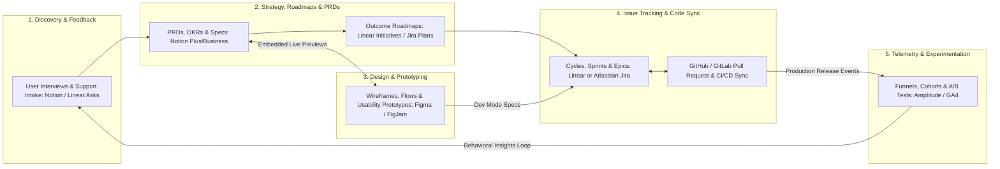

Selecting a product management tool stack is not a cosmetic software decision—the tools your team adopts quietly shape your operating speed, documentation culture, and engineering morale. A bloated, over-customized issue tracker with 35 mandatory fields per ticket turns backlog refinement into an administrative tax that slows developers down. Conversely, trying to run a 150-engineer multi-team enterprise release inside a flat, unstructured document page leads to missed dependencies, broken SLAs, and silent scope creep.

Most "best product management tools" roundups on the web list 40 disconnected apps alphabetically without verifying current pricing limits or explaining how the tools actually connect across a product workflow. In practice, a high-performing product team needs a cohesive stack spanning five core functional layers: **Issue Tracking & Delivery** ([Atlassian Jira](https://www.atlassian.com/software/jira/pricing) or [Linear](https://linear.app/pricing)), **Knowledge Base & PRD Documentation** ([Notion](https://www.notion.com/pricing) or Confluence), **Collaborative Design & Prototyping** ([Figma](https://uichemy.com/blog/figma-pricing/)), **Product Analytics & Experimentation** ([Amplitude](https://amplitude.com/north-star-hub), Mixpanel, or PostHog), and **Customer Discovery & Roadmapping** ([ProductPlan](https://www.productplan.com/learn/what-is-a-product-roadmap) or native roadmap views). This guide examines each core platform using verified 2026 official pricing and plan limits, compares Jira vs. Linear head-to-head, and walks through a complete Total Cost of Ownership (TCO) calculation for both a 25-person startup and a 120-person scale-up.

## 1. Issue Tracking & Delivery Execution: Atlassian Jira vs. Linear

The most consequential tooling choice for any software organization is deciding between the enterprise configurability of **Atlassian Jira** and the keyboard-first speed and opinionated workflow of **Linear**.

### Atlassian Jira ([Official Jira Pricing](https://www.atlassian.com/software/jira/pricing), verified October 2026)
 Jira remains the dominant enterprise issue tracker for complex, multi-squad organizations that require custom workflow state machines, granular space permissions, and cross-project dependency modeling:
- **Free Tier (\$0/month for up to 10 users):** Includes unlimited goals, projects, tasks, and forms; backlog, list, board, timeline, calendar, and summary views; 150 automation steps per subscription per month; 2 GB file storage; and a 100-email/day notification cap.
- **Standard Tier (\$8.48/user/month):** Scales up to 100,000 users per site; adds user roles and permissions, anonymous access, multi-region data residency, 250 GB storage, 400 automation steps per user per month, and Atlassian Rovo Search, Chat, and Agents (25 Rovo credits/user/month).
- **Premium Tier (\$15.56/user/month):** Adds cross-team Advanced Planning (*Plans*), cross-project dependency management, capacity management, scenario modeling, customizable approval steps, unlimited file storage, 750 automation steps per user per month, 70 Rovo credits/user/month, and a 99.9% uptime SLA with 24/7 critical issue support.
- **Enterprise Tier (Custom annual billing):** Supports up to 150 independent sites/instances, 1,000 automation steps/user/month, 150 Rovo credits/user/month, Atlassian Guard Standard (SSO/SCIM), Data Lake/dbt/Airflow governance integrations, and a 99.95% uptime SLA.
- **Best Fit & Limitations:** Unmatched when coordinating 10+ interdependent squads, strict regulatory audit trails, or IT service management (Jira Service Management). However, without disciplined administration, custom fields and sluggish page transitions can frustrate engineers.

### Linear ([Official Linear Pricing](https://linear.app/pricing), verified October 2026)
Linear was purpose-built for high-velocity product and engineering teams that value sub-50ms keyboard navigation, automatic GitHub/GitLab PR state syncing, structured *Cycles* (sprints), and top-level *Initiatives* & *Projects*:
- **Free Tier (\$0/month):** Supports unlimited members, up to 2 teams, **250 active issues** (archived issues do not count), 10 MB file upload limit, and access to the Linear Agent platform.
- **Basic Tier (\$10/user/month):** Expands to 5 teams, **unlimited issues**, unlimited file uploads, admin roles, and AI Loops.
- **Business Tier (\$16/user/month):** Unlocks **unlimited teams**, private teams and guest accounts, sub-initiatives, Triage Intelligence, Code Intelligence, **Linear Insights** (analytics), **Linear Asks** (Slack/Email intake workflows), and Zendesk/Intercom support integrations.
- **Enterprise Tier (Custom pricing):** Adds invoice/PO billing, SAML SSO and SCIM provisioning, granular admin controls, IP restrictions, audit logs, HIPAA compliance, and a dedicated account manager.
- **Best Fit & Limitations:** The premier choice for startups, AI-native teams, and product-led scale-ups (up to several hundred engineers) because its opinionated workflow prevents ticket clutter and keeps developers in flow. It intentionally avoids complex custom workflow schemes required by legacy non-software departments.

## 2. Knowledge Base, PRDs & Connected Workspace: Notion

Every product team needs a central system of record where Product Requirements Documents (**Article 09**), user interview notes (**Article 11**), OKR trackers (**Article 10**), and engineering RFCs live side by side.

### Notion ([Official Notion Pricing](https://www.notion.com/pricing), verified October 2026)
- **Free Tier (\$0/member/month):** Unlimited pages and blocks for individuals, but **a limited block trial for workspaces with 2+ members**; 5 MB file upload limit; 7-day page version history; up to 10 external guests; 1 database chart.
- **Plus Tier (\$10/member/month):** Unlimited collaborative blocks for teams, unlimited file uploads (up to ~5 GB per file), 30-day page history, unlimited external guests, unlimited database charts, custom forms and sites, and custom database automations.
- **Business Tier (\$20/member/month):** Includes **Notion Agent** (multi-step autonomous workflows), **AI Meeting Notes**, Enterprise Search Beta (across Slack, GitHub, etc.), **SAML SSO**, private teamspaces, **granular database permissions** (row-level access), page verification badges, and 90-day page history.
- **Enterprise Tier (Custom pricing):** Adds **zero data retention with LLM providers**, SCIM user provisioning, audit logs, DLP/SIEM security integrations, workspace analytics, and unlimited version history.
- **Strategic Trade-Off (Notion vs. Confluence):** Teams running on [Linear](https://linear.app/pricing) almost universally pair it with [Notion](https://www.notion.com/pricing) using two-way issue previews and database syncs. Teams deeply invested in [Atlassian Jira](https://www.atlassian.com/software/jira/pricing) often evaluate **Atlassian Confluence** alongside Notion because Rovo AI and Teamwork Graph index Jira + Confluence permissions natively.

## 3. Collaborative Design, Wireframing & Prototyping: Figma

Product Managers do not need to be pixel designers, but they spend hours every week inside **Figma** and **FigJam** mapping user flows, running discovery workshops, reviewing edge states, and conducting 5-user usability tests (**Article 14**).

### Figma ([Figma Pricing Overview](https://uichemy.com/blog/figma-pricing/), verified October 2026)
- **Starter Plan (\$0/month):** Free forever for individuals and small trials (up to 3 collaborative design files and 3 FigJam files) to test wireframing and basic prototyping.
- **Professional Plan (~$16/seat/month range depending on seat tier and billing):** Unlocks unlimited files, version history, shared team libraries, Dev Mode inspection for engineers, and advanced interactive prototyping (variables, conditional logic).
- **Organization & Enterprise Plans:** Add centralized design systems across multiple product lines, branching and merging, SAML SSO, granular workspace access controls, and enterprise security governance.
- **Cost Control Tip for PMs:** In Figma's seat model, Product Managers and executives who only need to **view designs, leave comments, or inspect flows** can typically occupy free Viewer-Restricted seats, while Product Designers, Front-End Engineers (Dev Mode), and PMs who actively edit FigJam boards occupy paid seats.

## 4. Product Analytics, Experimentation & Roadmapping Alternatives

To complete the stack, product teams pair their execution and design tools with behavioral telemetry:
- **Product Analytics & North Star Tracking:** **Amplitude** ([Amplitude North Star Hub](https://amplitude.com/north-star-hub)) and **Mixpanel** lead the market for event-based funnel analysis, cohort retention curves, and behavioral segmentation; **Google Analytics 4 (GA4)** ([Google Analytics Help](https://support.google.com/analytics/?hl=en)) remains standard for top-of-funnel web acquisition and marketing attribution; **PostHog** provides an open-source, developer-friendly all-in-one suite combining product analytics, session replay, feature flags, and A/B testing.
- **Dedicated Roadmapping & Discovery Repositories:** While small-to-midsize teams build roadmaps directly inside [Linear Projects/Initiatives](https://linear.app/pricing), [Jira Plans](https://www.atlassian.com/software/jira/pricing), or [Notion Databases](https://www.notion.com/pricing), large portfolio organizations sometimes adopt dedicated roadmapping and customer-feedback aggregation platforms such as **ProductPlan** ([ProductPlan Roadmaps](https://www.productplan.com/learn/what-is-a-product-roadmap)), **Productboard**, or **Jira Product Discovery** to link thousands of sales/support requests directly to strategic themes.

## Frameworks and Comparison Tables

### Table 5.1: Verified 2026 Product Management Tool Comparison Matrix

| Platform | Primary Layer | Free Tier & Key Cap | Entry Paid Tier (Verified 2026) | Mid / Scale Tier (Verified 2026) | Ideal Team Profile & Core Strength |
| :--- | :--- | :--- | :--- | :--- | :--- |
| **[Atlassian Jira](https://www.atlassian.com/software/jira/pricing)** | Issue Tracking & Agile Delivery | **\$0** (Up to 10 users, 2 GB storage, 150 automations/mo) | **Standard:** \$8.48/user/mo (250 GB, 400 automations/user, Rovo AI) | **Premium:** \$15.56/user/mo (Cross-team Plans, dependencies, 99.9% SLA) | Multi-squad scale-ups & enterprises needing custom workflows and cross-project dependency Plans |
| **[Linear](https://linear.app/pricing)** | High-Velocity Issue & Project Tracking | **\$0** (Unlimited users, 2 teams, **250 active issues**, 10 MB uploads) | **Basic:** \$10/user/mo (5 teams, unlimited issues & uploads, Loops) | **Business:** \$16/user/mo (Unlimited/private teams, Insights, Asks, Triage AI) | Startups to mid-market tech teams prioritizing speed, GitHub PR sync, and zero ticket bloat |
| **[Notion](https://www.notion.com/pricing)** | PRDs, Wiki, OKRs & Databases | **\$0** (Unlimited solo; **limited block trial for 2+ members**, 5 MB files) | **Plus:** \$10/member/mo (Unlimited blocks/charts, 30-day history, unlimited guests) | **Business:** \$20/member/mo (SAML SSO, private teamspaces, Notion Agent, row permissions) | Cross-functional teams unifying PRDs, user research repositories, and company wikis |
| **[Figma](https://uichemy.com/blog/figma-pricing/)** | Wireframing, UI Design & FigJam | **Starter:** \$0 (Up to 3 design & 3 FigJam files) | **Professional:** ~\$16/seat/mo (Unlimited files, shared libraries, advanced prototypes) | **Organization / Enterprise:** Custom/tiered (Centralized design systems, branching, SSO) | Universal industry standard for collaborative wireframing, interactive prototyping, and UX handoff |
| **[Amplitude](https://amplitude.com/north-star-hub) / GA4** | Product Telemetry & Cohort Analytics | Starter / Free tiers available ([GA4 Help](https://support.google.com/analytics/?hl=en)) | Growth / Plus usage-based event tiers | Enterprise (Data governance, experimentation, warehouse-native) | Measuring North Star metrics, N-day retention cohorts, funnels, and A/B test guardrails |

### Table 5.2: Head-to-Head Architectural Decision Matrix — When to Choose Linear vs. Atlassian Jira

| Decision Criterion | Choose **Linear** ([linear.app/pricing](https://linear.app/pricing)) | Choose **Atlassian Jira** ([atlassian.com/software/jira/pricing](https://www.atlassian.com/software/jira/pricing)) |
| :--- | :--- | :--- |
| **Engineering Culture & Speed** | Developers demand instant keyboard shortcuts, Markdown-first editing, and automatic Git branch/PR status transitions | Teams require customized multi-stage approval workflows, mandatory QA sign-off gates, and custom field schemas |
| **Team Size & Topology** | 1 to 15 product squads (<5 teams on Basic \$10/mo; unlimited teams on Business \$16/mo) | 10 to 500+ squads requiring cross-project capacity management, scenario modeling, and up to 100,000 users per site |
| **Non-Technical Department Integration** | Product & Engineering focus; intake from Sales/Support handled cleanly via *Linear Asks* (Slack/Email/Zendesk) | Entire company (IT Helpdesk, Legal, HR, Finance, Marketing, Engineering) must operate inside a single unified ticket ecosystem |
| **Administration Overhead** | Near-zero administration; opinionated data model (Initiatives $\rightarrow$ Projects $\rightarrow$ Cycles $\rightarrow$ Issues) works out of the box | Often requires a dedicated Jira / Product Ops administrator to maintain custom schemes, permissions, and automation rules |

## Visualizing the Framework

The following architecture diagram illustrates the workflow and decision criteria:

## Practical Worked Example

**Scenario (Hypothetical Stack Budgeting for Two Product Organizations):**  
Let us calculate the exact annual software licensing cost using the verified October 2026 list prices from [Atlassian Jira](https://www.atlassian.com/software/jira/pricing), [Linear](https://linear.app/pricing), [Notion](https://www.notion.com/pricing), and [Figma](https://uichemy.com/blog/figma-pricing/) for two distinct organizations:

## Case 1: Series A Startup (25 Total Employees across 3 Squads)
- **Headcount Breakdown:** 3 Product Managers, 3 Product Designers, 14 Software Engineers (20 R&D seats), plus 5 GTM/Ops staff (25 total company members).
- **Recommended High-Velocity Stack (Linear Basic + Notion Plus + Figma Professional):**
  1. **Issue Tracking ([Linear Basic](https://linear.app/pricing) at \$10/user/month):** Supports up to 5 teams and unlimited issues. Only the 20 R&D members need full seats (5 GTM staff submit requests via Slack/Asks or view roadmap summaries).  
     $$\text{Linear Cost} = 20\text{ users} \times \$10/\text{mo} \times 12\text{ months} = \$2,400/\text{year}$$
  2. **Knowledge Base & PRDs ([Notion Plus](https://www.notion.com/pricing) at \$10/member/month):** All 25 employees collaborate in Notion (since the Free plan restricts block counts once 2+ members join).  
     $$\text{Notion Cost} = 25\text{ members} \times \$10/\text{mo} \times 12\text{ months} = \$3,000/\text{year}$$
  3. **Design & Prototyping ([Figma Professional](https://uichemy.com/blog/figma-pricing/) at ~\$16/full seat/month):** 3 Product Designers + 3 PMs use full collaborative seats (6 seats at \$16/mo), while engineers use Dev Mode / Viewer inspection seats (assuming 6 full seats for core creation budget):  
     $$\text{Figma Core Creation Cost} = 6\text{ seats} \times \$16/\text{mo} \times 12\text{ months} = \$1,152/\text{year}$$
  - **Total Series A Annual Core Stack TCO:** $\$2,400 + \$3,000 + \$1,152 = \mathbf{\$6,552/\text{year}}$ ($\approx \$262/\text{employee/year}$).

## Case 2: Series C Scale-Up (120 Total Employees across 10 Squads Requiring SAML SSO & Cross-Team Dependencies)
- **Headcount Breakdown:** 12 Product Managers, 10 Product Designers, 68 Engineers (90 R&D seats), 30 GTM/Support/Exec staff (120 total members). Security requires SAML SSO and private teamspaces; leadership requires cross-squad dependency management across 10 teams.
- **Comparing Stack Option A (Jira Premium + Notion Business) vs. Stack Option B (Linear Business + Notion Business):**
  - **Option A — Jira Premium (\$15.56/user/mo for 90 R&D users) + Notion Business (\$20/member/mo for 120 members):**
    $$\text{Jira Premium Annual} = 90 \times \$15.56 \times 12 = \$16,804.80/\text{year}$$
    $$\text{Notion Business Annual} = 120 \times \$20.00 \times 12 = \$28,800.00/\text{year}$$
    $$\text{Combined Option A (Issue + Docs)} = \mathbf{\$45,604.80/\text{year}}$$
  - **Option B — Linear Business (\$16.00/user/mo for 90 R&D users, needed because Basic caps at 5 teams) + Notion Business (\$20/member/mo for 120 members):**
    $$\text{Linear Business Annual} = 90 \times \$16.00 \times 12 = \$17,280.00/\text{year}$$
    $$\text{Notion Business Annual} = 120 \times \$20.00 \times 12 = \$28,800.00/\text{year}$$
    $$\text{Combined Option B (Issue + Docs)} = \mathbf{\$46,080.00/\text{year}}$$

**Strategic Insight from the Math:** At 90 R&D seats across 10 teams, **Jira Premium (\$15.56/user/mo)** and **Linear Business (\$16.00/user/mo)** differ by only **\$0.44 per user per month** (\$475.20/year total—a $1\%$ difference). Therefore, a Series C organization should never choose between Jira Premium and Linear Business based on license price; the decision must rest purely on whether the team values **Jira's cross-project capacity/scenario modeling** or **Linear's developer execution velocity and Triage/Code Intelligence**.

## Common Mistakes and Limitations

1. **Expecting a New Tool to Fix a Broken Product Culture:** Migrating from Jira to Linear will not cure a "feature factory" if executives still dictate unvalidated features and PMs still skip customer discovery. Fix the workflow and decision rights first; configure the software second.
2. **Falling into the "Two-Member Free Plan" Trap in Notion:** Teams frequently start a shared company wiki on Notion's Free plan assuming it has unlimited blocks, only to hit the collaborative block cap the moment a second teammate is added as a workspace member (rather than an external guest) ([Notion Pricing](https://www.notion.com/pricing)). Budget \$10/member/month for Notion Plus as soon as 2+ teammates co-own workspace pages.
3. **Fragmenting the Source of Truth Across 5 Overlapping Tools:** Putting half of your roadmap in a Google Sheet, a quarter in Notion, and the rest in Jira creates immediate version drift. Establish a strict **Single Source of Truth (SSOT) rule**: narratives and PRDs live in Notion/Confluence; live ticket status and sprint velocity live in Linear/Jira; visual specs live in Figma.

## Practical Implementation Checklist

- [ ] **Single Source of Truth (SSOT) Charter:** Does every member of the Product Trio know exactly which tool holds the canonical PRD, which holds the active sprint status, and which holds the production UI spec?
- [ ] **Two-Way Integration Hygiene:** Are GitHub/GitLab pull requests, Figma artboard links, and Notion PRDs connected via automatic two-way previews so engineers never update statuses manually in three places?
- [ ] **Seat License Audit:** Have we configured view-only stakeholders as free Guests/Viewers in [Notion](https://www.notion.com/pricing), [Linear](https://linear.app/pricing), and [Figma](https://uichemy.com/blog/figma-pricing/) rather than paying full creator seats for passive readers?
- [ ] **Ticket Field Minimalism:** Can an engineer or PM create and triage a bug or user story in under 30 seconds without filling out 10+ mandatory dropdown fields?
- [ ] **AI Data Privacy Check:** If using built-in AI features (Notion AI, Atlassian Rovo, Linear Agents) on sensitive enterprise data, have we verified data-retention terms (e.g., zero data retention on Notion Enterprise)?

## Frequently Asked Questions

### 1. Is Linear really replacing Jira for software product teams in 2026?
Linear has become the default standard for YC startups, AI-native companies, and modern software scale-ups (trusted by over 40,000 companies per [Linear Pricing](https://linear.app/pricing)) because of its speed and developer ergonomics. However, Atlassian Jira remains entrenched in large enterprises, regulated banks, and multi-product conglomerates that require up to 100,000 users per site, multi-site data isolation, and non-engineering department workflows ([Atlassian Jira Pricing](https://www.atlassian.com/software/jira/pricing)).

### 2. Can a small startup use Jira, Linear, Notion, and Figma completely for free?
Yes, with specific thresholds: a startup with **$\le 10$ users** gets **Jira Free** (\$0, unlimited issues, 2 GB storage) or **Linear Free** (\$0, unlimited users, up to 2 teams and **250 active issues**). In **Notion Free**, a solo founder gets unlimited blocks (and can invite up to 10 external guests to specific pages without triggering the multi-member block cap). **Figma Starter** is \$0 for up to 3 design and 3 FigJam files.

### 3. Should I build my product roadmap inside Jira/Linear, or buy a dedicated roadmapping tool like ProductPlan or Productboard?
For startups and mid-sized companies (1 to 8 squads), building your roadmap directly inside **Linear Initiatives/Projects**, **Jira Timeline/Plans**, or a linked **Notion Database** is strongly recommended because it keeps the roadmap automatically synced with real engineering execution. Dedicated tools like [ProductPlan](https://www.productplan.com/learn/what-is-a-product-roadmap) or Productboard become valuable when you have 10+ squads and need to aggregate thousands of CRM sales requests or present tailored executive portfolio views.

### 4. What is the best free or open-source product analytics tool for a new product?
For web traffic and acquisition funnels, **Google Analytics 4 (GA4)** ([Google Analytics Help](https://support.google.com/analytics/?hl=en)) is free. For deep product event telemetry, cohort retention, feature flags, and session replay, **PostHog** and **Amplitude's Starter Plan** ([Amplitude](https://amplitude.com/north-star-hub)) offer generous free monthly event allowances that easily cover early-stage startups until they scale.

### 5. How do AI agents inside Jira (Atlassian Rovo), Linear (Linear Agents), and Notion (Notion Agent) change a PM's workflow?
In 2026, all three platforms embed native agentic capabilities and Model Context Protocol (MCP) connections: **Atlassian Rovo** (included with monthly credit tiers on Standard/Premium/Enterprise) indexes the Teamwork Graph across Jira and Confluence; **Linear Agents** assist with issue triage, duplicate detection, and coding sessions; and **Notion Agent** (included in Business at \$20/member/month) synthesizes meeting notes and drafts PRDs from connected Slack/GitHub context.

### 6. What tools should I learn first if I am preparing for my first Associate Product Manager job?
Master four tools in this exact order: (1) **Notion** (for writing structured PRDs and organizing user research databases), (2) **Linear or Jira** (for creating epics, user stories, sprints/cycles, and acceptance criteria), (3) **Figma & FigJam** (for mapping user journeys and building clickable wireframes), and (4) **Amplitude or SQL** (for building conversion funnels and retention cohorts).

## Next Steps and Recommended Reading

The best product management tool stack is the smallest set of integrated tools that lets your team discover customer problems, specify clear requirements, ship code rapidly, and measure behavioral outcomes without friction. Start lean—pairing [Linear](https://linear.app/pricing) (or [Jira Free/Standard](https://www.atlassian.com/software/jira/pricing)), [Notion](https://www.notion.com/pricing), [Figma](https://uichemy.com/blog/figma-pricing/), and an event analytics platform—and upgrade tiers only when team count, cross-project dependencies, or enterprise SAML/SSO governance demand it.

**Practical Next Step:** Audit your current issue tracker today: count how many active tickets have not been updated in over 90 days. Archive stale tickets older than 6 months so your backlog reflects genuine upcoming strategic priorities rather than historical clutter.

**Recommended Follow-Up Reading:** With Pillar A (Product Management Fundamentals) complete, advance to Pillar B starting with **Article 06: Product Strategy Explained: Vision, Goals, Positioning and Execution** (`/blog/product/product-strategy-explained/` — *Planned Destination*) to learn how to decide what your team should build inside these tools.

## About this guide

Aniket Thakur prepared this comprehensive Product Management guide based on continuous discovery frameworks, operational research, and practitioner benchmarks checked on 24 October 2026. All quantitative scenarios in Section G are explicitly labelled hypothetical worked examples illustrating decision math.
