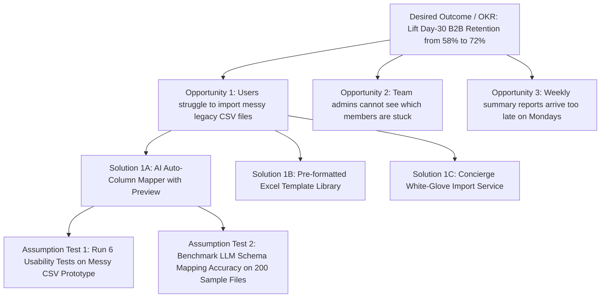

The single greatest waste in software engineering is building a technically flawless product that nobody bothers to adopt. Yet when many teams attempt to "do customer discovery," they inadvertently run validation theater: they show five friendly customers a mockup, ask *"Would you use a feature like this if we built it?"*, collect five polite nods, and commit six months of engineering capital—only to watch post-launch usage flatline near zero. Polite compliments in an interview room are not market demand.

As Aniket Thakur emphasizes in his portfolio note [*Why Market Validation Trumps Vibes: A Three-Step Query Framework*](https://aniket.app/learnings.html), teams must verify active behavioral intent before committing production engineering capital. Grounded in Marty Cagan's foundational discovery principles at the [Silicon Valley Product Group (SVPG)](https://www.svpg.com/the-origin-of-product-discovery/) and Teresa Torres's [*Continuous Discovery Habits* / Opportunity Solution Trees](https://www.producttalk.org/opportunity-solution-trees/), genuine **customer discovery** separates the **Problem Space** (understanding the user's current context, pain points, and costly workarounds) from the **Solution Space** (testing specific prototypes and willingness to pay). This article teaches you how to replace biased hypothetical questions with story-based behavioral prompts, design statistically clean surveys, rank evidence strength, and synthesize raw transcripts into an actionable Opportunity Solution Tree.

## 1. Why Asking Users "What They Want" Fails (And How Story-Based Interviews Work)

Humans are unreliable predictors of their own future behavior. When you ask a speculative question—*"Would you pay \$29/month for an automated expense categorization tool?"*—you trigger **social desirability and acquiescence bias**: the interviewee wants to be encouraging, and saying "yes" in a hypothetical conversation costs them zero dollars.

To extract ground-truth data (a principle popularized by Rob Fitzpatrick's *The Mom Test* and Teresa Torres's story-based interviewing at [Product Talk](https://www.producttalk.org/opportunity-solution-trees/)), anchor 100% of your discovery questions in **specific past behavior**:

1. **Ask About the Last Specific Instance, Never Generics:** Replace *"How do you usually reconcile vendor invoices?"* (which invites an idealized textbook summary) with *"Walk me through the exact last time you reconciled a batch of vendor invoices—when was that, what screen did you open first, and where did you get stuck?"*
2. **Look for "Costly Workarounds" as Proof of Pain:** If a user complains loudly about a problem during an interview, ask: *"What have you tried doing to solve or work around this over the last month?"* If they have not even spent 15 minutes building a messy Excel macro, hiring an intern, or searching Google for a workaround, the problem is a low-priority annoyance, not a hair-on-fire opportunity.
3. **Demand Commitment or Advancement at the End of B2B Interviews:** Measure interview success by whether the participant is willing to invest scarce resources: **Time** (scheduling a 45-minute deep-dive with their data engineer), **Reputation** (introducing you to their CFO/approver), or **Capital** (signing a paid pilot Letter of Intent or placing a refundable deposit).

## 2. Mapping Insights into an Opportunity Solution Tree (OST)

Raw interview transcripts sitting in a folder do not drive product alignment. To connect weekly discovery directly to your quarterly OKR (**Article 10**), map your synthesized findings into an **Opportunity Solution Tree (OST)** ([Product Talk Guide](https://www.producttalk.org/opportunity-solution-trees/)):

- **Layer 1 — The Desired Outcome (Top Root Node):** The single measurable Key Result assigned to your Product Trio (e.g., *"Increase Day-30 B2B workspace retention from 58% to 72%"*).
- **Layer 2 — The Opportunity Space (Customer Needs, Pain Points & Desires):** Hierarchical branches of unmet customer problems uncovered during story-based interviews (e.g., *Parent Opportunity:* "Finance leads cannot tell why automated reconciliation failed"; *Child Opportunity:* "Bank statement date formats mismatch ERP ledger timestamps").
- **Layer 3 — The Solution Space (Candidate Feature Ideas):** Only *after* selecting a high-impact target Opportunity node does the Product Trio brainstorm **at least 3 competing solutions** for that single opportunity.
- **Layer 4 — Assumption Testing (Rapid Experiments):** For each candidate solution, identify the riskiest value, usability, feasibility, or viability assumption ([SVPG](https://www.svpg.com/the-origin-of-product-discovery/)) and run a 2-to-5 day test before writing production code.

## 3. Designing Unbiased Product Surveys That Complement Interviews

Qualitative interviews tell you **why** a behavior happens and reveal mental models across 8 to 15 users; quantitative surveys tell you **how prevalent** those opportunities are across 500+ users. To prevent corrupted survey data, enforce four design rules:

1. **Eliminate Leading and Double-Barreled Questions:** Never ask *"How helpful was our fast, redesigned checkout page?"* (leading) or *"How satisfied are you with our API documentation and webhook reliability?"* (double-barreled—if a user scores 2/5, you do not know whether the docs or the webhooks failed).
2. **Randomize Multiple-Choice Option Order:** Respondents exhibit a documented **primacy bias** (selecting the first 2 options in a list). Always randomize option order (keeping "Other" and "None of the above" anchored at the bottom).
3. **Use MaxDiff (Best-Worst Scaling) Instead of "Rate Everything 1–5":** If you ask users to rate 10 proposed features on a 1–5 importance scale, they will rate all 10 features between $4.1$ and $4.6$. Instead, present sets of 4 problems and force respondents to pick the **Single Most Painful** and **Single Least Painful** item.
4. **Segment Respondents by Actual Product Telemetry:** Link survey responses to user IDs (with privacy consent) so you can separate answers from daily power users versus users who logged in once three months ago.

## Frameworks and Comparison Tables

### Table 11.1: Biased Hypothetical Prompts vs. Unbiased Story-Based Discovery Prompts

| Research Objective | Biased / Flawed Question (Induces False Positives) | Unbiased Story-Based Prompt (Extracts Ground Truth) | Cognitive Bias Prevented |
| :--- | :--- | :--- | :--- |
| **Validating Problem Severity** | *"Is managing multi-cloud GPU costs a big problem for your team?"* | *"Walk me through the last time you reviewed your cloud compute bill. What triggered that review, and what did you do next?"* | **Acquiescence & Leading Bias** (Telling the interviewer what they want to hear) |
| **Testing Feature Value** | *"If we built an automated Slack alert for budget spikes, would you use it?"* | *"The last time a compute spike happened, how did you find out, how long did it take, and what tools did you check?"* | **Hypothetical Future Projection Bias** (Zero-cost optimism) |
| **Uncovering Workarounds** | *"What features do you wish your current analytics tool had?"* | *"Show me the spreadsheet or script you built outside your analytics tool to get your weekly report done."* | **Solution-First Bias** (Users prescribe features instead of revealing needs) |
| **Validating Willingness to Pay** | *"Would \$99/month be a fair price for this workflow?"* | *"What budget line item pays for your current tools in this workflow, and who had to sign off on the last \$1,000+ tool you bought?"* | **Social Desirability Bias** (Polite price anchoring without procurement reality) |

### Table 11.2: The Product Discovery Evidence-Strength Hierarchy (Ranked Weakest to Strongest)

| Evidence Tier | Source / Method | Evidence Strength | Appropriate Decision Threshold |
| :--- | :--- | :--- | :--- |
| **Tier 1 (Weakest)** | Internal executive opinion or single anecdotal sales comment | **Very Low (1/10)** | Use only as an initial hypothesis generator; never commit sprint capacity |
| **Tier 2** | Hypothetical survey responses (*"I would probably buy this"*) | **Low (3/10)** | Useful for top-level market segmentation, not for feature validation |
| **Tier 3** | Past-behavior story interviews ($n = 8\text{–}15$) showing costly manual workarounds | **Medium-High (6/10)** | Justifies building a clickable prototype and running usability/smoke tests |
| **Tier 4** | Unassisted task completion in prototype usability test ([NN/g](https://www.nngroup.com/articles/why-you-only-need-to-test-with-5-users/)) + Search Demand ([Query Framework](https://aniket.app/learnings.html)) | **High (8/10)** | Justifies scoping an MVP (**Article 15**) or writing an engineering PRD |
| **Tier 5 (Strongest)** | Behavioral skin-in-the-game: Paid pilot LOI, live pre-order deposit, or production A/B test lift | **Very High (10/10)** | Justifies full multi-sprint engineering investment and GA scale |

## Visualizing the Framework

The following architecture diagram illustrates the workflow and decision criteria:

## Practical Worked Example

**Scenario (Hypothetical B2B SaaS Discovery Sprint — *SupplyChainIQ*):**  
Your Product Trio conducts **15 structured story-based discovery interviews** (45 minutes each) with procurement managers to understand why weekly platform engagement drops after Month 1. Instead of relying on whichever interview felt most emotional, you code every transcript systematically across three empirical criteria:

1. **Opportunity Frequency ($F$):** How many of the 15 interviewed procurement managers experienced this specific friction point in the past 30 days? ($F / 15$).
2. **Workaround Cost / Severity ($S$, 1–5 scale):** Measured by actual time or money wasted per occurrence ($1 = <5\text{ mins annoyance}$; $3 = 1\text{–}2\text{ hours manual Excel work}$; $5 = >4\text{ hours/week or direct financial penalty}$).
3. **Evidence of Active Workaround ($W$, 0.5 to 1.5 multiplier):** Did the user build an active workaround ($1.5\times$ = built custom scripts/macros or paid a contractor; $1.0\times$ = manual spreadsheet copy-paste; $0.5\times$ = complained verbally but took zero action)?

**Calculating the Composite Opportunity Score ($\text{Opportunity Score} = \text{Frequency \%} \times S \times W \times 20$):**

| Coded Opportunity Node (From 15 Transcripts) | Observed Frequency ($F / 15$) | Severity ($S$: 1–5) | Workaround Multiplier ($W$) | **Composite Score (Max 150)** & Discovery Decision |
| :--- | :--- | :--- | :--- | :--- |
| **Opp A: Vendor lead-time delays hidden in unstructured PDF email attachments** | $13 / 15$ ($86.7\%$) | $4.5$ *(~5 hrs/wk lost)* | $1.5\times$ *(Built manual tracker sheets)* | **$117.0$ (Rank #1 — Target for Q3 Solution Prototyping)** |
| **Opp B: Multi-currency FX rates require manual lookup during PO approval** | $9 / 15$ ($60.0\%$) | $3.5$ *(~1.5 hrs/wk)* | $1.0\times$ *(Copy-paste from web)* | **$42.0$ (Rank #2 — Hold for `Next` Horizon)** |
| **Opp C: Dashboard charts cannot be exported directly to PowerPoint** | $8 / 15$ ($53.3\%$) | $1.5$ *(10 mins screenshot)* | $0.5\times$ *(No active spend/tool)* | **$8.0$ (Rank #3 — Deprioritize; low-pain cosmetic request)** |
| **Opp D: Custom supplier ESG badge taxonomy** *(Pitched by 1 vocal enterprise VP)* | $1 / 15$ ($6.7\%$) | $3.0$ | $0.5\times$ | **$2.0$ (Rank #4 — Reject; outlier edge case)** |

**Practitioner Takeaway:** Notice that **Opp C (PowerPoint Export)** and **Opp A (PDF Email Lead-Time Extraction)** were mentioned by a similar number of users ($8$ vs. $13$). A naive team that only counts keyword mentions in support tickets would treat them as nearly equal. By weighting **Workaround Severity ($4.5\text{ vs }1.5$)** and **Active Workaround Behavior ($1.5\times\text{ vs }0.5\times$)**, the Product Trio sees immediately that **Opp A ($117.0$)** represents $14.6\times$ more real customer pain than **Opp C ($8.0$)**.

## Common Mistakes and Limitations

1. **Outsourcing Discovery Exclusively to a Separate UX Research Department:** While dedicated UX Researchers are invaluable partners for complex foundational studies, Product Managers, Product Designers, and Lead Engineers must participate first-hand in weekly customer interviews ([SVPG](https://www.svpg.com/the-origin-of-product-discovery/)). Reading a slide summary is no substitute for watching a user struggle with your workflow live.
2. **Interviewing Only Happy Power Users (Survivorship Bias):** If you recruit interview participants strictly from an in-app banner shown to daily active users, you completely miss the users who signed up, hit a wall in the first 10 minutes, and never returned. Always recruit across three cohorts: **Newly Churned / Inactive Users**, **Recent Sign-ups**, and **Active Customers**.
3. **Stopping Discovery Once the First Prototype Is Built:** Discovery is not a one-time "Phase 1" gate at the start of the year; it is a continuous weekly habit running in parallel with delivery (**Article 16**).

## Practical Implementation Checklist

- [ ] **Trio Participation:** Are at least two members of the Product Trio (e.g., PM + Designer or PM + Tech Lead) attending each customer interview together (one moderating, one taking verbatim timestamped notes)?
- [ ] **Zero Future-Tense Questions:** Have we scrubbed *"Would you..."*, *"Could you see yourself..."*, and *"How much would you pay for..."* from our interview script?
- [ ] **Workaround Verification:** Did we ask every interviewee to share their screen and show us the actual spreadsheet, tool, or manual process they currently use to solve the problem?
- [ ] **Three-Solution Minimum:** On our Opportunity Solution Tree, did we generate at least 3 distinct candidate solutions for our top opportunity before falling in love with the first idea?
- [ ] **Weekly Touchpoint Cadence:** Do we have an automated recruiting loop (via in-app intercepts or calendar links) scheduling 2 to 3 user conversations every single week?

## Frequently Asked Questions

### 1. How many customer discovery interviews are enough before we start prototyping?
For a well-defined target persona and workflow, qualitative saturation typically occurs between **8 and 15 structured story-based interviews**. By interview 10 to 12, you will notice the same top 3 workflow bottlenecks and workarounds repeating across 80%+ of conversations. (Note: For usability testing of a specific interface prototype, Jakob Nielsen's research at [NN/g](https://www.nngroup.com/articles/why-you-only-need-to-test-with-5-users/) demonstrates that **5 users** uncover ~85% of interface usability flaws per round—see **Article 14**.)

### 2. How do we recruit B2B enterprise users for discovery interviews when sales is protective of customer accounts?
Partner with Sales and Customer Success by establishing a transparent **"Discovery Charter"**: (1) Promise in writing that you will never pitch, negotiate pricing, or make roadmap commitments on discovery calls; (2) Invite the Account Executive or CSM to listen silently or receive the synthesis notes; (3) Embed a 1-click Calendly/SavvyCal prompt inside the product right after a user completes (or abandons) the target workflow, offering a \$50 gift card or early beta access for a 20-minute feedback session.

### 3. Should I record and transcribe customer discovery interviews?
Yes—always ask for explicit verbal consent at the start of the call (*"Do you mind if I record this session strictly for our internal product team's note-taking? Nothing will be shared externally"*). Recording allows the moderator to maintain natural eye contact and follow up on emotional cues rather than typing frantically, and enables verbatim quote extraction so engineers can hear the user's exact voice.

### 4. What is the difference between Generative (Exploratory) Research and Evaluative Research?
**Generative / Exploratory Research** happens *before* you have a solution: its goal is to map the problem space, mental models, and unmet opportunities (using story-based interviews, contextual inquiry, and search query validation). **Evaluative Research** happens *after* you have generated candidate solutions: its goal is to test whether a specific wireframe, prototype, or value proposition is usable and desirable (using usability testing, smoke tests, and A/B experiments).

### 5. How can AI / LLMs safely accelerate customer discovery synthesis without hallucinating insights?
LLMs are outstanding at clustering verbatim transcript chunks, extracting timestamped quotes, and tagging recurring pain points—provided you enforce **strict citation grounding** (requiring every synthesized theme to link to exact transcript IDs and speaker quotes, as detailed in [Designing Deterministic Validation Schemas for Multi-LLM Pipelines](https://aniket.app/learnings.html)). Never use synthetic AI personas as a replacement for talking to real humans; LLMs reflect average internet training data, not the specific edge-case friction of your actual customers.

### 6. What should I do when customers in interviews ask for a specific feature ("Add an Excel export button")?
Never take a customer's feature request literally, and never dismiss it rudely. Use the **"Five Whys" pivot**: *"That's really helpful—if you had that Excel export button right now, what is the very first thing you would do with the downloaded file?"* Nine times out of ten, you will discover they only wanted the CSV export because your in-app dashboard lacked a simple filter or shareable link that you can solve in a fraction of the time.

## Next Steps and Recommended Reading

Customer discovery is the antidote to building in the dark. By anchoring your interviews in real past stories rather than hypothetical compliments, verifying costly user workarounds, and mapping your insights into a living Opportunity Solution Tree, you ensure that every engineering sprint attacks a validated, high-leverage customer problem.

**Practical Next Step:** Review your next user interview guide or survey draft today and highlight every question containing the words *"would," "could," "might,"* or *"usually."* Rewrite each one to ask about the **last specific time** the participant encountered the workflow.

**Recommended Follow-Up Reading:** Proceed to **Article 12: User Personas, Jobs to Be Done and Customer Journey Mapping** (`/blog/product/user-personas-jobs-to-be-done-customer-journey-mapping/` — *Planned Destination*) to learn how to structure the raw insights from your discovery interviews into actionable Personas, Job Statements, and Journey Maps.

## About this guide

Aniket Thakur prepared this comprehensive Product Management guide based on continuous discovery frameworks, operational research, and practitioner benchmarks checked on 24 October 2026. All quantitative scenarios in Section G are explicitly labelled hypothetical worked examples illustrating decision math.
