Merging code into the production branch on Friday afternoon is a **technical release**, not a **product launch**. In weak product organizations, engineers deploy a major new capability after eight weeks of hard work, the product manager posts a three-line message in an internal Slack channel, and the team immediately moves on to the next ticket—leaving Sales unaware the feature exists, Customer Support scrambling without help-center documentation when tickets arrive, and 94% of existing customers completely oblivious to the capability.

A rigorous **Go-to-Market (GTM) Strategy** bridges the gap between **shipping working code** and **achieving sustained customer adoption and monetization**. While Product Marketing Managers (PMMs) frequently lead external campaign execution in larger companies, the Product Manager is co-accountable for defining the target buyer/user persona (**Article 12**), articulating competitive positioning, supplying pricing and packaging guardrails, managing progressive technical rollout rings (Canary $\rightarrow$ Beta $\rightarrow$ GA), and instrumenting post-launch activation telemetry (**Article 17**). This guide establishes the architectural distinction between technical release and commercial launch, provides a Tier 1–to–Tier 3 launch classification framework, details cross-functional readiness gates, and walks through a quantitative post-launch adoption funnel diagnosis.

## 1. Decoupling Technical Release Rings from Commercial Launch Day

Modern software teams never flip a massive feature from 0% to 100% of users on the exact same morning the press release goes live. Doing so guarantees that any unforeseen database lock or edge-case bug explodes in front of your entire customer base at peak traffic. Instead, decouple **Technical Release Rings** (managed via feature flags) from the **Commercial Marketing Launch**:

1. **Ring 0 — Internal Dogfooding / Staging (2–4 Weeks Before Launch):** 100% of internal employees use the feature in production.
2. **Ring 1 — Closed Design-Partner / Alpha Cohort (1%–5% of Accounts):** 10 to 25 friendly customers test the workflow under real data loads, providing qualitative feedback and early case-study quotes.
3. **Ring 2 — Open Beta / Progressive Ramp (10% $\rightarrow$ 25% $\rightarrow$ 50% of Accounts):** Validates p99 latency, infrastructure unit costs, and guardrail metrics (**Article 18**) at scale.
4. **Ring 3 — 100% General Availability (GA) & Commercial Launch Day:** Only *after* the code is already running stably at 50%–100% availability do Product and Marketing trigger the external announcement, sales outreach, and in-app onboarding banners.

## 2. The Tier 1, Tier 2, and Tier 3 Launch Classification System

Not every shipped feature deserves a homepage takeover, a webinar, and a 60-minute sales training session. If you cry wolf by treating a minor filter update as a "Tier 1 Mega-Launch," both your sales reps and your customers will tune out your announcements. Classify every roadmap item at the PRD stage (**Article 09**) into one of three launch tiers:

- **Tier 1 (Strategic / Market-Expanding Launch — 1 to 4 per Year):** A brand-new product line, major AI capability, or new enterprise pricing tier that unlocks a new customer segment or revenue stream. Requires 4–6 weeks of GTM preparation, executive PR, sales pitch certification, customer case studies, and multi-channel lifecycle campaigns.
- **Tier 2 (Significant Workflow / Retention Launch — 1 to 2 per Month):** A high-impact capability that meaningfully improves the workflow for existing customers or resolves a major competitive deal-breaker (e.g., launching Automated Webhook Retries from **Article 09**). Requires targeted email/in-app announcements to relevant segments, updated help docs, and an asynchronous 5-minute Loom demo for Sales and Support.
- **Tier 3 (Incremental Enhancement / Polish — Weekly):** Bug fixes, speed improvements, and minor UX refinements. Bundled into a monthly "What's New" changelog digest and release notes with zero dedicated campaign overhead.

## 3. Positioning, Packaging, and Pricing Inputs Owned by the Product Manager

Following April Dunford's *Obviously Awesome* positioning methodology and SaaS monetization frameworks (examined on [Linear Pricing](https://linear.app/pricing), [Notion Pricing](https://www.notion.com/pricing), and [Atlassian Jira Pricing](https://www.atlassian.com/software/jira/pricing) in **Article 05**), the Product Manager must supply four strategic inputs to the GTM brief:

1. **Competitive Alternatives (What the Customer Would Do Otherwise):** State clearly whether you are positioning against a legacy enterprise incumbent (where your angle is *10x speed and zero admin bloat*) or against manual Excel/email workarounds (where your angle is *error elimination and audit compliance*).
2. **Value Metric Selection (How Price Scales With Value):** Choose whether the feature is monetized per **Seat/User** (best when collaboration across people drives value), per **Usage/Consumption Unit** (e.g., API calls, GBs indexed, or AI credits—essential when variable LLM inference COGS are high, **Article 23**), or as a **Tier Upgrade Gate** (e.g., placing SAML SSO, SCIM, and Cross-Project Dependencies in the Business/Premium tier to drive expansion NRR).
3. **In-Product Discovery & Activation Triggers:** Marketing emails achieve 20%–30% open rates and 2% click rates; **contextual in-product empty states and workflow tooltips reach 100% of active users** right when they have the Job to Be Done. Always design the in-app discovery trigger as part of the core feature sprint.

## Frameworks and Comparison Tables

### Table 19.1: The Product Launch Tier Matrix (Tier 1 vs. Tier 2 vs. Tier 3)

| Launch Dimension | **Tier 1: Flagship Strategic Launch** | **Tier 2: Major Feature / Workflow Launch** | **Tier 3: Minor Enhancement / Fix** |
| :--- | :--- | :--- | :--- |
| **Strategic Criteria** | New product, new buyer persona, or new monetization tier | Major feature moving squad OKRs or closing sales gaps | UX polish, performance optimization, minor bug fix |
| **GTM Lead Time** | 4–6 Weeks prior to GA | 2 Weeks prior to GA | 1–2 Days prior to release |
| **External Channels** | Press/blog launch, webinar, homepage banner, outbound sales blitz, social video | Targeted segment email, in-app modal/banner, dedicated blog post | Monthly changelog entry & release notes page |
| **Sales & CS Enablement** | Live training, battlecards, objection handling FAQ, updated demo environment | 5-min async Loom walkthrough, Slack FAQ brief, updated Help Center | Short bullet in weekly internal product release note |
| **Technical Rollout** | Ring 0 $\rightarrow$ Alpha Design Partners $\rightarrow$ Open Beta $\rightarrow$ GA | Feature flag 10% $\rightarrow$ 100% + instant rollback switch | Standard CI/CD deploy behind flag |

### Table 19.2: Cross-Functional GTM Readiness Gate Checklist (PM vs. PMM vs. Sales vs. Support)

| Function | Pre-Launch Readiness Deliverable (Must Pass 48 Hours Before GA) | Owner | Sign-Off Gate Status |
| :--- | :--- | :--- | :--- |
| **Product & Engineering** | Feature stable at $\ge 25\%$ beta traffic; p95 latency & error guardrails green; telemetry firing | Product Manager + Tech Lead | Mandatory P0 Gate |
| **Product Marketing (PMM)** | Positioning brief, external blog post, customer email copy, and competitive battlecard finalized | Product Marketing Manager | Mandatory for Tier 1 & 2 |
| **Customer Support & Docs** | Public Help Center documentation live with screenshots; Tier-1 support troubleshooting runbook ready | PM + Technical Writer / Support Lead | Mandatory P0 Gate |
| **Sales & Solutions Eng** | Demo sandbox populated with realistic sample data; pricing SKU live in Stripe/CRM billing catalog | PM + RevOps / Sales Enablement | Mandatory for Tier 1 |
| **Legal, Privacy & Security** | Subprocessor disclosure, Terms of Service, and data-retention checks verified | Legal / Security Reviewer | Mandatory if touching PII/AI |

## Visualizing the Framework

The following architecture diagram illustrates the workflow and decision criteria:

```mermaid
flowchart LR
    subgraph Technical_Rings[1. Technical Release Rings - Feature Flagged]
        R0[Ring 0: Internal Dogfooding] --> R1[Ring 1: 15 Alpha Design Partners]
        R1 --> R2["Ring 2: 25% Open Beta & Telemetry Check"]
    end
    subgraph GTM_Launch[2. Commercial GA Launch Gate]
        R2 -->|Docs, Support & Sales Ready| GA["Ring 3: 100% GA + Tier 1/2 Campaign"]
    end
    subgraph Adoption_Funnel[3. Post-Launch Feature Adoption Funnel]
        GA --> F1["Stage 1: Exposed / Aware Users"]
        F1 --> F2["Stage 2: First Trial / Click"]
        F2 --> F3[Stage 3: Activated - Completed Workflow]
        F3 --> F4[Stage 4: Habitual Repeat Usage at Day 30]
    end
```

## Practical Worked Example

**Scenario (Hypothetical B2B SaaS Platform — *FlowBoard* Launching "Automated Sprint Retro Insights"):**  
Your squad spent 6 weeks building *Automated Sprint Retro Insights* for **10,000 active B2B customer accounts**. Your quarterly OKR target (**Article 10**) is to have **$\ge 2,500\text{ accounts}$ ($25.0\%$) actively using the feature at Day 30 post-launch** (defined as generating $\ge 2$ retro reports in the first month).

## Phase 1: What Happens Under a "Passive Email-Only" Launch (Baseline Projection)
If the team relies solely on a single marketing announcement email + hiding the feature inside a secondary top-navigation tab:
1. **Channel Reach (Exposed Users):** Out of $10,000$ accounts, $28\%$ open the marketing email and $6\%$ organically stumble upon the secondary tab $\rightarrow \mathbf{3,200\text{ Exposed Accounts}}$ ($32.0\%$).
2. **Trial Initiation Rate (Click-to-Try):** Of the $3,200$ exposed accounts, $35\%$ click to try the feature $\rightarrow \mathbf{1,120\text{ Trial Accounts}}$ ($11.2\%$ of total base).
3. **First-Time Activation Rate (Successful Report Generated):** $25\%$ of trial accounts fail because their historical sprint data isn't mapped, leaving $75\%$ activated $\rightarrow \mathbf{840\text{ Activated Accounts}}$ ($8.4\%$ of total base).
4. **Day-30 Repeat Habit Rate:** $60\%$ of activated accounts generate a second report two weeks later $\rightarrow \mathbf{504\text{ Day-30 Retained Feature Accounts}}$ (**$5.04\%$ of total base** — *missing the $2,500$-account OKR target by $80\%\text{!}$*).

## Phase 2: Upgrading to an Integrated Product + GTM Launch Architecture
Before GA, the PM and PMM inspect the funnel math above and implement three targeted GTM + Product interventions:
1. **Intervention 1 (Contextual In-Product Trigger to Fix Reach & Trial):** Instead of relying on email opens, place a contextual 1-click banner directly inside the **Sprint Close Confirmation Modal** (which $85\%$ of active accounts encounter every two weeks): *"Sprint 24 closed! Click here to generate your AI Retro Summary in 10 seconds."*
   - **New Exposed Accounts:** $85.0\%$ ($8,500\text{ accounts}$).
   - **New Trial Initiation Rate:** Lifts from $35\%$ to **$50\%$** because the prompt appears at the exact moment of the Job to Be Done $\rightarrow \mathbf{4,250\text{ Trial Accounts}}$.
2. **Intervention 2 (Pre-Populated Template to Fix First-Time Activation):** Auto-map default Jira/Linear status columns so users don't hit an empty setup screen.
   - **New First-Time Activation Rate:** Lifts from $75\%$ to **$88\%$** $\rightarrow 4,250 \times 0.88 = \mathbf{3,740\text{ Activated Accounts}}$.
3. **Intervention 3 (Automated Bi-Weekly Slack Digest to Fix Day-30 Repeat Habit):** Prompt activated users to toggle on a recurring Friday Slack summary at the end of their first report.
   - **New Day-30 Repeat Rate:** Lifts from $60\%$ to **$74\%$** $\rightarrow 3,740 \times 0.74 = \mathbf{2,768\text{ Day-30 Retained Accounts}}$ (**$27.7\%$ of total base** — *exceeding the $2,500$-account OKR target and delivering **$5.5\times$ higher adoption** than the email-only launch without changing a single line of core algorithm logic!*).

## Common Mistakes and Limitations

1. **Treating Launch Day as the Finish Line ("Ship and Forget"):** In many companies, the launch party happens on the afternoon the blog post goes live—before a single customer has retained to Week 2. Celebrate **30-day post-launch adoption outcomes**, not code deployment day.
2. **Blindsiding Customer Support and Account Executives:** Nothing destroys internal trust faster than a high-value enterprise customer calling their Account Executive to ask *"Why did my navigation bar change this morning, and what is this new AI toggle?"* and the rep replying *"I have no idea, Product didn't tell us."* Never launch a Tier 1 or Tier 2 capability without completing the internal enablement gate 48 hours prior.
3. **Over-Messaging Users With Blocking Modals ("Popup Fatigue"):** When 5 different product squads each launch a Tier 2 feature in the same month and all 5 trigger full-screen blocking popups on login, users reflexively click `X` on all of them within 200 milliseconds. Coordinate in-app messaging calendars centrally (often via Product Operations, **Article 25**) and prefer **contextual inline workflow triggers** over login popups.

## Practical Implementation Checklist

- [ ] **Launch Tier Assigned Early:** Did we classify this initiative as **Tier 1, Tier 2, or Tier 3** inside the PRD at least 3–4 weeks before target GA?
- [ ] **Decoupled Feature Flag:** Is the production deployment wrapped in a feature flag (`Ring 0 -> Ring 1 -> Ring 2 -> Ring 3`) with an instant 1-click rollback switch?
- [ ] **Contextual In-App Discovery:** Have we designed an inline empty-state or workflow trigger at the exact moment of the user's Job to Be Done (rather than relying solely on email announcements)?
- [ ] **Support & Sales Enablement Gate:** Are Help Center articles live, Tier-1 support macros written, and a 5-minute Loom demo shared with Sales/CS at least 48 hours before external launch?
- [ ] **4-Stage Adoption Dashboard Live:** Do we have a live dashboard tracking `Exposed % -> Tried % -> Activated % -> Day-30 Repeat %` ready for our 7-day and 30-day post-launch readouts?

## Frequently Asked Questions

### 1. What is the difference between a Product Manager (PM) and a Product Marketing Manager (PMM) during a launch?
Think of the partnership as **Inbound/Product Value (PM)** meeting **Outbound/Market Adoption (PMM)**:
- The **Product Manager** owns product readiness, beta cohort validation, pricing/tier packaging rules, in-app activation flows, technical documentation accuracy, and post-launch telemetry.
- The **Product Marketing Manager** owns external messaging, competitive positioning narratives, sales battlecards, launch campaign orchestration (blogs, webinars, email sequences), and buyer persona targeting. In early-stage startups without a dedicated PMM, the Product Manager and Founder execute both sides of the checklist.

### 2. How do you decide whether a new feature should be included for free in existing plans, gated in a higher tier, or sold as a paid add-on?
Use the **Retention vs. Expansion Monetization Matrix**:
- **Include in Core / Free-to-Plus Tiers:** If the feature increases daily stickiness, reduces churn for your entire user base, or drives viral network effects (e.g., sharing a dashboard link with a teammate).
- **Gate in Higher Tier (Business / Enterprise):** If the feature solves a governance, scale, security, or cross-team management problem valued primarily by larger organizations (e.g., SAML SSO, SCIM, Cross-Project Dependencies in [Jira Premium](https://www.atlassian.com/software/jira/pricing) or Private Teams in [Linear Business](https://linear.app/pricing)).
- **Sell as a Usage / Credit Add-On:** If only 15%–30% of accounts need the capability, willingness to pay is high, **or variable COGS (such as autonomous AI agent credits or SMS/telephony fees) scale steeply with usage** (as seen in [Notion Custom Agents](https://www.notion.com/pricing) and [Atlassian Rovo credits](https://www.atlassian.com/software/jira/pricing)).

### 3. What is Geoffrey Moore's "Crossing the Chasm," and how does it affect a PM's Go-to-Market strategy?
In *Crossing the Chasm*, Geoffrey Moore demonstrated that technology adoption does not transition smoothly from **Innovators / Early Adopters (Visionaries)** to the **Early Majority (Pragmatists)**. Visionaries will tolerate a raw, incomplete MVP (**Article 15**) because they want a strategic edge; Pragmatists in the Early Majority refuse to buy until they see the **"Whole Product"** (reliable integrations, security compliance, training documentation, and referenceable peer case studies within their exact vertical niche). Crossing the chasm requires focusing 100% of your GTM and product polish on winning one specific "bowling pin" vertical completely before expanding horizontally.

### 4. How should a Product Manager handle a "Soft Launch" versus a "Hard Launch"?
A **Soft Launch (Dark Launch / Quiet GA)** turns the feature on in production for 100% of users (after progressive beta rings) **without** external PR or marketing fanfare for 1 to 2 weeks. This allows the product team to verify organic discovery rates, server load, and support ticket volume under full traffic. Once telemetry confirms everything is rock-solid, the team executes the **Hard Launch (Commercial Announcement)** with zero technical anxiety and real early customer usage stats already in hand.

### 5. What metrics should be reviewed in the "Day-7 and Day-30 Post-Launch Readout"?
Never stop at tracking "Total Clicks on Launch Day." Structure your readout around five numbers: (1) **Awareness/Exposure %** of target segment, (2) **Trial Conversion %**, (3) **First-Time Completion (Activation) %**, (4) **Day-14 / Day-30 Repeat Usage %**, and (5) **Downstream Impact on the Squad's Primary OKR & Guardrail Metrics** (e.g., did it lift overall account retention or expansion ARR?).

### 6. How do you manage Go-to-Market when deprecating (sunsetting) an old legacy feature?
Sunsetting a low-usage legacy feature requires as much GTM discipline as launching a new one: (1) Audit exact 90-day usage telemetry to identify every active account; (2) Provide a clear **1-click migration path or alternative workflow**; (3) Give enterprise customers **60 to 90 days advance notice** via targeted email and in-app banners on the legacy screen; (4) Switch the feature to **Read-Only / Deprecated status** before final code removal so stragglers can export historical data safely.

## Next Steps and Recommended Reading

A feature only creates value when customers discover, adopt, and form a habit around it. By decoupling technical release rings from commercial launch day, classifying every feature into Tier 1, 2, or 3, aligning cross-functional readiness gates, and instrumenting the full 4-stage post-launch adoption funnel, you ensure your engineering team's best work achieves maximum market impact.

**Practical Next Step:** For the next feature in your `Now` roadmap column, calculate its expected **4-Stage Adoption Funnel** (`Exposed -> Tried -> Activated -> Repeated`) today, and add an inline contextual workflow trigger inside the product spec if your current launch plan relies solely on an email blast.

**Recommended Follow-Up Reading:** Complete Pillar D (Execution, Analytics and Growth) by reading **Article 20: Stakeholder Management: How Product Managers Align Teams and Handle Conflict** (`/blog/product/stakeholder-management-for-product-managers/` — *Planned Destination*) to learn how to align sales, engineering, and executives across high-stakes product decisions.

## About this guide

Aniket Thakur prepared this comprehensive Product Management guide based on continuous discovery frameworks, operational research, and practitioner benchmarks checked on 24 October 2026. All quantitative scenarios in Section G are explicitly labelled hypothetical worked examples illustrating decision math.
