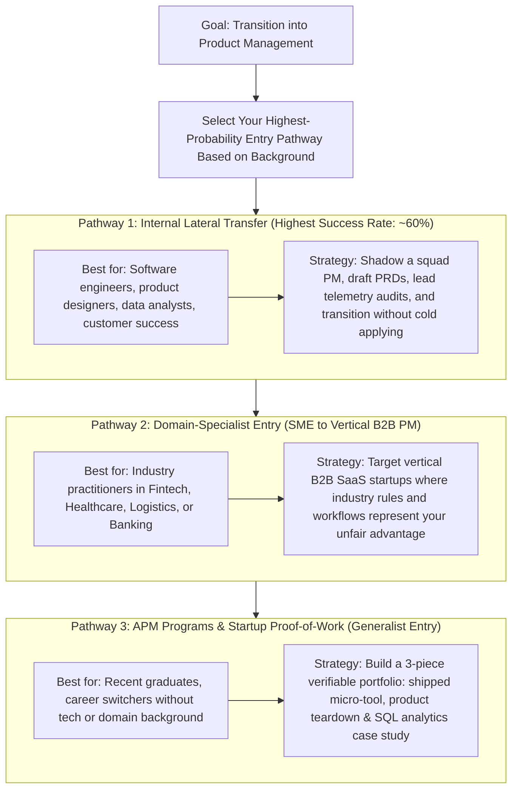

Breaking into product management is notoriously paradoxical: almost every job posting asks for 2+ years of prior Product Management experience, yet very few universities offer an undergraduate degree in Product Management. Faced with this catch-22, thousands of aspiring PMs spend large sums on generic weekend certifications, only to discover that hiring managers rarely shortlist candidates based on a certificate badge alone.

Why are hiring managers so cautious with first-time PM hires? Because an ineffective PM does not merely produce zero output of their own—they can misdirect an entire squad of six engineers and a designer for two quarters, costing the company hundreds of thousands of dollars in wasted payroll and missed market timing. Therefore, the secret to becoming a Product Manager is **de-risking yourself in the eyes of the hiring manager through verifiable proof of work, deep domain leverage, or internal organizational trust**.

In this guide, we examine the three highest-probability entry routes into product management, how to map your existing background (engineering, data analytics, operations, finance, or design) into PM leverage, how to build a proof-of-work portfolio that proves you can think like a practitioner, and a structured 90-day transition plan.

## The Three Highest-Probability Entry Routes

Instead of cold-applying to 500 generic PM roles on job boards, focus your energy on the three channels where first-time PMs are actually hired:

### Path A: The Internal Lateral Transfer (Highest Success Rate)
- **How it works:** You are already working at a company as a Data Analyst, Software Engineer, QA Lead, Customer Success Manager, or Operations Specialist. You already understand the company's database schema, customer pain points, and internal operations.
- **Tactical execution:** Offer to take low-leverage load off an overwhelmed PM on your team—write the first draft of a PRD, run SQL funnel analyses for their post-launch review, or sit in on user discovery calls. When headcount opens up, you are already doing 40% of the job with zero onboarding ramp time.

### Path B: The Domain-Specialist External Entry (Second Highest Success Rate)
- **How it works:** You leverage deep domain expertise that a generalist PM cannot learn in two weeks. For example, if you have spent two years working in automotive loan origination, credit risk modeling, or ML research pipelines, apply specifically to Fintech Lending PM or AI Platform PM roles at growth-stage startups.
- **Why it works:** A startup founder building a Loan Origination System (LOS) would much rather teach PRD formatting to someone who already understands bureau APIs, underwriting rules, and dealer disbursal friction than teach lending mechanics to a generalist consumer-app PM.

### Path C: Associate Product Manager (APM) & Rotational Programs
- **How it works:** Structured 1-to-2-year rotational programs at technology companies designed explicitly for candidates with strong analytical and technical foundations but limited full-time PM tenure.
- **Selection criteria:** Heavy emphasis on structured product sense, quantitative analytical rigor (SQL/metrics), technical curiosity, and shipped side projects or internships.

## The Five Core Competencies You Must Demonstrate

Regardless of your entry path, every PM interview loop and portfolio review tests five core pillars:

1. **Problem Discovery & User Empathy:** Can you isolate the root cause of user friction without jumping straight to your favorite feature idea?
2. **Quantitative & Analytical Rigor:** Can you define a North Star metric, build a conversion funnel in SQL, spot cohort survivorship bias, and calculate rough unit economics?
3. **Technical & System Literacy:** Do you understand how client apps, backend APIs, databases, third-party webhooks, and LLM pipelines interact—and where latency or failure states occur?
4. **Prioritisation & Strategic Trade-Offs:** Given 10 good ideas and capacity for only 2, can you justify what to build now and what to explicitly decline using structured frameworks (like RICE or Cost of Delay)?
5. **Execution & Communication Clarity:** Can you write a crisp PRD with edge cases and align engineers, designers, and business leads without formal authority?

## How to Build a Proof-of-Work PM Portfolio

Most aspiring PM portfolios fail because they consist of superficial 10-slide slide decks proposing *"Add a Group Watch party button to Netflix"* with invented survey numbers. Hiring managers reject these immediately because they ignore engineering constraints, unit economics, and existing product strategy.

A standout PM portfolio contains three deep, verifiable artifacts:

1. **A Shipped Side Project or Working Prototype:** Build and deploy a lightweight tool (using Python, Next.js, or lightweight APIs) that solves a specific niche problem—complete with analytics tracking, documented user feedback, and an iteration log showing what you changed after real users tried v1.
2. **A Production-Grade PRD & System Teardown:** Pick a specific, high-friction workflow in a real B2B or B2C product (e.g., broken multi-tranche refund tracking or slow document KYC verification). Map the exact current user flow, quantify the funnel drop-off using public data or documented usability tests, propose two competing solutions, score them via RICE, and write a complete PRD including API states, edge-case tables, and guardrail metrics.
3. **An Analytical / Quantitative Case Study:** Publish a technical note demonstrating how you use data (SQL queries, cohort retention charts, or search-demand validation scripts) to validate a market opportunity or diagnose a metric anomaly before writing software.

## Background-to-PM Leverage Matrix

| Your Current Background | Your Unfair Advantage | Your Typical Blind Spot | Portfolio Proof Project to Build |
|---|---|---|---|
| **Data Analyst / Data Scientist** | SQL fluency, experiment design, metric trees, cohort modeling, quantitative sizing. | Over-indexing on historical numbers without understanding qualitative user motivation or UI flows. | Pair a quantitative funnel analysis with 5 qualitative user usability tests and a wireframe prototype + PRD. |
| **Software Engineer / ML Researcher** | System architecture, feasibility estimation, API design, respect of engineering peers. | Focusing on technical elegance over distribution, pricing, and non-technical buyer friction. | Write a Go-to-Market, pricing, and customer-validation case study showing why a simpler technical solution wins on ROI. |
| **Operations / Finance / Credit Domain** | Deep knowledge of real-world operational bottlenecks, compliance, and unit economics. | Lack of exposure to Agile sprint ceremonies, UX wireframing, and software system architecture. | Document an internal operational bottleneck you automated or redesigned—including the To-Be state machine, PRD, and hours/cost saved. |
| **Product / UX Designer** | User research, wireframing, prototyping, usability testing, journey mapping. | Under-indexing on financial unit economics, backend API constraints, and revenue/margin math. | Build a full business case + RICE prioritization model + SQL metric tree accompanying a product redesign. |

## The 90-Day PM Transition Roadmap

| Phase | Focus Area | Concrete Weekly Actions | Deliverable / Milestone Achieved |
|---|---|---|---|
| **Days 1–30: Foundation & Audit** | Reframing past experience & building analytical/PM fundamentals. | Audit past projects for outcome metrics; complete SQL & metric-tree practice; shadow your current company's PMs. | Rewritten outcome-focused resume + Identified 2 high-friction domain problems for portfolio. |
| **Days 31–60: Proof-of-Work Build** | Creating verifiable artifacts on your live portfolio website. | Conduct 5–8 real user interviews/usability tests; write 1 complete end-to-end PRD; ship 1 lightweight tool or interactive prototype. | 3 published, deep-dive case studies live on your portfolio URL (not trapped in private PDFs). |
| **Days 61–90: Targeted Outreach & Mocks** | Domain-matched applications & rigorous interview drills. | Complete 15+ mock interviews (Product Sense, Metrics Execution, Strategy); pitch internal PM transfer OR send tailored teardown notes to 25 domain-matched hiring managers. | Active interview loops at target companies + Custom 1-page product memo prepared for each final round. |

## Entry Pathway Decision Tree

The following decision tree helps determine which entry pathway offers the highest probability of success based on your current professional standing:

## Practical Worked Example: Rewriting a Resume Bullet

Consider a hypothetical candidate who worked for 18 months in operations and data analytics at a vehicle financing company and wants to land a Product Manager role at a fintech startup.

### Before (Weak Task-Oriented Resume Bullet)
> *"Worked with the tech team to update the dealer loan tracking portal and created Excel reports for management on weekly loan disbursals."*  
> *(Sounds like a passive support/reporting role; zero product ownership or outcome quantified).*

### After (High-Signal PM-Oriented Resume Bullet)
> *"Identified via SQL funnel analysis that 28% of approved car loans stalled during dealer document verification; authored the functional specification for an automated stage-gate checklist and partnered with 4 engineers to ship it—reducing average disbursal turnaround time from 4.2 days to 1.8 days across 1,500+ monthly loans."*

### The Cold-Outreach Proof-of-Work Pitch
Instead of messaging *"Hi, please refer me for the PM role,"* the candidate tests the target startup's public onboarding flow, documents a friction point where users drop off during bank statement upload, writes a 2-page PRD with an edge-case fallback state machine, hosts it on their portfolio site, and sends a concise note:

> *"Hi [VP of Product], I noticed you're hiring an APM for the borrower onboarding squad. While testing your flow on mobile, I mapped how applicants whose bank PDFs are password-protected hit a dead-end error state without a retry prompt. I put together a concise 1-page teardown and fallback PRD based on my experience in lending workflows: [Portfolio Link]. Would love to share how I'd approach your Q4 activation goals."*

## Common Mistakes and Limitations

- **Collecting Certificates Instead of Building Artifacts:** Spending significant capital on multiple certification badges without publishing a single real PRD, SQL analysis, or shipped prototype will not differentiate you from thousands of other applicants with the exact same badge.
- **Proposing Massive "Moonshot" Features in Portfolio Teardowns:** Suggesting that an early-stage startup build a custom VR metaverse experience in a case study signals to hiring managers that you do not understand engineering feasibility or ROI prioritization. Propose high-leverage, well-scoped improvements with clear unit economics.
- **Market Reality Limitation:** Entry-level generalist PM roles shrink significantly during macroeconomic tightening cycles because companies increase the engineer-to-PM ratio. During tight hiring markets, Path A (Internal Transfer) and Path B (Domain/Technical Specialist Entry—especially in AI/Data and Fintech) remain vastly more resilient than generic external applications.

## Practical Checklist for Your PM Transition Portfolio

- [ ] **Live Web Accessibility:** Are your case studies and PRDs published as clean, fast-loading web pages on your portfolio rather than hidden behind Google Drive permission walls?
- [ ] **Real Problem Grounding:** Does every portfolio piece start with quantified evidence of user friction or market demand before showing wireframes?
- [ ] **Technical & Edge-Case Depth:** Does your sample PRD include data/API requirements, failure/timeout states, and explicit non-goals?
- [ ] **Metrics & Guardrails:** Does every project specify both a primary success metric and a guardrail metric (to ensure you don't break another part of the business)?
- [ ] **Resume Alignment:** Does every bullet point on your resume follow the Problem $\rightarrow$ Action/Trade-off $\rightarrow$ Quantified Outcome structure?

## Frequently Asked Questions

### Do I need an MBA to become a Product Manager?
No. While an MBA from a top-tier business school provides a structured recruiting pipeline into large enterprise PM roles, the vast majority of product managers at high-growth technology startups and modern product companies enter via engineering, data analytics, design, or domain operations without an MBA.

### Are Scrum Master (CSM) or CSPO certifications worth it for aspiring PMs?
They are only marginally helpful if you are targeting traditional enterprise IT companies or banks that filter resumes by Agile keywords. For modern technology companies and startups, a live portfolio containing a shipped project and a rigorous PRD carries far more weight than a two-day certificate.

### Should I take a pay cut to become an Associate Product Manager (APM)?
If you are an experienced software engineer or senior consultant, moving to an APM level may involve a temporary base-salary plateau for 12–18 months while you build a product track record. However, if you enter via Path B (Domain or Technical PM)—such as an AI/ML researcher becoming an AI PM—you can often transition horizontally at the mid-level PM band without a compensation step-back.

### How many projects should I include in my PM portfolio?
Three deep, rigorous projects beat ten shallow slide decks every time. Ideally, include: (1) something you actually built or shipped in your current job or as a side project, (2) a full B2B or B2C Product Requirements Document (PRD) with wireframes and edge cases, and (3) a quantitative/analytical product growth or validation study.

### How do I answer "Have you ever worked as a titled Product Manager?" in interviews when my title was Analyst or Engineer?
Answer directly and pivot immediately to evidence of PM execution: *"My official HR title was Data Analyst / Operations Lead, but on the [Project X] initiative I operated as the functional PM—I ran the funnel diagnosis, defined the functional requirements and acceptance criteria, prioritized the backlog with 4 engineers, and owned the post-launch activation metric."*

## Next Steps and Recommended Reading

You do not need permission or an official HR title change to start practicing product management today. Whether you are automating a broken workflow in your current role, analyzing cohort retention in SQL, or building and shipping a side project on GitHub, hiring managers hire people who already operate like Product Managers before they get the title.

To continue preparing for your product transition:

- Review foundational principles in [What Is Product Management? A Complete Beginner's Guide](/blog/product/what-is-product-management/).
- Study daily deliverables in [What Does a Product Manager Do? Roles, Responsibilities and Daily Tasks](/blog/product/what-does-a-product-manager-do/).
- Understand team collaboration in [Product Manager vs Project Manager vs Business Analyst](/blog/product/product-manager-vs-project-manager-vs-business-analyst/).
- Explore live proof-of-work projects in our [Selected Work](/work.html) and [Learnings Library](/learnings.html).

## About this guide

Aniket Thakur prepared this career transition blueprint based on Associate Product Manager (APM) selection criteria, product hiring manager interviews, and domain-specialist career progression standards checked on 24 October 2026. The vehicle financing resume transformation and cold-outreach pitch in Section G are explicitly labelled as hypothetical worked examples illustrating practical portfolio framing.
