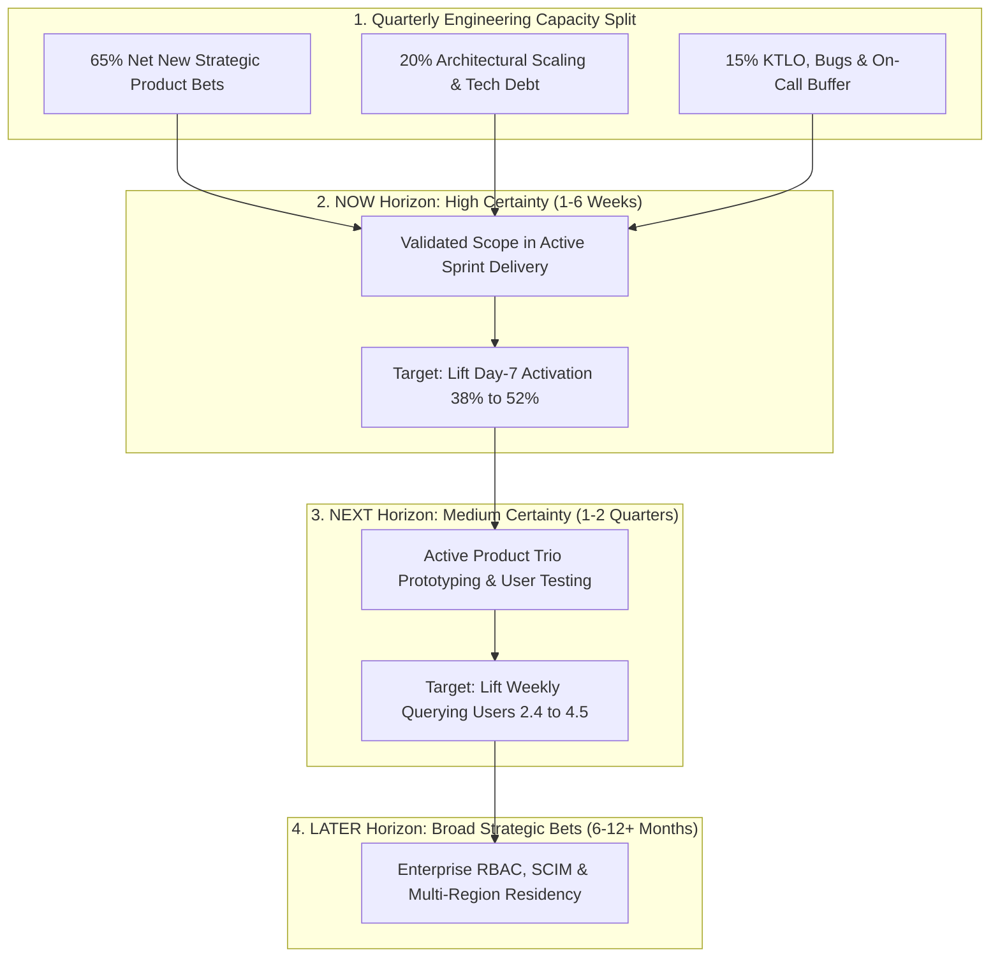

A product roadmap is one of the most visible—and most frequently abused—artifacts in a technology company. When constructed poorly, a roadmap looks like a 12-month Gantt chart promising exact calendar release dates for 40 unvalidated features. Within six weeks, an unexpected infrastructure bottleneck or customer discovery insight invalidates the schedule, forcing the product manager into endless apology tours with sales and executives. When constructed properly, as defined in foundational guides from [ProductPlan](https://www.productplan.com/learn/what-is-a-product-roadmap) and the [Silicon Valley Product Group (SVPG)](https://www.svpg.com/product-management-start-here/), a product roadmap is **not a static release calendar—it is a strategic communication tool that sequences the customer problems and business outcomes your team plans to solve across decreasing levels of certainty**.

Why do traditional date-driven feature roadmaps fail? Because software product development entails both **discovery uncertainty** (we do not yet know which design iteration will actually move user behavior) and **delivery uncertainty** (complex distributed systems surface unforeseen edge cases once coding begins). Locking a specific feature and an exact launch date nine months in advance pretends that both uncertainties are zero. This guide compares the three primary roadmap architectures, provides copy-pasteable templates you can deploy immediately in [Linear](https://linear.app/pricing), [Jira Plans](https://www.atlassian.com/software/jira/pricing), or [Notion](https://www.notion.com/pricing), explains how to tailor roadmap views for different audiences, and walks through a quantitative capacity-allocation and roadmap refactoring example.

## 1. Comparing the Three Primary Product Roadmap Formats

Before opening a roadmapping tool ([ProductPlan Examples](https://www.productplan.com/learn/example-roadmaps-for-product-managers)), choose the structural format that matches your product's maturity, regulatory environment, and uncertainty profile:

1. **The Now–Next–Later (Time-Horizon) Roadmap (Recommended Default for Agile Teams):** Popularized by Janna Bastow, the Now–Next–Later framework replaces brittle calendar months with three cone-of-uncertainty horizons:
   - **Now (Current 1–3 Sprints / ~4–6 Weeks — High Certainty, Scoped Delivery):** Problems that have already passed discovery validation (**Article 11**, **Article 14**), have completed PRDs (**Article 09**), and are actively being built or refined by the engineering squad.
   - **Next (Upcoming 1–2 Quarters — Medium Certainty, Active Discovery):** Validated problem territories and outcome targets where the Product Trio is currently prototyping candidate solutions and running technical spikes.
   - **Later (6–18 Months Out — Low Certainty, Strategic Bets):** High-level strategic themes aligned with the long-term Product Vision (**Article 06**). No detailed UI specs or sprint estimates exist yet.
2. **The Quarterly Outcome-Based (OKR) Roadmap:** Organizes columns by calendar quarters (e.g., Q1, Q2, Q3, Q4), but populates cards with **measurable customer problems and target Key Results** (*"Reduce merchant checkout failure rate from 8.2% to <3.0%"*) rather than specific feature names (*"Build PayPal v3 SDK"*). Under each outcome card, candidate feature hypotheses are listed explicitly as *options under investigation*.
3. **The Timeline / Release-Date Roadmap (Use Strictly for Hard External Deadlines):** Displays explicit dates or weeks across a horizontal timeline. This format should **only** be used for initiatives governed by non-negotiable external events—such as statutory banking regulations (e.g., RBI compliance cutovers), hardware manufacturing trade shows, or contractual deprecations of legacy APIs—and must include explicit scope buffers.

## 2. Step-by-Step Workflow: Building a Defensible Roadmap in 6 Steps

1. **Step 1 — Anchor in Strategy & OKRs:** Start with your approved Product Strategy (**Article 06**) and quarterly Objectives and Key Results (**Article 10**). Every item entering the roadmap must trace directly to a strategic pillar.
2. **Step 2 — Calculate True Net Engineering Capacity (The 70/20/10 Rule):** Never allocate 100% of your engineering headcount to new roadmap features. In any production software system, a realistic capacity model reserves:
   - **~15%–20% for KTLO (Keep The Lights On):** On-call triage, bug fixes, security patches, and minor customer escalations.
   - **~15%–20% for Technical Debt & Architectural Scaling:** Database migrations, test automation, refactoring, and latency optimization.
   - **~60%–70% for Net New Strategic Product Bets:** Customer-facing discovery and delivery initiatives on the roadmap.
3. **Step 3 — Cluster Discovery Insights into Problem Themes:** Group raw customer requests from sales, support, and user interviews into underlying **problem themes** rather than listing 80 granular feature tickets.
4. **Step 4 — Score and Sequence Using Explicit Prioritization Frameworks:** Apply [Intercom's RICE Model](https://www.intercom.com/blog/rice-simple-prioritization-for-product-managers) or Cost of Delay (**Article 08**) alongside cross-squad dependency mapping (available in [Jira Premium Plans](https://www.atlassian.com/software/jira/pricing) or [Linear Initiatives](https://linear.app/pricing)).
5. **Step 5 — Map Cross-Team Dependencies & Risk Buffers:** Identify early whether your initiative requires API changes from another squad (e.g., Core Auth or Data Platform) or security/legal sign-off, and lock those dependency handoffs one horizon ahead.
6. **Step 6 — Establish a Monthly Review & Re-Calibration Cadence:** Review the roadmap monthly with the Product Trio and quarterly with executive stakeholders so new evidence from A/B experiments (**Article 18**) can smoothly update the *Next* and *Later* columns.

## 3. Tailoring Roadmap Views by Audience (Internal vs. External Governance)

A single roadmap view rarely serves every audience safely. Sharing an internal engineering timeline with prospective enterprise buyers invites sales reps to write unverified target dates directly into legally binding contracts. Maintain three synchronized views from the same underlying source of truth:

- **Engineering & Design Squad View:** High granularity on **Now** and **Next**; displays technical dependencies, discovery status (`In Research`, `Prototyping`, `Ready for Dev`), and target telemetry metrics.
- **Executive & Board View:** High-level strategic themes mapped directly to quarterly OKRs, R&D headcount allocation (e.g., 65% Core Growth, 20% Platform Reliability, 15% AI New Bets), and expected ARR / retention impact.
- **Sales, Customer Success & External Customer View:** Strict **Now–Next–Later** view with **zero exact calendar dates** except for capabilities already in beta or final staging QA, paired with an explicit safe-harbor disclaimer.

## Frameworks and Comparison Tables

### Table 7.1: Comparison of the Three Product Roadmap Architectures

| Dimension | Now–Next–Later Roadmap | Quarterly Outcome Roadmap | Timeline / Gantt Feature Roadmap |
| :--- | :--- | :--- | :--- |
| **Primary Organizing Axis** | Certainty & validation horizon (`Now`, `Next`, `Later`) | Calendar quarters (`Q1`, `Q2`, `Q3`, `Q4`) anchored in OKRs | Exact calendar dates/months and fixed feature deliverables |
| **Unit of Commitment** | Validated near-term scope (`Now`) + problem themes (`Next`/`Later`) | Measurable customer behavioral outcomes & metric targets | Specific features promised on specific dates |
| **Adaptability to Discovery** | **High** — failed prototypes in `Next` are swapped without breaking dates | **High** — team can pivot features mid-quarter to hit the outcome | **Very Low** — any discovery pivot looks like a "missed deadline" |
| **Best Audience** | Product squads, Sales/CS, External customers, Agile scale-ups | Executive leadership, Board reviews, Portfolio alignment | Hardware launches, statutory regulatory mandates, fixed agency contracts |
| **Primary Failure Mode** | Letting `Next` and `Later` become unprioritized dumping grounds | Writing disguised feature outputs as fake outcomes | Chronic deadline slippage, technical shortcuts, and feature factory output |

### Table 7.2: Copy-Pasteable Outcome-Based Now–Next–Later Roadmap Template (Illustrated for a B2B Analytics Platform)

| Horizon & Timeframe | Strategic Theme & Target Outcome (OKR) | Validated / Candidate Solutions | Discovery & Technical Status | Key Dependencies & Risks |
| :--- | :--- | :--- | :--- | :--- |
| **NOW** *(Current 6 Weeks — High Certainty)* | **Theme:** Frictionless Data Onboarding **Outcome:** Lift Day-7 workspace activation from **38% to 52%** | 1. One-click Snowflake/BigQuery OAuth connector 2. Automated schema error preview table | **In Delivery** (PRD complete; Sprint 2 of 3; feature flagged at 10% beta) | Security review passed; requires Docs update from PMM before 100% GA |
| **NEXT** *(Upcoming 1–2 Quarters — Medium Certainty)* | **Theme:** Self-Serve Query Intelligence **Outcome:** Increase weekly active querying users per account from **2.4 to 4.5** | *Candidate Hypotheses:* A. Natural-language-to-SQL prompt bar B. Pre-built industry KPI dashboard templates | **In Discovery** ([Figma](https://uichemy.com/blog/figma-pricing/) usability tests with 6 analysts; LLM latency spike underway) | Requires deterministic SQL validation guardrail from AI Platform squad |
| **LATER** *(6–12+ Months — Strategic Exploration)* | **Theme:** Enterprise Governance & Scale **Outcome:** Unlock >\$100k ACV tier with **<60-day security review cycle** | *Exploratory Bets:* - Row-level RBAC & SCIM provisioning - Multi-region EU/India data residency | **Concept Stage** (Sizing enterprise pipeline demand with Sales) | Dependent on AWS multi-region infrastructure migration in H2 |

## Visualizing the Framework

The following architecture diagram illustrates the workflow and decision criteria:

## Practical Worked Example

**Scenario (Hypothetical Series B SaaS Squad — *PulseHR*):**  
You inherit a product squad consisting of **6 full-time software engineers** planning a **12-week quarter (6 two-week sprints)**. The previous PM left behind a traditional timeline roadmap promising **7 major features totaling 84 person-weeks of estimated engineering effort** in Q3.

**Step 1 — Calculate True Available Engineering Capacity for Q3:**
- **Gross Theoretical Engineering Time:** $6\text{ engineers} \times 12\text{ weeks} = \mathbf{72\text{ person-weeks}}$.
- **Subtract Vacation, Public Holidays & Sick Leave (~10%):** $72 - 7.2 = \mathbf{64.8\text{ net working person-weeks}}$.
- **Apply the Operational Capacity Buffer (65% New Bets / 20% Tech Debt / 15% KTLO):**
  - **KTLO, Production Bugs & Support Escalations (15%):** $64.8 \times 0.15 = \mathbf{9.7\text{ person-weeks}}$.
  - **Architectural Refactoring & Database Indexing (20%):** $64.8 \times 0.20 = \mathbf{13.0\text{ person-weeks}}$.
  - **Net Capacity Available for Strategic Roadmap Bets (65%):** $64.8 \times 0.65 = \mathbf{42.1\text{ person-weeks}}$.

**Step 2 — Expose the Overcommitment Gap:**  
The inherited roadmap promised **84 person-weeks** of feature work against an actual net strategic capacity of **42.1 person-weeks**—an **overcommitment of 99.5%** ($84 / 42.1 = 2.0\times$). If left unchanged, the squad is mathematically guaranteed to miss half of its promised dates, burn out engineers, and skip critical database indexing.

**Step 3 — Refactor into an Outcome-Based Now–Next–Later Roadmap:**  
You audit the 7 promised features against the Q3 company OKR (*Reduce time-to-complete quarterly performance reviews from 11 days to 4 days*):
- **Move to NOW (Total = 38 person-weeks, leaving a 4.1-week safety buffer inside the 42.1-week budget):**
  1. *Automated Manager Review Reminder & Slack Action Bot* (16 person-weeks) — directly eliminates the #1 bottleneck identified in user telemetry.
  2. *One-Click Peer Feedback Summary Synthesis* (22 person-weeks) — cuts manager writing time by 55% in prototype testing.
- **Move to NEXT (Active Discovery for Q4 = 28 person-weeks):**
  3. *Custom Competency Matrix Builder* (18 person-weeks) and *HRIS Bi-Directional Sync* (10 person-weeks) — designer and tech lead will prototype and validate in Q3 while engineers deliver the `NOW` items.
- **Deprecate / Move to LATER (18 person-weeks):**
  4. Three low-impact cosmetic reporting requests (18 person-weeks) that had zero correlation with review completion speed.

**Result:** The squad delivers 100% of its `NOW` commitments by Week 11, reduces customer review completion time from 11 days to **3.6 days** (exceeding the OKR), and completes the database indexing that cuts page load latency by 40%.

## Common Mistakes and Limitations

1. **Treating the Roadmap as a Binding Sales Contract:** When sales teams promise a `Later` horizon item with a hard Q4 contract penalty to close a single deal, the entire product organization becomes hostage to one custom account. Enforce a company policy that only `Now` items in final staging can be contractually dated without VP of Product + VP of Engineering written sign-off.
2. **Allotting Zero Capacity for Post-Launch Iteration (Version 1.1):** Teams often schedule Feature A for Weeks 1–6 and Feature B starting Monday of Week 7. When Feature A launches in Week 6 and real user telemetry reveals two usability friction points that need a 1-week iteration to unlock full adoption, the team has zero capacity left to fix it. Always budget a **15%–20% post-launch iteration buffer** after major releases.
3. **Confusing a Backlog with a Roadmap:** A backlog contains hundreds of granular user stories and bug tickets; a roadmap is a high-level strategic narrative of 3 to 5 themes per horizon. Never dump raw Jira tickets onto an executive roadmap slide.

## Practical Implementation Checklist

- [ ] **Outcome First, Feature Second:** Does every card on the roadmap state the **customer problem and target metric shift** before naming the candidate feature solution?
- [ ] **Realistic Capacity Math:** Does the total engineering effort in our `Now` / current-quarter horizon fit within **60%–70% of net available engineering weeks** (after subtracting PTO, KTLO, and tech debt)?
- [ ] **Iteration Buffer Included:** Have we reserved 1–2 sprints of capacity after major launches to iterate on real customer feedback and A/B test learnings?
- [ ] **Explicit Dependency Flags:** Are cross-squad technical dependencies (APIs, auth, data pipelines) and non-technical gates (Legal, Security, GTM) explicitly linked and agreed upon by the partner teams?
- [ ] **Audience-Appropriate Views:** Do we have a clean, date-free Now–Next–Later view ready for sales and external customer briefings?

## Frequently Asked Questions

### 1. How do I convince executives or enterprise customers to accept a Now–Next–Later roadmap when they demand exact release dates?
Explain the trade-off transparently using the **Cone of Uncertainty**: for items in the **Now** column (next 4–6 weeks), scope is fully specified and you can provide high-confidence target release windows (e.g., *"October 2026 release"*). For items in **Next** and **Later**, committing to an exact calendar day today would require either padding estimates by 300% or locking into a rigid specification before customer testing is complete. Offer quarterly delivery windows for *Next* and invite enterprise customers into early design partner betas instead of giving fake day-specific dates 9 months out.

### 2. How far into the future should a product roadmap look?
For an early-stage startup (Seed to Series A), a roadmap should span **3 to 6 months** (`Now` = 4 weeks, `Next` = 2 months, `Later` = 3–6 months), because market discovery moves too fast for annual plans. For a mature Series C+ scale-up or enterprise product, a **4-quarter (12-month) rolling horizon** is standard—with high specificity in Q1, moderate specificity in Q2, and broad strategic themes in H2.

### 3. Should technical debt and infrastructure migrations appear on the product roadmap?
Major architectural initiatives (such as migrating to a multi-region database or upgrading an LLM orchestration pipeline) **should** appear on the roadmap, framed around the **customer and business outcome they unlock**—for example, *"Platform Reliability: Reduce p99 API latency from 1,200ms to 300ms and enable 99.95% enterprise SLA."* Routine sprint-level refactoring (~15%–20% capacity allocation) can be managed as a continuous capacity band without cluttering executive roadmap cards.

### 4. How often should a Product Manager update the roadmap?
The roadmap is a living artifact: update delivery status continuously via your issue tracker ([Linear](https://linear.app/pricing) or [Atlassian Jira](https://www.atlassian.com/software/jira/pricing)), conduct a formal **Product Trio roadmap check-in once a month** to incorporate new discovery findings, and run a comprehensive **quarterly roadmap alignment review** alongside OKR planning (**Article 10**).

### 5. What should I do when an urgent executive or regulatory request forces a mid-quarter roadmap change?
Enforce the **"Swap, Don't Stack" rule**. Because net engineering capacity in a quarter is fixed (as proven in Section G), adding a new 12-person-week initiative mid-quarter requires explicitly moving 12 person-weeks of existing `Now` scope into `Next`. Present the exact trade-off table to leadership so they consciously approve which existing item shifts out.

### 6. How does a Product Roadmap differ from a Release Plan?
A **Product Roadmap** is a strategic document spanning quarters that communicates *why* you are pursuing specific outcomes and *in what sequence*. A **Release Plan** (or Sprint Plan) is a tactical execution schedule spanning 2 to 6 weeks that details the exact user stories, QA staging cutovers, feature-flag rollout percentages, and go-to-market launch tasks (**Article 19**) for an imminent shipment.

## Next Steps and Recommended Reading

Building an effective product roadmap is not an exercise in graphic design or fortune-telling—it is the discipline of aligning your organization around a realistic, capacity-backed sequence of customer problems to solve. By replacing brittle 12-month feature promises with an outcome-driven **Now–Next–Later** architecture, you protect your engineering team's ability to build high-quality software while giving executives and customers honest, transparent visibility into where the product is headed.

**Practical Next Step:** Take your current quarter's roadmap and run the **Capacity Audit from Section G**: multiply your squad's net working weeks by $0.65$ and compare that budget against the sum of estimated weeks for every promised feature. If your committed scope exceeds 65% of gross capacity, proactively renegotiate the bottom 30% of items into your *Next* horizon this week.

**Recommended Follow-Up Reading:** Now that you know how to structure the roadmap container, read **Article 08: RICE, MoSCoW and ICE: How to Prioritize Product Features** (`/blog/product/rice-moscow-ice-prioritization-frameworks/` — *Planned Destination*) to master the quantitative scoring formulas that decide which features earn a spot in the `Now` column.

## About this guide

Aniket Thakur prepared this comprehensive Product Management guide based on continuous discovery frameworks, operational research, and practitioner benchmarks checked on 24 October 2026. All quantitative scenarios in Section G are explicitly labelled hypothetical worked examples illustrating decision math.
