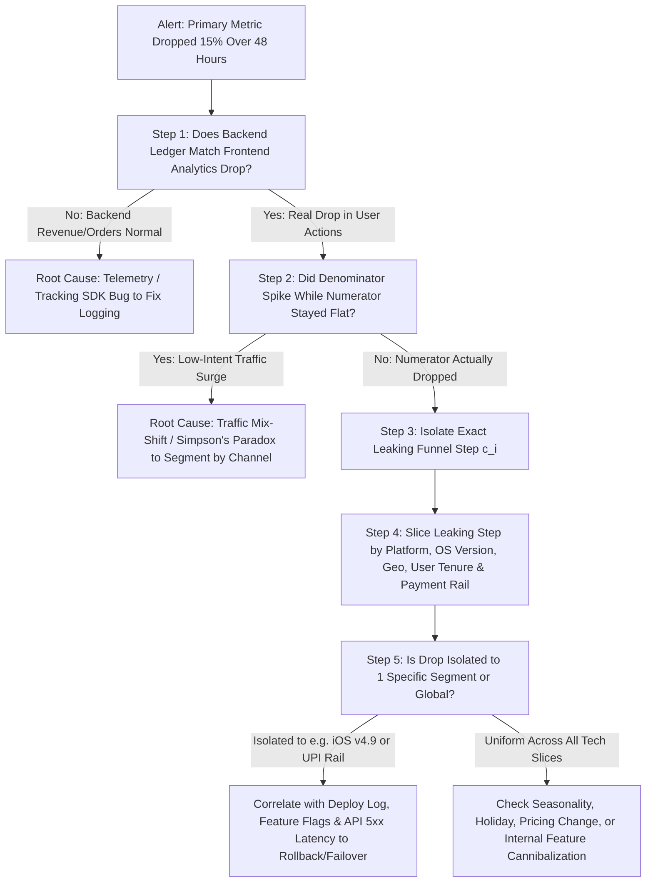

It is Monday at 9:05 AM. You open your product dashboard in [Amplitude](https://amplitude.com/north-star-hub) or your SQL BI tool and see that **checkout conversion dropped 18% over the weekend** (or in a Product Manager interview, the interviewer asks: *"You are the PM for Instagram Stories and Daily Active Creation dropped 12% yesterday—walk me through how you figure out why"*). Panic and random guessing are the enemies of root-cause diagnosis. If you immediately ask six engineers to roll back five unrelated releases or launch an emergency discount coupon before isolating the mechanism, you will waste days chasing ghosts—especially when **roughly 30% to 40% of sudden overnight "metric cliffs" in software companies turn out to be broken analytics logging or traffic mix-shifts rather than actual user abandonment!**

Diagnosing a drop in product metrics is a deterministic process of **binary search and variance decomposition**. By systematically eliminating hypotheses from the cheapest, fastest checks (telemetry pipeline health and numerator/denominator math) to multi-dimensional segmentation (platform, geography, acquisition channel, and funnel step) and cross-metric correlation, you can isolate the exact culprit in under an hour. This guide provides a universal 7-step diagnostic playbook, a segmentation triage matrix, a clear explanation of **Simpson's Paradox (Traffic Mix-Shift)**, and a worked numerical example showing how a product's blended conversion rate can drop by $16\%$ even when every single underlying user segment actually improved!

## Step 1: Verify the Metric Definition, Time Horizon, and Telemetry Integrity (Rule Out False Alarms First)

Before waking up the engineering team, answer three foundational questions:
1. **What is the exact mathematical formula of the metric (Numerator vs. Denominator)?** If your metric is a ratio—such as $\text{Conversion Rate} = \frac{\text{Completed Checkouts}}{\text{Unique Product Page Visitors}}$—did the **numerator drop** (fewer checkouts), or did the **denominator spike** (a low-intent top-of-funnel marketing campaign or scraper bot flooded the site with 50,000 non-buying visitors while actual checkouts stayed completely flat)?
2. **Is the drop a sudden "Step-Function Cliff" (within hours/1 day) or a "Gradual Slope" (over 4–8 weeks)?**
   - **Sudden Cliff:** Almost always caused by a **production code deployment, feature-flag ramp, broken analytics SDK event, third-party API outage (e.g., payment gateway or OAuth provider down), or a sudden marketing channel spike**.
   - **Gradual Slope:** Typically caused by **competitive erosion, seasonal fatigue, cohort quality decay as paid ad channels saturate, or progressive database latency degradation**.
3. **Is the analytics pipeline itself healthy?** Check whether the raw event (`checkout_completed`) stopped firing on a specific client version (e.g., an engineer renamed a button class in iOS v5.4, breaking a tag-manager listener) while actual backend Stripe/database ledger orders remained normal.

## Step 2: Check Temporal Context & Seasonality (Day-of-Week, Holidays, Macro Outages)

Compare the drop not just against *yesterday*, but against **the exact same day of the week last week (WoW) and the exact same week last year (YoY)**. B2B SaaS products naturally drop 60%–75% every Saturday and Sunday; consumer food-delivery and regional fintech apps shift dramatically during major festivals (such as Diwali, Christmas, or Lunar New Year), major sporting events (IPL/World Cup finals), or regional telecom/cloud outages.

## Step 3: Decompose Along the User Journey Funnel (Where Horizontally Is the Leak?)

Map the metric to its exact sequential funnel steps (**Article 17**):
$$\text{App Open} \xrightarrow{c_1} \text{Search / Browse} \xrightarrow{c_2} \text{Add to Cart} \xrightarrow{c_3} \text{Initiate Payment} \xrightarrow{c_4} \text{Payment Success}$$
Isolate which exact step transition ($c_1, c_2, c_3,\text{ or }c_4$) experienced the drop. If $c_1, c_2,\text{ and }c_3$ are identical to last week ($100\%$ normal), and 100% of the drop occurs between `Initiate Payment` and `Payment Success` ($c_4$ plunged from $92\%$ to $68\%$), you have immediately eliminated 80% of the product surface area and narrowed the culprit to the checkout/payment gateway step.

## Step 4: Slice Across the Five Standard Segmentation Dimensions (Where Vertically Is the Leak?)

Take the leaking funnel step from Step 3 and slice it across five mutually exclusive dimensions to check if the drop is **Uniform (Global)** or **Isolated (Concentrated in One Slice)**:
1. **Platform / Client Version / OS / Browser:** Web vs. iOS vs. Android; Chrome vs. Safari; App Version `v4.1` vs. `v4.2`.
2. **Geography / Region / Currency / Language:** India vs. US vs. EU (e.g., did a single country's local payment rail or CDN node go down?).
3. **User Cohort & Tenure:** **New Users (Day 0–7)** vs. **Existing / Power Users**; Free vs. Paid Tier.
4. **Acquisition Channel / Traffic Source:** Paid Social vs. Organic Search vs. Direct vs. Referral (**Crucial for catching Simpson's Paradox / Mix-Shift**).
5. **Product Category / Merchant / Payment Method:** UPI vs. Credit Card vs. NetBanking; specific SKU or B2B workspace size.

## Step 5: Check Correlated Technical & Ecosystem Counter-Metrics

Cross-reference the isolated segment against engineering and support telemetry:
- Did **p95 / p99 API latency**, **HTTP 5xx error rates**, or **client crash rates** spike in that exact slice?
- Did **Customer Support tickets** or social media mentions mentioning a specific error spike?
- Did another squad ramp an **A/B experiment or feature flag** (**Article 18**) to 50% or 100% within 4 hours of the cliff?

## Steps 6 & 7: Formulate the Causal Hypothesis, Verify via Logs/Replay, and Execute Remediation

Watch 5 session replays (or inspect production error logs) inside the isolated slice to confirm the exact failure mechanism visually, execute the immediate remediation (rollback release, kill feature flag, or fail over to backup gateway), and schedule a blameless postmortem (**Article 22**).

## Frameworks and Comparison Tables

### Table 21.1: Diagnostic Signature Matrix — Matching Symptom Patterns to Root Causes

| Observed Symptom Pattern | Numerator vs. Denominator Behavior | Segment Concentration | Most Probable Root Cause | Immediate Verification Check |
| :--- | :--- | :--- | :--- | :--- |
| **1. Analytics Logging Bug** | Analytics event drops 40%, **BUT** backend SQL database / Stripe revenue is 100% normal | Often 100% concentrated in a newly released client version (e.g., Android `v3.8`) | Tracking event accidentally deleted or renamed during UI refactor | Compare frontend event count against immutable backend ledger table |
| **2. Traffic Mix-Shift (Simpson's Paradox)** | Numerator rises $+10\%$, Denominator spikes $+35\%$, Blended Rate drops $-18\%$ | Every individual channel's conversion is stable, but low-intent channel volume spiked | Marketing launched a viral/paid top-of-funnel campaign bringing low-converting traffic | Calculate channel-weighted vs. fixed-weight conversion rate (Section G) |
| **3. Production Bug / Release Regression** | Numerator plunges while Denominator stays constant | Concentrated in 1 platform/OS or matches a feature-flag ramp timestamp | Broken UI component, API schema mismatch, or unhandled null pointer | Check deployment log & feature-flag audit trail; roll back to verify recovery |
| **4. Third-Party Dependency Outage** | Step-specific conversion plunges at external handoff (e.g., Auth, SMS OTP, Payment) | Concentrated in 1 provider (e.g., SMS carrier in 1 region or 1 bank rail) | External SMS gateway, OAuth provider, or payment processor downtime | Check provider status page & webhook `HTTP 502/504` timeout logs |
| **5. Internal Feature Cannibalization** | Metric for Feature A drops 25%, while newly launched Feature B surges | Concentrated among users exposed to the new navigation or AI shortcut | New workflow successfully absorbed users' Job to Be Done from old flow | Check **Combined Net User Outcome** across Feature A + Feature B |

### Table 21.2: Interview & On-Call Triage Checklist Across Internal vs. External Factors

| Factor Category | Diagnostic Questions to Ask | Telemetry Source |
| :--- | :--- | :--- |
| **A. Telemetry & Math** | Did the tracking schema change? Did the denominator spike while the numerator stayed flat? | Event QA logs, Backend DB vs. Analytics diff |
| **B. Temporal & Macro** | Is it a holiday, weekend, tax deadline, weather event, or major external internet outage? | YoY / WoW calendar overlay, Downdetector |
| **C. Internal Releases** | What code deploys, config changes, or A/B tests ramped within $\pm 6$ hours of the inflection point? | GitHub/GitLab deploy log, Feature Flag console |
| **D. GTM & Marketing** | Did Marketing launch a new ad campaign, change landing page targeting, or alter pricing? | UTM channel breakdown, Ad Spend log |
| **E. Competitive & Ecosystem** | Did Apple/Google change an OS permission (e.g., push notifications) or a competitor launch a promo? | App Store reviews, OS version segmentation |

## Visualizing the Framework

The following architecture diagram illustrates the workflow and decision criteria:

## Practical Worked Example

**Scenario (Hypothetical Fintech Credit Card Marketplace — *CardMatch*):**  
On Monday morning, the CEO messages you in alarm: **Overall site-wide Credit Card Application Conversion Rate dropped from $5.00\%$ in Week 1 to $4.20\%$ in Week 2—a relative drop of $-16.0\%$!**  
The CEO wants to immediately roll back Week 2's mobile checkout redesign. Before rolling back code, you run **Step 1 (Numerator vs. Denominator)** and **Step 4 (Channel / Platform Segmentation)** on the SQL data:

## Complete Numerical Breakdown (Week 1 vs. Week 2 by Platform Segment)

| Segment Slice | **Week 1 Visitors (Denominator)** | **Week 1 Approvals (Numerator)** | **Week 1 Conversion Rate** | **Week 2 Visitors (Denominator)** | **Week 2 Approvals (Numerator)** | **Week 2 Conversion Rate** | **Segment Conversion Change** |
| :--- | :--- | :--- | :--- | :--- | :--- | :--- | :--- |
| **Desktop Web** *(High-intent organic search)* | $80,000$ ($80\%$ of traffic) | $4,800$ | **$6.00\%$** | $80,000$ ($40\%$ of traffic) | $4,960$ | **$6.20\%$** | **$+0.20\%$ (IMPROVED!)** |
| **Mobile Web** *(Paid social discovery ads)* | $20,000$ ($20\%$ of traffic) | $200$ | **$1.00\%$** | $120,000$ ($60\%$ of traffic) | $3,440$ | **$2.87\%$** | **$+1.87\%$ (NEARLY TRIPLED!)** |
| **TOTAL BLENDED SITE** | **$100,000$** ($100\%$) | **$5,000$** | **$5.00\%$** | **$200,000$** ($100\%$) | **$8,400$** | **$4.20\%$** | **$-0.80\%$ ($-16\%$ DROP?!)** |

## Mathematical Diagnosis of the Paradox
Look closely at the table above—this is a classic real-world manifestation of **Simpson's Paradox**:
1. **Desktop conversion improved** from $6.00\%$ to **$6.20\%$**.
2. **Mobile Web conversion nearly tripled** from $1.00\%$ to **$2.87\%$** thanks to the squad's mobile checkout redesign!
3. **Total approved credit cards (Numerator) surged by $+68\%$**, from $5,000$ to **$8,400$ cards**!
4. **Why did the blended site-wide conversion rate drop from $5.00\%$ to $4.20\%$?**  
   Because in Week 2, Marketing scaled a Mobile Web paid social campaign by $6\times$ (growing Mobile Web traffic from $20,000$ to $120,000$ visitors—shifting the site's traffic mix from **$80\%$ Desktop / $20\%$ Mobile** in Week 1 to **$40\%$ Desktop / $60\%$ Mobile** in Week 2). Even though Mobile Web conversion nearly tripled to $2.87\%$, $2.87\%$ is still lower than Desktop's $6.20\%$ baseline, so weighting Mobile at $60\%$ of total traffic pulled the **unadjusted blended average** down:
   $$\text{Blended Rate}_{\text{Wk1}} = (0.80 \times 6.00\%) + (0.20 \times 1.00\%) = 4.80\% + 0.20\% = \mathbf{5.00\%}$$
   $$\text{Blended Rate}_{\text{Wk2}} = (0.40 \times 6.20\%) + (0.60 \times 2.87\%) = 2.48\% + 1.72\% = \mathbf{4.20\%}$$

**What Would Have Happened Without This Diagnostic Framework:**  
A naive team looking only at the top-line blended conversion chart ($5.00\% \rightarrow 4.20\%$) would have **rolled back the Mobile Web redesign**—destroying a feature that actually lifted mobile conversion by $+187\%$ and added $+3,400$ incremental card approvals! By separating **Mix-Shift** from **Within-Segment Rate Change**, you save the winning feature and upgrade the executive dashboard to report **Mix-Adjusted (Fixed-Weight) Conversion Rates** alongside segmented funnels.

## Common Mistakes and Limitations

1. **Jumping to External Macro Excuses Before Checking Internal Releases:** Bad teams immediately blame "macroeconomic headwinds" or "the weather" for a Tuesday drop without checking whether Monday night's Android v4.2 deployment broke the login button for 30% of devices. Always audit internal telemetry, deployments, and third-party API health first.
2. **Stopping at the First Plausible Correlation:** Sometimes two things happen on the same weekend (e.g., a minor holiday *and* a broken payment webhook). Verify that the **magnitude of the isolated cause mathematically accounts for the total drop** ($e.g.$, if the holiday accounts for $-400$ orders, what caused the other $-1,600$ missing orders?).
3. **Alert Fatigue from Uncalibrated Thresholds:** If an automated Slack alert fires every time hourly DAU fluctuates by $\pm 3\%$, PMs and engineers will mute the channel within a week. Configure anomaly alerts using **day-of-week-adjusted seasonal standard deviation bands ($> 2.5\sigma\text{ to }3.0\sigma$)** paired with minimum sample volume floors.

## Practical Implementation Checklist

- [ ] **Telemetry vs. Ledger Check:** Did we verify that the drop appears in the backend transactional database/ledger and is not just a broken frontend analytics event?
- [ ] **Numerator vs. Denominator Split:** For any rate or ratio metric, did we plot the numerator and denominator as separate time series first?
- [ ] **Horizontal Funnel Cut:** Have we identified the exact single funnel step transition ($c_i$) where the drop occurs?
- [ ] **5-Way Vertical Segmentation:** Have we sliced that leaking funnel step by **Platform/Version**, **Geography**, **User Tenure**, **Acquisition Channel**, and **Payment/Feature Type**?
- [ ] **Mix-Shift / Simpson's Paradox Audit:** Did traffic volume shift across segments with different baseline conversion rates?

## Frequently Asked Questions

### 1. How do I structure my answer to a "Metric Drop" question in a Product Manager interview?
Interviewers use Metric Drop questions (**Article 24**) to test whether you think like a structured scientist or guess randomly. Walk through the exact **7-Step Framework** out loud in 4 to 5 crisp stages:
1. **Clarify the Metric & Timeframe:** Ask for the exact definition (numerator/denominator) and whether the drop was sudden (cliff) or gradual (slope).
2. **Check Telemetry & Seasonality:** Rule out logging bugs and calendar/holiday effects.
3. **Isolate the Funnel Step & Segment:** Ask the interviewer for cuts across Platform (iOS/Android/Web), Geography, User Tenure (New vs. Returning), and Channel.
4. **Correlate with Internal/External Changes:** Check recent code releases, A/B experiments, API latency/crashes, or cannibalization from another feature.
5. **Propose Action:** Once the interviewer confirms the root cause (e.g., *"Android v5.1 introduced a 4-second video load delay in India"*), state the immediate mitigation (rollback/hotfix) and long-term guardrail fix.

### 2. How do you distinguish between healthy "Internal Cannibalization" and a destructive product drop?
Suppose you launch an **AI Instant Answer Summary** at the top of your search results page, and clicks on traditional blue documentation links drop by 22%. Is that good or bad? Measure the **Upstream Goal / Downstream Retention Outcome**: if users who see the AI Instant Answer resolve their problem $40\%$ faster, file $30\%$ fewer support tickets, and exhibit higher Day-30 product retention, then the 22% drop in link clicks is **healthy workflow cannibalization**. You simply need to update your North Star Metric definition (**Article 17**) to count *Verified Answers Resolved* across both surfaces.

### 3. What is the fastest mathematical formula to remove Simpson's Paradox (Mix-Shift) from a weekly dashboard?
Use **Kitagawa–Oaxaca Decomposition (or Fixed-Weight Direct Standardization)**: hold each segment's traffic weight fixed at the **Baseline Period ($w_{i,0}$)** and multiply by the new period's conversion rates ($r_{i,1}$):
$$\text{Fixed-Weight Conversion Rate}_1 = \sum_{i} w_{i,0} \cdot r_{i,1}$$
In our Section G *CardMatch* example, applying Week 1's weights ($80\%$ Desktop, $20\%$ Mobile) to Week 2's rates gives $(0.80 \times 6.20\%) + (0.20 \times 2.87\%) = \mathbf{5.53\%}$ (proving intrinsic conversion improved from $5.00\%$ to $5.53\%$, while the remaining $-1.33\%$ shift to $4.20\%$ was pure channel mix-shift!).

### 4. Why can Cohort Retention appear to drop in recent weeks even when nothing is wrong ("Right-Censoring Bias")?
If a dashboard queries **Unbounded Retention** (**Article 17**) or **30-Day LTV** without filtering out cohorts that have not yet had 30 full calendar days to mature, cohorts from 10 days ago will look like their retention plunged—simply because they have only had 10 days to return instead of 30! Always enforce a **maturity window filter** (`signup_date <= CURRENT_DATE - INTERVAL '30 days'`) when plotting N-day cohort trends.

### 5. What should a Product Manager do if a metric drops 10% gradually over 3 months and no single bug or release explains it?
Gradual multi-month erosion is rarely a single bug; it is typically **death by a thousand cuts** across three areas: (1) **Performance Creep** (each sprint added 80ms of JavaScript bundle size until mobile load time crossed 4 seconds), (2) **Channel Saturation** (paid marketing exhausted the core early-adopter audience and is now buying lower-intent cohorts), or (3) **Competitive Substitution** (a competitor launched a superior workflow). Run a cohort-by-cohort quality decomposition and schedule 10 churned-user Switch Interviews (**Article 11**, **Article 12**).

### 6. Who owns investigating a sudden metric drop—the Product Manager, the Data Analyst, or the On-Call Engineer?
The **Product Manager** owns orchestrating the cross-functional investigation—pairing with the **Data Analyst** to slice funnel and segment queries (Steps 1–4) while checking with the **On-Call Tech Lead** on recent deployments, feature flags, and infrastructure latency (Step 5). A PM who waits passively for three days for an analyst to hand them a finished report allows preventable customer damage to compound.

## Next Steps and Recommended Reading

Diagnosing a drop in product metrics is where analytical product management proves its mettle. By systematically checking telemetry integrity and numerator/denominator math first, isolating the exact funnel step and segment slice, testing for Simpson's Paradox mix-shifts, and correlating with release and latency logs, you replace panic with surgical root-cause resolution.

**Practical Next Step:** Add a **Fixed-Weight (Mix-Adjusted) Conversion View** and a **Numerator vs. Denominator Dual-Line Chart** to your squad's primary KPI dashboard this week so a future marketing traffic surge never triggers a false-alarm code rollback.

**Recommended Follow-Up Reading:** Once you have diagnosed an incident or product failure, proceed to **Article 22: Why Products Fail: Root-Cause Analysis, Postmortems and Lessons Learned** (`/blog/product/why-products-fail-root-cause-analysis-postmortems/` — *Planned Destination*) to learn how to run blameless postmortems and prevent strategic product failures.

## About this guide

Aniket Thakur prepared this comprehensive Product Management guide based on continuous discovery frameworks, operational research, and practitioner benchmarks checked on 24 October 2026. All quantitative scenarios in Section G are explicitly labelled hypothetical worked examples illustrating decision math.
