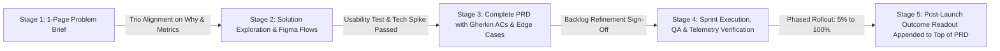

A **Product Requirements Document (PRD)** is the single source of truth that translates a validated customer problem into an unambiguous, testable specification for engineering, design, QA, and go-to-market teams. In the era of waterfall software development, PRDs were notorious 60-page treatises written in isolation over three months and thrown "over the wall" to developers. When Agile methodologies emerged ([The 2020 Scrum Guide](https://scrumguides.org/scrum-guide.html)), some teams swung to the opposite extreme—abandoning documentation entirely and expecting six engineers to build complex financial or AI workflows from a two-sentence Jira ticket title. Both extremes fail in production.

Without a clear, living Agile PRD, engineering teams discover unaddressed edge cases (such as expired auth tokens, API rate-limit retries, empty states, and permission boundaries) halfway through coding, multiplying sprint cycle time by $2\times$ to $3\times$. Conversely, when a PRD is concise, visual, and co-created with the Product Trio inside [Notion](https://www.notion.com/pricing) or Confluence, it accelerates engineering velocity by resolving ambiguity before the first line of code is written. This guide breaks down the 10 mandatory components of a modern Agile PRD, teaches you how to write deterministic Gherkin acceptance criteria, and provides a **complete, filled-in worked PRD example** for an Automated Webhook Retry & Dead-Letter Queue feature.

## 1. The 10 Mandatory Sections of an Engineering-Ready Agile PRD

A modern PRD should fit cleanly in a **2-to-5 page living document** structured so any teammate—whether a front-end developer, a security reviewer, or the VP of Product—can scan down to their required section in 30 seconds:

1. **Document Control & Status Header:** Lists the Document Owner (PM), Tech Lead, Product Designer, current lifecycle stage (`Draft / In Discovery` $\rightarrow$ `In Trio Review` $\rightarrow$ `Approved for Sprint` $\rightarrow$ `Shipped`), target release horizon, and links to the [Figma](https://uichemy.com/blog/figma-pricing/) file and [Linear](https://linear.app/pricing) / [Jira](https://www.atlassian.com/software/jira/pricing) epic.
2. **Problem Statement & Customer Evidence ("The Why"):** Explains specifically *who* is experiencing the problem, *what* quantitative telemetry or qualitative user research proves the pain exists, and *what happens if we do nothing*.
3. **Goals, Success Metrics & Non-Goals:** Separates the **Primary Outcome Metric** (e.g., lift webhook delivery recovery rate from 72% to 96%), **Guardrail Metrics** (e.g., queue memory utilization $<70\%$), and **Explicit Non-Goals (Out of Scope)** so scope creep is blocked upfront.
4. **User Personas & Core User Stories:** Frames functional needs from the perspective of specific actors (`As a [persona], I want to [action], so that [measurable outcome]`).
5. **User Flow & Design Specifications:** Embeds the user state-machine flow and direct links to annotated Figma frames covering **five mandatory UI states**: *Empty State*, *Loading/Skeleton State*, *Ideal Populated State*, *Partial/Edge State*, and *Error/Fallback State*.
6. **Functional Requirements & Deterministic Acceptance Criteria:** Specifies exact system behaviors using **Priority Tags** (`P0 = Launch Blocker`, `P1 = Fast-Follow Before GA`, `P2 = Post-Launch Enhancement`) and **Gherkin syntax** (`Given [precondition] / When [trigger] / Then [expected verifiable outcome]`).
7. **Non-Functional & Technical Constraints:** Defines p95/p99 latency budgets, throughput volume, backward compatibility, RBAC permissions, data retention/privacy (GDPR/DPDP/SOC2), and accessibility standards.
8. **Analytics & Telemetry Instrumentation Table:** Specifies the exact event names (e.g., `webhook_manual_replay_clicked`), payload properties (`merchant_id`, `http_status_code`, `retry_count`), and dashboard destinations required before launch.
9. **Rollout Plan, Feature Flags & Go-to-Market Readiness:** Details the phased release gates (e.g., Internal Dogfooding $\rightarrow$ 5% Beta Cohort $\rightarrow$ 100% General Availability) and instant kill-switch rollback criteria.
10. **Open Questions & Decision Log (DACI):** Tracks resolved and pending cross-functional decisions ([Atlassian DACI Framework](https://www.atlassian.com/team-playbook/plays/daci)) so engineers never re-litigate settled architecture choices.

## 2. Writing Testable User Stories and Gherkin Acceptance Criteria

Vague requirements are the #1 cause of friction between Product Managers and QA/Engineering teams. Never write an unverifiable requirement like *"The system should handle failed payments gracefully and notify the user quickly."* Every person on the squad will interpret *"gracefully"* and *"quickly"* differently.

Instead, pair every **INVEST-compliant User Story** (*Independent, Negotiable, Valuable, Estimable, Small, Testable*) with deterministic **Gherkin (`Given / When / Then`) Acceptance Criteria** that translate directly into automated unit and integration tests:
- **Bad (Ambiguous):** *"Allow merchants to retry failed webhooks from the dashboard."*
- **Good (Deterministic Gherkin):**
  - *Given* an authenticated Merchant Admin viewing the `Failed Webhooks` tab with $\ge 1$ event in `DEAD_LETTER` status,
  - *When* the user clicks `Replay Selected (Max 50)` and the downstream endpoint returns `HTTP 200 OK` within `5,000ms`,
  - *Then* the system transitions the event status from `DEAD_LETTER` to `DELIVERED_MANUAL_RETRY`, increments `manual_retry_count` by $+1$, logs the timestamp and actor ID in the audit trail, and displays a green toast notification within `300ms`.

## Frameworks and Comparison Tables

### Table 9.1: Waterfall BRD/MRD vs. Vague Agile Ticket vs. Modern Living PRD

| Dimension | Legacy Waterfall Spec (50+ Pages) | Bare-Bones Agile Ticket (2 Lines) | Modern Living Agile PRD (2–5 Pages) |
| :--- | :--- | :--- | :--- |
| **Authoring Process** | Written in isolation by PM/BA over 8 weeks before engineering sees it | Typed hastily by PM 10 minutes before Sprint Planning | Co-evolved iteratively by the Product Trio (PM, Designer, Tech Lead) |
| **Problem Context** | Buried on page 14 under corporate boilerplate | Omitted entirely (*"Add retry button to table"*) | Front-and-center in Paragraph 1 with exact telemetry & user quotes |
| **Edge-Case Coverage** | Attempts to guess every detail 6 months early (quickly becomes obsolete) | Discovered mid-sprint when developers get blocked, causing scope slip | Explicitly maps the 5 UI states, latency SLAs, and Gherkin acceptance rules |
| **Analytics & Rollout** | Treated as an afterthought after coding finishes | Frequently forgotten until 2 weeks after launch | Embedded as a mandatory P0 table inside the Definition of Done |

### Table 9.2: Section-by-Section PRD Quality Audit Matrix

| PRD Section | Primary Consumer | Question It Must Answer | Red Flag That Blocks Sprint Readiness |
| :--- | :--- | :--- | :--- |
| **1. Problem & Evidence** | Entire Squad & Leadership | *Why is this worth our next 4 weeks of engineering capacity?* | No baseline metric or customer evidence cited |
| **2. Goals & Non-Goals** | PM, Tech Lead, Stakeholders | *What metric moves if we succeed, and what are we explicitly NOT building?* | "Non-Goals" section left blank |
| **3. UX & 5 States** | Front-End Eng & Designer | *What does the user see on empty, loading, success, partial, and error states?* | Only the "Happy Path" screenshot is attached |
| **4. Functional & Gherkin Specs** | Backend/Frontend Eng & QA | *What are the exact inputs, state transitions, limits, and error codes?* | Uses subjective adjectives (*"fast," "intuitive," "seamless"*) |
| **5. Telemetry & Rollout** | Data Analyst, DevOps, PMM | *Which events fire, and what triggers an emergency feature-flag rollback?* | Analytics event names and properties are missing |

## Visualizing the Framework

The following architecture diagram illustrates the workflow and decision criteria:

## Practical Worked Example

*(Note: Below is a complete, production-grade worked PRD for a hypothetical B2B payments infrastructure platform, **PayStream API**, demonstrating how all 10 sections lock together in practice.)*

## 1. Document Metadata & Control Header
- **Feature Title:** Automated Exponential Webhook Retry & Self-Serve Dead-Letter Queue (DLQ)
- **Document Owner:** Aniket Thakur (Product Manager, Developer Experience) · **Tech Lead:** Priya Nair · **Product Designer:** Arjun Mehta
- **Lifecycle Status:** `Approved for Sprint 18 Delivery` · **Target Release:** Q4 2026 (2 Engineering Sprints / 4 Weeks)
- **RICE Priority Score:** $2,400$ ($R = 3,200\text{ active API merchants/qtr}, I = 2.0, C = 100\%, E = 2.67\text{ person-months}$)

## 2. Problem Statement & Empirical Evidence
When *PayStream* processes an asynchronous payment settlement (e.g., UPI or NEFT confirmation), our gateway sends an `HTTP POST` webhook (`payment.settled`) to the merchant's server. Currently, if a merchant's server experiences a transient 30-second deployment restart or database spike and returns `HTTP 502/503/504` or times out after `5,000ms`, *PayStream* drops the webhook after a single immediate retry.
- **Quantitative Evidence (Last 90 Days Telemetry):** Out of $42\text{ million}$ monthly webhooks, $1.8\%$ ($756,000\text{ events/month}$) fail due to transient merchant server downtime. This generated **1,420 support tickets in Q3** (28% of all Tier-2 engineering support volume), costing ~35 engineering hours/week in manual database state checks.
- **Qualitative Evidence:** Across 9 developer discovery interviews, CTOs cited silent webhook drops as their #1 reconciliation headache, forcing them to build brittle polling cron jobs that hammer our `GET /v1/payments` endpoint.

## 3. Goals, Success Metrics & Explicit Non-Goals
- **Primary Product Outcome Metric:** Increase automated webhook delivery success rate (without manual merchant intervention) from **98.20% to $\ge$ 99.85%** within 30 days of GA.
- **Secondary Outcome Metric:** Reduce webhook-related Tier-2 support tickets from **1,420/quarter to < 200/quarter** ($-86\%$) and reduce merchant polling traffic on `GET /v1/payments` by **35%**.
- **Guardrail Metrics:** (1) p99 webhook initial dispatch latency must remain **$\le 450\text{ms}$**; (2) Retry queue infrastructure cost must not exceed **\$420/month**.
- **Explicit Non-Goals (Out of Scope for v1):**
  - *Out of Scope:* Custom per-merchant retry schedule configuration (all merchants use the standard 6-step exponential backoff schedule in v1).
  - *Out of Scope:* Payload transformation or custom header injection inside the DLQ replay UI.

## 4. Functional Requirements & Priority Matrix

| Req ID | Priority | Requirement Specification |
| :--- | :--- | :--- |
| **REQ-01** | **P0** | **Exponential Backoff Schedule:** Any webhook receiving `HTTP 408`, `429`, `5xx`, or network timeout ($>5,000\text{ms}$) must automatically enter the retry queue across 6 intervals with $\pm 15\%$ random jitter: **Attempt 1:** $+30\text{s}$; **Attempt 2:** $+2\text{m}$; **Attempt 3:** $+15\text{m}$; **Attempt 4:** $+1\text{h}$; **Attempt 5:** $+6\text{h}$; **Attempt 6:** $+24\text{h}$. |
| **REQ-02** | **P0** | **Non-Retryable Fast-Fail Rule:** Webhooks returning `HTTP 400`, `401`, `403`, `404`, or `410` (client configuration errors) must bypass automated retries after 1 verification attempt and transition immediately to `FAILED_CLIENT_ERROR` to prevent wasted queue throughput. |
| **REQ-03** | **P0** | **Dead-Letter Queue (DLQ) Persistence & UI:** If Attempt 6 fails at $+24\text{h}$, transition event to `DEAD_LETTER`, fire an email/Slack alert to the merchant's registered DevOps contact, and retain the full JSON payload for **14 calendar days** in the Merchant Dashboard for 1-click manual or batch replay (up to 100 events per batch). |
| **REQ-04** | **P1** | **Idempotency Header Enforcement:** Every initial and retried webhook dispatch must include an immutable `X-PayStream-Idempotency-Key` (UUIDv4) and `X-PayStream-Delivery-Attempt` (`1` to `7`) header so merchants can safely deduplicate retries. |

## 5. Deterministic Gherkin Acceptance Criteria (QA Test Spec)
- **Scenario 1 (Transient 503 Recovery on Attempt 3):**
  - *Given* a `payment.settled` webhook with `event_id = evt_991` where Initial Dispatch and Retry Attempts 1 ($+30\text{s}$) and 2 ($+2\text{m}$) receive `HTTP 503 Service Unavailable`,
  - *When* Retry Attempt 3 ($+15\text{m} \pm \text{jitter}$) receives `HTTP 200 OK` within `1,200ms`,
  - *Then* the system marks `evt_991` as `DELIVERED`, cancels Attempts 4–6, records `total_attempts = 4` (1 initial + 3 retries), and displays the full attempt response log in the Merchant Developer Console.
- **Scenario 2 (Batch Manual Replay from Dead-Letter Queue):**
  - *Given* a user with role `Developer` or `Admin` (Read-Only `Finance` role must see the button disabled with tooltip *"Requires Developer role"*) selecting 25 `DEAD_LETTER` events in the console,
  - *When* the user clicks `Replay Selected (25)`,
  - *Then* the system enqueues all 25 events asynchronously with header `X-PayStream-Manual-Replay: true`, displays a progress banner, and updates each row's status badge within `3,000ms`.

## 6. Telemetry Instrumentation & Phased Rollout Plan
- **Mandatory Analytics Events:** `webhook_auto_retry_scheduled` (`attempt_number`, `http_status`), `webhook_dlq_entered` (`merchant_id`, `failure_reason`), and `webhook_dlq_manual_replay_triggered` (`batch_size`, `actor_role`, `recovery_rate`).
- **Rollout Gates:** **Week 3:** Enable behind feature flag `ff_webhook_dlq_v1` for 15 internal sandbox accounts + 20 design-partner merchants. **Week 4:** Ramp to 25% $\rightarrow$ 100% of production merchants once p99 dispatch latency ($<450\text{ms}$) and idempotency headers are verified.

## Common Mistakes and Limitations

1. **Writing the PRD in Isolation Without the Tech Lead and Designer:** If the first time your Tech Lead sees a PRD is at Sprint Planning, you have guaranteed a painful 90-minute debate over database feasibility. Draft the **Problem, Goals, and Non-Goals** first, review them with the Product Trio, and co-author the technical and UX sections together.
2. **Omitting Role-Based Permissions (RBAC) and Error States:** Nearly 40% of mid-sprint scope creep happens because a PRD specifies what an Admin sees on a successful click, but forgets to specify what a Read-Only viewer sees or what happens when an external API returns a 429 rate-limit error.
3. **Allowing the PRD to Drift From Reality Mid-Sprint:** When an engineering discovery on Wednesday of Sprint 1 changes an API timeout from 10 seconds to 5 seconds, update the PRD table immediately and log a 1-line note in the **Decision Log**. Never let Slack threads become an unindexed shadow spec.

## Practical Implementation Checklist

- [ ] **Problem & Baseline Metric:** Does Section 1 state the exact current baseline metric and sample size proving the problem is real?
- [ ] **Explicit Non-Goals:** Are there at least 2–3 tempting scope expansions listed explicitly under *Out of Scope / Non-Goals*?
- [ ] **All 5 UI States Covered:** Do the linked [Figma](https://uichemy.com/blog/figma-pricing/) frames show Empty, Loading, Ideal Populated, Edge/Large-Data, and Error states?
- [ ] **Gherkin Testability:** Can a QA engineer write automated tests directly from our `Given / When / Then` acceptance criteria without guessing?
- [ ] **Telemetry & Feature Flag Defined:** Are the exact analytics event names, properties, and feature-flag rollback thresholds documented?

## Frequently Asked Questions

### 1. Do Agile teams still need PRDs, or do user stories in Jira/Linear replace them?
Individual user stories in [Linear](https://linear.app/pricing) or [Atlassian Jira](https://www.atlassian.com/software/jira/pricing) do **not** replace a cohesive PRD for multi-story features or epics. When context is fragmented across 18 separate Jira tickets, engineers lose sight of the overarching user flow, non-goals, and architectural constraints. The best modern workflow keeps a **single 2-to-4 page PRD in Notion/Confluence** for the epic, and links individual implementation tickets back to that master document.

### 2. How long should a good PRD be?
Aim for **800 to 2,000 words (roughly 2 to 4 pages)** depending on architectural complexity. A minor UI enhancement only needs a 1-page mini-spec inside a Linear project description, whereas a new payment settlement engine or multi-LLM orchestration workflow warrants a full 4-page PRD with state tables and latency SLAs.

### 3. What is the difference between a PRD and an Engineering RFC (Request for Comments) / Technical Design Doc (TDD)?
The **PRD** (owned by the Product Manager) defines **what** problem is being solved, **who** it is for, **what** observable system behaviors and acceptance criteria are required, and **how** success will be measured. The **Engineering RFC / TDD** (owned by the Tech Lead or Staff Engineer) defines the internal **technical architecture**—such as Kafka topic partitioning, PostgreSQL indexing, class hierarchies, and microservice schemas. The two documents link to each other at the top header.

### 4. How do you write a PRD for an AI or LLM-powered feature where outputs are probabilistic rather than deterministic?
For AI/LLM features (**Article 23**), deterministic `Given / When / Then` rules alone are insufficient for model text quality. Your PRD must include two additional sections: (1) an **Evaluation Dataset & Quality Rubric** (e.g., *"Must achieve $\ge 94\%$ factual grounding accuracy and $<1\%$ schema validation failure across our 500-prompt golden eval dataset"*), and (2) **Deterministic Fallback & Guardrail Rules** (as detailed in Aniket Thakur's [Designing Deterministic Validation Schemas for Multi-LLM Pipelines](https://07anishu12.github.io/learnings.html)).

### 5. Who signs off on a PRD before engineering starts coding?
In an empowered Product Trio, sign-off requires alignment across three peers: the **Product Manager** (verifies value, viability, and metric instrumentation), the **Product Designer** (verifies UX states and accessibility), and the **Tech Lead** (verifies technical feasibility and estimability)—plus domain reviewers (Legal/Security) if regulated data is touched.

### 6. Should I include wireframes inside the PRD if I am not a designer?
During early problem framing, a PM may include rough low-fidelity box sketches or flowcharts to illustrate logical transitions (**Article 14**), but once the Product Designer creates the canonical flows in [Figma](https://uichemy.com/blog/figma-pricing/), replace rough sketches with **live embedded Figma frames** so engineers never accidentally code from an outdated PM sketch.

## Next Steps and Recommended Reading

Writing a great PRD is the highest-leverage writing skill in product management. Every hour you invest in clarifying edge cases, defining explicit non-goals, and specifying Gherkin acceptance criteria saves ten hours of mid-sprint engineering rework and post-launch bug triage.

**Practical Next Step:** Copy the 10-section structure and worked example from Section G into a reusable [Notion](https://www.notion.com/pricing) or Confluence template for your squad, and enforce the rule that no multi-week epic enters Sprint Planning without an explicit **Non-Goals** section and **Telemetry Table**.

**Recommended Follow-Up Reading:** Complete Pillar B (Product Strategy and Planning) by reading **Article 10: Product Management OKRs: How to Set Objectives and Key Results** (`/blog/product/product-management-okrs/` — *Planned Destination*) to see how individual feature outcomes roll up into quarterly team objectives.

## About this guide

Aniket Thakur prepared this comprehensive Product Management guide based on continuous discovery frameworks, operational research, and practitioner benchmarks checked on 24 October 2026. All quantitative scenarios in Section G are explicitly labelled hypothetical worked examples illustrating decision math.
