A Product Manager does not need to master typography kerning, custom vector illustration, or design-system token maintenance—those crafts belong to your Product Designer. Yet every great PM must possess deep **interaction literacy and usability testing rigor**. Why? Because even if a feature solves a genuine, high-priority customer problem (passing **Value Risk**), it will still fail in production if users cannot understand the interface hierarchy, get trapped in dead-end error states, or abandon the flow halfway through (failing **Usability Risk**, [SVPG Four Risks](https://www.svpg.com/product-management-start-here/)).

Friction between Product Managers and UX Designers almost always happens for one of two reasons: either the PM jumps straight into [Figma](https://uichemy.com/blog/figma-pricing/) and draws a pixel-specific mockup before explaining the underlying customer problem, or the PM throws a text-only specification at the designer two days before sprint planning and treats UX as cosmetic decoration. This guide establishes the exact collaboration boundary within the Product Trio, compares the four levels of design fidelity (Sketches, Wireframes, Mockups, and Interactive Prototypes), explains how to apply **Jakob Nielsen's 10 Usability Heuristics** ([NN/g Official Guide](https://www.nngroup.com/articles/ten-usability-heuristics/)) and the mathematical **5-User Usability Testing Law** ([NN/g 5-User Research](https://www.nngroup.com/articles/why-you-only-need-to-test-with-5-users/)), and walks through a complete quantitative usability test evaluation.

## 1. The Fidelity Ladder: Sketch vs. Wireframe vs. Mockup vs. Prototype

Choosing the wrong artifact fidelity wastes weeks of design time and corrupts user feedback. Match your visual artifact to the specific question you are trying to answer:

1. **Level 1 — User Flow & State Diagram (Logical Fidelity):** Boxes and arrows in FigJam or Mermaid mapping every screen transition, conditional branch (`If KYC verified` vs `If KYC rejected`), and edge case. *Owner:* Co-created by PM, Designer, and Tech Lead before drawing any screens.
2. **Level 2 — Low-Fidelity Sketch / Wireframe (Structural Fidelity):** Grayscale, schematic layouts focusing strictly on information hierarchy, content grouping, and primary actions without colors, brand fonts, or polished icons. *Why low fidelity matters early:* When you show a rough grayscale wireframe to a customer in discovery, they feel comfortable saying *"This whole workflow is backwards."* When you show them a gleaming, pixel-perfect mockup, they assume you spent a month building it and give polite comments about button colors instead.
3. **Level 3 — High-Fidelity Static Mockup (Visual Fidelity):** Pixel-accurate screens in [Figma](https://uichemy.com/blog/figma-pricing/) using the production design system, typography, color contrast (WCAG $\ge 4.5:1$), and exact microcopy across all five UI states (Empty, Loading, Ideal, Partial/Edge, Error). *Owner:* Product Designer.
4. **Level 4 — Interactive Prototype (Behavioral Fidelity):** Clickable Figma flows (or lightweight front-end code prototypes) that simulate realistic task sequences so a test participant can attempt an end-to-end workflow without moderator hand-holding.

## 2. Conducting a Pre-Test Audit Using Jakob Nielsen's 10 Usability Heuristics

Before spending participant recruiting budget on external usability tests, the Product Manager and Product Designer should run a 30-minute internal **Heuristic Evaluation** ([NN/g How to Conduct a Heuristic Evaluation](https://www.nngroup.com/articles/how-to-conduct-a-heuristic-evaluation/)) against **Jakob Nielsen's 10 Usability Heuristics for User Interface Design** ([NN/g 10 Heuristics](https://www.nngroup.com/articles/ten-usability-heuristics/)):

1. **Visibility of System Status:** Keep users informed about what is happening (e.g., showing step progress `Step 2 of 4` or streaming token progress in an LLM response rather than a frozen blank screen).
2. **Match Between System and the Real World:** Speak the user's domain language (*"Cancel Invoice"* instead of *"Execute Nullification Mutation ID 409"*).
3. **User Control and Freedom:** Provide a clear "Emergency Exit" (`Undo`, `Cancel`, `Back to Draft`) when users click something by mistake.
4. **Consistency and Standards:** Follow platform conventions (per Jakob's Law, users spend most of their time on other products and expect standard patterns).
5. **Error Prevention:** Eliminate error-prone conditions upfront (e.g., disabling the `Submit` button until mandatory fields validate, or requiring confirmation before deleting a production database).
6. **Recognition Rather Than Recall:** Minimize memory load by making options, recent queries, and field formats visible inline rather than forcing users to memorize syntax from another tab.
7. **Flexibility and Efficiency of Use:** Provide accelerators (such as `Cmd+K` command palettes and keyboard shortcuts, as championed by [Linear](https://linear.app/pricing)) for power users while keeping the default interface clean for novices.
8. **Aesthetic and Minimalist Design:** Remove irrelevant information; every extra badge or secondary metric on a card competes with the primary call-to-action and reduces relative visibility.
9. **Help Users Recognize, Diagnose, and Recover from Errors:** Write error messages in plain language stating **what went wrong, why, and the exact action to fix it** (*"CSV upload failed on Row 14: Date `14/31/2026` must use `YYYY-MM-DD` format — Click here to auto-convert"*).
10. **Help and Documentation:** Provide concise, contextual inline tooltips tied directly to the user's immediate task.

## 3. The Mathematics Behind Jakob Nielsen's 5-User Usability Testing Law

Why do [Jakob Nielsen and Tom Landauer at the Nielsen Norman Group (NN/g)](https://www.nngroup.com/articles/why-you-only-need-to-test-with-5-users/) famously recommend testing qualitative usability with **5 users per round** rather than running a single massive 30-user study?

The recommendation is grounded in the **Poisson / Binomial Problem-Discovery Model**:
$$P(\text{Proportions of Usability Problems Found}) = 1 - (1 - p)^n$$
where:
- $n =$ the number of test participants in a homogeneous user group, and
- $p =$ the probability that any single participant encounters a given usability problem during the task (empirically averaged at **$p = 0.31$** across NN/g's multi-project database).

Plugging **$p = 0.31$** into the formula across increasing sample sizes $n$:
- **$n = 1\text{ user}$:** $1 - (1 - 0.31)^1 = \mathbf{31.0\%}$ of usability problems discovered.
- **$n = 3\text{ users}$:** $1 - (0.69)^3 = 1 - 0.3285 = \mathbf{67.1\%}$ of problems discovered.
- **$n = 5\text{ users}$:** $1 - (0.69)^5 = 1 - 0.1564 = \mathbf{84.4\%\ (\approx 85\%)}$ of problems discovered.
- **$n = 10\text{ users}$:** $1 - (0.69)^{10} = \mathbf{97.6\%}$ (spending $2\times$ the budget to find only an incremental $13\%$).
- **$n = 15\text{ users}$:** $1 - (0.69)^{15} = \mathbf{99.6\%}$.

**The Practitioner Rule:** If you have budget and time to recruit **15 users**, **never test all 15 on the exact same static prototype**. Instead, run **three iterative rounds of 5 users each**: test with 5 users on Monday (uncovering ~85% of flaws), fix the prototype in [Figma](https://uichemy.com/blog/figma-pricing/) on Tuesday, test the revised design with 5 new users on Wednesday to verify the fixes didn't introduce new bugs, and run a final 5-user validation on Friday ([NN/g Qualitative vs. Quantitative 5-User Distinction](https://www.nngroup.com/articles/5-test-users-qual-quant/)). *(Note: If your product serves two completely distinct personas—such as Doctors and Patients—test 5 users per distinct persona).*

## Frameworks and Comparison Tables

### Table 14.1: Comparison of the Four Design Fidelity Artifacts

| Artifact Level | Speed to Create | Primary Purpose | Who Creates It | What Feedback to Ask For |
| :--- | :--- | :--- | :--- | :--- |
| **1. User Flow / State Diagram** | 30–60 mins | Map logic, branches, permissions, and system states | PM + Designer + Tech Lead | *"Did we miss any edge cases, API failures, or role restrictions?"* |
| **2. Low-Fi Wireframe / Sketch** | 1–3 hours | Explore 3+ layout concepts and information hierarchy cheaply | Designer (or PM for rough concept framing) | *"Does the sequence of steps match how you think about this task?"* |
| **3. High-Fi Static Mockup** | 1–3 days | Lock visual hierarchy, design system tokens, and all 5 UI states | Product Designer | *"Is visual contrast clear, and are all 5 states specified for devs?"* |
| **4. Interactive Prototype** | 2–5 days | Simulate end-to-end task completion with real test users | Product Designer (or Frontend Engineer) | Observe unassisted task completion rate, time-on-task, and misclicks |

### Table 14.2: Usability Defect Severity & Action Rubric (Adapted from NN/g Severity Scale)

| Severity Rating | Definition (Frequency $\times$ Impact $\times$ Persistence) | Action Required Before Engineering Sprint / Launch |
| :--- | :--- | :--- |
| **S0 — Catastrophic Blocker (4/4)** | Prevents user from completing the core task entirely or causes accidental data/financial loss | **Mandatory P0 Fix** before coding/launch; re-test with 5 users after redesign |
| **S1 — Major Usability Problem (3/4)** | Causes significant delay (>2 mins confusion) or requires moderator rescue for $\ge 2/5$ users | **High-Priority Fix** in current design iteration before Sprint Planning sign-off |
| **S2 — Minor Usability Friction (2/4)** | User hesitates briefly (10–20 seconds) or misclicks once but recovers unassisted | **Fast-Follow Fix**; adjust label copy, tooltip, or visual contrast in Figma |
| **S3 — Cosmetic / Preference Note (1/4)** | Subjective visual comment that does not impede task speed or comprehension | **Log & Monitor**; fix only if effortless and aligned with the design system |

## Visualizing the Framework

The following architecture diagram illustrates the workflow and decision criteria:

```mermaid
flowchart LR
    A["Internal Heuristic Audit: Check Nielsen's 10 Heuristics"] --> B[Round 1: Test Prototype v1 with 5 Target Users]
    B -->|Finds ~85% of v1 Usability Flaws| C["Triage Defects by S0-S3 Severity & Redesign in Figma"]
    C --> D[Round 2: Test Prototype v2 with 5 New Target Users]
    D -->|Verifies v1 Fixes & Catches Secondary Edge Cases| E["Refine Microcopy, Error States & Affordances"]
    E --> F[Round 3: Test Prototype v3 with 5 Final Users]
    F -->|Task Completion >= 85% Unassisted| G["Approve PRD & Hand Off via Figma Dev Mode to Sprint"]
```

## Practical Worked Example

**Scenario (Hypothetical B2B E-Commerce Checkout Platform — *TaxShield*):**  
Your Product Trio is designing a "Custom Multi-State GST/VAT Rule Builder" for finance managers. Before committing 3 engineering sprints, you conduct a **30-minute moderated Think-Aloud Usability Test** on a clickable [Figma](https://uichemy.com/blog/figma-pricing/) prototype across **3 core tasks** with **$n = 5$ target finance managers (Round 1)**:
- **Task 1:** Create a conditional tax exemption rule for B2B buyers with a verified GSTIN.
- **Task 2:** Run a sandbox simulation on a sample ₹50,000 invoice to verify the tax calculation.
- **Task 3:** Schedule the rule to go live on the 1st of next month at 00:00 IST.

**Moderator Protocol Used:** Rather than giving step-by-step instructions (*"Click the blue Settings gear in the top right, then click Rules"*—which ruins the test by telling the user where to click), the moderator gives a **realistic scenario goal** (*"Imagine your CFO asked you to exempt verified B2B buyers from regional surcharge starting next month. Show me how you would set that up here, thinking out loud as you go"*).

**Round 1 Empirical Results ($n = 5$ Users on Prototype v1):**

| Task ID | Unassisted Success ($n / 5$) | Assisted / Rescue ($n / 5$) | Task Failure ($n / 5$) | Median Time on Task (Target) | Root-Cause Heuristic Violation Observed |
| :--- | :--- | :--- | :--- | :--- | :--- |
| **Task 1 (Create B2B Rule)** | $4 / 5$ ($80\%$) | $1 / 5$ ($20\%$) | $0 / 5$ ($0\%$) | $75\text{s}$ ($\le 90\text{s}$) | **S2 Minor:** 1 user hesitated between `AND` vs `OR` boolean dropdowns. |
| **Task 2 (Run Sandbox Test)** | **$1 / 5$ ($20\%$)** | $2 / 5$ ($40\%$) | **$2 / 5$ ($40\%$)** | $240\text{s}$ ($\le 60\text{s}$) | **S0 Blocker (Heuristic #6 — Recognition over Recall & #1 — System Status):** The `Simulate Invoice` icon looked like a decorative terminal symbol (`>_`) with no text label, hidden inside a collapsed drawer. |
| **Task 3 (Schedule Go-Live)** | **$2 / 5$ ($40\%$)** | $1 / 5$ ($20\%$) | **$2 / 5$ ($40\%$)** | $165\text{s}$ ($\le 45\text{s}$) | **S1 Major (Heuristic #5 — Error Prevention):** Clicking `Save Rule` immediately published the rule live to production without asking `Publish Now` vs `Schedule Future Date`! |

**Design Iteration (24 Hours in Figma) & Round 2 Results ($n = 5$ New Users on Prototype v2):**
1. **Fixing Task 2 (S0 Blocker):** Replaced the cryptic `>_` icon with an always-visible right-hand split pane titled **`Live Invoice Preview & Sandbox Calculator`**, automatically recalculating sample tax as the user edits conditions.
2. **Fixing Task 3 (S1 Major):** Changed the primary CTA from an ambiguous `Save Rule` button into a split two-button footer: `Save as Draft` (Secondary) and `Review & Schedule Activation...` (Primary, opening a confirmation modal with `Activate Immediately` vs `Schedule Date/Time`).
3. **Round 2 Verification Metrics ($n = 5$ new users):**
   - **Task 1 Unassisted Success:** $5 / 5$ ($100\%$, median time $52\text{s}$).
   - **Task 2 Unassisted Success:** Lifted from **$20\%$ to $100\%$ ($5 / 5$)**, median time dropped from $240\text{s}$ to **$28\text{s}$**.
   - **Task 3 Unassisted Success:** Lifted from **$40\%$ to $100\%$ ($5 / 5$)**, median time dropped from $165\text{s}$ to **$31\text{s}$**.

By investing **4 days and 10 user sessions in Figma**, the Product Trio prevented a catastrophic production UX flaw where 60% of finance managers would have accidentally published unverified tax rules live to production checkout.

## Common Mistakes and Limitations

1. **Leading the Witness During Usability Tests ("Click the Top-Right Button"):** If your task prompt uses the exact text label printed on the button (*"Click on 'Manage Webhook Endpoints' to add a URL"*), you are testing whether the user can read English, not whether your interface is intuitive. Describe the **goal** in natural words that do not match the UI button label.
2. **Asking "Do You Like This Design?" Instead of Measuring Behavior:** Usability testing is an **observational behavioral method**, not an opinion poll. Watch where the user's cursor hovers, where they misclick, and whether they complete the task without help.
3. **Confusing 5-User Qualitative Testing with Quantitative Statistical Significance:** As [NN/g explicitly clarifies](https://www.nngroup.com/articles/5-test-users-qual-quant/), 5 users are ideal for **qualitative formative discovery of major interface bottlenecks ($p \approx 0.31$)**. If you need to compare whether Design A converts $2.5\%$ higher than Design B with $95\%$ statistical confidence, you need a quantitative live A/B test with thousands of users (**Article 18**), not a 5-person usability test.

## Practical Implementation Checklist

- [ ] **Problem First, Pixels Second:** Did the PM share a clear Problem Framing Brief and user journey context *before* asking the Product Designer to open Figma?
- [ ] **All Five UI States Designed:** Before marking an epic ready for engineering refinement, do the Figma frames explicitly show **Empty**, **Loading**, **Ideal Populated**, **Edge/Overflow**, and **Error/Offline** states?
- [ ] **Nielsen Heuristic Pre-Check:** Did the PM and Designer review the flow against [Nielsen's 10 Usability Heuristics](https://www.nngroup.com/articles/ten-usability-heuristics/) (especially Error Prevention and Recognition over Recall)?
- [ ] **Non-Leading Task Scenarios:** Are our usability test prompts written as realistic user goals without containing the exact UI button labels?
- [ ] **Iterative 5-User Rounds:** Have we scheduled at least two rounds of 5 users ($5 + 5$) with a 48-hour design fix buffer in between?

## Frequently Asked Questions

### 1. Should a Product Manager create wireframes in Figma, or does that step on the Product Designer's toes?
It depends entirely on fidelity and intent. Product Designers universally appreciate a PM who maps **logical user flows, state transitions, or rough box-and-arrow concept sketches** to clarify complex domain rules—provided the PM frames them explicitly as *"Here is a disposable logic diagram to show the required data fields; let's throw it away and design the right UX together."* Designers rightly push back when a PM spends 10 hours building a rigid, high-fidelity UI mockup and treats the designer as a pixel-polishing contractor.

### 2. When does the "5-User Usability Rule" NOT apply?
You need **more than 5 users** in three specific situations ([NN/g 5-User Exceptions](https://www.nngroup.com/articles/why-you-only-need-to-test-with-5-users/)): (1) When your product has **multiple distinct user groups** with completely different workflows (e.g., Buyers vs. Sellers on a marketplace—test 5 users *per group*); (2) When running a **quantitative benchmark study** comparing time-on-task or conversion rates statistically across versions (which requires 20–40+ users for quantitative UX metrics or thousands for live A/B tests); or (3) When performing **Card Sorting** or **Tree Testing** for large navigation menus (typically 20–30+ participants).

### 3. What is the difference between Moderated and Unmoderated Usability Testing?
In **Moderated Usability Testing** (conducted live over Zoom/Meet or in person), a facilitator observes the participant in real time and can ask probing follow-up questions (*"I noticed you paused before clicking 'Confirm'—what were you expecting to happen?"*). It is the gold standard for early complex workflows. In **Unmoderated Testing** (via tools like Maze or UserTesting), participants record themselves completing tasks asynchronously; it is faster for scaling 15–30 checks on simple, self-contained flows, but you cannot rescue a confused user or probe unexpected behavior live.

### 4. How do you test usability for an API, CLI, or Developer Platform that has no graphical UI?
Developer experience (DX) is still user experience! Run a **30-minute "Time-to-First-Hello-World" Developer Usability Test**: give 5 target software engineers your staging API documentation and an API key, ask them to share their IDE/terminal screen, and observe them attempting to authenticate and make their first successful webhook or SDK call without help. You will immediately spot missing environment variable explanations, confusing HTTP error payloads, and broken code snippets.

### 5. What is "Think-Aloud Protocol" in usability testing?
Originated in cognitive psychology and adapted for HCI by Clayton Lewis and Jakob Nielsen, the **Concurrent Think-Aloud Protocol** asks participants to verbalize their stream of consciousness continuously as they interact with the prototype (*"I'm looking for where the tax rate is set... maybe under Billing? No, that's just my credit card..."*). This reveals the exact gap between the **Designer's Mental Model** and the **User's Mental Model**.

### 6. How should PMs and Designers hand off validated designs to Software Engineers?
Never throw a Figma link into Slack on Friday afternoon and consider handoff "done." Instead, involve the **Tech Lead early during Level 1 (Flows) and Level 2 (Wireframes)** so technical constraints are baked in from day one. Once Round 2 usability testing passes, conduct a live **30-minute Trio Walkthrough** walking through Figma Dev Mode annotations, the 5 UI states, responsive breakpoints, and the PRD's Gherkin acceptance criteria (**Article 09**).

## Next Steps and Recommended Reading

Great product design is not about winning Dribbble visual awards; it is about reducing cognitive friction so customers can accomplish their Job to Be Done effortlessly on the first try. By respecting the design fidelity ladder, auditing interfaces against Nielsen's 10 Heuristics, and running fast, iterative 5-user usability tests before committing engineering sprints, you eliminate Usability Risk at a fraction of the cost of post-launch rework.

**Practical Next Step:** Before your squad's next major feature enters Sprint Planning, run a **5-user Think-Aloud Usability Test** on the clickable [Figma](https://uichemy.com/blog/figma-pricing/) prototype using three non-leading task prompts, and fix every **S0 and S1 defect** before writing a single line of production front-end code.

**Recommended Follow-Up Reading:** Complete Pillar C (Discovery, Customers and Product Design) by reading **Article 15: What Is an MVP? How to Define Scope and Validate a Product Idea** (`/blog/product/what-is-an-mvp-minimum-viable-product/` — *Planned Destination*) to learn how prototypes fit into the broader Minimum Viable Product validation strategy.

## About this guide

Aniket Thakur prepared this comprehensive Product Management guide based on continuous discovery frameworks, operational research, and practitioner benchmarks checked on 24 October 2026. All quantitative scenarios in Section G are explicitly labelled hypothetical worked examples illustrating decision math.
