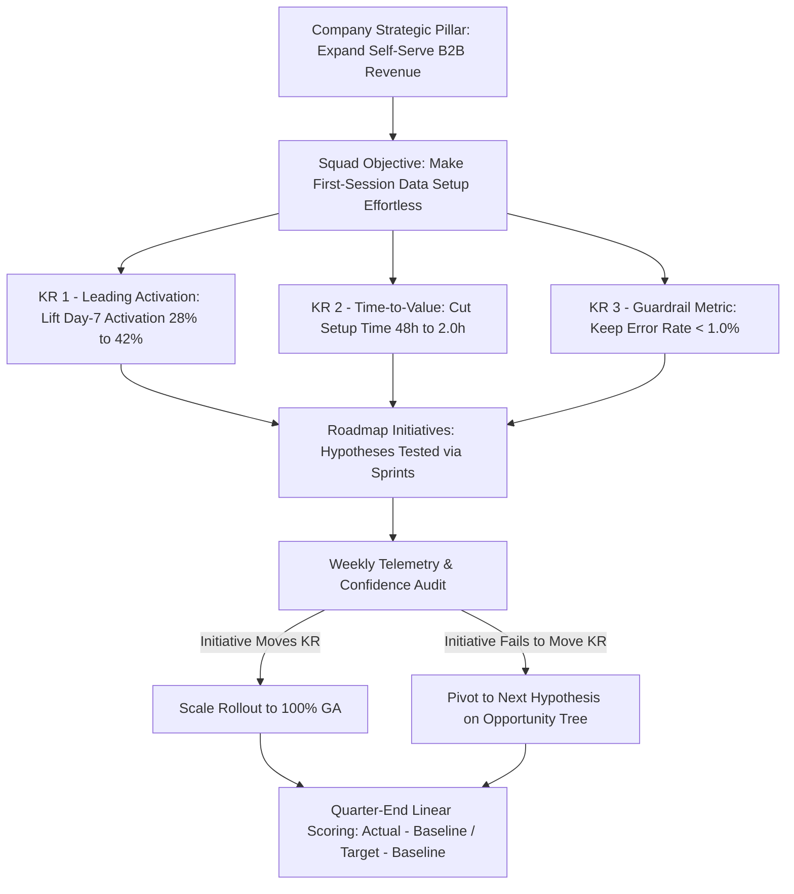

Every quarter, thousands of technology companies spend weeks locked in conference rooms drafting **Objectives and Key Results (OKRs)**—only to produce spreadsheets that are nothing more than disguised Jira task lists (*"Key Result 1: Launch Redesigned Dashboard by March 31; Key Result 2: Ship 3 AI Features"*). When Key Results are written as binary feature outputs rather than measurable shifts in customer behavior, a product team can score $100\%$ on its quarterly OKRs while user retention drops and revenue stagnates.

Originated by **Andy Grove** at Intel in the 1970s (initially called *iMBOs*—Intel Management by Objectives) and introduced to Google's founders by **John Doerr** in 1999 (as documented in Doerr's [*Measure What Matters* / WhatMatters.com](https://www.whatmatters.com/faqs/okr-meaning-definition-example)), the OKR framework was designed specifically to align autonomous teams around **measurable outcomes**, divorce stretch goal-setting from annual compensation formulas, and maintain focus across 90-day planning cycles. This guide explains the exact anatomy of a high-leverage Product OKR, shows how to pair leading behavioral indicators with guardrail counter-metrics, provides side-by-side "Bad vs. Good" OKR transformations across five product domains, and walks through a complete quarterly OKR calibration and $0.0\text{–}1.0$ grading calculation.

## 1. The Anatomy of a Product OKR: Objective vs. Key Result vs. Initiative

The single most important structural rule in product goal-setting is separating the **Objective**, the **Key Results**, and the **Initiatives (Roadmap Features)**:

1. **The Objective (Qualitative, Directional & Memorable — *Where Do We Want to Go?*):** A concise, jargon-free statement that rallies the Product Trio and stakeholders around a single strategic theme for the quarter (e.g., *"Make first-time merchant onboarding effortless and instant"*). A squad should have **at most 1 to 2 Objectives per quarter**.
2. **The Key Results (Quantitative, Behavioral Outcomes — *How Will We Know We Are Getting There?*):** **2 to 4 measurable metrics per Objective** that quantify the change in customer behavior or system performance required to achieve the Objective (e.g., *"Reduce median time-to-first-live-transaction from 42 hours to < 4 hours"*). As Andy Grove emphasized ([WhatMatters.com Origin Story](https://www.whatmatters.com/articles/the-origin-story)), a Key Result has no room for gray-area interpretation: at the end of the quarter, you can look at the number and declare without debate whether it was achieved.
3. **The Initiatives / Projects (Hypotheses & Outputs — *What Will We Build or Test to Move the KRs?*):** The specific features, prototypes, and A/B tests on your Now–Next–Later roadmap (**Article 07**) that you hypothesize will move the Key Results. If Initiative A launches in Week 4 of the quarter and fails to move Key Result 1, the Key Result remains fixed while the squad pivots to Initiative B.

## 2. Leading Indicators vs. Lagging Business Metrics (And Why Squads Need Guardrails)

A common mistake when moving away from Output OKRs is swinging too far toward **Lagging Executive Metrics**—such as telling a single checkout squad their quarterly Key Result is *"Increase company Year-over-Year Net Revenue Retention (NRR) from 108% to 118%."* While NRR is vital to the CFO, it takes 12 months to mature and is heavily confounded by macroeconomic budgets, sales discounting, and account management.

Effective Product OKRs anchor in **Leading Behavioral Indicators** derived from the product's North Star Metric Tree ([Amplitude North Star Framework](https://amplitude.com/north-star-hub), **Article 17**):
- **Lagging Executive Metric (Too slow for a 90-day squad sprint loop):** *Annual Logo Churn Rate* or *Annual Recurring Revenue (ARR)*.
- **Leading Product Indicator (Directly movable by the squad within 14–30 days):** *Percentage of new workspaces that invite $\ge 3$ teammates and complete $\ge 5$ core workflows within their first 7 days (Day-7 Team Activation Rate).*

Crucially, every aggressive growth or efficiency Key Result must be paired with a **Guardrail Counter-Metric** so the team cannot hit the target by degrading user experience:
- *Growth KR:* Increase self-serve checkout conversion from $14.0\%$ to $19.0\%$.
- *Mandatory Guardrail KR:* Maintain 30-day refund/chargeback rate **$\le 0.8\%$** (preventing dark-pattern upsells).

## 3. Committed (Roofshot) vs. Aspirational (Moonshot) OKRs & The $0.0\text{–}1.0$ Grading Scale

Per Google and [WhatMatters.com's official OKR methodology](https://www.whatmatters.com/faqs/okr-culture), organizations must explicitly label whether an OKR is **Committed** or **Aspirational**:

- **Committed OKRs (Roofshots — Target Score = $1.0$):** Goals tied to statutory compliance, SLA uptime, or foundational infrastructure handoffs that the company has agreed *must* reach $100\%$ completion by quarter-end. Teams are expected to reallocate resources immediately if a Committed OKR tracks below $1.0$.
- **Aspirational OKRs (Moonshots — Target Score = $0.6\text{ to }0.7$):** Ambitious stretch goals designed to push product innovation beyond comfortable incrementalism. On Google's standard **$0.0\text{ to }1.0$ linear grading scale**, scoring **$0.7$ ($70\%$ of the stretch delta)** on an Aspirational OKR is considered a strong success (Green). If a squad consistently scores $1.0$ on every Aspirational OKR without breaking a sweat, they are **sandbagging** their targets.

**Why OKRs Must Be Divorced from Compensation Formulas:**  
As John Doerr documents in [*Measure What Matters*](https://www.whatmatters.com/faqs/okr-meaning-definition-example), if a company ties a Product Manager's annual bonus mathematically to hitting $\ge 0.95$ on their OKRs, rational humans will immediately sandbag their quarterly goals—setting safe, trivial targets (*"Improve conversion by 0.2%"*) rather than bold, transformative bets. Performance reviews should evaluate **the difficulty of the problem tackled, rigor of execution, and business impact achieved**, never a mechanical average of raw OKR scores.

## Frameworks and Comparison Tables

### Table 10.1: Transforming "Output-Trap" OKRs into High-Leverage Outcome OKRs Across 5 Product Domains

| Product Domain | Weak "Output-Trap" OKR (Binary Task List) | Strong Outcome-Driven OKR (Leading Metric + Guardrail) |
| :--- | :--- | :--- |
| **1. B2B SaaS Onboarding** | *Obj:* Improve onboarding. *KR1:* Ship new 4-step welcome wizard. *KR2:* Record 5 tutorial videos. | **Obj:** Deliver instant first-session value to new self-serve teams. **KR1 (Leading):** Lift Day-7 activation rate ($\ge 3$ active members) from **28% to 42%**. **KR2 (Speed):** Cut median time-to-first-workflow from **48 hrs to < 25 mins**. **KR3 (Guardrail):** Keep onboarding support tickets **< 15 per 1,000 sign-ups**. |
| **2. Consumer E-Commerce / Marketplace** | *Obj:* Launch AI search. *KR1:* Deploy vector search API. *KR2:* Redesign search filter sidebar. | **Obj:** Help shoppers find and purchase exact-match items effortlessly. **KR1 (Conversion):** Increase search-to-cart add rate from **18.5% to 24.0%**. **KR2 (Failure Reduction):** Reduce "zero-result or exit-without-click" searches from **22% to < 10%**. **KR3 (Guardrail):** Maintain p95 search response latency **$\le 220\text{ms}$**. |
| **3. Fintech / Lending Platform** | *Obj:* Automate credit underwriting. *KR1:* Integrate 3 bank statement APIs. *KR2:* Build underwriter dashboard v2. | **Obj:** Accelerate SME loan approvals without compromising credit quality. **KR1 (Efficiency):** Increase straight-through automated underwriting rate from **34% to 65%**. **KR2 (Speed):** Reduce median application-to-sanction time from **72 hrs to < 4 hrs**. **KR3 (Guardrail):** Maintain 90-day early delinquency rate (FPD-90) **$\le 1.4\%$**. |
| **4. Internal Developer Platform ( DevOps / Cloud)** | *Obj:* Upgrade CI/CD pipeline. *KR1:* Migrate 20 repos to GitHub Actions. *KR2:* Publish docs in Notion. | **Obj:** Eliminate deployment friction so product squads ship faster and safer. **KR1 (Velocity):** Reduce p90 build-and-test pipeline duration from **34 mins to < 11 mins**. **KR2 (Adoption):** Migrate **85% of active production services** (from 20%) to self-serve deploy. **KR3 (Guardrail):** Keep change-failure rollback rate **< 1.5%**. |
| **5. AI / LLM Customer Support Agent** | *Obj:* Roll out GenAI chatbot. *KR1:* Connect Claude/GPT API to chat widget. *KR2:* Index 500 help center articles. | **Obj:** Resolve routine customer inquiries autonomously with high trust. **KR1 (Resolution):** Increase verified autonomous resolution rate (no human escalation within 48h) from **24% to 52%**. **KR2 (Economics):** Reduce average cost per resolved ticket from **\$4.80 to < \$1.40**. **KR3 (Guardrail):** Maintain customer CSAT on AI-resolved threads **$\ge 4.4 / 5.0$** and hallucination rate **< 0.5%**. |

### Table 10.2: The Quarterly OKR Operating Cadence (12-Week Rhythm)

| Timepoint in Quarter | Key Activity & Focus | Participants | Primary Output / Decision |
| :--- | :--- | :--- | :--- |
| **Week -2 (Pre-Quarter)** | Strategic Context & Top-Level Goal Sharing | Leadership / VP Product | Shares company annual strategy pillars & top-level problems |
| **Week -1 (Pre-Quarter)** | Squad Bottom-Up OKR Drafting & Baseline Audit | Product Trio (PM, Design, Tech Lead) | Drafts 1 Objective + 3 KRs with verified baseline telemetry |
| **Week 1 (Kickoff)** | Cross-Squad Dependency & Alignment Lock | Group PM, Squad Leads, Partner Teams | Confirms shared dependencies and publishes final OKRs in [Notion](https://www.notion.com/pricing) |
| **Weeks 2–11 (Weekly)** | 15-Minute Monday OKR Confidence Check-In | Product Squad | Updates current metric value & confidence (`On Track`, `At Risk`, `Off Track`) |
| **Week 6 (Mid-Quarter)** | Mid-Quarter Intervention & Roadmap Pivot | Product Trio + GPM | Drops underperforming initiatives and reallocates sprints to at-risk KRs |
| **Week 12 (Closeout)** | Linear $0.0\text{–}1.0$ Grading & Blameless Retrospective | Product Squad & Stakeholders | Computes final score, documents learnings, and seeds next quarter's discovery |

## Visualizing the Framework

The following architecture diagram illustrates the workflow and decision criteria:

## Practical Worked Example

**Scenario (Hypothetical B2B Analytics Squad — *MetricFlow Q3 OKR Review*):**  
At the start of Q3 (Week 1), your squad locked a single **Aspirational Objective**: *"Eliminate data-connection friction so new workspaces reach their first chart insight on Day 1."*  
Before setting targets, you queried exact 90-day historical baselines to avoid guessing, establishing three Key Results:

1. **KR 1 (Activation Rate — Weight 40%):** Increase Day-1 Chart Creation Rate for new workspaces from **Baseline $B_1 = 22.0\%$** to **Target $T_1 = 42.0\%$** ($\Delta\text{Target} = +20.0\text{ percentage points}$).
2. **KR 2 (Setup Speed — Weight 35%):** Reduce median time from signup to first connected database from **Baseline $B_2 = 36.0\text{ hours}$** to **Target $T_2 = 4.0\text{ hours}$** ($\Delta\text{Target} = -32.0\text{ hours}$).
3. **KR 3 (Reliability Guardrail — Weight 25%):** Reduce database connector authentication failure rate from **Baseline $B_3 = 9.5\%$** to **Target $T_3 = 1.5\%$** ($\Delta\text{Target} = -8.0\text{ percentage points}$).

**The Linear OKR Scoring Formula:**  
For any continuous metric with Baseline $B$, Target $T$, and Quarter-End Actual Result $A$ (capped between $0.0$ and $1.0$):
$$\text{KR Score} = \text{clamp}_{[0, 1]}\left(\frac{A - B}{T - B}\right)$$

**How the Quarter Played Out (Including a Week-5 Discovery Pivot):**
- In Weeks 1–4, the squad shipped *Initiative 1A (Interactive Setup Documentation Guide)*. At the **Week 5 check-in**, telemetry showed $A_1$ had barely moved from $22.0\%$ to $23.5\%$ ($\text{KR1 Score} = 0.075$ — Red).
- Instead of blindly building more documentation for the remaining 7 weeks, the PM and Designer watched 10 session replays and realized new users did not have production database credentials ready during their first 10 minutes—they needed a **1-Click Pre-Loaded Sandbox Sample Database** plus an **"Invite Your Data Engineer"** modal.
- The squad pivoted in Week 6, shipping the 1-Click Sample Database and OAuth Connector Retry in Week 8.

**Quarter-End (Week 12) Actual Telemetry & Exact Score Calculation:**
1. **KR 1 Actual ($A_1 = 38.0\%$):**
   $$\text{Score}_{\text{KR1}} = \frac{38.0\% - 22.0\%}{42.0\% - 22.0\%} = \frac{16.0\%}{20.0\%} = \mathbf{0.80}\text{ (Green — Exceeds }0.70\text{ stretch threshold)}$$
2. **KR 2 Actual ($A_2 = 12.0\text{ hours}$):**
   $$\text{Score}_{\text{KR2}} = \frac{12.0 - 36.0}{4.0 - 36.0} = \frac{-24.0}{-32.0} = \mathbf{0.75}\text{ (Green)}$$
3. **KR 3 Actual ($A_3 = 2.7\%$):**
   $$\text{Score}_{\text{KR3}} = \frac{2.7\% - 9.5\%}{1.5\% - 9.5\%} = \frac{-6.8\%}{-8.0\%} = \mathbf{0.85}\text{ (Green)}$$
4. **Overall Objective Score (Unweighted Mean vs. Weighted Mean):**
   - **Standard Unweighted Mean:** $\frac{0.80 + 0.75 + 0.85}{3} = \mathbf{0.80}$
   - **Importance-Weighted Mean:** $(0.80 \times 0.40) + (0.75 \times 0.35) + (0.85 \times 0.25) = 0.320 + 0.2625 + 0.2125 = \mathbf{0.795 \approx 0.80}$.

Had the squad written Output KRs (*"Ship Interactive Setup Guide"*), they would have scored $1.0$ in Week 4 while leaving activation stuck at $23.5\%$. Because they used true Outcome KRs, the Week-5 telemetry forced the exact pivot that lifted activation to $38.0\%$.

## Common Mistakes and Limitations

1. **Setting Targets Without Querying the Historical Baseline First ("TBD Baselines"):** Writing *"Increase retention by 25%"* when nobody on the team knows whether current retention is $10\%$ or $60\%$ makes the KR meaningless for the first half of the quarter. Never finalize a KR until the baseline SQL query is live and verified.
2. **Cascading OKRs Like a Rigid Waterfall Math Tree:** When executives force every department to mathematically subdivide a top-level target across 5 management layers before anyone can start working, the company loses the first 4 weeks of every 12-week quarter to bureaucratic negotiation. Leadership should set top-level company KRs, and squads should align **bottom-up and horizontally** within one week.
3. **Having Too Many OKRs (The "Everything Is Important" Dilution):** If a single product squad has 4 Objectives and 16 Key Results in one quarter, each Key Result receives $6\%$ of the team's focus. Strictly cap each squad at **1 to 2 Objectives and 3 to 4 total Key Results per quarter**.

## Practical Implementation Checklist

- [ ] **Zero Output Verbs in Key Results:** Have we stripped verbs like *"Launch," "Build," "Deploy," "Redesign,"* and *"Complete"* from our Key Results and moved those items into the **Initiatives** column?
- [ ] **Baseline & Target Verified:** Does every Key Result state both the exact starting baseline ($B$) and the target number ($T$) ("From $X$ to $Y$ by Date $Z$")?
- [ ] **Leading Indicator Horizon:** Can our Key Results measurably respond to product changes within a 2-to-4 week sprint window (rather than requiring 12 months to mature)?
- [ ] **Guardrail Included:** Have we paired our primary growth or speed Key Results with a quality, reliability, or unit-economics guardrail metric?
- [ ] **Committed vs. Aspirational Tag:** Is every Objective explicitly labeled as either **Committed ($1.0$ expected)** or **Aspirational ($0.7$ target)**?

## Frequently Asked Questions

### 1. What is the difference between an OKR and a KPI (Key Performance Indicator)?
A **KPI** is an ongoing health metric that you monitor continuously on your dashboard (like a car's speedometer, engine temperature, and fuel gauge—e.g., server uptime $99.95\%$, monthly active users, gross margin). An **OKR** is a time-boxed, directional **change agenda** (like a GPS destination for the next 90 days) focused on moving a specific bottleneck KPI from State A to State B. When a healthy KPI suddenly drops below its acceptable threshold, it triggers an **OKR** for the upcoming quarter to fix it.

### 2. How do you set OKRs for a Zero-to-One product that has not launched yet and has zero baseline metrics?
For a pre-launch zero-to-one product where live funnel baselines do not yet exist, frame Key Results around **validated learning and milestone validation thresholds** rather than ungrounded revenue numbers—for example: *"KR 1: Conduct usability tests with 15 target finance controllers and achieve $\ge 85\%$ unassisted task completion on the core reconciliation prototype; KR 2: Onboard 10 design-partner companies into private beta with $\ge 60\%$ Week-4 active retention."*

### 3. Should individual Product Managers have personal OKRs separate from their squad's OKRs?
No. For a Product Manager, **the squad's Product OKRs are your OKRs**. Giving a PM personal OKRs that diverge from the engineering and design squad's OKRs creates perverse incentives where the PM optimizes for personal career checkboxes rather than shared team outcomes. Personal skill-development goals (such as learning Python eval scripts or improving executive presentation skills) belong in a separate **Individual Career Development Plan** with your manager.

### 4. Can we change or delete a Key Result in the middle of the quarter if our strategy shifts?
Avoid changing a Key Result simply because it looks hard to hit at Week 6—that hides valuable failure signals. Instead, pivot your **Initiatives (features)** to try to rescue the Key Result. The only valid reason to formally retire or replace an OKR mid-quarter is if an external macroeconomic, regulatory, or company-level strategic pivot renders the entire Objective obsolete.

### 5. How do cross-functional teams handle shared OKRs when two squads must collaborate to move one metric?
Use **Shared (Joint) Key Results** rather than splitting the metric into artificial halves. For example, if lifting checkout conversion from $50\%$ to $60\%$ requires both the *Checkout UI Squad* and the *Payments Gateway Squad*, assign the exact same shared Key Result (*"Lift checkout conversion from 50% to 60%"*) to both squads, with clear sub-initiatives and dependency contracts mapped in the PRD (**Article 09**).

### 6. Who invented OKRs, and how do they differ from Peter Drucker's MBOs (Management by Objectives)?
Peter Drucker introduced **MBOs** in 1954, which Andy Grove evolved into **OKRs** at Intel in the 1970s and John Doerr brought to Google in 1999 ([WhatMatters.com](https://www.whatmatters.com/faqs/okr-meaning-definition-example)). Whereas traditional MBOs were **annual, top-down, private, risk-averse, and tied directly to salary bonuses**, modern OKRs are **quarterly, transparent to the entire company, 60%+ bottom-up, ambitious (scoring $0.7$ on stretch goals is rewarded), and divorced from compensation**.

## Next Steps and Recommended Reading

Product Management OKRs work only when teams treat them as a **learning and alignment compass** rather than a bureaucratic task scorecard. By anchoring your Objectives in your product strategy, writing Key Results strictly as measurable customer behavior shifts with guardrail counter-metrics, and reviewing confidence weekly to pivot underperforming initiatives, you empower your squad to solve real problems autonomously.

**Practical Next Step:** Audit your team's current quarterly OKRs against **Table 10.1**. For every Key Result that begins with a delivery verb (*"Ship," "Launch," "Build"*), ask yourself: *"If we ship this feature and nobody uses it, why would we be disappointed?"*—and rewrite the Key Result around that exact behavioral metric.

**Recommended Follow-Up Reading:** With Pillar B (Strategy and Planning) complete, advance to Pillar C (Discovery, Customers and Product Design) starting with **Article 11: Customer Discovery for Product Managers: Interviews, Surveys and Research** (`/blog/product/customer-discovery-for-product-managers/` — *Planned Destination*) to learn how to uncover the customer insights that drive your OKRs.

## About this guide

Aniket Thakur prepared this comprehensive Product Management guide based on continuous discovery frameworks, operational research, and practitioner benchmarks checked on 24 October 2026. All quantitative scenarios in Section G are explicitly labelled hypothetical worked examples illustrating decision math.
