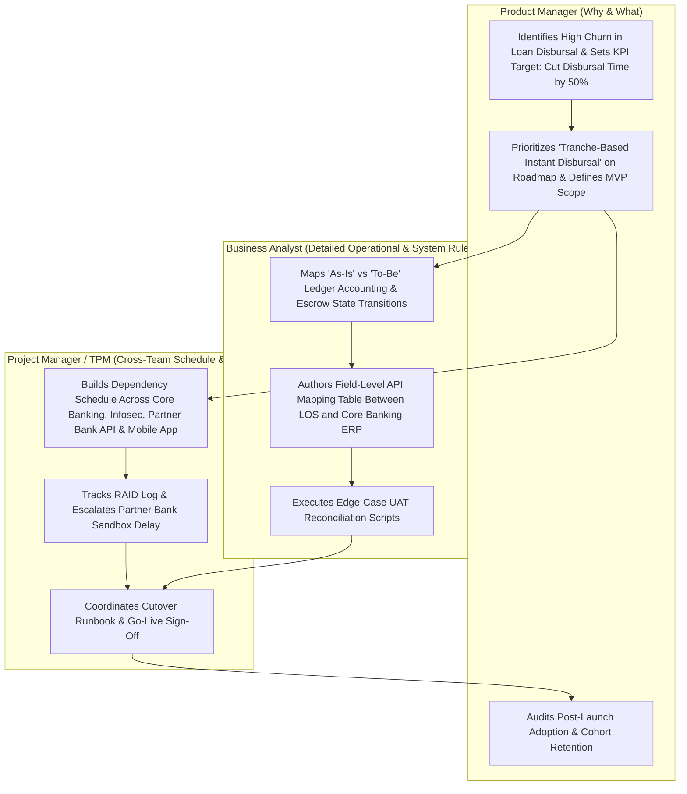

Across corporate job boards and technology organizations, few titles are mixed up as frequently as Product Manager (PM), Project Manager (PjM / TPM), and Business Analyst (BA). In some traditional banks or IT consulting firms, a job posted as "Product Manager" is actually 90% schedule tracking or internal requirements gathering. Conversely, in mid-sized software companies without dedicated project managers or business analysts, the Product Manager absorbs parts of all three roles.

However, in mature product engineering organizations, these three roles have fundamentally different north stars:

- **The Product Manager owns Value and Viability:** *"What problem should we solve, why does it matter to customers and unit economics, and what outcome must it achieve?"*
- **The Project Manager owns Delivery, Schedule, and Risk Execution:** *"How do we coordinate 4 teams, 12 dependencies, and a fixed deadline to ship this safely on time and within budget?"*
- **The Business Analyst owns Process Mapping, System Logic, and Data Rules:** *"How do current internal business operations, legacy database schemas, and accounting rules map to the new software system?"*

In this article, we compare all three roles side by side, map how they collaborate on the same software build without stepping on each other's toes, and outline how Business Analysts and Project Managers can transition into Product Management.

## The Product Manager: Continuous Lifecycle & Market Outcomes

A Product Manager manages a living asset (a product or platform surface) that has no fixed end date. As long as customers use the product, the PM continuously iterates on it to maximize adoption, retention, and monetization.

- **Primary Focus:** External customers, market positioning, product strategy, and outcome metrics.
- **Core Question:** *"Are we building the right thing to solve a high-value problem?"*
- **Key Authority:** Deciding which problems enter the roadmap and what scope cuts are acceptable to maximize user value per unit of engineering effort.

## The Project Manager: Temporary Endeavors & Predictable Delivery

According to the Project Management Institute (PMI), a project is a temporary endeavor undertaken to create a unique product, service, or result with a defined start and end date. Once the cloud migration is complete or the regulatory compliance integration goes live, the project closes.

- **Primary Focus:** Cross-team dependencies, critical path scheduling, resource allocation, budget burn rate, and risk registers.
- **Core Question:** *"Are we delivering the agreed scope on time, on budget, and without unmitigated blockers?"*
- **Modern Tech Equivalent:** In software companies, this role is often titled Technical Program Manager (TPM) or Delivery Manager, managing multi-squad dependencies (e.g., coordinating a platform migration across Mobile, Payments, Legal, and Infrastructure).

## The Business Analyst: Operational Rules & System Requirements

Guided by the International Institute of Business Analysis (IIBA / BABOK), a Business Analyst bridges internal business operations (finance, underwriting, supply chain, claims processing) and IT systems.

- **Primary Focus:** As-Is vs. To-Be process workflows (BPMN), detailed system rules, ledger/database field mappings, and edge-case business logic verification.
- **Core Question:** *"Do the detailed system specifications accurately reflect every operational rule, accounting constraint, and legacy system dependency?"*
- **Where BAs Shine:** Complex enterprise, fintech, banking, insurance, and ERP environments where a single transaction touches seven internal ledgers and strict regulatory state tables.

## Why Confusion Happens: Organizational Maturity Models

Role overlap depends heavily on the type of company:

- **Product-Led Tech Companies (e.g., SaaS, Consumer Apps):** Often do not employ Business Analysts or traditional Project Managers for single-squad work. The Product Manager writes the PRD and runs discovery, the Engineering Manager handles sprint delivery velocity, and a Technical Program Manager (TPM) is only brought in for massive cross-company initiatives.
- **Enterprise IT & Consulting Firms (e.g., System Integrators, Legacy Banks):** Often have large teams of BAs and Project Managers serving internal business stakeholders, where the "Product Manager" title was recently introduced during an "Agile transformation" without changing the underlying project-funding model.

## Master Comparison Matrix: PM vs. Project Manager vs. Business Analyst

| Dimension | Product Manager (PM) | Project Manager (PjM / TPM) | Business Analyst (BA) |
|---|---|---|---|
| **Core Mandate** | Maximize customer value and long-term business outcomes. | Deliver defined scope on schedule, within budget, and across dependencies. | Translate operational processes and business rules into exact system specs. |
| **Time Horizon** | Ongoing product lifecycle (continuous quarters/years). | Defined project start date to project sign-off/closure. | Project or sprint definition phase through UAT verification. |
| **Primary Stakeholders** | External users/buyers, Design, Engineering, Execs, GTM/Sales. | Engineering leads, external vendors, Legal, Security, Exec sponsors. | Internal operations teams, domain SMEs, QA engineers, database architects. |
| **Signature Deliverables** | Product strategy, Now/Next/Later roadmap, PRD, A/B test hypotheses. | Gantt / critical path plan, RAID log (Risks, Assumptions, Issues, Dependencies), burn report. | As-Is / To-Be BPMN process flows, BRD/FRD, data mapping tables, UAT test scripts. |
| **Success Metrics (KPIs)** | Activation, retention, conversion, NRR, unit economics (LTV:CAC). | On-time delivery %, budget variance, dependency resolution speed. | Requirement completeness, low defect leakage due to missed business rules, process efficiency. |
| **Biggest Failure Mode** | Shipping features on time that users ignore or that lose money. | Missing critical path dependencies causing a multi-month launch delay. | Overlooking an operational accounting or legacy field rule that corrupts production data. |

## Transition Gap Analysis: Moving into Product Management

| Current Role | Transferable Superpowers | Habits to Unlearn | Skills to Build & Demonstrate |
|---|---|---|---|
| **Business Analyst $\rightarrow$ PM** | Deep edge-case thinking, SQL/data literacy, structured documentation, UAT rigor. | Waiting for a stakeholder to tell you what they want and documenting it as an order-taker. | Market sizing, external user interviewing, competitive positioning, and saying "no" to low-ROI internal requests. |
| **Project Manager $\rightarrow$ PM** | Cross-functional communication, risk mitigation, stakeholder diplomacy, execution rhythm. | Optimizing for shipping any scope on a fixed date rather than questioning whether the scope drives user behavior. | Product sense, UX critique, funnel analytics, experimentation (A/B testing), and unit-economic modeling. |

## Collaboration Workflow on an Enterprise Feature

The following swimlane diagram illustrates how a Product Manager, Business Analyst, and Project Manager collaborate on an enterprise lending release without overlapping responsibilities:

## Practical Worked Example: Launching a Tranche-Based Loan Payment System

To see why these three roles are distinct, let's examine a hypothetical fintech company launching a Tranche-Based Used Car Loan Disbursal System (where 80% of the loan is paid immediately to the seller and 20% is held until vehicle registration transfer is verified).

### The Product Manager's Work
- Discovers through dealer interviews that dealers refuse to hand over vehicles until they receive at least 80% payment upfront, causing a 34% cancellation rate on approved loans.
- Sizes the opportunity: Reducing post-approval cancellation from 34% to 15% will generate ₹4.2 Crore in additional monthly disbursed volume.
- Defines the product experience: Dealers see a real-time "Tranche 1 Disbursed / Tranche 2 Pending Registration" status tracker in their app and can upload registration proof via mobile camera.

### The Business Analyst's Work
- Sits down with the Treasury and Accounting teams to document the exact ledger entries: How is interest accrued when 80% is disbursed on Day 1 and 20% on Day 14? What happens if the registration fails after 30 days and the 20% tranche must be canceled and adjusted against the borrower's EMI principal?
- Produces a 40-row state-transition and ledger-mapping table so the backend engineers don't break accounting reconciliation.

### The Project Manager's Work
- Maps the critical path across four separate teams: the Mobile App squad, the Loan Management System (LMS) team, the external Partner Bank escrow API team, and the Legal team updating the borrower loan agreement template.
- Identifies in Week 2 that the Partner Bank's UAT firewall whitelisting takes 10 business days, submitting the network request early so engineering testing isn't blocked in Week 4.

## Common Mistakes and Limitations

- **Hiring All Three Roles for a Small Startup:** In a small, agile squad building a consumer or lightweight SaaS product, having a PM, a BA, and a Project Manager creates massive communication overhead (a game of telephone between customer $\rightarrow$ PM $\rightarrow$ BA $\rightarrow$ Project Manager $\rightarrow$ Engineer). In small teams, one strong Product Manager and an Engineering Lead handle these responsibilities directly.
- **Treating BAs as "Junior PMs":** Business Analysis is a deep technical and operational craft in complex domains (banking, healthcare, logistics). A senior BA often knows more about regulatory state machines and ERP schemas than a PM; the roles are horizontal peers with different focus areas, not a strict hierarchy.
- **Measuring a PM by Project Management KPIs:** If leadership evaluates a Product Manager purely on *"Did the feature ship on October 30?"* rather than *"Did the feature reduce loan cancellation from 34% to 15%?"*, the PM will naturally stop doing discovery and turn into a schedule tracker.

## Practical Checklist: Auditing Which Role You Are Performing

- [ ] **Decision Authority:** If customer research proves a planned feature won't move the target KPI, do you have the authority to propose killing or pivoting it? *(Yes = PM / No = Project Manager or BA)*
- [ ] **Primary Counterpart:** Do you spend more time interviewing external customers and analyzing funnel telemetry (PM), mapping internal accounting/ERP rules (BA), or managing cross-team timelines and vendor dependencies (Project Manager)?
- [ ] **Success Evaluation:** At your annual performance review, are you graded on product adoption and revenue/retention metrics (PM), on-time/on-budget delivery (Project Manager), or requirement accuracy and process efficiency (BA)?

## Frequently Asked Questions

### Which role pays more: Product Manager, Project Manager, or Business Analyst?
In technology companies, Product Managers (and Technical Program Managers) generally command higher total compensation—particularly in equity/stock grants—because their role is tied directly to top-line revenue growth and product-market fit. However, specialized Senior Enterprise BAs (e.g., SAP/Core Banking architects) and PMP-certified Program Directors in finance or construction also earn high executive compensation.

### Can a Business Analyst become a Product Manager without coding skills?
Yes. BAs already possess strong analytical and requirement-structuring skills. The key to transitioning is shifting your portfolio stories from *"I gathered requirements from 5 internal stakeholders and wrote a 50-page BRD"* to *"I analyzed funnel drop-off data, identified a high-impact user problem, prioritized an MVP scope, and drove a 22% increase in conversion."*

### What is a Technical Program Manager (TPM) and how do they fit in?
A TPM is the technical evolution of a Project/Program Manager inside software engineering organizations. Unlike a generalist Project Manager, a TPM understands system architecture, API contracts, cloud infrastructure migrations, and security compliance, enabling them to coordinate complex technical programs across 5 to 20 engineering squads.

### Do Agile Scrum Masters replace Project Managers?
No. A Scrum Master coaches a single Agile team on Scrum practices and removes team-level impediments. A Project or Program Manager manages cross-team dependencies, budgets, vendor contracts, and executive timelines across multiple departments.

### Why do some job postings say "Product Manager / Business Analyst"?
This usually happens in mid-sized B2B, fintech, or enterprise software companies where the product has heavy domain logic (like tax rules, underwriting, or insurance claims), requiring the PM to perform both strategic discovery and detailed field-level requirement mapping.

## Next Steps and Recommended Reading

Understanding the distinction between Product Management (value and outcomes), Project Management (schedule and cross-team delivery), and Business Analysis (operational processes and system rules) eliminates friction on software teams and helps you target the right career path. Whether one person wears all three hats in a startup or three specialists collaborate in a regulated fintech enterprise, all three functions must be covered for complex software to succeed.

To explore role execution and career progression:

- See how a PM executes daily tasks in [What Does a Product Manager Do? Roles, Responsibilities and Daily Tasks](/blog/product/what-does-a-product-manager-do/).
- Read our foundational guide on [What Is Product Management? A Complete Beginner's Guide](/blog/product/what-is-product-management/).
- Follow the transition strategy in [How to Become a Product Manager: Skills, Portfolio and Career Roadmap](/blog/product/how-to-become-a-product-manager/).
- Explore our [Fintech & Financial Engineering Topic Hub](/topics/index.html) to understand loan origination and ledger state systems.

## About this guide

Aniket Thakur prepared this comparative analysis based on Project Management Institute (PMI) standards, the BABOK requirements engineering body of knowledge, and modern technology squad operating models checked on 24 October 2026. The Tranche-Based Used Car Loan Disbursal scenario in Section G is an explicitly labelled hypothetical worked example illustrating cross-functional collaboration.
