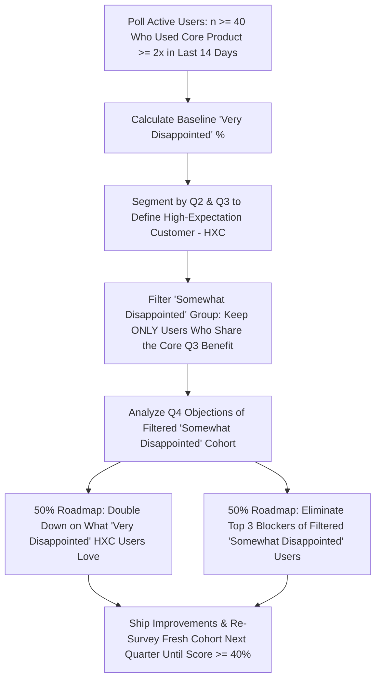

Coined by benchmark venture capitalist Andy Rachleff (drawing on Don Valentine's investment thesis at Sequoia) and popularized by Marc Andreessen, **Product-Market Fit (PMF)** means being in a good market with a product that can satisfy that market. For years, startup folklore claimed that Product-Market Fit could not be measured quantitatively—that *"you simply feel it when the servers start melting and customers bang down your door."* While runaway viral pull is unmistakable when it happens, telling a seed-stage product manager to "wait until you feel it" provides zero diagnostic guidance on how to get there—or how to tell whether early revenue growth is genuine market pull or an illusion fueled by unsustainable paid ads.

In reality, Product-Market Fit is measurable, multi-dimensional, and operationalizable. By combining three empirical lenses—**Behavioral Retention** (whether cohort retention curves flatten to a non-zero asymptote), **Attitudinal Necessity** (Sean Ellis's **40% "Very Disappointed" benchmark**, operationalized into a systematic engine by Superhuman CEO Rahul Vohra in [First Round Review](https://review.firstround.com/how-superhuman-built-an-engine-to-find-product-market-fit/)), and **Commercial Unit Economics** (whether customers pay and renew at healthy gross margins)—product teams can diagnose exactly how close they are to PMF and systematically close the gap. This article breaks down the three-pillar PMF scorecard, explains the step-by-step Superhuman PMF Engine, exposes common false-positive PMF traps, and works through a complete quantitative PMF re-segmentation model.

## 1. The Three Quantitative Pillars of True Product-Market Fit

No single metric proves Product-Market Fit in isolation; a viral consumer app can score high on a sentiment survey for three weeks and still go bankrupt if retention decays to zero, while a B2B tool can sign ten enterprise pilots through heavy founder discounts and lose 80% of them at Year-1 renewal. True PMF requires convergence across three pillars:

1. **Pillar 1 — Behavioral Retention (The Flattening Cohort Curve):** If you plot the percentage of a newly acquired user cohort that remains active over time (Day 1, Day 7, Day 30, Day 90, Day 180) ([Amplitude Retention Guide](https://amplitude.com/blog/product-metrics-guide)), a product **without** PMF exhibits a curve that slopes continuously downward until it hits $0\%$. A product **with** PMF exhibits a curve that drops initially during onboarding, and then **flattens horizontally (asymptotes)** at a stable plateau (e.g., $25\%\text{–}40\%$ for consumer apps; $70\%\text{–}90\%+$ logo retention for B2B SaaS)—proving a core group of users has formed an enduring habit.
2. **Pillar 2 — Attitudinal Necessity (The Sean Ellis 40% Rule):** Originated by **Sean Ellis** in July 2009 after benchmarking over 100 startups ([Sean Ellis PMF Guide](https://medium.com/growthhackers/using-product-market-fit-to-drive-sustainable-growth-58e9124ee8db) and [Siela PMF Survey Analysis](https://siela.in/blog-product-market-fit-survey)), the test asks active users who have experienced the core product at least twice in the past two weeks:  
   > *"How would you feel if you could no longer use [Product]?"*  
   > A) Very disappointed · B) Somewhat disappointed · C) Not disappointed  
   Companies that struggled to scale almost always scored $<40\%$ **Very Disappointed**, whereas companies with strong traction consistently cleared **$\ge 40\%$ Very Disappointed**.
3. **Pillar 3 — Commercial & Unit Economic Viability:** Customers must value the product enough to pay a price that exceeds Customer Acquisition Cost (CAC) and Variable Cost of Goods Sold (COGS / inference compute). In B2B SaaS, this manifests as **Net Revenue Retention (NRR) $> 100\%$**, **LTV:CAC $\ge 3.0\times$**, and efficient organic/word-of-mouth acquisition.

## 2. Operationalizing the Rahul Vohra / Superhuman 5-Step PMF Engine

In a landmark case study published in [First Round Review](https://review.firstround.com/how-superhuman-built-an-engine-to-find-product-market-fit/) (and further documented in [Siela's 40% Test Breakdown](https://siela.in/blog-product-market-fit-survey)), Superhuman founder **Rahul Vohra** demonstrated how to turn Sean Ellis's static 40% score into an iterative **Product-Market Fit Engine** that lifted Superhuman's score from **22% in summer 2017 to 33% via persona segmentation, and to 58% within three quarters**:

1. **Step 1 — Survey Qualified Active Users With Four Questions:** Send the survey to users who have used the core product at least twice in the last two weeks (directionally valid starting around $n \ge 40$ responses; Superhuman first polled 100–200 users):
   - *Q1:* "How would you feel if you could no longer use [Product]?" (*Very disappointed / Somewhat disappointed / Not disappointed*)
   - *Q2:* "What type of people do you think would most benefit from [Product]?" *(Happy users almost always describe themselves in their own words.)*
   - *Q3:* "What is the main benefit you receive from [Product]?"
   - *Q4:* "How can we improve [Product] for you?"
2. **Step 2 — Segment Respondents to Isolate Your "High-Expectation Customer" (HXC):** Analyze the personas inside the **Very Disappointed** group (using Q2). Exclude mismatched personas who signed up out of curiosity, and recalculate your PMF score strictly for your true target segments.
3. **Step 3 — Analyze What the "Very Disappointed" Users Love (Q3):** Identify the exact core benefit (for Superhuman, it was *speed, keyboard shortcuts, and triage efficiency*).
4. **Step 4 — Filter the "Somewhat Disappointed" Group by Shared Core Benefit:** Do **not** build features requested by *Not Disappointed* users (they are a lost cause), and do **not** listen to *Somewhat Disappointed* users who don't care about your core benefit. Instead, look **exclusively at the subset of "Somewhat Disappointed" users who named your exact core benefit in Q3**—because something small is holding them back from becoming fans! Analyze their Q4 answers (*"How can we improve?"*) to find their top objections (e.g., lack of a mobile app or calendar integration).
5. **Step 5 — Allocate Your Roadmap 50/50:** Dedicate **50% of engineering capacity** to doubling down on what the *Very Disappointed* users already love (increasing extreme delight), and **50% of capacity** to systematically eliminating the top objections of the *Somewhat Disappointed (Core-Benefit-Aligned)* users. Re-run the survey quarterly with new cohorts to track the score climbing past 40%.

## Frameworks and Comparison Tables

### Table 13.1: The Multi-Dimensional Product-Market Fit Scorecard Across Business Models

| PMF Dimension | B2C Consumer / Social / Subscription | B2B Product-Led Growth (PLG) SaaS | B2B Enterprise Sales-Led SaaS |
| :--- | :--- | :--- | :--- |
| **1. Sean Ellis Survey ($\ge 40\%$ Very Disappointed)** | **$\ge 40\%$** among users active $\ge 2\times$ in last 14 days ([First Round Review](https://review.firstround.com/how-superhuman-built-an-engine-to-find-product-market-fit/)) | **$\ge 40\%$** among active daily/weekly workspace operators | **$\ge 40\%$** among core end-users + champion referenceability |
| **2. Cohort Retention Asymptote** | Day-30 / Day-90 retention flattens at **$\ge 20\%\text{–}35\%$** (category-dependent) | Month-6 workspace retention flattens at **$\ge 65\%\text{–}80\%$** | Annual Gross Logo Retention **$\ge 90\%$**; Net Revenue Retention **$> 110\%$** |
| **3. Engagement / Stickiness** | $\text{DAU}/\text{MAU}$ ratio **$\ge 25\%\text{–}50\%$** (for daily habit apps) | Weekly active seats per account expanding organically | High feature utilization across contracted seats (>60% active) |
| **4. Commercial & Organic Pull** | $>50\%$ of new sign-ups arrive via organic search or word-of-mouth ($K\text{-factor}$ / referrals) | Free-to-Paid conversion **$\ge 3\%\text{–}7\%$**; CAC Payback **$< 12\text{ months}$** | Repeatable sales cycle with win rate **$\ge 25\%$** and LTV:CAC **$\ge 3.0\times$** |

### Table 13.2: Pre-PMF vs. Post-PMF Product Management Operating Rules

| Operational Area | Pre-Product-Market Fit (Searching for Value) | Post-Product-Market Fit (Scaling & Defending Value) |
| :--- | :--- | :--- |
| **Primary Strategic Goal** | Validate intense retention and willingness to pay in **1 narrow beachhead persona** | Scale distribution, reliability, adjacent workflows, and unit economics |
| **Discovery & Iteration Speed** | Rapid, high-variance pivots; weekly qualitative interviews and disposable prototypes | Controlled A/B testing (**Article 18**), guardrail protection, and backward compatibility |
| **Sales & Marketing Spend** | **Keep paid acquisition minimal** (avoid pouring water into a leaky bucket) | Scale paid acquisition, partnerships, and outbound sales once LTV:CAC is proven |
| **Engineering Architecture** | Optimize for learning speed and modularity over 10-year scale | Invest heavily in p99 latency, SOC2/security, automated testing, and technical debt |
| **Biggest Fatal Mistake** | Premature scaling (hiring 20 sales reps before the retention curve flattens) | Losing product-market fit when foundation technology (e.g., AI/LLMs) shifts the market |

## Visualizing the Framework

The following architecture diagram illustrates the workflow and decision criteria:

## Practical Worked Example

**Scenario (Hypothetical AI Code-Review Assistant — *PR-Guardian*):**  
You run the Sean Ellis PMF survey across **$N = 200$ active users** who used *PR-Guardian* on at least two pull requests in the past 14 days.

**Step 1 — Raw Unsegmented Survey Results ($N = 200$):**
- **Very Disappointed:** $52\text{ users}$ ($\mathbf{26.0\%}$ — *Below the $40\%$ PMF threshold*)
- **Somewhat Disappointed:** $96\text{ users}$ ($48.0\%$)
- **Not Disappointed:** $52\text{ users}$ ($26.0\%$)

**Step 2 — Segment by Persona to Isolate the High-Expectation Customer (HXC):**  
Inspecting Q2 and account metadata reveals your 200 respondents span three very different personas:
1. **Persona 1 — Full-Stack Startup Tech Leads ($n = 90$):** $38$ answered *Very Disappointed* ($\mathbf{42.2\%}$), $42$ answered *Somewhat Disappointed* ($46.7\%$), $10$ answered *Not Disappointed* ($11.1\%$).
2. **Persona 2 — Mid-Market Backend Staff Engineers ($n = 60$):** $12$ answered *Very Disappointed* ($\mathbf{20.0\%}$), $34$ answered *Somewhat Disappointed* ($56.7\%$), $14$ answered *Not Disappointed* ($23.3\%$).
3. **Persona 3 — Hobbyist / Student Solo Coders ($n = 50$):** $2$ answered *Very Disappointed* ($\mathbf{4.0\%}$), $20$ answered *Somewhat Disappointed* ($40.0\%$), $28$ answered *Not Disappointed* ($56.0\%$).

By excluding **Persona 3 (Hobbyist/Students)**—who have no team code-review bottleneck and were dragging the aggregate score down—your core B2B professional population ($N_{\text{B2B}} = 90 + 60 = 150\text{ users}$) has:
$$\text{Segmented B2B PMF Score} = \frac{38 + 12}{150} = \frac{50}{150} = \mathbf{33.3\%}\text{ (Up from }26.0\%\text{, needing }+10\text{ converted users to hit }40.0\%)$$

**Step 3 — Filter the "Somewhat Disappointed" B2B Users by Core Benefit (Q3 & Q4):**  
- Among the $50$ *Very Disappointed* B2B users, $88\%$ named **"Automated detection of subtle SQL/concurrency bugs before merge"** as their #1 benefit (Q3).
- Among the $76$ *Somewhat Disappointed* B2B users ($42 + 34$), **$48\text{ users}$ ($63\%$) also named "Automated bug detection"** as their favorite benefit, while $28\text{ users}$ wanted a generic code formatter.
- Looking at Q4 (*"How can we improve?"*) solely for those **$48$ core-benefit-aligned Somewhat Disappointed users**, two blockers account for $79\%$ of complaints:
  1. *Blocker 1 ($24\text{ users}$):* Noise from false-positive style comments cluttering GitHub PR threads.
  2. *Blocker 2 ($14\text{ users}$):* Review latency exceeding 4 minutes on large monorepo PRs.

**Step 4 — Two-Quarter Roadmap Execution & Resulting PMF Lift:**  
The squad allocates 50% of Q3 capacity to enhancing deep concurrency/security detection (delighting the fans) and 50% to shipping a **High-Confidence-Only Filter** (eliminating false-positive noise) and **Incremental Diff Caching** (cutting review latency from 4 mins to 28 seconds). In Q4, polling a fresh cohort of $150$ B2B users converts half of the aligned *Somewhat Disappointed* segment ($+24\text{ users}$), lifting the B2B PMF score to:
$$\text{New B2B PMF Score} = \frac{50 + 24}{150} = \frac{74}{150} = \mathbf{49.3\%}\text{ (Exceeding the }40\%\text{ threshold)}$$

## Common Mistakes and Limitations

1. **Confusing Paid-Ad Growth or Token Subsidies with Product-Market Fit:** If a startup spends \$150 in Facebook/Google ads (or subsidizes \$50/month of free LLM API credits) to acquire a user who generates \$40 in lifetime gross profit, high top-line signup growth is an optical illusion. Always evaluate retention and PMF on **unsubsidized cohorts and gross-margin-adjusted unit economics**.
2. **Polling Users Too Early (Before They Experience the Core Loop):** Sending the Sean Ellis survey to someone 5 minutes after they create an account measures onboarding confusion, not Product-Market Fit. Only survey users who have completed the core value loop at least twice inside the last 14 days ([Siela PMF Survey Guide](https://siela.in/blog-product-market-fit-survey)).
3. **Treating Product-Market Fit as Permanent Once Achieved:** As Rahul Vohra noted when discussing AI-native productivity shifts ([Product School Podcast](https://productschool.com/resources/product-podcast/rahul-vohra-superhuman-pmf-engine-ai-native)), markets and customer expectations evolve. A product that had strong PMF in 2021 can lose PMF in 2026 if foundation models or new regulatory standards raise the baseline bar of what customers expect.

## Practical Implementation Checklist

- [ ] **Pre-Build Demand Verification:** Before writing code, did we validate active buyer search intent using a structured query framework ([Why Market Validation Trumps Vibes](https://07anishu12.github.io/learnings.html))?
- [ ] **Cohort Asymptote Check:** Does our Day-30 / Day-90 / Month-6 cohort retention curve flatten into a stable horizontal plateau rather than sloping continuously toward zero?
- [ ] **Sean Ellis Survey ($n \ge 40$):** Have we surveyed at least 40 active users (who completed the core loop $\ge 2\times$ in the past 2 weeks) and segmented the **Very Disappointed** percentage by persona?
- [ ] **Filtered Objection Roadmap:** Are we prioritizing the Q4 objections of **Somewhat Disappointed users who love our core benefit** while ignoring feature requests from *Not Disappointed* users?
- [ ] **Unit Economics Sanity Check:** Is our gross margin positive after hosting and AI inference costs, and is our CAC payback period trending inside sustainable bounds?

## Frequently Asked Questions

### 1. Why is the Sean Ellis Product-Market Fit threshold specifically 40% and not 50% or 70%?
The **40% benchmark** is an empirical threshold discovered by Sean Ellis in 2009 after comparing identical survey distributions across roughly 100 startups ([First Round Review](https://review.firstround.com/how-superhuman-built-an-engine-to-find-product-market-fit/)). Startups that scored below 40% "Very Disappointed" consistently struggled to sustain organic growth and retention, whereas startups at or above 40% exhibited durable retention and compounding word-of-mouth traction. It is a directional benchmark, not a law of physics—combining it with cohort retention curves provides full confidence.

### 2. How many survey responses do you need for the 40% PMF test to be valid?
Per Rahul Vohra's documentation ([Siela PMF Guide](https://siela.in/blog-product-market-fit-survey)), results become directionally meaningful starting at **around 40 qualified responses**, and reach solid statistical stability at **100 to 200+ responses**. If your early B2B startup only has 15 active corporate accounts total, supplement the survey across multiple seats per account with deep 1-on-1 retention interviews and renewal intent audits.

### 3. Why is the Sean Ellis 40% test better than Net Promoter Score (NPS) for measuring Product-Market Fit?
**Net Promoter Score (NPS)** asks a speculative social question (*"How likely are you to recommend us to a friend or colleague?"*), which suffers from polite inflation and reluctance to spam colleagues in B2B contexts. The Sean Ellis question (*"How would you feel if you could no longer use the product?"*) measures **perceived loss and workflow dependency** directly, making it a much tighter leading indicator of retention and churn.

### 4. What does it mean if our cohort retention curve flattens, but it flattens at only 8%?
If your cohort retention curve flattens horizontally at 8%, you have achieved **Product-Market Fit with a tiny 8% sub-segment of your sign-ups**—meaning either (a) your top-of-funnel marketing is attracting 92% mismatched personas, or (b) your onboarding activation flow (**Article 17**) is failing to guide new users to the "Aha! Moment." Run persona segmentation (as shown in Section G) to discover who those 8% retained users are and why they stayed.

### 5. How do you measure Product-Market Fit in low-frequency products (like tax filing, real estate, or travel booking)?
In products with natural annual or quarterly usage cycles, $\text{DAU}/\text{MAU}$ and 14-day active windows are inappropriate. Instead, match your retention interval to the **natural frequency of the underlying Job to Be Done** (e.g., Year-over-Year tax filing retention or 90-day repeat booking rate), combined with the Sean Ellis survey triggered within 7 days of completing a transaction and organic referral rate.

### 6. What should a Product Manager do if the team's PMF score is stuck at 15% after two quarters of iteration?
If six months of disciplined iteration fail to move your PMF score above 15%–20% and cohort retention continues decaying toward zero, incremental UI polish will not save the product. You must execute a **Zoom-Out / Segment or Problem Pivot** (**Article 15**, **Article 22**)—returning to customer discovery (**Article 11**) to find a more acute, underserved problem before burning through remaining runway.

## Next Steps and Recommended Reading

Product-Market Fit is the ultimate dividing line in a product's lifecycle: before PMF, your single job is to find a narrow segment of users who would be *very disappointed* without your core value proposition and whose cohort retention flattens into a durable habit; after PMF, your job is to scale and defend that value engine.

**Practical Next Step:** Deploy the 4-question Sean Ellis survey this week to users who have completed your core product action at least twice in the past 14 days, and plot your 90-day cohort retention curve side by side to establish your honest baseline.

**Recommended Follow-Up Reading:** Continue to **Article 14: Product Design for PMs: Wireframes, Prototypes and Usability Testing** (`/blog/product/product-design-for-pms-wireframes-prototypes-usability-testing/` — *Planned Destination*) to learn how to prototype and usability-test the workflow improvements that drive your PMF score past 40%.

## About this guide

Aniket Thakur prepared this comprehensive Product Management guide based on continuous discovery frameworks, operational research, and practitioner benchmarks checked on 24 October 2026. All quantitative scenarios in Section G are explicitly labelled hypothetical worked examples illustrating decision math.
