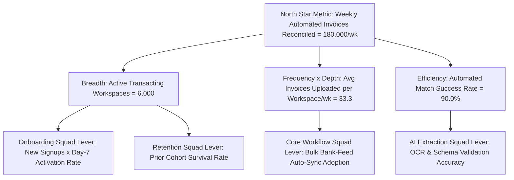

A product manager who cannot decompose their product's behavioral telemetry mathematically is flying blind. Yet many product dashboards are cluttered with **vanity metrics**—cumulative app downloads, total registered accounts since 2022, or raw pageviews—that go up and to the right every week even as active user retention silently collapses. Conversely, relying solely on top-line financial accounting metrics like Annual Recurring Revenue (ARR) gives product squads a lagging indicator that reacts months after a bad product release has already alienated customers.

As codified in [Amplitude's North Star Framework](https://amplitude.com/north-star-hub) and [Google Analytics 4 (GA4) Engagement Documentation](https://support.google.com/analytics/?hl=en), world-class product analytics connects **customer value delivery** to **sustainable business revenue** through a structured **Metric Tree**. At the apex sits the **North Star Metric (NSM)**—a single leading indicator that captures the exact moment users realize core value from the product—supported underneath by controllable squad-level **Input Metrics** across Acquisition, Activation, Engagement ($\text{DAU}/\text{MAU}$), Retention, and Monetization. This guide defines the exact mathematical formulas for every foundational product metric, contrasts the three types of cohort retention (N-Day, Unbounded, and Bracket), explains how to build a decomposed Metric Tree, and walks through a complete quantitative growth-accounting and retention audit.

## 1. The North Star Metric (NSM) and Its Four Input Levers

Per [Amplitude's North Star Playbook](https://amplitude.com/books/north-star/about-north-star-framework) (and [What Makes a Good vs. Bad North Star Metric](https://amplitude.com/blog/good-bad-north-star-metric)), a valid **North Star Metric** must satisfy three strict criteria: (1) it must measure the **moment the customer receives core value** (not merely opening the app or paying an invoice), (2) it must lie within the **product and engineering team's direct sphere of influence**, and (3) it must act as a **leading indicator of long-term revenue and retention**.

Why is "Monthly Revenue (MRR)" a poor North Star Metric for a product squad? Because a squad can temporarily boost short-term MRR by hiding the "Cancel Subscription" button or raising prices 30% overnight—actions that destroy customer trust and cause churn two quarters later. Instead, choose a North Star aligned with your product's **Core Engagement Game**:
- **Attention Game (Media / Streaming / Social):** *Total hours of engaged streaming per week* or *Daily active creators publishing content*.
- **Transaction Game (E-Commerce / Fintech / Ride-Sharing):** *Weekly completed cross-border settlements* or *Monthly rides completed without cancellation*.
- **Productivity Game (B2B SaaS / Developer Tools / Analytics):** *Weekly active teams completing $\ge 5$ automated workflows* or *Weekly queries executed returning verified insights* ([Amplitude Defining Your North Star](https://amplitude.com/books/north-star/defining-your-North-Star)).

To make the North Star actionable for individual squads, decompose it mathematically into **Four Input Levers**:
1. **Breadth:** How many new and returning users/workspaces enter the active loop?
2. **Depth:** How deeply does each user engage per session (e.g., features adopted or team seats invited)?
3. **Frequency:** How often does each user return to complete the core action per week/month?
4. **Efficiency / Speed:** What percentage of initiated attempts succeed rapidly without error?

## 2. Exact Mathematical Formulas for Core Product Metrics

Every Product Manager must know these exact definitions and formulas cold—both for building SQL/BI dashboards ([Topical Knowledge Hubs — Data Science & BI](https://07anishu12.github.io/topics/index.html)) and for answering analytical interview cases (**Article 21**, **Article 24**):

1. **Active Users ($\text{DAU}$, $\text{WAU}$, $\text{MAU}$) & Stickiness Ratio:**  
   Crucially, "Active" must **never** be defined as *"logged in or loaded the homepage."* Define **Active User** as a unique user who completes at least one meaningful value event within the window (1 day, 7 days, or 30 days):
   $$\text{Stickiness Ratio} = \frac{\text{DAU (Daily Active Users)}}{\text{MAU (Monthly Active Users)}} \times 100\%$$
   *(Interpretation: A $\text{DAU}/\text{MAU}$ ratio of $20\%$ means the average monthly active user engages on $0.20 \times 30 = \mathbf{6\text{ days per month}}$. Consumer social/messaging apps target $50\%\text{–}70\%+$; B2B daily workflow SaaS targets $25\%\text{–}45\%$ when measured on working weekdays).*

2. **The Three Mathematical Variants of Cohort Retention ([Amplitude Metrics Guide](https://amplitude.com/blog/product-metrics-guide)):**  
   Given a starting cohort of $N_0$ users who performed their first key action on **Day 0**:
   - **Classic N-Day (Exact-Day) Retention:** The percentage of $N_0$ who return and perform a value action on **exact Day $k$** (e.g., Day 7 = 7 days after signup):  
     $$\text{N-Day Retention}_k = \frac{\text{Users from } N_0 \text{ active on exact Day } k}{N_0}$$
     *(Best for high-frequency daily habit products like mobile games or consumer messaging).*
   - **Bracket (Bounded Window) Retention:** The percentage of $N_0$ who return at least once within a multi-day interval bucket (e.g., Week 2 = Days 8–14; Month 2 = Days 31–60):  
     $$\text{Bracket Retention}_{[t_1, t_2]} = \frac{\text{Users from } N_0 \text{ active at least once in } [t_1, t_2]}{N_0}$$
     *(Best for weekly or monthly B2B SaaS workflows and fintech platforms).*
   - **Unbounded (Rolling / Return-On-or-After) Retention:** The percentage of $N_0$ who return on **Day $k$ or any day after Day $k$**:  
     $$\text{Unbounded Retention}_k = \frac{\text{Users from } N_0 \text{ active on any day } t \ge k}{N_0}$$
     *(Mathematically equal to $1 - \text{True Permanent Churn}_k$; best for low-frequency products).*

3. **Growth Accounting & The SaaS Quick Ratio:**  
   Any change in Monthly Active Users ($\Delta \text{MAU}$) or Monthly Recurring Revenue ($\Delta \text{MRR}$) obeys the conservation identity:
   $$\Delta \text{MAU}_t = \underbrace{\text{New Users}_t + \text{Resurrected Users}_t}_{\text{Gross Inflows}} - \underbrace{\text{Churned Users}_t}_{\text{Gross Outflows}}$$
   $$\text{User Quick Ratio} = \frac{\text{New Users}_t + \text{Resurrected Users}_t}{\text{Churned Users}_t}$$
   *(A Quick Ratio $= 1.0$ means the product is treading water; healthy growth requires a Quick Ratio $> 1.5\text{–}2.0$ for consumer users and $> 3.0\text{–}4.0$ for B2B SaaS MRR).*

4. **Net Revenue Retention (NRR) vs. Gross Revenue Retention (GRR):**
   $$\text{NRR} = \frac{\text{Starting ARR} + \text{Expansion ARR} - \text{Contraction ARR} - \text{Churned ARR}}{\text{Starting ARR}} \times 100\%$$
   $$\text{GRR} = \frac{\text{Starting ARR} - \text{Contraction ARR} - \text{Churned ARR}}{\text{Starting ARR}} \times 100\%\quad (\text{Bounded }\le 100\%)$$

## Frameworks and Comparison Tables

### Table 17.1: Vanity Metrics vs. Actionable Product Metrics Across the Pirate (AARRR) Funnel

| Funnel Stage | Vanity Metric (Misleading / Unactionable) | Actionable Product Metric (Formula & Decision Enabled) |
| :--- | :--- | :--- |
| **1. Acquisition** | Cumulative lifetime downloads or raw site hits | **Qualified Signup Conversion Rate** ($\frac{\text{Verified ICP Signups}}{\text{Unique Visitors}}$) by channel |
| **2. Activation** | Total registered user accounts in database | **Day-7 Habit Activation Rate** ($\frac{\text{Signups completing core value loop within 7d}}{\text{Total New Signups}}$) |
| **3. Engagement** | Average session time (inflated when users get confused!) | **North Star Metric & Stickiness** ($\text{DAU}/\text{MAU}$) + **Task Completion Efficiency** |
| **4. Retention** | Aggregate MAU count (hides high churn under paid ad spend) | **Cohort Bracket Retention** (Week 4 / Month 3 plateau) & **Gross Logo Retention** |
| **5. Monetization** | Gross Transaction Volume (GMV) with negative take-rate margin | **Net Revenue Retention (NRR)**, **Gross-Margin-Adjusted LTV:CAC**, & **CAC Payback Months** |

### Table 17.2: North Star Metric & Input Tree Examples Across Four Product Archetypes

| Product Archetype | **North Star Metric (NSM)** | **Breadth Input** | **Depth Input** | **Frequency Input** | **Efficiency Input** |
| :--- | :--- | :--- | :--- | :--- | :--- |
| **B2B Collaborative Analytics SaaS** | **Weekly Active Querying Teams** ($\ge 3$ members viewing/running charts) | # of active workspaces + Day-7 onboarding activation % | Avg seats invited & dashboards created per workspace | Avg days per week a team member views a live dashboard | % of queries returning results in $<1.5\text{s}$ without SQL error |
| **B2B Fintech Payment Gateway** | **Monthly Successfully Settled Merchant Transactions** | # of live transacting merchant accounts | Avg payment methods (UPI, Card, NetBanking) enabled per merchant | Transactions initiated per active merchant per month | End-to-end payment authorization & settlement success rate % |
| **Two-Sided Food / Grocery Delivery** | **Weekly Orders Delivered On-Time & Defect-Free** | Monthly active ordering households | Avg basket size (items per order) & merchant selection breadth | Orders placed per active customer per month | % of orders delivered within promised ETA with zero missing items |
| **AI Coding / Workflow Copilot** | **Weekly Accepted & Retained AI Code/Action Completions** | Weekly active developers with extension enabled | Lines/tasks assisted per active session | Active coding sessions per developer per week | **Acceptance Rate %** (completions kept in code $>24\text{h}$ without revert) |

## Visualizing the Framework

The following architecture diagram illustrates the workflow and decision criteria:

## Practical Worked Example

**Scenario (Hypothetical Prosumer AI Productivity App — *NoteGenius*):**  
The CEO of *NoteGenius* celebrates at the monthly all-hands because **Monthly Active Users ($\text{MAU}$) grew from $50,000$ in January to $58,000$ in April ($+16\%$) follow-on growth**. However, as the newly hired Product Manager, you decompose the underlying **Growth Accounting, Stickiness, and Cohort Retention tables** to verify whether the product is genuinely healthy.

**Step 1 — Decomposing April's Growth Accounting & User Quick Ratio:**  
Querying the April event database reveals how $\text{MAU}$ moved from March ($\text{MAU}_{\text{Mar}} = 55,000$) to April ($\text{MAU}_{\text{Apr}} = 58,000$):
- **New Activated Users in April (driven by a \$120k paid influencer blitz):** $+18,000$
- **Resurrected Users in April:** $+2,000$
- **Churned Users in April (Active in March, 0 sessions in April):** $-17,000$ ($30.9\%$ monthly logo churn!)
- **Net $\Delta \text{MAU}$:** $+18,000 + 2,000 - 17,000 = +3,000$ ($\text{MAU}_{\text{Apr}} = 58,000$).
- **Calculating the User Quick Ratio:**
  $$\text{Quick Ratio}_{\text{Apr}} = \frac{\text{New} + \text{Resurrected}}{\text{Churned}} = \frac{18,000 + 2,000}{17,000} = \frac{20,000}{17,000} = \mathbf{1.18\times}$$
  *Finding 1:* A Quick Ratio of **$1.18\times$** with $30.9\%$ monthly churn proves *NoteGenius* is a **leaky bucket**: the moment marketing pauses the \$120k monthly ad spend, $\text{MAU}$ will collapse by ~30% per month!

**Step 2 — Comparing Classic N-Day vs. Bracket vs. Unbounded Retention on the January Cohort ($N_0 = 10,000$ Signups):**
- **Users active on exact Day 30:** $420\text{ users} \rightarrow \text{Exact Day-30 Retention} = \mathbf{4.2\%}$.
- **Users active at least once during Month 2 (Days 31–60):** $1,450\text{ users} \rightarrow \text{Month-2 Bracket Retention} = \mathbf{14.5\%}$.
- **Users active at least once during Month 3 (Days 61–90):** $810\text{ users} \rightarrow \text{Month-3 Bracket Retention} = \mathbf{8.1\%}$ *(Curve has not flattened; decaying by ~44% per month).*
- **Users active on Day 30 or any day after Day 30 (Unbounded Day-30):** $1,720\text{ users} \rightarrow \text{Unbounded Retention}_{30} = \mathbf{17.2\%}$ (meaning **$82.8\%$ of the January cohort is permanently dead** after just 30 days).

**Step 3 — Multiplicative North Star Input Leverage Modeling:**  
Currently, the North Star Metric (**Weekly AI Summaries Saved & Shared**) equals:
$$\text{NSM}_0 = \text{WAU (14,500)} \times \text{Attempts/WAU (2.5)} \times \text{Completion Success Rate (64\%)} = \mathbf{23,200\text{ summaries/week}}$$
Instead of spending another \$120k on top-of-funnel ads, you reallocate Q3 product capacity to two retention & efficiency levers:
1. Fixing LLM timeout errors lifts **Completion Success Rate** from $64\%$ to **$85\%$** ($+32.8\%$ relative lift).
2. Adding an automated Calendar Meeting Bot lifts **Weekly Active Users ($\text{WAU}$)** from $14,500$ to **$19,000$** ($+31.0\%$ lift) and **Attempts/WAU** from $2.5$ to **$3.2$** ($+28.0\%$ lift).
$$\text{New NSM}_1 = 19,000 \times 3.2 \times 0.85 = \mathbf{51,680\text{ summaries/week}}\ (+122.8\%\text{ compound lift without increasing ad spend})$$

## Common Mistakes and Limitations

1. **Defining "Active User" as Any App Open or Login:** If an angry customer logs insolely to download their past invoices and cancel their account, a naive tracker counts them as an "Active User" for that month! Always anchor $\text{DAU}/\text{MAU}$ and Retention in a **verified core value event** (e.g., `query_executed`, `transaction_settled`, `document_exported`).
2. **Averaging Retention Across All Cohorts into a Single Blended Number:** A single blended retention percentage hides whether your product improvements over the last three months actually made the product better for new users. Always plot **triangular cohort retention tables by signup week/month** so you can compare whether the October cohort retains at a higher Day-7 rate than the July cohort.
3. **Goodhart's Law ("When a Measure Becomes a Target, It Ceases to Be a Good Measure"):** Every single metric can be gamed if tracked without a guardrail counter-metric (**Article 10**). Always pair engagement/conversion metrics with quality, latency, and churn guardrails.

## Practical Implementation Checklist

- [ ] **North Star Criteria Check:** Does our North Star Metric measure customer value realization rather than raw revenue or superficial pageviews?
- [ ] **Mathematical Tree Decomposition:** Have we decomposed our North Star Metric into mutually exclusive, collectively exhaustive (MECE) input levers across Breadth, Depth, Frequency, and Efficiency?
- [ ] **Value-Event Active Definition:** Is our definition of $\text{DAU}/\text{WAU}/\text{MAU}$ tied strictly to completing a core value action rather than loading a page or receiving a push notification?
- [ ] **Right Retention Formula Selected:** Are we using **Bracket Retention** for weekly/monthly workflows, **N-Day Retention** for daily habits, and **Unbounded Retention** for churn audits?
- [ ] **Growth Accounting Separation:** Does our executive dashboard separate **New**, **Retained**, **Resurrected**, and **Churned** users via the Quick Ratio so paid acquisition never masks churn?

## Frequently Asked Questions

### 1. Can a company have more than one North Star Metric?
A single product line or business unit should have **one overarching North Star Metric** so that Product, Design, Engineering, and Growth align around a single shared equation ([Amplitude North Star Hub](https://amplitude.com/north-star-hub)). Only a multi-product conglomerate operating completely independent business models (for example, Uber Rides vs. Uber Freight, or Atlassian Jira vs. Trello) should maintain separate North Star Metrics per business unit—and even then, each individual product squad owns a specific **Input Metric** on that unit's tree rather than inventing an isolated North Star.

### 2. How did Google Analytics 4 (GA4) change the definition of "Bounce Rate" and "Engagement Rate"?
In legacy Universal Analytics, a user who clicked a blog article, read every word for 4 minutes, found their exact answer, and closed the tab without clicking a second page was counted as a $100\%$ "Bounce"! Per [Google Analytics 4 Official Documentation](https://support.google.com/analytics/?hl=en) (and [GA4 Engagement Metrics Guide](https://www.mbadv.agency/google-analytics-4/engagement-and-user-metrics)), GA4 replaced that flawed definition with **Engaged Sessions**—defined as any session that **lasts longer than 10 seconds (configurable up to 60 seconds), has a key conversion event, or has $\ge 2$ page/screen views**. In GA4, $\text{Engagement Rate} = \frac{\text{Engaged Sessions}}{\text{Total Sessions}}$, and $\text{Bounce Rate}$ is simply the mathematical inverse ($100\% - \text{Engagement Rate}$).

### 3. What is a good DAU/MAU Stickiness ratio benchmark?
Benchmarks depend entirely on the natural frequency of the customer's Job to Be Done:
- **Daily Communication / Social / Messaging Apps (WhatsApp, Slack):** $50\%\text{ to }80\%+$
- **B2B Daily SaaS Workflows (Issue Trackers, CRM, IDE Copilots):** $25\%\text{ to }45\%$ (Note: because B2B users work 5 days a week—roughly 21–22 workdays per 30-day month—the theoretical ceiling for a weekday-only B2B tool is $\approx 72\%$, or compute **Workday Stickiness** excluding weekends).
- **E-Commerce / On-Demand Delivery:** $10\%\text{ to }20\%$
- **Travel / Tax / Mortgage Platforms:** $\text{DAU}/\text{MAU}$ is the wrong metric; track quarterly or annual repeat transaction retention instead.

### 4. Why can Net Revenue Retention (NRR) exceed 100%, and why do B2B investors obsess over it?
**Gross Revenue Retention (GRR)** cannot exceed $100\%$ because it only measures how much of last year's starting ARR was retained after downgrades and churn. **Net Revenue Retention (NRR)** includes **Expansion ARR** (existing customers buying more seats, higher usage tiers, or cross-sell modules). If a B2B SaaS company has **$\text{NRR} = 120\%$**, its existing customer base grows by $20\%$ every year automatically—even if the sales team signs zero new logos!

### 5. What is the "Aha! Moment" (or Activation Metric), and how do you find it mathematically?
The **Aha! Moment** is the specific early behavioral threshold (e.g., *"A new workspace that connects a data source and shares 1 chart with a colleague within 72 hours of signup"*) where a user experiences core value for the first time. To find it mathematically, plot a $2 \times 2$ contingency matrix comparing early behaviors (Days 1–7) against long-term retention (Month 3 Retained vs. Churned), maximizing both **Precision/Lift** (users who complete Action $X$ retain at $3\times$ the baseline rate) and **Recall/Coverage** (a large proportion of retained users completed Action $X$), then validate causality via an A/B experiment (**Article 18**).

### 6. How should I organize an Event Taxonomy so our analytics database doesn't become a mess?
Enforce a strict **`object_action` snake_case naming convention** documented in a shared tracking plan (e.g., `invoice_created`, `invoice_pdf_downloaded`, `webhook_replay_clicked`) paired with standardized **Event Properties** (`account_tier`, `user_role`, `latency_ms`, `source_screen`). Never create separate event names for property variations (use `button_clicked` with property `location: header` rather than `header_blue_button_clicked_v2`).

## Next Steps and Recommended Reading

Product metrics are the sensory nervous system of a product organization. By anchoring your team in a value-based **North Star Metric**, decomposing it into controllable **Breadth, Depth, Frequency, and Efficiency inputs**, and tracking **Cohort Retention and Quick Ratios** instead of vanity aggregates, you gain the mathematical clarity to invest engineering effort where it compounds fastest.

**Practical Next Step:** Draw your product's **North Star Metric Tree** on a single page today (following the exact structure in **Section F**), plug in last month's actual numbers for each node, and identify which single input lever has the largest gap against benchmark.

**Recommended Follow-Up Reading:** Now that your metric tree and event taxonomy are defined, proceed to **Article 18: A/B Testing for Product Managers: Hypotheses, Sample Size and Results** (`/blog/product/ab-testing-for-product-managers/` — *Planned Destination*) to learn how to prove causal metric lifts with statistical rigor.

## About this guide

Aniket Thakur prepared this comprehensive Product Management guide based on continuous discovery frameworks, operational research, and practitioner benchmarks checked on 24 October 2026. All quantitative scenarios in Section G are explicitly labelled hypothetical worked examples illustrating decision math.
