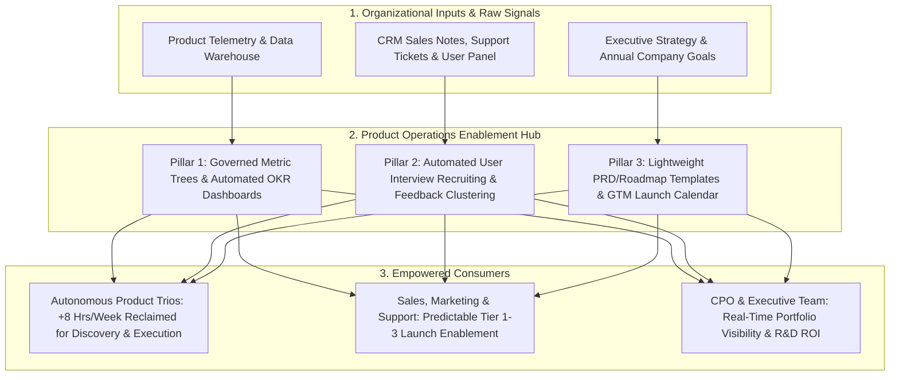

When a startup has two Product Managers sitting beside ten engineers in a single room, alignment happens organically over coffee. Fast-forward two years: the company now has **15 Product Managers across 15 squads, 110 engineers, and 80 sales and support staff**. Suddenly, chaos sets in. Squad A tracks roadmaps in a private spreadsheet while Squad B uses [Linear](https://linear.app/pricing) and Squad C uses [Jira](https://www.atlassian.com/software/jira/pricing); three different PMs accidentally spam the exact same enterprise customer for user interviews in the same week; the CEO receives 15 incompatible slide decks before every quarterly board meeting; and each PM wastes 9 hours a week writing manual SQL extracts and chasing cross-team launch checklists.

This scaling inflection point is why **Product Operations (Product Ops)** emerged as a vital function in modern technology organizations. Pioneered at scale-ups like Stripe, Uber, and Amplitude—and codified by Melissa Perri and Denise Tilles in *Product Operations* ([Melissa Perri Official Book Hub](https://melissaperri.com/book)) alongside Marty Cagan's [Product Operating Model at SVPG](https://www.svpg.com/the-product-operating-model-an-introduction/)—**Product Operations is the operational enablement function that equips Product Managers and Product Leaders with clean quantitative telemetry, frictionless customer research access, standardized tooling, and synchronized strategic cadences so squads can focus on high-leverage discovery and delivery**. This capstone article defines the three core pillars of Product Ops, distinguishes high-leverage enablement from bureaucratic "process policing," establishes exact headcount thresholds for hiring your first Product Ops Manager, and walks through a quantitative ROI model for a 15-PM organization.

## 1. The Three Core Pillars of Modern Product Operations

Just as Sales Operations (RevOps) empowers Account Executives with CRM hygiene, territory routing, and pipeline analytics, and DevOps/Platform Engineering empowers developers with automated CI/CD pipelines, **Product Operations** serves the product organization across three distinct pillars:

1. **Pillar 1 — Quantitative Data, Telemetry & Business Insights:**  
   Instead of leaving 15 PMs to write conflicting SQL definitions of "Active Workspace" or "Net Revenue Retention" (**Article 17**), Product Ops partners with Data Engineering and BI ([Topical Knowledge Hubs — Data Science & BI](https://07anishu12.github.io/topics/index.html)) to govern a **Single Source of Truth Event Taxonomy**, maintain automated self-serve KPI and OKR dashboards, and standardize A/B test readout templates (**Article 18**).
2. **Pillar 2 — Qualitative Customer Research & Market Feedback Infrastructure (Research Ops):**  
   Recruiting B2B interview participants, managing incentive gift cards, ensuring GDPR/DPDP consent compliance, and aggregating thousands of support tickets from Zendesk/Intercom and sales loss notes from Salesforce takes hours of administrative effort. Product Ops builds the **automated customer research recruiting engine** and centralizes feedback repositories (e.g., via *Linear Asks* or [Notion](https://www.notion.com/pricing) databases, **Article 05**) so any Product Trio can schedule 3 qualified user interviews in 5 minutes without spamming key accounts.
3. **Pillar 3 — Operating Cadences, Tooling Governance & Go-to-Market Alignment:**  
   Product Ops designs and facilitates the **Quarterly OKR & Outcome Roadmapping Rhythm (**Article 07**, **Article 10**)**, maintains the canonical templates for PRDs (**Article 09**), DACI decisions (**Article 20**), and Postmortems (**Article 22**), administers the product software stack ([Jira](https://www.atlassian.com/software/jira/pricing), [Linear](https://linear.app/pricing), [Notion](https://www.notion.com/pricing), [Figma](https://uichemy.com/blog/figma-pricing/)), and orchestrates the **Tier 1–3 Go-to-Market Launch Calendar (**Article 19**)** with Product Marketing, Sales, and Support.

## 2. Enablement vs. Bureaucracy: How to Prevent the "Process Police" Failure Mode

Critics of Product Operations—including cautionary notes from [SVPG](https://www.svpg.com/the-product-operating-model-an-introduction/)—rightly warn against a specific failure mode: hiring former waterfall project administrators into Product Ops who invent 25-page mandatory gatekeeping checklists, insert themselves between Product Managers and customers, or strips squads of their autonomy.

To ensure Product Operations functions as an **accelerator rather than a brake**, enforce three golden boundaries:
- **Boundary 1 — Product Ops Never Owns Product Strategy or Roadmap Decisions:** The Product Manager and VP/CPO own *what* to build and *why*; Product Ops provides the **data inputs, templates, and decision forum** that make those decisions faster and better informed.
- **Boundary 2 — Product Ops Never Blocks Direct Customer Contact:** Product Ops automates the **scheduling, legal consent, and CRM cooldown rules** for customer discovery (**Article 11**), so PMs, Designers, and Engineers talk to *more* customers directly, never fewer.
- **Boundary 3 — Measure Product Ops by "PM Hours Saved & Decision Velocity":** Treat internal Product Managers and Leadership as the customers of Product Ops (running quarterly internal Sean Ellis / CSAT surveys to verify that every template or ritual earns its keep).

## 3. When Should an Organization Hire Its First Product Operations Manager?

Hiring a full-time Product Ops specialist when you only have 2 Product Managers is premature overhead; waiting until you have 35 Product Managers creates years of entrenched tooling and data fragmentation. Follow these empirical organizational scaling stages:
- **Stage 1 (1 to 5 Product Managers — Seed to Series A):** **No dedicated Product Ops hire needed.** The Head of Product or a systems-minded Senior PM establishes lightweight templates in [Notion](https://www.notion.com/pricing) and [Linear](https://linear.app/pricing) in 2 hours/month.
- **Stage 2 (6 to 12 Product Managers — Series B Scale-Up):** **The Inflection Point (Hire 1 Founding Product Ops Lead).** Cross-squad dependencies, quarterly OKR alignment across 8+ squads, and GTM launch coordination with a growing 30-person sales/support team begin consuming 25%+ of the VP of Product's and PMs' week.
- **Stage 3 (15 to 50+ Product Managers — Series C to Enterprise):** **Scale a Specialized Product Ops Team (Ratio of roughly 1 Product Ops Specialist per 10–15 Product Managers)**, splitting specialization across *Data/Telemetry Ops*, *Research Ops*, and *Portfolio/Launch Governance*.

## Frameworks and Comparison Tables

### Table 25.1: The Three Pillars of Product Operations — Responsibilities, Artifacts & Metrics

| Product Ops Pillar | Core Operational Responsibilities | Owned Artifacts & Systems | Primary Success Metric |
| :--- | :--- | :--- | :--- |
| **1. Data & Telemetry Ops** | Govern event taxonomy (`object_action`); build automated OKR/North Star dashboards; audit metric definitions | Tracking Plan, Self-Serve BI Dashboards ([Amplitude](https://amplitude.com/north-star-hub) / SQL), Quarterly Portfolio Readout | **Time-to-Insight** (PM self-serve query resolution $<5\text{ mins}$) & zero conflicting KPI decks |
| **2. Customer Research & Insight Ops** | Automate interview recruiting panels; enforce account contact cooldowns; synthesize support/CRM feedback | Opt-In Research Panel, Incentive Automation, Unified Feedback Database ([Notion](https://www.notion.com/pricing) / Linear Asks) | **Discovery Velocity** (% of squads interviewing $\ge 2$ users/week; recruitment lead time $<48\text{h}$) |
| **3. Cadence, Tooling & GTM Ops** | Facilitate quarterly OKR & roadmap reviews; administer Jira/Linear/Notion; coordinate Tier 1–3 launch gates | PRD / DACI / Postmortem Templates, Master GTM Launch Calendar, SaaS Seat/TCO Audit | **PM Administrative Overhead Reduction** (hours saved/PM/week) & GTM launch readiness pass rate |

### Table 25.2: Healthy Enablement Product Ops vs. Dysfunctional "Process Police" Product Ops

| Dimension | Dysfunctional "Process Police" Product Ops (Avoid) | High-Leverage Enablement Product Ops (Target) |
| :--- | :--- | :--- |
| **Core Philosophy** | Standardize compliance through rigid mandatory forms and approval gates | Pave the easiest path: make doing good discovery, analytics, and launches effortless |
| **Relationship to Customers** | Acts as a gatekeeper; forbids PMs from emailing customers directly | Automates an opt-in calendar loop so PMs wake up with 3 user interviews booked on Tuesdays |
| **Quarterly Planning Role** | Forces squads to fill out 40-column Gantt spreadsheets 4 weeks before the quarter | Pre-populates every squad's baseline KPI metrics and dependencies so planning finishes in 3 days |
| **Tooling Approach** | Adds 18 mandatory custom fields to every Jira ticket | Automates two-way syncs between [Linear](https://linear.app/pricing), [Notion](https://www.notion.com/pricing), GitHub, and CRM so nobody double-enters data |

## Visualizing the Framework

The following architecture diagram illustrates the workflow and decision criteria:

## Practical Worked Example

**Scenario (Hypothetical Series B SaaS Scale-Up — *ScaleCloud* with 12 Product Squads):**  
*ScaleCloud* has grown to **12 Product Managers, 12 Product Designers, and 72 Software Engineers**. The VP of Product is evaluating whether to use her next headcount slot to hire a **13th Feature Product Manager (\$160,000/year loaded cost)** or a **1st Founding Product Operations Manager (\$145,000/year loaded cost)**.

## Step 1: Audit Current Administrative Time Loss Across the 12 Existing Product Managers
A 2-week time-tracking audit across the 12 PMs (480 total PM hours/week across the org) reveals that **each PM currently loses 8.5 hours per 40-hour week ($21.25\%$ of total capacity)** to repetitive, unstandardized operational friction:
1. **Manual Data Pulling & Conflicting KPI Formatting:** $3.0\text{ hrs/week/PM}$ manually exporting CSVs and reconciling metric definitions before weekly leadership reviews.
2. **Manual User Interview Recruiting & Gift-Card Admin:** $2.5\text{ hrs/week/PM}$ cold-emailing customers, checking with Account Executives for permission, and chasing scheduling links.
3. **Ad-Hoc Launch Chasing & Duplicate Status Updates:** $3.0\text{ hrs/week/PM}$ manually messaging Sales, Support, and Marketing across 6 Slack channels to coordinate release notes and answering repetitive *"When does X ship?"* pings.
- **Total Organization-Wide PM Capacity Lost to Friction:**
  $$12\text{ PMs} \times 8.5\text{ hrs/week} = \mathbf{102.0\text{ PM hours lost per week}}\ (\text{Across 48 working weeks} = \mathbf{4,896\text{ PM hours/year}})$$
- At a loaded cost of **\$160,000/year per PM** ($\approx \$83.33/\text{hour}$ across $1,920\text{ working hours/year}$), *ScaleCloud* is burning:
  $$4,896\text{ hours/year} \times \$83.33/\text{hr} = \mathbf{\$408,000/\text{year in wasted senior PM salary}}$$
  —equivalent to **2.55 full-time Product Managers** doing clerical coordination!

## Step 2: Quantifying the Impact of Hiring 1 Founding Product Ops Manager (\$145,000/Year)
Within 90 days, the Founding Product Ops Manager implements three automated systems:
1. **Automated Self-Serve OKR & North Star BI Dashboards:** Cuts manual PM data formatting from $3.0\text{ hrs/wk}$ to $0.5\text{ hrs/wk}$ (**saves $2.5\text{ hrs/wk/PM}$**).
2. **Automated In-App & CRM-Synced Research Recruiting Loop:** Cuts interview scheduling overhead from $2.5\text{ hrs/wk}$ to $0.5\text{ hrs/wk}$ (**saves $2.0\text{ hrs/wk/PM}$** and lifts weekly customer interviews across the org from $11/\text{wk}$ to $28/\text{wk}$).
3. **Unified Linear/Notion Roadmap Sync & Tier 1–3 GTM Launch Hub:** Cuts status/launch chasing from $3.0\text{ hrs/wk}$ to $1.0\text{ hr/wk}$ (**saves $2.0\text{ hrs/wk/PM}$**).

## Step 3: Net Financial & Capacity ROI Calculation
- **Hours Reclaimed per PM per Week:** $2.5 + 2.0 + 2.0 = \mathbf{6.5\text{ hours/week/PM}}$.
- **Total Annual PM Hours Reclaimed Across 12 PMs:**
  $$12\text{ PMs} \times 6.5\text{ hrs/week} \times 48\text{ weeks} = \mathbf{3,744\text{ high-leverage PM hours/year}}$$
  *(Equivalent to adding **$1.95\text{ full-time Product Managers}$** of pure customer discovery and strategic execution capacity across all 12 squads!)*
- **Direct Economic Value of Reclaimed PM Capacity:**
  $$3,744\text{ hours} \times \$83.33/\text{hr} = \mathbf{\$312,000/\text{year}}$$
- **SaaS License Consolidation Bonus:** By auditing unused full-creator seats across [Figma](https://uichemy.com/blog/figma-pricing/), [Notion](https://www.notion.com/pricing), and duplicate roadmapping tools (**Article 05**), Product Ops saves an additional **\$24,000/year** in SaaS spend.
- **Net First-Year ROI of the \$145,000 Product Ops Hire:**
  $$\text{Total Annual Value Created} = \$312,000 + \$24,000 = \mathbf{\$336,000/\text{year}}$$
  $$\text{Net Annual Gain} = \$336,000 - \$145,000 = \mathbf{+\$191,000/\text{year}}\quad \left(\mathbf{2.32\times\text{ Return on Investment}}\right)$$
  Hiring the 1st Product Ops Manager yields nearly **$2\times$ the effective PM capacity gain** of hiring a 13th isolated PM while elevating discovery velocity across all 12 existing squads simultaneously.

## Common Mistakes and Limitations

1. **Treating Product Ops as an Executive Secretary or Slide-Formatting Service:** If the VP of Product uses the Product Ops Manager strictly as a personal chief-of-staff to format board slides and book travel, the 12 product squads receive zero enablement benefit. Product Ops must serve the **squads and cross-functional interfaces** first.
2. **Standardizing Everything When Context Demands Flexibility:** A zero-to-one AI R&D incubator squad (**Article 15**, **Article 23**) and a regulated core-banking ledger squad (**Article 03**) should **not** be forced to use the exact same sprint velocity metrics or release cadence. Standardize **strategic interfaces** (how OKRs, roadmaps, and GTM launch tiers are communicated upward and outward) while allowing squads flexibility in their internal daily execution.
3. **Hiring Product Ops Before Fixing Fundamental Leadership Dysfunction:** If the CEO overrides the roadmap every Tuesday morning on a whim, hiring a Product Ops Manager to build a prettier Notion database will not solve the problem. Executive commitment to an outcome-based operating model ([SVPG](https://www.svpg.com/the-product-operating-model-an-introduction/)) is a prerequisite for Product Ops success.

## Practical Implementation Checklist

- [ ] **Three-Pillar Balance:** Does our Product Ops charter cover **Data/Telemetry**, **Research Ops**, and **Cadence/GTM Governance** (rather than just scheduling meetings)?
- [ ] **Zero Customer Gatekeeping:** Can any Product Trio schedule a customer discovery interview in under 48 hours using the self-serve Research Ops pipeline?
- [ ] **Single Source of Truth Tooling:** Are our roadmaps, PRDs, and sprint tickets linked dynamically across [Linear](https://linear.app/pricing)/[Jira](https://www.atlassian.com/software/jira/pricing) and [Notion](https://www.notion.com/pricing)/Confluence with zero manual copy-pasting into spreadsheet status trackers?
- [ ] **Standardized GTM Launch Calendar:** Do Sales, Customer Success, and Marketing have a single live view of upcoming Tier 1, Tier 2, and Tier 3 launches?
- [ ] **Annual Process Subtraction Audit:** Once a year, do we delete or simplify at least two internal templates or recurring meetings that no longer earn high satisfaction scores from PMs?

## Frequently Asked Questions

### 1. What is the difference between Product Operations (Product Ops), Project Management, and Chief of Staff to the CPO?
- **Project / Technical Program Management (PjM / TPM — Article 03):** Focuses on driving the **delivery execution schedule and technical dependencies of a specific complex initiative** from start to finish.
- **Chief of Staff to the CPO:** Focuses upward and outward on executive communications, board prep, headcount budgeting, and M&A integration for the Chief Product Officer.
- **Product Operations (Product Ops):** Focuses horizontally on building the **permanent, repeatable systems, data pipelines, research access, and GTM workflows** that make every Product Manager in the company more effective every single week.

### 2. Who should Product Operations report to?
Product Operations should report directly to the **Chief Product Officer (CPO) or VP of Product** (or in larger enterprises, to a dedicated **Head / VP of Product Operations** who sits on the Product Leadership Team alongside the VPs of Product and Design). Reporting into a central IT/PMO organization outside the Product hierarchy almost always causes Product Ops to drift toward waterfall schedule policing rather than product discovery and outcome enablement.

### 3. What backgrounds make the strongest Product Operations hires?
The highest-performing Product Ops leaders typically come from one of three backgrounds: (1) **Former Mid-to-Senior Product Managers** who discovered a passion for systems architecture, analytics standardization, and organizational scaling; (2) **Product Data Analysts / BI Engineers** who understand event taxonomies and want to bridge telemetry with strategy; or (3) **Go-to-Market / Revenue Operations or UX Research Ops leads** who have deep experience building cross-functional enablement pipelines.

### 4. Can AI and LLM automation replace parts of Product Operations in 2026?
AI agents and programmatic pipelines dramatically **amplify** Product Operations! As demonstrated by Aniket Thakur's production systems on [Topical Knowledge Hubs](https://07anishu12.github.io/topics/index.html) and tools like *Linear Triage Intelligence*, *Notion Agent*, and *Atlassian Rovo* (**Article 05**), modern Product Ops teams use multi-LLM pipelines with deterministic schemas to **automatically cluster 5,000 incoming support tickets by Opportunity Tree node, transcribe and tag weekly user interviews, check PRDs for missing Gherkin/telemetry tables, and draft weekly changelog digests**—allowing a single Product Ops Manager to support 15–20 squads effortlessly.

### 5. How do you introduce Product Operations to a team of skeptical Senior Product Managers who fear losing autonomy?
Never announce Product Ops by saying *"We are here to standardize how you work."* Start with a **30-Day "Pain-Killer" Listening Tour**: ask every PM *"What is the most annoying, repetitive 3-hour chore on your calendar every week that keeps you away from customers and strategy?"* When the Product Ops Manager eliminates their manual Friday status spreadsheet and hands them an automated user-interview booking link in Month 1, skeptical Senior PMs immediately become the function's biggest champions.

### 6. How does this 25-article series fit together as a complete Product Operations and Product Management Playbook?
Every template, formula, and governance gate across this 25-article compendium—from **Pillar A** (Role Boundaries & Tool Stack) and **Pillar B** (Strategy, Outcome Roadmaps, RICE, PRDs & OKRs) through **Pillar C** (Story Interviews, JTBD, PMF, 5-User Usability & MVPs), **Pillar D** (Dual-Track Agile, Metric Trees, A/B Testing, Tier 1–3 GTM & DACI), and **Pillar E** (Metric Diagnosis, Blameless Postmortems, AI Evals/Economics & Interviews)—forms a single, unified **Product Operating System** ready for deployment across any startup or enterprise.

## Next Steps and Recommended Reading

Product Operations is the capstone of a mature product organization: it ensures that as your team scales from 1 squad to 20 squads, your customer intimacy, analytical rigor, and execution speed **accelerate rather than decay**. By treating your product operating system itself as a product—continuously removing administrative friction and amplifying data and research access—you empower every Product Trio to build products that endure.

**Practical Next Step:** Run the **5-Question Time Audit from Section G** with your product team this Friday: ask every PM how many hours they spent this week on (1) manual data pulls, (2) interview scheduling logistics, and (3) ad-hoc status/launch chasing, and automate the #1 time sink next sprint.

**Recommended Follow-Up Reading:** Return to **Article 01: What Is Product Management? A Complete Beginner's Guide** (`/blog/product/what-is-product-management/` — *Planned Destination*) or explore the complete **Cross-Article Topic-Cluster Architecture in Section 8** below to navigate the entire 25-article curriculum.

## About this guide

Aniket Thakur prepared this comprehensive Product Management guide based on continuous discovery frameworks, operational research, and practitioner benchmarks checked on 24 October 2026. All quantitative scenarios in Section G are explicitly labelled hypothetical worked examples illustrating decision math.
