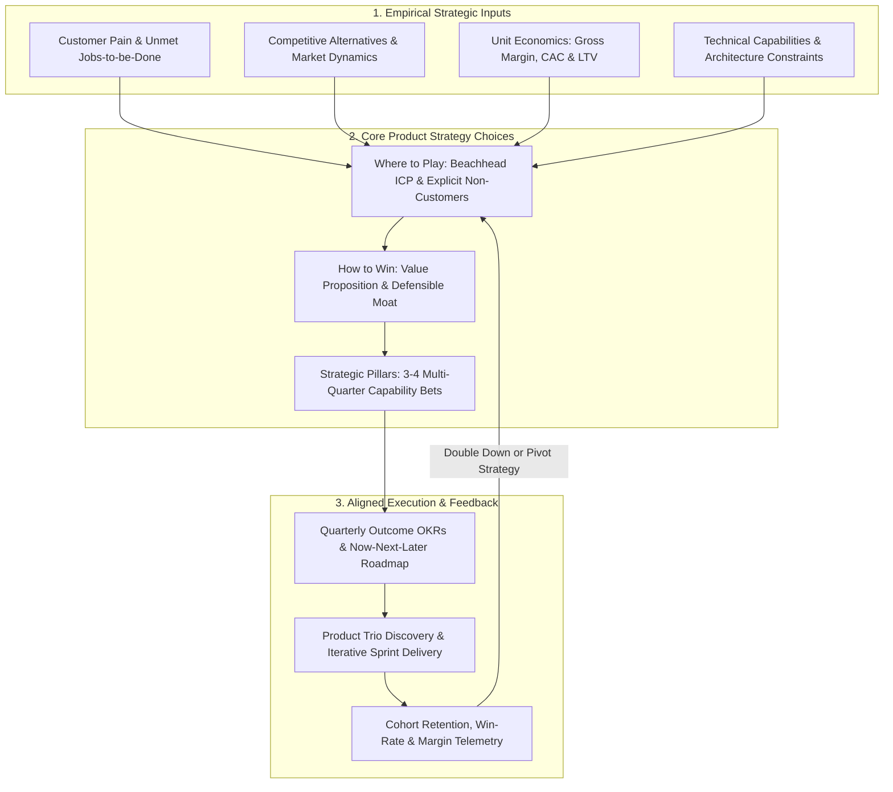

Most documents labeled "2026 Product Strategy" inside technology companies are not strategies at all—they are either lofty motivational slogans (*"Be the #1 AI-powered financial platform in the world"*) or 40-item feature wish-lists stitched together from sales requests. Neither helps an engineering squad make a hard trade-off on a Tuesday afternoon. A genuine **product strategy** is a coherent system of choices that specifies **which specific customer segment you will serve first, which painful problem you will solve better than any alternative, what economic moat you will build to defend your margin, and—most importantly—which markets and features you will explicitly refuse to pursue**.

As product management researchers at [ProductPlan](https://www.productplan.com/learn/why-a-top-down-product-strategy-is-the-best-way-to-plan-your-roadmap) and the [Silicon Valley Product Group (SVPG)](https://www.svpg.com/a-vision-for-product-teams/) emphasize, when a team lacks a clear top-down product strategy, roadmapping degenerates into reactive horse-trading where the loudest executive or largest enterprise prospect dictates the next sprint. This article explains the architectural difference between Vision, Strategy, Roadmap, and Execution; breaks down a practical 5-question strategic framework; shows how to ground product strategy in real unit economics and gross margins; and walks through a quantitative strategic segment-selection example.

## 1. The Five-Layer Strategy Cascade: Separating Vision from Strategy and Roadmaps

To eliminate confusion across leadership and engineering teams, anchor your planning vocabulary in five distinct layers that cascade from multi-year permanence down to bi-weekly iteration:

1. **Company Mission (5–10+ Year Horizon — *Why We Exist*):** The enduring purpose of the enterprise (e.g., Stripe's mission to *"increase the GDP of the internet"*).
2. **Product Vision (3–5 Year Horizon — *Where We Are Going*):** A vivid, customer-centric description of the future state your product will create over the next three to five years ([SVPG Vision Guide](https://www.svpg.com/a-vision-for-product-teams/)). The vision inspires teams and remains stable across quarterly market shifts.
3. **Product Strategy (1–2 Year Horizon — *How We Will Win*):** The logical sequence of beachhead markets, customer segments, value propositions, and business model mechanics chosen to achieve the vision. Strategy changes only when validated market evidence invalidates a core assumption.
4. **Product Roadmap & OKRs (1–4 Quarter Horizon — *What Problems We Solve Next*):** The time-phased sequence of strategic themes and measurable behavioral outcomes (**Article 07**, **Article 10**) that execute the current strategy.
5. **Backlog & Sprint Execution (2-Week Horizon — *How We Build & Validate*):** The specific prototypes, user stories, PRDs (**Article 09**), and A/B experiments shipped by the squad.

## 2. The Five-Question Product Strategy Framework (Adapted from *Playing to Win* & *DHM*)

Whether you use Roger Martin and A.G. Lafley's classic *Playing to Win* cascade or Gibson Biddle's **DHM Model** (*How will we Delight customers, in Hard-to-copy, Margin-enhancing ways?*), every complete product strategy document must answer five concrete questions:

1. **Where Will We Play (Beachhead Segment & ICP)?** Who is our Ideal Customer Profile (ICP) for the next 12–18 months, and who is explicitly **out of scope**? Trying to build simultaneously for solo freelancers and Fortune 500 procurement teams breaks both your UX simplicity and your sales motion.
2. **What Problem Do We Uniquely Solve (Value Proposition & Positioning)?** What high-frequency, high-pain job (**Article 12**) are we solving, and what is the customer's current alternative (competitor software, Excel spreadsheets, or manual agency labor)?
3. **How Will We Win (Defensibility & Hard-to-Copy Advantage)?** Once competitors see our traction, what stops them from copying our UI in two sprints? Durable product moats come from **proprietary data loops**, **high switching costs / workflow embedding**, **two-sided network effects**, or **economies of scale**—never from surface UI polish alone.
4. **How Do We Make Money (Business Model & Unit Economics)?** How does our pricing metric align with customer value (per-seat, usage-based token/API consumption, or transaction take-rate), and does it sustain healthy gross margins after cloud compute and LLM inference costs? (See Aniket Thakur's analysis in [Public Market Listings as the Ultimate Stress Test for AI Valuations](https://07anishu12.github.io/learnings.html) on why gross margin discipline separates durable software businesses from narrative bubbles.)
5. **What Capabilities & Systems Must We Build (Strategic Pillars)?** Which 3 to 4 foundational capabilities (e.g., deterministic validation pipelines, self-serve onboarding, automated compliance engines) must our engineering squads construct over the next four quarters to make this strategy real?

## 3. Applying the "Opposite Test" to Detect Fake Strategies

A simple diagnostic used by seasoned Chief Product Officers is the **Opposite Test**: look at each statement in your strategy deck and write down its exact logical opposite. If the opposite statement sounds completely absurd—for example, the opposite of *"Our strategy is to build fast, reliable, user-friendly software"* is *"Our strategy is to build slow, buggy, confusing software"*—then your original statement is a **platitude, not a strategic choice**.

A real strategic choice always has a plausible, respectable opposite that another successful company is actively pursuing:
- *Real Strategic Choice:* *"We will win mid-market B2B teams (50–500 employees) through a 100% self-serve, product-led growth (PLG) onboarding motion with transparent credit-card pricing, refusing custom on-premise deployments."*
- *Plausible Opposite:* *"We will win regulated Fortune 500 banks through top-down enterprise sales, custom VPC/on-premise deployments, and $250k+ annual contracts."*  
Both are valid ways to build a \$100M software business, which is precisely why choosing one—and rejecting the other—constitutes real strategy.

## 4. Connecting Strategy to Execution Without Micro-Managing Squads

In the [SVPG Product Operating Model](https://www.svpg.com/the-product-operating-model-an-introduction/), leadership provides **Strategic Context** (vision, target segments, unit-economic guardrails, and annual company objectives), while individual product squads retain autonomy to discover the best feature solutions that move their assigned outcome metrics. This prevents both failure extremes: top-down micromanagement (feature factories) and bottom-up chaos (where 8 squads build disconnected features that do not add up to a coherent product).

## Frameworks and Comparison Tables

### Table 6.1: The Five-Layer Product Strategy Cascade — Owners, Horizons & Anti-Patterns

| Cascade Layer | Core Question Answered | Time Horizon | Primary Owner | Review Cadence | Common Anti-Pattern (Failure Mode) |
| :--- | :--- | :--- | :--- | :--- | :--- |
| **1. Company Mission** | *Why does our organization exist in the world?* | 5–10+ Years | Founders / CEO / Board | Rarely changes | Writing a generic slogan disconnected from actual product domain |
| **2. Product Vision** | *What future customer state are we building toward?* | 3–5 Years | CPO / VP of Product / Founders | Audited annually | Describing internal revenue targets (*"Reach $50M ARR"*) instead of customer transformation |
| **3. Product Strategy** | *Which segments, problems, moats, and economics will win?* | 12–24 Months | VP Product / Group PM / Senior PM | Reviewed semi-annually | Listing 30 disconnected features instead of making segment and trade-off choices |
| **4. Outcome Roadmap & OKRs** | *Which measurable problems will we solve in Now / Next / Later?* | 1–4 Quarters | Product Manager + Product Trio | Updated quarterly | Committing to exact day-specific feature release dates 12 months in advance ([ProductPlan](https://www.productplan.com/learn/what-is-a-product-roadmap)) |
| **5. Backlog & Experiments** | *What exact stories and prototypes ship this sprint?* | 1–4 Weeks | Product Trio (PM, Design, Eng) | Refined weekly | Treating every backlog ticket as irreversible gospel instead of a testable hypothesis |

### Table 6.2: Fake Strategy (Platitudes) vs. Real Product Strategy (Explicit Trade-Offs)

| Strategic Dimension | Fake Strategy (Wish-List / Platitude) | Real Product Strategy (Actionable Trade-Off) |
| :--- | :--- | :--- |
| **Target Customer (ICP)** | *"Anyone who needs project management or productivity tools."* | *"Software engineering squads of 15–150 developers using GitHub who are frustrated by Jira latency."* |
| **Value Proposition** | *"Provide a world-class, intuitive, AI-first user experience."* | *"Cut bug triage and sprint planning time by 60% via sub-50ms keyboard navigation and automated PR state sync."* |
| **Competitive Moat** | *"Build better features faster than our competitors."* | *"Deep bi-directional Git workflow integration and historical codebase context that creates high team switching costs."* |
| **Monetization & Margin** | *"Maximize revenue across all customer tiers."* | *"Freemium bottom-up team adoption capped at 250 issues, converting to \$10–\$16/seat/month at >80% gross margin."* |
| **Explicit "What We Won't Do"** | *(Left blank—never says no to any sales request)* | *"We will not build custom Gantt resource time-tracking sheets or non-software HR/Legal ticketing modules in 2026."* |

## Visualizing the Framework

The following architecture diagram illustrates the workflow and decision criteria:

## Practical Worked Example

**Scenario (Hypothetical AI Document Intelligence Startup — *DocuVerify AI*):**  
*DocuVerify AI* has built a multi-LLM document extraction engine with deterministic JSON validation schemas (similar in technical principle to [Designing Deterministic Validation Schemas for Multi-LLM Pipelines](https://07anishu12.github.io/learnings.html)). The company has **\$1.8M in seed runway (18 months)** and an 8-person engineering team. Leadership must choose **one beachhead product strategy** for the next 12 months from three competing segments:

- **Strategic Option A — Consumer Tax Receipt Scanner App (B2C):** Target freelance gig workers at \$9/month (\$108/year ACV). High volume, but heavy mobile ad Customer Acquisition Cost (CAC = \$85/user) and 6% monthly churn (average lifetime = 16.7 months). LLM OCR inference + cloud storage costs \$2.70/user/month.
- **Strategic Option B — Horizontal "Chat With Any PDF" Prosumer Tool:** Target general knowledge workers at \$15/month (\$180/year ACV). Extremely crowded market (competing directly with bundled features inside Notion, ChatGPT, and Adobe); CAC = \$140/user; 7% monthly churn (14.3 months lifetime); inference cost = \$4.50/user/month.
- **Strategic Option C — Vertical B2B Commercial Loan Underwriting & Financial Spreading Engine (Mid-Market Banks & NBFCs):** Target commercial lending teams at \$24,000/year ACV (\$2,000/month). Inside-sales + founder-led CAC = \$12,000 per lender; annual logo churn = 8% (average lifetime = 12.5 years, capped conservatively at 5 years / 60 months for modeling). Deterministic multi-LLM extraction + audit trail inference costs \$180/lender/month.

**Step-by-Step Quantitative Strategic Evaluation:**

1. **Gross Margin Calculation:** $\text{Gross Margin \%} = \frac{\text{Monthly Revenue} - \text{Monthly COGS}}{\text{Monthly Revenue}}$
   - **Option A (B2C Tax):** $\frac{\$9.00 - \$2.70}{\$9.00} = \mathbf{70.0\%}$
   - **Option B (Horizontal PDF):** $\frac{\$15.00 - \$4.50}{\$15.00} = \mathbf{70.0\%}$
   - **Option C (Vertical Lending LOS):** $\frac{\$2,000 - \$180}{\$2,000} = \mathbf{91.0\%}$
2. **Gross-Margin-Adjusted LTV & LTV:CAC Ratio:** $\text{LTV} = \text{Monthly Gross Profit} \times \text{Average Lifetime (Months)}$
   - **Option A (B2C Tax):** $\text{LTV} = \$6.30 \times 16.7\text{ mo} = \$105.21 \rightarrow \text{LTV:CAC} = \frac{\$105.21}{\$85} = \mathbf{1.24\times}$ *(Unviable; below the $3.0\times$ software sustainability threshold).*
   - **Option B (Horizontal PDF):** $\text{LTV} = \$10.50 \times 14.3\text{ mo} = \$150.15 \rightarrow \text{LTV:CAC} = \frac{\$150.15}{\$140} = \mathbf{1.07\times}$ *(Unviable; commoditized by foundation model providers).*
   - **Option C (Vertical Lending LOS):** $\text{LTV (60-mo cap)} = \$1,820 \times 60\text{ mo} = \$109,200 \rightarrow \text{LTV:CAC} = \frac{\$109,200}{\$12,000} = \mathbf{9.10\times}$ with a **CAC Payback Period** of $\frac{\$12,000}{\$1,820/\text{mo}} = \mathbf{6.6\text{ months}}$.
3. **Strategic Decision:** *DocuVerify AI* commits 100% of its 12-month product strategy to **Option C (Vertical B2B Commercial Loan Spreading)**—building deep integrations into existing Loan Origination Systems (LOS) and regulatory audit logs that generalist chatbots cannot easily replicate, while explicitly refusing to build consumer mobile apps or generic PDF chat features.

## Common Mistakes and Limitations

1. **The "Peanut-Butter Strategy" (Spreading R&D Thinly Across Everything):** When leadership refuses to pick a primary customer segment, they allocate 1.5 engineers to five different bets simultaneously. None of the five bets reaches the critical mass required to win against focused competitors.
2. **Copying a Competitor's Feature Matrix ("Competitor-Driven Strategy"):** Building a feature simply because a competitor announced it in a press release assumes the competitor actually validated that their customers use it. Compete on superior problem resolution for your target segment, not checkbox parity.
3. **Treating Product Strategy as an Annual Static Artifact:** While strategy should not flip-flop every sprint, if a core hypothesis (such as self-serve conversion among SMBs) fails after two quarters of rigorous experimentation, clinging to the document out of sunk-cost pride destroys the company.

## Practical Implementation Checklist

- [ ] **The Opposite Test:** Does every strategic choice in our document have a plausible, respectable opposite that we have consciously decided *not* to pursue?
- [ ] **Explicit "Non-Goals" Section:** Does our strategy document list at least 3 customer segments or feature categories that we will decline over the next 12 months?
- [ ] **Unit Economics Grounding:** Have we verified that our target pricing model, CAC payback period, and COGS (including cloud and AI inference costs) yield sustainable gross margins?
- [ ] **Defensible Moat Identification:** Can we articulate *why* a well-funded competitor or foundation-model provider cannot replicate our core advantage in 60 days?
- [ ] **Squad-Level Translation:** Can every engineer and designer on the team explain in two sentences how their current sprint connects to our top-level strategic bets?

## Frequently Asked Questions

### 1. What is the difference between a Product Strategy and a Business Strategy?
A **Business Strategy** encompasses the entire enterprise—including capital allocation, M&A, geographic legal entities, sales compensation structures, and corporate finance. A **Product Strategy** defines specifically how the software or hardware product portfolio will create differentiated customer value, capture market share, and drive unit economics to fulfill that overarching business strategy.

### 2. Who writes the Product Strategy—the CEO, the CPO, or individual Product Managers?
In an early-stage startup, the CEO/Founders and Founding PM co-author the company-wide product strategy. In a multi-squad scale-up or enterprise, the **CPO or VP of Product** defines the portfolio-level product strategy across business units, while **each Senior PM or Group PM** writes a domain-specific product strategy (a 3-to-6 page narrative memo) for their specific product vertical or squad area.

### 3. How often should a Product Strategy be updated?
A well-researched product strategy should remain directionally stable for **12 to 24 months**, with formal strategic checkpoints conducted **every 6 months** (or immediately if a major regulatory, macroeconomic, or technological shift—such as a 10x drop in foundation model inference cost—alters the market landscape). Quarterly cycles should adjust the *roadmap and OKRs*, not reinvent the company's strategy from scratch every 90 days.

### 4. Should a Product Strategy be written as a slide deck or a narrative memo?
Write the primary product strategy as a **4-to-6 page structured narrative memo** (in [Notion](https://www.notion.com/pricing), Confluence, or Google Docs) first, and create a visual summary slide deck only *after* the narrative logic is airtight. Slide decks allow authors to hide weak causal reasoning behind three-word bullet points, whereas complete prose sentences force you to explain *how* Choice A leads to Outcome B.

### 5. How do you formulate Product Strategy for an internal platform or infrastructure team that has no external competitors?
Even internal platform teams have "competitors"—their competitors are **individual product squads building shadow workarounds, adopting third-party SaaS vendors, or wasting developer hours on manual scripts**. An internal platform strategy defines which internal developer personas to serve first, which high-friction infrastructure bottlenecks (e.g., CI/CD build times, LLM evaluation pipelines, or data warehouse latency) to eliminate, and how to measure adoption and engineering hours saved.

### 6. What is the relationship between Product Strategy and Product-Market Fit?
Product Strategy is the **hypothesis of how to achieve and expand Product-Market Fit (PMF)** (**Article 13**). Pre-PMF, your product strategy is a focused discovery plan designed to prove retention and willingness to pay in one narrow beachhead segment. Post-PMF, your product strategy governs how to defend that core segment while expanding into adjacent workflows or buyer tiers.

## Next Steps and Recommended Reading

A great product strategy is an act of disciplined subtraction. By choosing a specific target segment, defining a sharp value proposition, building a structural economic moat, and explicitly documenting what your team will *not* build, you give your engineers and designers the clarity needed to execute at high velocity.

**Practical Next Step:** Open your team's current strategy or planning deck and run the **Opposite Test** on every headline. Replace any generic aspiration (*"Improve user experience"*) with a concrete, falsifiable strategic choice specifying *for whom*, *on which workflow*, and *at the expense of which lower-priority alternative*.

**Recommended Follow-Up Reading:** Continue to **Article 07: How to Build a Product Roadmap: Templates, Examples and Best Practices** (`/blog/product/how-to-build-a-product-roadmap/` — *Planned Destination*) to translate your product strategy into a living, outcome-based roadmap without getting trapped by brittle date commitments.

## About this guide

Aniket Thakur prepared this comprehensive Product Management guide based on continuous discovery frameworks, operational research, and practitioner benchmarks checked on 24 October 2026. All quantitative scenarios in Section G are explicitly labelled hypothetical worked examples illustrating decision math.
