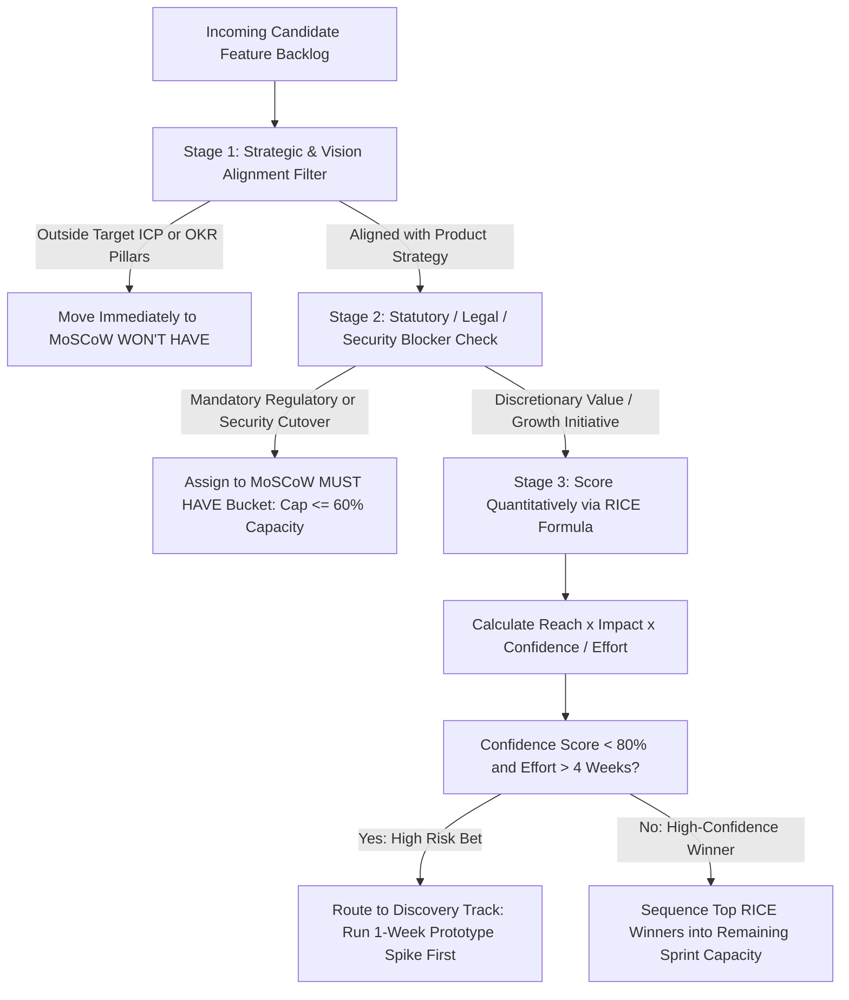

Every product manager faces the same fundamental mathematical reality: incoming feature ideas, sales requests, technical debt tickets, and executive suggestions always exceed engineering capacity by a factor of five to ten. Without a transparent prioritization mechanism, backlog ordering defaults to **HiPPO decision-making** (*Highest Paid Person's Opinion*), **decibel prioritization** (the loudest sales rep wins), or **recency bias** (building whatever yesterday's angry customer tweeted about).

Prioritization frameworks—specifically **RICE**, **ICE**, and **MoSCoW**—do not replace strategic judgment, nor do they act as magic calculators that absolve a PM from thinking. Instead, they force cross-functional teams to **make their underlying assumptions about customer reach, behavioral impact, evidence confidence, and engineering effort explicit and auditable**. This guide examines the history, exact mathematical formulas, and scoring rubrics of RICE ([Intercom](https://www.intercom.com/blog/rice-simple-prioritization-for-product-managers)), ICE ([ProductPlan](https://www.productplan.com/glossary/ice-scoring-model)), and MoSCoW ([WhichFramework / DSDM](https://whichframework.org/frameworks/moscow.html)), runs a single 6-feature backlog through all three frameworks simultaneously to demonstrate where and why their rankings diverge, and explains how to prevent stakeholders from gaming the numbers.

## 1. The RICE Scoring Model (Reach, Impact, Confidence, Effort)

Developed at **Intercom** by Sean McBride and his product team ([Intercom Official RICE Guide](https://www.intercom.com/blog/rice-simple-prioritization-for-product-managers)), the **RICE** framework was designed specifically to overcome two flaws in simpler scoring models: the failure to distinguish features that touch 100,000 users from features that touch 50 users (**Reach**), and the tendency to treat speculative hunches the same as A/B-tested evidence (**Confidence**).

### The Official RICE Formula
$$\text{RICE Score} = \frac{\text{Reach} \times \text{Impact} \times \text{Confidence}}{\text{Effort}}$$

To prevent arbitrary guessing, Intercom defined strict calibration scales for each variable:
1. **Reach (Real Metric Count per Time Period):** Measured as the actual number of users, accounts, or transactions that will encounter the feature within a standardized time window (e.g., *users per month* or *customers per quarter*). For example, if 5,000 monthly active users visit the billing page and 30% will use the new export workflow, $\text{Reach} = 1,500\text{ users/quarter}$.
2. **Impact (Non-Linear 5-Tier Multiplier per User):** Estimates how much the feature will move the target outcome metric (such as conversion or retention) for an individual user who encounters it, using Intercom's discrete logarithmic scale:
   - $\mathbf{3.0} = \text{Massive impact}$
   - $\mathbf{2.0} = \text{High impact}$
   - $\mathbf{1.0} = \text{Medium impact}$
   - $\mathbf{0.5} = \text{Low impact}$
   - $\mathbf{0.25} = \text{Minimal impact}$
3. **Confidence (Evidence-Backed Percentage Tier):** Discounts ideas that rely on intuition rather than empirical data, typically bucketed into three standard tiers to avoid false precision:
   - $\mathbf{100\%\ (1.0)} = \text{High confidence}$ (Backed by quantitative telemetry, A/B baselines, usability tests, and engineering effort spikes).
   - $\mathbf{80\%\ (0.8)} = \text{Medium confidence}$ (Backed by qualitative customer interviews and rough t-shirt engineering estimates, but lacking quantitative scale validation).
   - $\mathbf{50\%\ (0.5)} = \text{Low confidence}$ (Anecdotal sales request or speculative hypothesis with unverified technical complexity; anything below 50% is a "moonshot" that needs discovery first).
4. **Effort (Person-Months or Person-Weeks):** The total combined time required across Product, Design, and Engineering (e.g., $2\text{ person-months}$, or $0.5\text{ person-months}$ for a quick two-week build).

## 2. The ICE Scoring Model (Impact, Confidence, Ease)

Popularized by **Sean Ellis** (who coined the term *Growth Hacking* and developed the 40% PMF test, [ProductPlan ICE Glossary](https://www.productplan.com/glossary/ice-scoring-model)), **ICE** was created for rapid growth experimentation and early-stage ideation where teams need to triage 30+ growth hypotheses in a 45-minute meeting without spending hours querying exact cohort reach numbers.

### The ICE Formula
$$\text{ICE Score (Multiplicative)} = \text{Impact} \times \text{Confidence} \times \text{Ease}$$
*(Note: Each input is scored on a 1–10 scale, yielding a multiplicative score from 1 to 1,000; some teams divide the sum by 3 to normalize on a 1–10 average scale, as noted in [GrowthMethod ICE Guide](https://growthmethod.com/ice-framework/)).*

- **Impact (1–10):** Expected movement in the target growth or product metric if the hypothesis succeeds (where $1\text{–}10$implicitly blends per-user impact and audience reach).
- **Confidence (1–10):** Strength of empirical support (often calibrated using Itamar Gilad's **Confidence Meter**—where self-conviction scores $1/10$, qualitative user interviews score $3\text{–}5/10$, and prior A/B experiment data scores $7\text{–}9/10$).
- **Ease (1–10):** The inverse of engineering effort—where **10 = effortless** (e.g., <2 days of work) and **1 = massive effort** (multi-month build).

## 3. The MoSCoW Method (Must-Have, Should-Have, Could-Have, Won't-Have)

Created by **Dai Clegg** at Oracle in 1994 and donated to the **Dynamic Systems Development Method (DSDM) Consortium** (now the Agile Business Consortium, [WhichFramework MoSCoW Guide](https://whichframework.org/frameworks/moscow.html)), **MoSCoW** is a **nominal-scale release-scoping framework** rather than a numerical ranking formula. It is designed specifically for **time-boxed releases** (such as scoping an MVP or a regulatory deadline) where stakeholders must agree on what is mandatory for launch day:

- **M — Must Have (Non-Negotiable Launch Blockers):** Requirements without which the product release is illegal, unsafe, non-functional, or commercially useless. *Diagnostic test:* "If this single item is not finished by launch day, do we cancel the release?" If the answer is no, it is not a Must-Have. **DSDM Golden Rule:** *Must-Haves should never exceed 60% of total time-boxed effort*, ensuring a 40% contingency buffer.
- **S — Should Have (High-Value, Non-Vital):** Important capabilities that add significant customer value, but the release can still ship on schedule with a temporary workaround if needed (typically ~20% of effort).
- **C — Could Have (Desirable "Nice-to-Haves"):** Enhancements included only if `Must` and `Should` items finish ahead of schedule (~20% of effort; the primary contingency buffer).
- **W — Won't Have (Explicitly Out of Scope for This Timebox):** Agreed-upon exclusions for the current release cycle. Defining `Won't Have` explicitly prevents scope creep.

## Frameworks and Comparison Tables

### Table 8.1: Structural Comparison — RICE vs. ICE vs. MoSCoW

| Dimension | RICE Scoring ([Intercom](https://www.intercom.com/blog/rice-simple-prioritization-for-product-managers)) | ICE Scoring ([ProductPlan](https://www.productplan.com/glossary/ice-scoring-model)) | MoSCoW Method ([DSDM / WhichFramework](https://whichframework.org/frameworks/moscow.html)) |
| :--- | :--- | :--- | :--- |
| **Origin & Creator** | Sean McBride & team at Intercom | Sean Ellis (GrowthHackers) | Dai Clegg (Oracle, 1994) / DSDM Agile Consortium |
| **Mathematical Form** | Ratio formula: $\frac{R \times I \times C}{E}$ | Multiplicative ($I \times C \times E$) or Average ($\frac{I+C+E}{3}$) | Categorical bucketing (`Must`, `Should`, `Could`, `Won't`) |
| **Best Use Case** | Quarterly roadmap prioritization across diverse features with varying audience sizes | High-velocity growth experiment ideation & rapid backlog triage | Scoping a fixed-date release, MVP (**Article 15**), or stakeholder scope negotiation |
| **Key Strength** | Separates **Reach** from **Impact** and forces evidence-based **Confidence** discounting | Takes <2 minutes per idea; ideal when exact Reach telemetry is unavailable | Forces explicit agreement on launch blockers (`Must`) vs out-of-scope (`Won't`) |
| **Primary Blind Spot / Bias** | Systematically penalizes mandatory compliance/security work with low behavioral "Impact" | Highly subjective; two PMs can score the same feature $8 \times 8 \times 7 = 448$ vs $4 \times 5 \times 4 = 80$ | Does **not** rank items *within* the same bucket (if 12 items are labeled `Must`, which comes first?) |

### Table 8.2: Worked Side-by-Side Simulation — Scoring the Exact Same 6-Feature Backlog Across RICE, ICE, and MoSCoW

*Context: A B2B SaaS invoicing platform with **10,000 Monthly Active Accounts** is prioritizing 6 candidate features for an upcoming 12-person-week quarter (Effort measured in **Person-Weeks** for RICE).*

| Feature Candidate | RICE Inputs ($R \times I \times C / E$) | **RICE Score & Rank** | ICE Inputs ($I \times C \times E$, 1–10 scale) | **ICE Score & Rank** | **MoSCoW Category & Rationale** |
| :--- | :--- | :--- | :--- | :--- | :--- |
| **F1: One-Click UPI Auto-Reconciliation** *(Core user friction; backed by 12 interviews + prototype)* | $R=6,000\text{ accts}$ $I=2.0\text{ (High)}$ $C=100\%\ (1.0)$ $E=4\text{ wks}$ | **3,000** *(Rank #1)* | $I=9, C=9, E=6$ | **486** *(Rank #2)* | **Should Have** *(Highest value growth driver, though existing manual reconciliation still works)* |
| **F2: Onboarding Empty-State Tooltip Checklist** *(Quick growth tweak touching all new signups)* | $R=2,000\text{ accts}$ $I=0.5\text{ (Low)}$ $C=100\%\ (1.0)$ $E=0.5\text{ wks}$ | **2,000** *(Rank #2)* | $I=6, C=9, E=10$ | **540** *(Rank #1)* | **Could Have** *(Low-effort polish; easy contingency item)* |
| **F3: Statutory GST e-Invoice API v2 Upgrade** *(Mandatory government tax schema cutover in 60 days)* | $R=10,000\text{ accts}$ $I=0.5\text{ (Maintains status quo)}$ $C=100\%\ (1.0)$ $E=5\text{ wks}$ | **1,000** *(Rank #3)* | $I=5, C=10, E=5$ | **250** *(Rank #4)* | **MUST HAVE** *(Non-negotiable legal/operational blocker; platform breaks without it)* |
| **F4: AI Invoice Anomaly Detector** *(Exciting executive idea, but unvalidated & complex)* | $R=4,000\text{ accts}$ $I=2.0\text{ (High)}$ $C=50\%\ (0.5)$ $E=8\text{ wks}$ | **500** *(Rank #4)* | $I=8, C=5, E=3$ | **120** *(Rank #5)* | **Won't Have (This Quarter)** *(Needs discovery prototype in `Next` before committing 8 weeks)* |
| **F5: Custom Dark-Mode Dashboard Theme** *(Vocal request on social media; low retention lift)* | $R=1,500\text{ accts}$ $I=0.25\text{ (Minimal)}$ $C=80\%\ (0.8)$ $E=2\text{ wks}$ | **150** *(Rank #5)* | $I=4, C=8, E=8$ | **256** *(Rank #3)* | **Won't Have** *(Zero tie to quarterly retention OKR)* |
| **F6: Custom ERP Connector for 1 Enterprise Prospect** *(Sales request for a single unclosed prospect)* | $R=1\text{ acct}$ $I=3.0\text{ (Massive)}$ $C=50\%\ (0.5)$ $E=6\text{ wks}$ | **0.25** *(Rank #6)* | $I=7, C=4, E=4$ | **112** *(Rank #6)* | **Won't Have** *(Single-tenant custom work fails scalable product strategy)* |

## Visualizing the Framework

The following architecture diagram illustrates the workflow and decision criteria:

## Practical Worked Example

Examine the mathematical findings from **Table 8.2** above—specifically why the three frameworks produced three different #1 priorities from the exact same 6 features:

1. **Why ICE Ranked F2 (Onboarding Tooltip Checklist) #1 ($\text{ICE} = 540$) while RICE Ranked F1 (UPI Auto-Reconciliation) #1 ($\text{RICE} = 3,000$):**  
   In ICE, scoring `Ease = 10` on a tiny half-week tweak inflates the multiplicative product ($6 \times 9 \times 10 = 540$), causing teams that rely purely on ICE to become addicted to shipping "snackable" micro-tweaks (`F2` and `F5: Dark Mode`, which ranked #3 in ICE!) while starving high-impact structural improvements (`F1`). RICE corrects this distortion by explicitly multiplying **Reach ($6,000\text{ accounts}$)** and using a non-linear Impact scale ($2.0\text{ vs }0.5$), elevating **F1 (UPI Auto-Reconciliation)** to #1 ($\text{RICE} = 3,000$).
2. **Why Pure RICE Underranked F3 (Statutory GST e-Invoice API v2 Upgrade) at #3 ($\text{RICE} = 1,000$):**  
   Because a mandatory tax compliance upgrade simply prevents existing customers from being blocked—rather than lifting conversion rate—a literal reading of RICE assigns it low behavioral Impact ($0.5$), placing it behind `F1` and `F2`. Yet if the team fails to ship `F3` within 60 days, 100% of invoices become legally invalid!
3. **The Practitioner Synthesis (How to Construct the Actual 12-Week Sprint Plan):**  
   By applying the **Two-Stage Hybrid Workflow (Section F)** across our **12-person-week net budget**:
   - **Step 1 (MoSCoW Must-Have Gate):** Allocate **5.0 person-weeks** first to **F3 (Statutory GST API v2 Upgrade)** ($41.7\%$ of capacity, well under the DSDM 60% Must-Have ceiling).
   - **Step 2 (RICE Value Ranking on Remaining 7.0 Weeks):** Allocate **4.0 person-weeks** to the #1 RICE winner **F1 (One-Click UPI Auto-Reconciliation)** ($\text{RICE} = 3,000$) and **0.5 person-weeks** to the #2 RICE winner **F2 (Onboarding Tooltip Checklist)** ($\text{RICE} = 2,000$).
   - **Step 3 (Discovery Allocation on Remaining 2.5 Weeks):** Use **1.5 person-weeks** to run a low-cost discovery prototype spike on **F4 (AI Invoice Anomaly Detector)** to test whether its Confidence can be raised from $50\%$ to $100\%$ for next quarter, leaving **1.0 person-week** as an iteration buffer.

## Common Mistakes and Limitations

1. **Denominator Gaming (Artificially Deflating Effort to Boost RICE Scores):** When stakeholders realize that dividing by $E = 0.25$ quadruples a feature's RICE score, they pressure engineers to give optimistic 2-day estimates that omit QA, telemetry, documentation, and edge-case handling. *Fix:* Only the Tech Lead and engineering squad may assign the Effort ($E$) denominator, and $E$ must include testing and rollout time.
2. **Treating RICE Scores as Absolute Precision:** A RICE score of $1,420$ is not meaningfully superior to a score of $1,350$. Use RICE to separate **order-of-magnitude tiers** (e.g., separating $3,000$-point slam dunks from $150$-point distractions), then apply strategic coherence and dependency sequencing within the top tier.
3. **Ignoring Technical Dependencies and Sequencing Logic:** If Feature B has a higher RICE score than Feature A, but Feature B cannot function until the database schema inside Feature A is built, mathematical ranking must yield to architectural dependency order.

## Practical Implementation Checklist

- [ ] **Pre-Filter by Strategy:** Have we removed ideas that fall outside our current quarterly OKRs (**Article 10**) *before* spending time scoring them?
- [ ] **Separate Compliance Bucket:** Have mandatory regulatory, security, and infrastructure uptime requirements been carved out via a MoSCoW `Must-Have` gate ($\le 60\%$ capacity) rather than forced to compete with growth features in RICE?
- [ ] **Evidence-Backed Confidence:** Did we enforce strict Confidence tiers in RICE ($100\%$ = quantitative data + user tests; $80\%$ = qualitative research; $50\%$ = unvalidated intuition)?
- [ ] **Engineering-Owned Effort:** Were all Effort ($E$) or Ease scores estimated by the engineering squad rather than guessed by the PM or requester?
- [ ] **Post-Launch Score Audit:** Do we review shipped features 60 days post-launch to compare *predicted* Reach and Impact against *actual* telemetry?

## Frequently Asked Questions

### 1. When should I use RICE instead of ICE?
Use **ICE** during early-stage brainstorming or weekly growth experiment triage when you are filtering 30+ rough ideas down to the top 5 candidates for deeper research. Switch to **RICE** when prioritizing your formal quarterly product roadmap across multiple squads or customer segments, where differences in audience **Reach** (e.g., a self-serve flow used by 50,000 users vs. an admin setting used by 200 users) significantly alter expected return on investment.

### 2. How do I prevent stakeholders from calling every single feature a "Must-Have" in MoSCoW?
Apply two objective rules from the [DSDM Agile Business Consortium methodology](https://whichframework.org/frameworks/moscow.html): First, ask the **Cancellation Question** (*"If this single item slips by one week, will you sign off on delaying the entire release for all customers?"*). Second, enforce a hard **60% Effort Cap on Must-Haves**. Once `Must-Have` items consume 60% of the sprint/release capacity budget, any stakeholder who wants to add a new `Must-Have` must demote an existing `Must-Have` of equal effort to `Should-Have`.

### 3. What is "Weighted Shortest Job First" (WSJF), and how does it compare to RICE?
Popularized in SAFe and Donald Reinertsen's product development flow theory, **WSJF** calculates $\frac{\text{Cost of Delay}}{\text{Job Duration}}$, where **Cost of Delay** sums *User/Business Value + Time Criticality + Risk Reduction/Opportunity Enablement*. WSJF is particularly useful when comparing time-sensitive regulatory features against long-term platform capabilities because it explicitly prices the penalty of waiting (**Time Criticality**), which standard RICE omits.

### 4. Where does the Kano Model fit alongside RICE and MoSCoW?
Developed by Professor Noriaki Kano, the **Kano Model** classifies features by how their presence or absence affects customer satisfaction across three primary curves: **Basic / Must-Be Expectations** (table stakes), **Performance / Linear Attributes** (more is better, such as faster query speed), and **Delighters / Attractive Attributes** (unexpected differentiators). Kano is a **qualitative research lens** (using paired functional/dysfunctional user survey questions) that helps you estimate the **Impact ($I$)** variable more accurately before plugging it into RICE.

### 5. How should I score a foundational platform refactor that has zero direct user interface?
Score foundational technical refactors by quantifying their **downstream impact on customer experience or engineering velocity**: for example, if refactoring a legacy payment service reduces checkout timeout errors from 2.5% to 0.2% across 100,000 monthly checkouts, its Reach is $2,300\text{ recovered checkouts/month}$ and its Impact on conversion is High ($2.0$). Alternatively, manage pure architectural maintenance via a dedicated 20% engineering capacity allocation (**Article 07**) rather than forcing it through feature RICE scoring.

### 6. What should I do if a feature has Massive Impact ($3.0$) and High Reach ($10,000$), but Low Confidence ($50\%$) and Huge Effort ($12\text{ weeks}$)?
Never commit 12 engineering weeks to a 50%-confidence bet right away. Instead, split the ticket into a **1-week Discovery Prototype & Technical Spike** (**Article 14**, **Article 15**). Spending 1 week to test a clickable prototype with 6 users either raises your Confidence to $80\%\text{–}100\%$ (justifying the 12-week build) or proves the idea is flawed (saving 11 weeks of wasted engineering time).

## Next Steps and Recommended Reading

Prioritization frameworks are conversation tools, not autopilot scripts. By combining **MoSCoW** to ring-fence non-negotiable launch and compliance commitments, **RICE** to rank discretionary product investments by evidence-backed ROI per engineering week, and **ICE** to triage rapid growth experiments, you transform roadmap planning from political debate into transparent, data-informed decision-making.

**Practical Next Step:** Take the top 10 feature requests sitting in your backlog today, add four columns (`Reach`, `Impact`, `Confidence`, `Effort`) in [Notion](https://www.notion.com/pricing) or [Linear](https://linear.app/pricing), and score them independently with your Tech Lead and Designer before comparing where your assumptions diverge.

**Recommended Follow-Up Reading:** Once a feature wins prioritization and enters your `Now` horizon, proceed to **Article 09: How to Write a Product Requirements Document (PRD) With a Real Example** (`/blog/product/how-to-write-a-product-requirements-document-prd/` — *Planned Destination*) to specify it clearly for engineering delivery.

## About this guide

Aniket Thakur prepared this comprehensive Product Management guide based on continuous discovery frameworks, operational research, and practitioner benchmarks checked on 24 October 2026. All quantitative scenarios in Section G are explicitly labelled hypothetical worked examples illustrating decision math.
