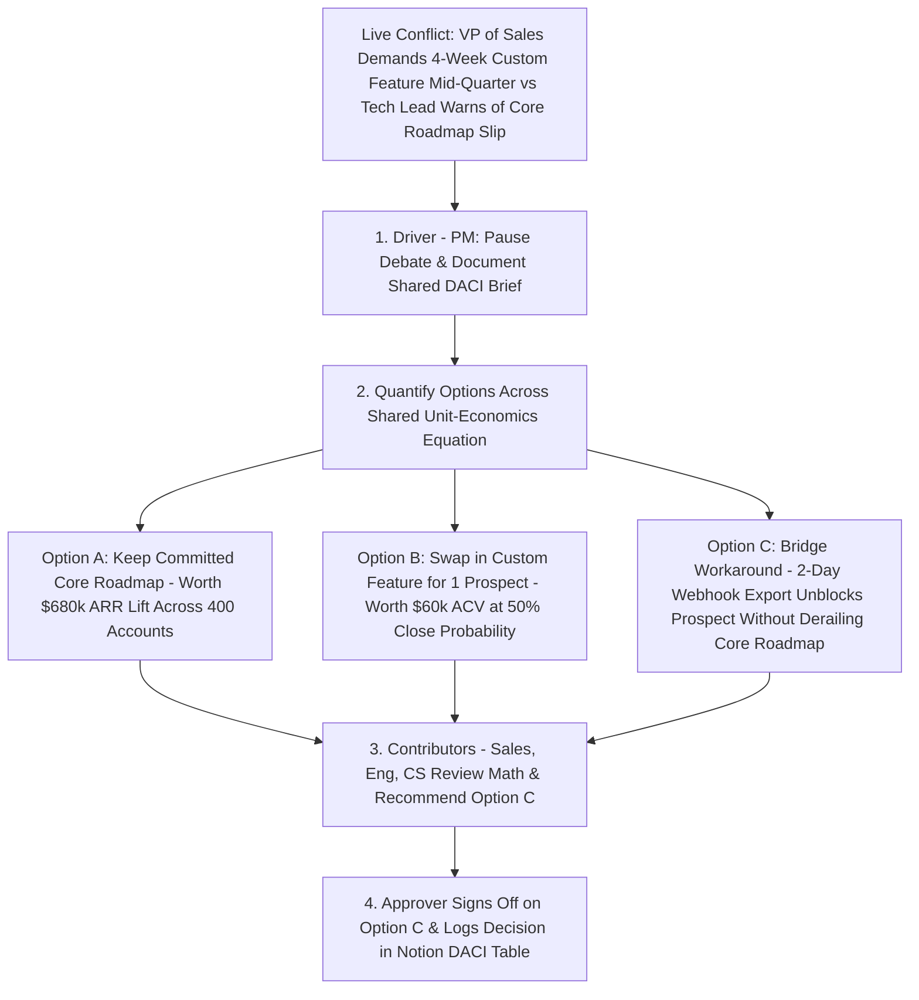

Here is the central structural tension of product management: **you are held accountable for the commercial and behavioral success of the product, yet almost nobody in the building reports to you**. You cannot order the VP of Sales to stop promising custom features to prospects, you cannot command the Staff Engineer to work over the weekend, and you cannot overrule the General Counsel on regulatory compliance by pulling rank. When a Product Manager attempts to lead through positional bluster or passive-aggressive gatekeeping, cross-functional trust evaporates within weeks.

Effective **stakeholder management** is not corporate politics or people-pleasing—it is the systematic architecture of **shared context, transparent trade-offs, and explicit decision rights**. When executives, sales leaders, legal reviewers, and engineers argue heatedly over a roadmap, 90% of the time they are not arguing because they are irrational; they are arguing because each department is optimizing for a different departmental incentive (e.g., Sales is compensated on **this quarter's closed bookings**, while Engineering is evaluated on **system stability and multi-year maintainability**) without a shared equation to weigh those competing goals. This guide shows you how to map your stakeholder ecosystem using Mendelow's Power–Interest Grid, eliminate decision paralysis with the **DACI Framework** ([Atlassian Team Playbook](https://www.atlassian.com/team-playbook/plays/daci)), say "no" to feature requests by saying "yes" to transparent trade-off criteria, and resolve a live executive standoff using expected-value math.

## 1. Mapping Your Ecosystem: Mendelow's Power–Interest Grid & Departmental Incentives

Before you can align stakeholders, you must audit **what each stakeholder optimizes for, what they fear, and what communication cadence they require**. Adapting Aubrey Mendelow's classic **Power–Interest Matrix**, classify every internal and external stakeholder across two axes—**Power / Decision Influence (Low vs. High)** and **Interest / Direct Workflow Impact (Low vs. High)**:

1. **Quadrant 1 — High Power, High Interest (*Manage Closely & Co-Create Early*):** E.g., your VP of Product, Tech Lead, Product Designer, and the VP of Sales for a B2B enterprise product. Never surprise Quadrant 1 stakeholders in a 20-person group meeting! Use **"Pre-Wiring" (1-on-1 alignment before the big meeting)** to surface their concerns while your roadmap or PRD is still an editable draft.
2. **Quadrant 2 — High Power, Low Day-to-Day Interest (*Keep Satisfied & Consult at Gateways*):** E.g., the CFO, Chief Information Security Officer (CISO), or General Counsel. They do not want to attend weekly backlog refinement, but they hold absolute **veto power** if your feature violates SOC2 compliance, GDPR/DPDP privacy laws, or gross-margin unit economics. Engage them early via structured 1-page risk briefs.
3. **Quadrant 3 — Low Power, High Interest (*Keep Informed & Harvest Insights*):** E.g., Tier-1 Customer Support agents, Solutions Engineers, and Sales Development Reps (SDRs). They hear raw customer pain every single hour. Include them in bi-weekly async Loom updates and give them a structured intake channel (such as *Linear Asks* or a Notion database, **Article 05**) so they feel heard.
4. **Quadrant 4 — Low Power, Low Interest (*Monitor Lightly via Broadcasts*):** Adjacent departments unaffected by your squad's domain. Keep them updated solely through monthly company-wide release digests.

## 2. Eliminating Decision Paralysis: DACI vs. RACI

When a cross-functional conflict stalls for three weeks, the root cause is almost always **ambiguous decision rights**—either nobody knows who has the final call, or three executives believe they all hold veto power.

Originated at Intuit in the 1980s and popularized across modern software teams by [Atlassian's DACI Playbook](https://www.atlassian.com/team-playbook/plays/daci) (and documented in [Project-Management.com's DACI Guide](https://project-management.com/daci-model/)), **DACI** upgrades the traditional project-execution **RACI** matrix (*Responsible, Accountable, Consulted, Informed*) específicamente for **high-stakes strategic decisions**:

- **D — Driver (Exactly 1 Individual — Typically the Product Manager):** The person responsible for gathering the facts, scheduling the alignment review, documenting the options and trade-offs, and driving the decision to closure by the deadline. Crucially, the Driver orchestrates the process, though they may or may not be the final Approver on company-wide resource shifts.
- **A — Approver (Strictly 1 Individual — Never a Committee):** The single person who makes the final binding call if consensus cannot be reached (e.g., the Group PM or VP of Product for a cross-squad roadmap swap, or the PM for a squad-level scope trade-off). Assigning two Approvers guarantees deadlock.
- **C — Contributors (Consulted Voices — Have a Voice, Not a Vote):** Domain experts (Tech Lead, Designer, Sales Lead, Legal, Data Scientist) whose input, constraints, and data **must** be actively solicited and documented in the DACI brief before the decision is made.
- **I — Informed (Downstream Teams):** Stakeholders who are notified of the final decision and its rationale once locked.

## 3. How to Say "No" Without Destroying Relationships ("Blame the Shared Math, Not the Person")

Junior Product Managers either say **"Yes"** to every stakeholder request (destroying the roadmap) or say a blunt **"No, that's not on our roadmap"** (making the stakeholder feel dismissed and prompting them to escalate over the PM's head to the CEO).

Senior Product Managers follow a 4-step **Evidence-Based Negotiation Protocol**:
1. **Validate the Underlying Problem First:** Never reject the feature at second zero. Ask: *"Help me understand the customer problem behind this request—which accounts are blocked, and what is the revenue or retention impact?"*
2. **Expose the Fixed Capacity & Current OKR Anchor:** Show the live **Now–Next–Later Roadmap (**Article 07**)** and the **RICE Prioritization Table (**Article 08**)** that leadership already approved for the quarter.
3. **Price the Opportunity Cost ("If We Add X, Which Committed Item Y Do We Drop?"):** Because engineering capacity in the current sprint/quarter is fixed, never frame the answer as *"I refuse to build your feature."* Frame it as: *"Our 6 engineers are currently 100% allocated to Initiative A (projected to lift activation by +\$450k ARR) and Initiative B (statutory compliance). Building Request C takes 4 engineering weeks. Should we delay Initiative A into next quarter to build C right now, or place C into our Q4 discovery queue?"*
4. **Close the Loop With Data:** When you put an item into discovery or decline it after scoring, send a 3-sentence follow-up showing the exact RICE score or customer interview count so the stakeholder sees a fair, transparent process rather than personal bias.

## Frameworks and Comparison Tables

### Table 20.1: Departmental Stakeholder Incentive & Alignment Matrix

| Stakeholder Group | Primary Metric / Incentive They Care About | Primary Fear / Objection | How the PM Should Frame Alignment |
| :--- | :--- | :--- | :--- |
| **Sales & Account Executives** | Closing quarterly bookings quota & unblocking active enterprise deals | Losing a late-stage deal because a competitor has a checkbox feature | Share date-free Now-Next-Later roadmaps; quantify total addressable pipeline vs. one-off custom work |
| **Software Engineering & Tech Lead** | System reliability, clean architecture, low tech debt, realistic estimates | Being forced to build brittle, unvalidated hacks under arbitrary deadlines | Bring customer pain videos to refinement; protect a permanent 20% tech-debt & architectural capacity band |
| **Customer Success & Support** | Account renewal (GRR/NRR), low ticket volume, fast resolution | Getting blindsided by breaking UI changes or buggy launches | Enforce the 48-hour pre-launch GTM documentation gate (**Article 19**); fix top support-driver bugs every sprint |
| **Legal, Compliance & Security** | Zero regulatory fines, zero data breaches, audit pass rate | Unapproved PII/LLM data sharing or statutory non-compliance | Engage at the 1-page Problem Brief stage (Quadrant 2) and build deterministic guardrails into P0 specs |
| **Executive Leadership (CEO / CFO)** | ARR growth, Net Revenue Retention, Gross Margin, R&D ROI | Spending millions on engineering with no visible movement in company KPIs | Communicate strictly in **Outcomes, OKRs, and Unit Economics (LTV:CAC, Payback)** rather than story points |

### Table 20.2: DACI vs. RACI — Choosing the Right Governance Framework

| Dimension | **DACI Framework** ([Atlassian Playbook](https://www.atlassian.com/team-playbook/plays/daci)) | **RACI Matrix** |
| :--- | :--- | :--- |
| **Primary Purpose** | **Making a specific strategic or trade-off decision** (e.g., *"Should we delay the Q3 launch to add Enterprise SSO?"*) | **Clarifying ongoing task execution roles** across a multi-step operational process |
| **Core Roles** | **D**river, **A**pprover, **C**ontributors, **I**nformed | **R**esponsible, **A**ccountable, **C**onsulted, **I**nformed |
| **Why It Works Better for PMs** | Separates the **Driver** (PM who runs the analysis) from the single **Approver** (who breaks ties) and explicitly labels **Contributors** (*voice, not a vote*) | Often confuses people on whether "Responsible" or "Accountable" is driving the decision document |

## Visualizing the Framework

The following architecture diagram illustrates the workflow and decision criteria:

## Practical Worked Example

**Scenario (Hypothetical Series B B2B Workflow Platform — *OpsFlow*):**  
It is Week 3 of a 12-week quarter. Your 6-engineer squad is currently executing its committed Q3 OKR initiative: **Self-Serve Multi-Workspace Provisioning**, which takes **8 engineering weeks** and is projected (based on beta conversion data) to generate **\$480,000 in Incremental Annual Recurring Revenue (ARR)** across 200 mid-market accounts over the next 12 months.

Suddenly, the **VP of Sales** escalates an urgent request to the CEO and PM: a Fortune 1000 logistics prospect (*GlobalFreight*) is offering a **\$120,000/year contract**, but insists they will only sign this quarter if *OpsFlow* builds a **Custom Legacy AS2/EDI File Transfer Module** within 4 weeks.  
- The **Tech Lead** pushes back fiercely: building a custom AS2/EDI parser takes **5 full engineering weeks**, requires pulling the entire squad off the core Q3 OKR (delaying the \$480k self-serve launch by a full quarter), and introduces permanent maintenance overhead for a protocol that zero other customers in the pipeline use.

**How a Weak PM Fails:**  
Either caves immediately to the VP of Sales (wrecking the Q3 OKR and demoralizing engineering) or tells the VP of Sales *"Engineering says no"* (triggering an executive war).

**How an Effective PM Resolves the Conflict Using a 1-Page DACI & Expected-Value Model:**

1. **Step 1 — Quantify the True Risk-Adjusted Expected Value (EV) of Both Options:**
   - **Option 1 (Do Nothing / Stay 100% on Core Q3 Roadmap):**
     - Preserves on-time delivery of *Self-Serve Multi-Workspace Provisioning* ($\text{ARR Impact} = \$480,000/\text{yr}$, Confidence $= 90\% \rightarrow \text{Expected Value} = \mathbf{\$432,000}$).
     - Quarterly Cost of Delay if slipped by 1 quarter (3 months): $\frac{\$432,000}{4} = \mathbf{\$108,000\text{ in lost Q4 ARR}}$, plus broken OKR commitment.
   - **Option 2 (Hijack the Squad for 5 Weeks to Build Custom AS2/EDI):**
     - The \$120,000 *GlobalFreight* deal is **not yet signed**—Sales estimates a **50% close probability** even if the feature is built (procurement and legal still pending).
     - Gross Risk-Adjusted Expected Value of the Custom Deal: $\$120,000 \times 50\% = \mathbf{\$60,000}$.
     - Subtract the **-\$108,000 Cost of Delay** on the core roadmap and **-\$25,000/year** in ongoing legacy EDI maintenance $\rightarrow \mathbf{\text{Net Expected Value} = -\$73,000\text{ (Net Value Destroyer!)}}$.
2. **Step 2 — Discover the Underlying Job to Be Done (Creating Option 3 — The Third Way):**
   - Instead of stopping at the negative math, the PM and Tech Lead join a 20-minute technical call with *GlobalFreight*'s IT architect to ask **why** they requested AS2/EDI (**Article 11**).
   - They discover *GlobalFreight*'s modern middleware already supports **SFTP + Standard Webhook JSON**, which *OpsFlow* already has 90% built—the prospect only asked for AS2/EDI because an outdated procurement RFP template listed it! Adding a minor PGP key wrapper to *OpsFlow*'s existing SFTP exporter takes **1.5 engineering days (0.3 weeks)** instead of 5 weeks.
3. **Step 3 — DACI Sign-Off:**
   - Both the VP of Sales and the Tech Lead enthusiastically sign off on **Option 3 (1.5-Day SFTP/PGP Wrapper)**: the sales rep unblocks the \$120,000 deal, the core Q3 OKR launches on schedule with zero slip, and the squad avoids 5 weeks of dead-end legacy code.

## Common Mistakes and Limitations

1. **Surprising Senior Stakeholders in Large Group Meetings ("The Big Reveal Trap"):** If you wait until the quarterly 15-person executive review to reveal that a major stakeholder's pet project was cut from the roadmap, psychological defensiveness guarantees they will attack your methodology in public to save face. Always **pre-wire** controversial trade-offs in calm 1-on-1 conversations 48 hours *before* the group meeting.
2. **Playing the "Bad Cop / Messenger" Game ("I Wanted to Build It, But Engineering/Leadership Said No"):** Throwing your engineers or your VP under the bus to look sympathetic to a stakeholder destroys your credibility as a product leader. Own the product trade-off with one unified team voice.
3. **Using Data as a Blunt Weapon Instead of a Shared Lens:** Slapping a RICE score on the table and telling an experienced sales director *"Your intuition is worth 0 points"* breeds resentment. Use data collaboratively: *"Here is how our current model sizes Reach and Effort—what market context are we missing that would change these inputs?"*

## Practical Implementation Checklist

- [ ] **Power–Interest Map Updated:** Have I mapped my core stakeholders across the 4 Power–Interest quadrants and scheduled recurring 1-on-1 syncs with all **Quadrant 1 (High Power, High Interest)** peers?
- [ ] **Pre-Wired Before Big Reviews:** Before any major roadmap or PRD review meeting, have I pre-briefed key Contributors 1-on-1 so there are zero surprise ambushes in the room?
- [ ] **Single Approver in DACI:** For any active cross-departmental disagreement, have we written a 1-page [DACI document](https://www.atlassian.com/team-playbook/plays/daci) naming **exactly one Approver** and separating *Contributors (voice)* from *Approvers (vote)*?
- [ ] **"Swap, Don't Stack" Trade-Off Framing:** Whenever a new mid-quarter request arrives, do I present the explicit **Opportunity Cost / Cost of Delay** against currently committed OKR items rather than giving a naked "no"?
- [ ] **Job-Behind-the-Request Probe:** Did I ask *why* the stakeholder or prospect requested a specific solution to check if a $10\times$ simpler architectural workaround solves the underlying need?

## Frequently Asked Questions

### 1. How do you handle a "HiPPO" (Highest Paid Person's Opinion—such as a Founder or VP) who insists on building an unvalidated pet feature?
Never tell a founder or executive *"Your idea is bad."* Instead, treat their idea with respect as a **high-priority hypothesis** and propose the **fastest, cheapest way to test its riskiest assumption first** (**Article 15**): *"If this works as projected, it could be huge for retention. Because building the full automated version takes 8 engineering weeks away from our Q3 checkout goal, let's run a 3-day Figma prototype usability test with 6 customers (or a 4-day Fake-Door smoke test) this week. If $\ge 25\%$ of users engage, we immediately slot the full build into Sprint 4."* Executives almost always agree to a fast 4-day test—and when they watch real users ignore or struggle with the prototype, the evidence changes their mind without an ego battle.

### 2. What should a Product Manager do when Engineering and Design are in conflict over UI complexity vs. delivery speed?
Facilitate a **Time-vs-Value Decomposition Session** inside the Product Trio. Ask the Designer and Tech Lead to break the proposed design down into (a) the **80% core functional layout** (which might take 3 days to code using existing design-system components) and (b) the **20% custom animation or bespoke component** (which might take 8 extra days). Often, shipping the standard component in v1 to validate user adoption—and committing to add the custom interaction polish in v1.1 if the feature hits its adoption target—aligns both disciplines immediately.

### 3. How do you manage a toxic or chronically combative stakeholder who bypasses the PM and messages engineers directly to change scope?
Address this immediately on two fronts: First, establish a clear **Squad Protection Agreement** with your Tech Lead where engineers politely reply to side-channel DMs with a single standard sentence: *"Happy to help look into this! Tagging @[PM] here so we can weigh this against our active Sprint Goal and backlog priorities."* Second, meet 1-on-1 with the stakeholder to diagnose *why* they felt the need to go around the process (often because they felt their urgent operational bugs were vanishing into a black-hole backlog), and create a transparent SLA intake lane for their legitimate emergencies.

### 4. What does "Disagree and Commit" mean in Product Management, and when should you invoke it?
Popularized at Intel (Andy Grove) and Amazon (Jeff Bezos), **Disagree and Commit** means that while a decision is still open (during the **C — Contributor** phase of a DACI), every team member is obligated to voice dissenting evidence, risks, and counter-arguments candidly. However, the moment the single designated **Approver** makes the final call and logs the rationale, everyone stops passive-aggressively undermining the decision and commits 100% to executing the chosen path—while instrumenting telemetry (**Article 17**) to verify the outcome empirically.

### 5. How often should a Product Manager communicate with stakeholders across the company?
Match your cadence to Mendelow's quadrants:
- **Product Trio (Tech Lead & Designer):** Daily async/standup + 2–3 weekly working sessions.
- **Quadrant 1 Peers (Sales Lead, PMM, CS Lead, Manager):** Bi-weekly 25-minute 1-on-1s (focused on forward-looking trade-offs and customer trends, not reading status slides).
- **Quadrant 2 & 3 Stakeholders:** A concise, scannable **Weekly or Bi-Weekly Written Update** in Slack/Notion (5 bullets max: *Metrics Moved*, *Shipped This Week*, *Learned in Discovery*, *Upcoming Launches*, *Blockers/Decisions Needed*).

### 6. How do I answer the behavioral interview question: "Tell me about a time you had a conflict with a stakeholder and how you resolved it"?
Interviewers ask this question (**Article 24**) to test whether you use **empathy, shared objective criteria, and data** rather than escalating to your boss or caving in. Structure your story around: (1) The **legitimate competing incentive** of the other stakeholder (showing you respected their viewpoint), (2) The **quantitative trade-off analysis or customer discovery** you drove to make the options objective, (3) How you uncovered a **creative third option or aligned on a shared OKR metric**, and (4) The **verified outcome** after launch.

## Next Steps and Recommended Reading

Stakeholder management is the force multiplier that allows a Product Manager without formal authority to lead an entire organization cleanly. By mapping departmental incentives across a Power–Interest Grid, clarifying decision rights with Atlassian's DACI model, pre-wiring alignment 1-on-1, and translating heated feature debates into calm expected-value math, you turn cross-functional friction into shared momentum.

**Practical Next Step:** Identify the single most contentious unresolved debate on your product roadmap right now, open a 1-page [Notion](https://www.notion.com/pricing) or Confluence page titled **`DACI: [Decision Question]`**, fill in the single **Approver**, the **Contributors**, and the quantified pros/cons/costs of **Options A, B, and C**, and schedule a 25-minute review to close the decision this week.

**Recommended Follow-Up Reading:** With Pillar D (Execution, Analytics and Growth) complete, advance to the capstone section—Pillar E (Advanced Product Management and Careers)—beginning with **Article 21: How to Diagnose a Drop in Product Metrics: A Step-by-Step Framework** (`/blog/product/how-to-diagnose-a-drop-in-product-metrics/` — *Planned Destination*).

## About this guide

Aniket Thakur prepared this comprehensive Product Management guide based on continuous discovery frameworks, operational research, and practitioner benchmarks checked on 24 October 2026. All quantitative scenarios in Section G are explicitly labelled hypothetical worked examples illustrating decision math.
