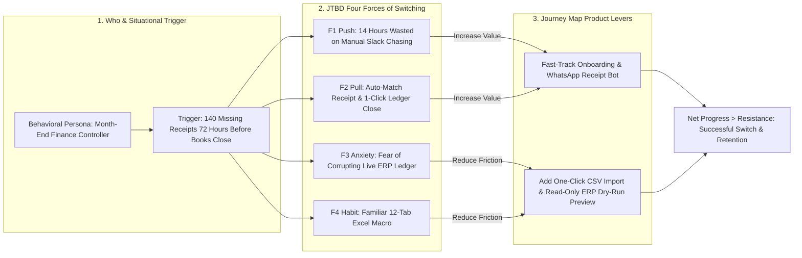

Product teams waste countless hours arguing over whether **User Personas** are obsolete and whether **Jobs to Be Done (JTBD)** should replace them entirely, while UX designers simultaneously build **Customer Journey Maps** in a separate silo. This debate rests on a false dichotomy. Personas, Jobs to Be Done, and Customer Journey Maps are not competing religions—they are three complementary lenses that answer three distinct questions about your customer:

- **Behavioral User Personas answer "WHO":** What role, workflow constraints, technical proficiency, and decision authority characterize the human actor using or buying the product?
- **Jobs to Be Done (JTBD) answers "WHY":** What specific situational trigger and desired progress cause that human to "hire" a product—and "fire" their previous solution?
- **Customer Journey Mapping answers "HOW & WHERE":** Across the chronological sequence of steps from initial trigger to recurring habit, where do emotional drops, handoff delays, and interface friction occur?

When used in isolation, each tool has a blind spot: demographic personas degenerate into fictional stereotypes (*"Marketing Mary, 34, loves yoga and iced lattes"*), pure JTBD statements can strip away critical B2B role permissions, and journey maps can document a broken workflow without questioning whether the underlying job could be automated entirely. This guide explains how to build behavioral personas, compares the two major schools of Jobs to Be Done ([Koji JTBD Complete Guide](https://www.koji.so/docs/jobs-to-be-done-framework)), demonstrates how to construct an actionable Customer Journey Map, and works through Tony Ulwick's quantitative Opportunity Algorithm.

## 1. Fixing User Personas: From Demographic Fiction to Behavioral Archetypes

Introduced to software design by Alan Cooper in the late 1990s, **User Personas** went off the rails when marketing agencies started filling templates with irrelevant demographic trivia (marital status, hobbies, stock photos) that have zero causal relationship with software usage. Knowing that a user is 38 years old and drives a sedan does not tell an engineer how to design an API error log.

To make a **Behavioral Product Persona** genuinely useful for product decisions, strip out all demographic fluff and document five operational attributes derived from real interviews (**Article 11**):
1. **Workflow Context & Domain Role:** E.g., *On-Call Site Reliability Engineer (SRE)* vs. *VP of FinOps* in a cloud monitoring platform.
2. **Primary Frequency & Mental Model:** Do they live inside the tool 6 hours every day (requiring keyboard shortcuts and high information density, like [Linear](https://linear.app/pricing)), or do they log in once a quarter (requiring guided wizards and zero setup learning curve)?
3. **Technical & Data Fluency:** Can they write regex and SQL queries, or do they require visual point-and-click filters?
4. **Ecosystem & Tool Stack:** Which adjacent tools (e.g., Slack, GitHub, Snowflake, Excel) feed into and out of their daily workflow?
5. **Buyer vs. End-User Authority (Especially in B2B):** Are they the **Daily Operator**, the **Technical Evaluator**, or the **Economic Buyer** signing the contract?

## 2. Jobs to Be Done (JTBD): Understanding the Two Schools of Thought

As documented in historical analyses of the framework ([Koji JTBD Guide](https://www.koji.so/docs/jobs-to-be-done-framework) and [Lenny's Newsletter / Bob Moesta Guide](https://www.lennysnewsletter.com/p/the-ultimate-guide-to-jtbd-bob-moesta)), **Jobs to Be Done** rests on the insight that people do not buy products simply to own software features; they "hire" a product to make specific progress in a struggling circumstance. Crucially, practitioners draw from two complementary schools of JTBD:

1. **The "Jobs-as-Progress / Switch" School (Clayton Christensen & Bob Moesta):** Focuses on the qualitative situational context that causes a customer to switch from an old solution to a new one, structured via the **Job Statement syntax**:  
   > **When** *[struggling situation / contextual trigger]*, **I want to** *[motivation / action]*, **so I can** *[expected outcome / progress without emotional or social friction]*.  
   Moesta and Christensen further model switching behavior using the **Four Forces of Progress**:
   - **Progress-Promoting Forces:** **F1 — Push of the Current Situation** (pain/frustration with the old workaround) + **F2 — Pull of the New Solution** (magnetism of the new capability).
   - **Progress-Blocking Forces:** **F3 — Anxiety of the New Solution** (fear of data loss, learning curve, or reliability failure) + **F4 — Habit / Allegiance to the Current Behavior** (switching costs and muscle memory).  
   *Rule:* A customer switches products only when $(\text{Push} + \text{Pull}) > (\text{Anxiety} + \text{Habit})$.
2. **The "Jobs-as-Activities / Outcome-Driven Innovation (ODI)" School (Tony Ulwick):** Originated by Tony Ulwick in 1990 ([Jobs-to-be-Done.com](https://jobs-to-be-done.com/)), ODI breaks a core functional job down into 50 to 100 granular **Desired Outcome Statements** (e.g., *"Minimize the time it takes to verify whether a vendor invoice contains duplicate line items"*) and surveys customers on **Importance** and **Satisfaction** to calculate underserved market opportunities mathematically.

## 3. Customer Journey Mapping: Pinpointing Friction Across Time

Once you know **Who** the behavioral persona is and **Why** they are trying to accomplish a Job to Be Done, a **Customer Journey Map** plots their exact chronological experience across five stages (**Trigger $\rightarrow$ Onboarding/Setup $\rightarrow$ Core Task Execution $\rightarrow$ Exception/Error Recovery $\rightarrow$ Value Realization/Sharing**).

Across each stage, a high-precision PM Journey Map records five horizontal swimlanes:
1. **User Action:** What the user clicks, types, or exports.
2. **System / Touchpoint:** Where the action happens (Web app, Mobile notification, Email, or External Excel sheet).
3. **Quantitative Funnel Drop-Off & Time-on-Task:** The actual conversion percentage and median duration at that exact step.
4. **Emotional Curve & Verbatim Quote:** Whether confidence is rising or crashing, grounded in usability test observations.
5. **Product Opportunity Owner:** Which squad owns fixing the friction at that step.

## Frameworks and Comparison Tables

### Table 12.1: Comparative Synthesis — User Personas vs. Jobs to Be Done vs. Customer Journey Maps

| Dimension | Behavioral User Persona | Jobs to Be Done (JTBD) | Customer Journey Map |
| :--- | :--- | :--- | :--- |
| **Core Question Answered** | **WHO** is the actor and what are their constraints/permissions? | **WHY** are they motivated to act and switch solutions right now? | **HOW & WHERE** do they move step-by-step across the workflow? |
| **Primary Unit of Analysis** | The user/buyer archetype (skills, environment, frequency, role) | The struggling circumstance, desired progress, and Four Forces | The chronological timeline of stages, touchpoints, and drop-offs |
| **When It Is Most Useful** | Calibrating UI density, permission roles (RBAC), and B2B GTM targeting | Defining product strategy (**Article 06**), value propositions, and true competitors | Diagnosing onboarding drop-offs, UX handoff gaps, and multi-channel friction |
| **What It Fails to Do Alone** | Does not explain *what triggers* a purchase or action on a given Tuesday | Can obscure critical skill differences between a novice user and a power admin | Documents current steps without questioning if 4 steps can be automated into 1 |
| **Primary Artifact Format** | 1-Page Behavioral Archetype Card | Job Statement (`When / I want / So I can`) + Forces Matrix + ODI Score | Horizontal Multi-Stage Swimlane Table + Funnel Metric Overlay |

### Table 12.2: Unified B2B Workflow Example — Combining Persona, JTBD, and Journey Map for Corporate Expense Management

| Framework Layer | Applied Specification (Hypothetical B2B Mid-Market Finance Team) |
| :--- | :--- |
| **1. Behavioral Persona ("Who")** | **Archetype:** *Month-End Finance Controller ("Priya")* · **Context:** Reconciles 800+ employee card transactions during the final 3 days of every month · **Fluency:** Advanced Excel/ERP user, zero coding · **Constraint:** Audited quarterly; cannot tolerate missing GST tax receipts. |
| **2. Core JTBD ("Why")** | **When** it is Day 28 of the month and 140 employees have not uploaded receipts for corporate card swipes, **I want to** automatically match receipts and freeze non-compliant cards without chasing employees on Slack, **so I can** close the monthly general ledger on time with zero audit exceptions. |
| **3. Four Forces of Progress** | **Push:** Spending 14 hours every month manually DMing employees for PDF receipts. **Pull:** Automated WhatsApp/Slack receipt capture + instant ERP sync. **Anxiety:** *"What if the automated sync posts duplicate journal entries into our live NetSuite ledger?"* **Habit:** Existing 12-tab Excel reconciliation macro used for 4 years. |
| **4. Journey Map Bottleneck ("Where")** | **Stage 3 (Exception Handling):** 34% of new controllers abandon the automated ERP sync screen because there is no "Dry-Run Sandbox Preview" showing exactly which ledger accounts will be debited before committing (**Anxiety Force F3**). *Product Fix:* Build a 1-click Read-Only Ledger Diff Preview. |

## Visualizing the Framework

The following architecture diagram illustrates the workflow and decision criteria:

## Practical Worked Example

**Scenario (Hypothetical Cloud Database Platform — *QueryScale*):**  
Following Tony Ulwick's **Outcome-Driven Innovation (ODI)** methodology ([Jobs-to-be-Done.com](https://jobs-to-be-done.com/) and [Koji JTBD Guide](https://www.koji.so/docs/jobs-to-be-done-framework)), your team surveys **200 data engineers** across 5 granular Desired Outcome Statements. For each outcome, respondents rate two questions on a 1-to-5 scale:
1. **Importance ($I$):** What percentage of respondents rate this outcome **4 or 5 (Very or Extremely Important)**? (Expressed on a $0\text{ to }10$ scale, where $85\% = 8.5$).
2. **Satisfaction ($S$):** What percentage of respondents rate their current solution **4 or 5 (Very or Extremely Satisfied)**? (Expressed on a $0\text{ to }10$ scale, where $30\% = 3.0$).

**The Official ODI Opportunity Algorithm Formula:**
$$\text{Opportunity Score} = \text{Importance} + \max(\text{Importance} - \text{Satisfaction},\ 0)$$
- **Interpretation Thresholds:**
  - $\text{Score} > \mathbf{15.0}$: **Extreme Underserved Opportunity** (High priority for product differentiation).
  - $\text{Score } \mathbf{12.0\text{ to }15.0}$: **Solid Underserved Opportunity** (Core roadmap candidate).
  - $\text{Score } \mathbf{10.0\text{ to }12.0}$: **Appropriately Served** (Table stakes; maintain parity).
  - $\text{Score} < \mathbf{10.0}$ (especially when $S > I$): **Overserved Market** (Do not invest feature R&D; potential candidate for cost reduction or simplification).

**Worked Calculation Across 5 Candidate Desired Outcomes ($N = 200$ Data Engineers):**

| Desired Outcome Statement (JTBD Activity Step) | Importance ($I$, 0–10 scale) | Current Satisfaction ($S$, 0–10 scale) | Gap $\max(I - S, 0)$ | **ODI Opportunity Score** & Strategic Decision |
| :--- | :--- | :--- | :--- | :--- |
| **O1:** Minimize the time required to isolate which runaway SQL query spiked cloud warehouse credit consumption | **9.2** *(92% rate 4–5)* | **2.6** *(26% rate 4–5)* | $9.2 - 2.6 = \mathbf{6.6}$ | **$9.2 + 6.6 = \mathbf{15.8}$ (Rank #1 — Extreme Underserved; Build Real-Time Cost Anomaly Killer)** |
| **O2:** Minimize the likelihood that an upstream schema change silently breaks downstream BI dashboards | **8.8** *(88% rate 4–5)* | **3.1** *(31% rate 4–5)* | $8.8 - 3.1 = \mathbf{5.7}$ | **$8.8 + 5.7 = \mathbf{14.5}$ (Rank #2 — Solid Underserved; Build Pre-Commit Lineage Check)** |
| **O3:** Minimize the time required to provision a read-replica for a new analytics teammate | **7.5** *(75% rate 4–5)* | **6.2** *(62% rate 4–5)* | $7.5 - 6.2 = \mathbf{1.3}$ | **$7.5 + 1.3 = \mathbf{8.8}$ (Rank #3 — Appropriately Served; Maintain current flow)** |
| **O4:** Maximize the number of custom color palettes available in the SQL editor window | **2.4** *(24% rate 4–5)* | **7.8** *(78% rate 4–5)* | $\max(-5.4, 0) = \mathbf{0.0}$ | **$2.4 + 0.0 = \mathbf{2.4}$ (Rank #4 — Overserved; Reject cosmetic UI requests)** |

**Why This Formula Works:** If you only looked at raw Importance, `O1` ($9.2$) and `O3` ($7.5$) seem moderately close. By adding the **Unsatisfied Gap ($\max(I - S, 0)$)**, the ODI algorithm amplifies outcomes where importance is high *and* existing tools fail miserably (`O1` jumps to **$15.8$**, nearly double `O3`'s **$8.8$**).

## Common Mistakes and Limitations

1. **Writing "Feature-Disguised" Job Statements:** Writing *"When I open the app, I want to click a PDF export button so I can have a PDF"* is not a Job to Be Done—it embeds your own UI solution inside the job. A valid Job Statement describes the **underlying human or business progress** completely independent of your technology (*"...so I can prove quarterly audit compliance to our external regulator without manual formatting"*).
2. **Ignoring Emotional and Social Dimensions of a Job:** Even in B2B enterprise software, purchasing and usage decisions are heavily governed by **Emotional Jobs** (avoiding embarrassment in front of the CFO or preventing a 2:00 AM PagerDuty wake-up call) and **Social Jobs** (being perceived by peers as a rigorous, data-driven leader).
3. **Building Beautiful Journey Map Posters That Never Connect to Telemetry:** Many teams hire an agency to design a colorful PDF Journey Map that sits in a Google Drive folder untouched for two years. A Journey Map is useful only when each stage is wired to live product analytics funnel conversion rates (**Article 17**).

## Practical Implementation Checklist

- [ ] **Zero Demographic Fluff:** Have we removed age, marital status, stock photos, and fictional hobbies from our User Personas and replaced them with workflow frequency, technical fluency, and RBAC buyer/user roles?
- [ ] **Solution-Free Job Statements:** Are all of our JTBD statements written in pure `When [situation] / I want to [motivation] / So I can [progress]` syntax without naming specific UI buttons?
- [ ] **Four-Forces Audit:** Have we explicitly identified the **Anxiety ($F_3$)** and **Habit ($F_4$)** forces that block users from switching to our product, and designed onboarding features (such as 1-click imports or sandbox previews) to neutralize them?
- [ ] **Quantified Journey Stages:** Does every stage on our Customer Journey Map display the actual telemetry conversion rate and median completion time?
- [ ] **Buyer vs. User Separation (B2B):** If our buyer and daily user are different people, have we mapped their distinct Jobs to Be Done separately?

## Frequently Asked Questions

### 1. Should a startup create User Personas or Jobs to Be Done first?
Start with **Jobs to Be Done (JTBD)** first—especially in early-stage or zero-to-one products—because two users who look completely different demographically often share the exact same struggling circumstance and hire the exact same product. Once you have validated the core Job to Be Done, layer on **Behavioral Personas** to account for differences in role permissions, technical skill, and enterprise buying authority.

### 2. Who are the true competitors of a product according to Jobs to Be Done theory?
In JTBD theory, your primary competitor is rarely another startup in your G2 category—your primary competitor is **non-consumption, manual spreadsheets, WhatsApp messages, or an internal workaround hired for the same job**. For example, a B2B workflow automation platform competes far more often with *"an operations analyst copying and pasting between Excel and Gmail for 3 hours on Friday"* than with a rival SaaS vendor.

### 3. How many User Personas should a single product have?
Keep your core persona set strictly between **2 and 4 distinct behavioral archetypes** per product line (e.g., in an analytics platform: *The Data Engineer / Admin*, *The Daily Business Analyst*, and *The Executive Dashboard Consumer*). When a company creates 12+ personas, engineers and designers cannot hold them in working memory, and the personas cease to guide design trade-offs.

### 4. What is a "Switch Interview" in Bob Moesta's JTBD methodology?
A **Switch Interview** ([Lenny's Newsletter / Bob Moesta Guide](https://www.lennysnewsletter.com/p/the-ultimate-guide-to-jtbd-bob-moesta)) is a 45-to-60 minute forensic timeline interview conducted with a customer who **recently purchased your product (or recently churned to a competitor)**. Like a documentary director, you trace their exact chronological timeline backwards: *First Thought $\rightarrow$ Passive Looking $\rightarrow$ First Trigger Event $\rightarrow$ Active Looking $\rightarrow$ Deciding Trade-Offs $\rightarrow$ First Usage Experience*, uncovering the exact Push, Pull, Anxiety, and Habit forces at play.

### 5. What is the difference between a Customer Journey Map and a Service Blueprint?
A **Customer Journey Map** visualizes the experience from the **front-stage perspective of the customer** (what the user sees, clicks, and feels). A **Service Blueprint** adds the **back-stage operational and technical layers underneath each customer step**—mapping which internal support agents, APIs, database queues, and third-party webhooks execute behind the scenes to make that front-stage step work.

### 6. How often should Personas and Customer Journey Maps be updated?
Review your Customer Journey Map's quantitative funnel metrics **monthly or quarterly** as onboarding and core workflows evolve, and refresh your foundational JTBD and Behavioral Persona research **annually** (or whenever you expand into a new market segment, buyer tier, or product line).

## Next Steps and Recommended Reading

User Personas, Jobs to Be Done, and Customer Journey Mapping form a single, unified discovery architecture: **Personas** define the actor's constraints, **JTBD** reveals the causal motivation and switching forces, and **Journey Maps** expose the exact step-by-step workflow bottlenecks. When you combine all three with quantitative scoring like Ulwick's Opportunity Algorithm, product design moves from guesswork to precision engineering.

**Practical Next Step:** Schedule five 30-minute **Switch Interviews** this month with customers who upgraded to a paid plan in the last 30 days. Map their answers across the **Four Forces of Progress** (`Push`, `Pull`, `Anxiety`, `Habit`) and identify the #1 `Anxiety` force you can eliminate in your onboarding flow next sprint.

**Recommended Follow-Up Reading:** Continue to **Article 13: Product-Market Fit: Meaning, Metrics, Examples and Validation** (`/blog/product/product-market-fit-meaning-metrics-examples/` — *Planned Destination*) to learn how solving a high-priority Job to Be Done translates into measurable, compounding Product-Market Fit.

## About this guide

Aniket Thakur prepared this comprehensive Product Management guide based on continuous discovery frameworks, operational research, and practitioner benchmarks checked on 24 October 2026. All quantitative scenarios in Section G are explicitly labelled hypothetical worked examples illustrating decision math.
