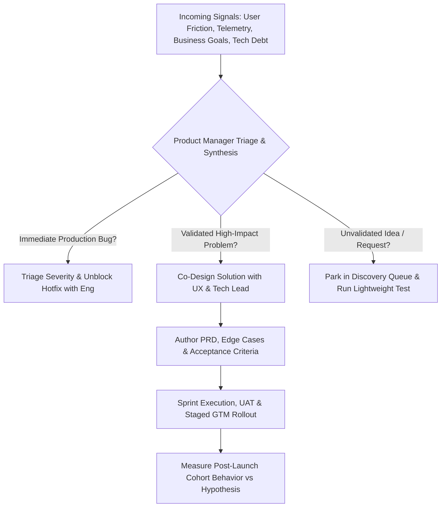

If engineers write production code, product designers create Figma interfaces, and data scientists train models, what tangible work does a Product Manager actually produce? Because a PM does not directly push code or pixels to production, outsiders often mistake the role for a meeting scheduler or note-taker.

In reality, a Product Manager's primary output is **high-leverage decisions backed by structured context**. A PM reduces ambiguity for the entire engineering and design organization. Every day, a PM translates messy, conflicting inputs—customer complaints, database constraints, regulatory rules, and executive revenue targets—into clear problem definitions, prioritized backlogs, unambiguous acceptance criteria, and measurable launch plans. 

When a PM does their job well, a 10-person engineering and design squad moves twice as fast because they never have to stop mid-sprint to ask, *"Wait, what happens if a user triggers a partial refund while their account is suspended?"*

This article strips away vague job-description buzzwords to show you the exact artifacts a PM creates, how a realistic 40-hour PM workweek is allocated, where PM ownership starts and stops, and how expectations evolve from an Associate Product Manager (APM) to a Director of Product.

## The Five Core Pillars of Daily PM Work

While no two days look identical—because your calendar shifts depending on whether your squad is in early discovery, mid-sprint crunch, or launch week—almost every PM task falls into five operational buckets:

1. **Customer & Market Discovery (20–30% of time):** Conducting 1-on-1 user interviews, reviewing support ticket clusters, shadowing sales calls, and analyzing competitor workflows to understand unmet customer needs.
2. **Product Analytics & Telemetry Auditing (15–20% of time):** Querying SQL databases or analytics dashboards to monitor conversion funnels, retention cohorts, A/B test guardrails, and anomaly drops.
3. **Requirements Definition & Backlog Curation (20–25% of time):** Writing Product Requirements Documents (PRDs), mapping edge-case state machines, reviewing Figma prototypes with designers, and refining upcoming sprint tickets with engineering leads.
4. **Cross-Functional Execution & Unblocking (15–20% of time):** Participating in daily standups, answering edge-case questions from developers within hours so PRs aren't blocked, running UAT (User Acceptance Testing) before release, and triaging production bugs by severity.
5. **Stakeholder Alignment & GTM Enablement (15–20% of time):** Negotiating scope trade-offs with leadership, training customer support and sales teams on upcoming features, and writing release notes or internal launch briefs.

## Concrete Deliverables: What a PM Actually Writes and Owns

Because PMs do not own the codebase, their craftsmanship shows up in the clarity and rigor of their written and analytical artifacts:

- **Opportunity Assessments / One-Pagers:** Short, evidence-backed memos explaining why a problem is worth solving, how many users it affects, and the expected impact on business KPIs before design begins.
- **Product Requirements Documents (PRDs):** The single source of truth for a feature, covering user stories, functional requirements, API/data dependencies, explicit non-goals, and latency/security constraints.
- **Prioritized Roadmaps & Backlogs:** A living, sequenced queue of upcoming initiatives (Now / Next / Later) and groomed sprint tickets where every item has clear acceptance criteria.
- **Experiment & Launch Plans:** Documentation defining rollout cohorts (e.g., 5% canary $\rightarrow$ 25% $\rightarrow$ 100%), feature flag kill-switches, primary evaluation metrics, and guardrail thresholds.
- **Post-Launch Impact Reviews:** Quantitative assessments published 14–30 days after launch comparing actual user adoption and funnel movement against the original PRD hypothesis.

## Ownership Boundaries: What a PM Does Not Do

High-performing product teams maintain crisp boundaries so roles do not step on each other:

- **PMs own the "What" and the "Why"** (and the "When" at a macro roadmap level).
- **Product Designers own the "How it looks and flows"** (interaction patterns, visual hierarchy, UX copy). A PM should critique a wireframe by saying, *"Merchants on mobile won't see the tax breakdown above the fold, which caused 30% of support tickets last month,"* rather than saying, *"Make that button blue and move it 10 pixels left."*
- **Engineers own the "How it is built and estimated."** A PM never dictates story point estimates or forces an engineer to use a specific database index; instead, the PM explains the throughput and latency requirements (e.g., *"Must support 500 concurrent requests under 200ms p95"*) and lets engineering propose the technical architecture.

## Specialization Archetypes: Growth, Core, Platform, and AI PMs

Not all Product Managers solve the same types of problems:

- **Core / Experience PM:** Focuses on end-user workflows, feature depth, usability, and persona pain points (e.g., building a loan origination dashboard or checkout flow).
- **Growth PM:** Operates like an applied scientist focused on specific funnel levers—acquisition, activation, referral, monetization, and resurrection—running high-velocity A/B tests.
- **Platform / Technical PM:** Serves internal engineering teams or external API developers; focuses on system reliability, SDK ergonomics, microservices consolidation, and unit cost reduction.
- **AI / ML Product Manager:** Manages probabilistic systems where outputs are non-deterministic; focuses on evaluation datasets (evals), precision/recall trade-offs, prompt/model routing, latency, and human-in-the-loop fallback workflows.

## Career Progression Matrix: APM to Director of Product

| Dimension | Associate PM (APM / Junior) | Product Manager (Mid-Level) | Senior Product Manager | Group PM / Director of Product |
|---|---|---|---|---|
| **Scope of Ownership** | Single feature module or sub-workflow within one squad. | End-to-end product area or full cross-functional squad. | Complex, multi-squad product surface or core revenue line. | Portfolio of multiple product lines and management of 3–8 PMs. |
| **Time Horizon** | Current sprint to 1 quarter out (1–3 months). | 1 to 2 quarters out (3–6 months). | Annual strategy and multi-quarter roadmap (6–12 months). | 1–3 year portfolio vision, M&A/build-vs-buy, and org design. |
| **Problem Ambiguity** | Given a well-defined problem by a Senior PM; executes solution & delivery. | Given a metric goal (e.g., "Lift activation by 15%"); discovers problems & executes. | Identifies net-new strategic problems and market gaps autonomously. | Allocates headcount and capital across competing product bets. |
| **Primary Failure Mode** | Missing edge cases in PRDs; acting as a passive ticket scribe. | Building features without validating unit economics or GTM adoption. | Over-indexing on local squad politics instead of company-level P&L. | Micromanaging individual PRDs instead of coaching PMs and setting strategy. |

## A Realistic Weekly Calendar for a Mid-Level PM

| Day | Morning Block (09:30 – 13:00) | Afternoon Block (14:00 – 18:00) | Primary Output Produced |
|---|---|---|---|
| **Monday** | Funnel & KPI audit (SQL/Mixpanel); Weekly squad sync & sprint goal alignment. | Deep work: Drafting PRD and edge-case tables for next sprint's epic. | Weekly KPI health note; Draft PRD v1. |
| **Tuesday** | 2× Customer Discovery Interviews (45 mins each + synthesis notes). | Design critique & wireframe review with Product Designer; Engineering technical spike check-in. | Structured interview synthesis; Validated Figma user flows. |
| **Wednesday** | Backlog refinement & ticket grooming with Engineering Tech Lead. | No-meeting focus block: Analyzing A/B test cohort data & writing acceptance criteria. | Groomed, sprint-ready Jira/Linear backlog. |
| **Thursday** | Cross-functional sync with Sales, Support, or Legal/Compliance on launch blockers. | 1× Customer Usability Test on prototype; Bug triage & UAT testing on staging environment. | Go-to-market FAQ doc; UAT sign-off for release. |
| **Friday** | Sprint Demo / Review OR Bi-weekly Retro; Post-launch metric audit. | Strategic reading, competitor teardown, and planning next week's discovery priorities. | Release notes; Updated Now/Next/Later roadmap. |

## Weekly Time Allocation Shift Across Career Levels

| Activity Category | APM / Junior PM (%) | Mid-Level PM (%) | Senior PM (%) | Group PM / Director (%) |
|---|---|---|---|---|
| **Tactical Execution, QA & Ticket Grooming** | 50% | 30% | 15% | 5% |
| **Customer Discovery & Data Analysis** | 25% | 30% | 25% | 15% |
| **Product Strategy & Roadmap Planning** | 10% | 20% | 35% | 40% |
| **Stakeholder Alignment, Org & Coaching** | 15% | 20% | 25% | 40% |

## Product Decision Flowchart

The following workflow illustrates how a Product Manager triages incoming signals, balances discovery with execution, and unblocks engineering delivery:

## Practical Worked Example: Navigating a Mid-Sprint Scope Trade-Off

Imagine you are the Product Manager for a hypothetical automotive financing marketplace. Your team is 6 days into a 10-day sprint building an Instant Pre-Approval Loan Calculator aimed at increasing verified dealer leads by 20%.

### The Wednesday Crisis
At 11:00 AM, your backend engineer messages you: *"The third-party credit bureau API we rely on is timing out on 18% of requests when users have thin credit files (no prior credit history). Building a full fallback parser for their secondary XML endpoint will take 5 extra engineering days—pushing our launch past the festive season sale."*

### What an Effective PM Does Step-by-Step

1. **Quantify the Blast Radius (11:15 AM):** The PM queries the production database for the last 30 days of loan applicants. They discover that thin-file applicants represent 14% of total traffic, while the remaining 86% have standard credit files that resolve in 400ms on the primary JSON API.
2. **Evaluate Options with Engineering & Design (12:00 PM):**
   - *Option 1:* Delay the whole launch by 5 days to support 100% of users on Day 1. (Cost: Lose 5 peak festive days for the 86% standard cohort).
   - *Option 2:* Ship on time for the 86% standard cohort. For the 14% thin-file cohort where the API times out after 2.5 seconds, gracefully route them to an "Income-Based Estimate + Priority Callback" screen that takes 2 hours of frontend work to implement, and schedule the secondary XML parser for the next sprint.
3. **Make and Document the Decision (12:45 PM):** Selects Option 2. Updates the PRD acceptance criteria, adds an analytics tracking event (`credit_api_timeout_fallback_triggered`), notifies the call-center operations lead to expect ~14% callback leads, and protects the festive launch date.

## Common Mistakes and Limitations

- **Becoming a Human Router / Project Secretary:** Spending 35 hours a week copying status updates from Jira into Slack and PowerPoint slides for executives leaves zero time for customer discovery or data analysis. Automate status reporting with shared dashboards so your time stays focused on product decisions.
- **Writing Novel-Length PRDs Nobody Reads:** A 25-page text wall hides critical edge cases. Engineers scan tables, state diagrams, bulleted acceptance criteria, and annotated Figma links far more effectively than dense prose.
- **Organizational Limitation — When PMs Have No Access to Users:** In some legacy enterprises, sales or account management teams block PMs from speaking directly to customers. In those environments, a PM must use indirect discovery channels (session replay tools, call recordings, and support ticket tagging) while campaigning leadership for direct user access.

## Practical Weekly Checklist for Product Managers

- [ ] **Customer Contact:** Did I speak to or watch session recordings of at least 2–3 real users this week?
- [ ] **Metric Hygiene:** Did I check our core North Star and guardrail metrics for unexpected cohort drops?
- [ ] **Engineering Unblocking:** Are the next 1–2 sprints of tickets refined with clear acceptance criteria and edge cases so engineers aren't blocked on Monday morning?
- [ ] **Protected Deep Work:** Do I have at least two 2-hour no-meeting blocks on my calendar this week for analytical and strategic work?
- [ ] **Post-Launch Follow-Up:** Did I audit the performance of features shipped 2–4 weeks ago rather than moving straight to the next shiny ticket?

## Frequently Asked Questions

### How many hours a week does a Product Manager typically work?
In most structured technology companies, PMs work between 40 and 50 hours per week. Weeks may temporarily spike during major product launches, severe production incidents, or quarterly roadmap planning cycles, but chronic 65-hour weeks usually signal poor delegation or broken prioritization processes.

### Who does a Product Manager report to?
In product-led organizations, PMs report to a Senior PM, Group Product Manager (GPM), Director of Product, or VP of Product / Chief Product Officer (CPO). In early-stage startups, PMs typically report directly to the CEO or CTO.

### How many engineers does one Product Manager work with?
The industry benchmark across software companies is typically 1 Product Manager and 1 Product Designer for every 5 to 9 engineers (one Agile squad). If a PM is stretched across 20+ engineers without APM support, they get pulled entirely into backlog grooming and lose time for discovery.

### Do Product Managers write SQL queries themselves?
Increasingly, yes. While data analysts and data scientists handle complex causal inference and multi-table warehouse modeling, self-serve SQL allows a PM to answer daily funnel and cohort sizing questions in 5 minutes instead of waiting 4 days in an analytics ticket queue.

### What is the hardest part of a Product Manager's daily job?
Saying "no" (or "not right now") to smart, well-intentioned stakeholders—including sales leads, executives, and engineers—while keeping them aligned and motivated around the top-priority goals.

## Next Steps and Recommended Reading

A great Product Manager is a force multiplier for their squad. By absorbing ambiguity, grounding decisions in user and telemetry evidence, and documenting crystal-clear requirements, you allow engineers and designers to do the best work of their careers on problems that genuinely move the business forward.

To expand your product management toolkit:

- Read [What Is Product Management? A Complete Beginner's Guide](/blog/product/what-is-product-management/) for foundational discipline principles.
- Compare how PM duties differ from adjacent execution roles in [Product Manager vs Project Manager vs Business Analyst](/blog/product/product-manager-vs-project-manager-vs-business-analyst/).
- Follow our career roadmap in [How to Become a Product Manager: Skills, Portfolio and Career Roadmap](/blog/product/how-to-become-a-product-manager/).
- Explore our [Data Science & Prompt-Based BI Topic Hub](/topics/index.html) to build self-serve analytics skills.

## About this guide

Aniket Thakur prepared this operational guide based on software engineering industry benchmarks, cross-functional squad operating rhythms, and product management career leveling standards checked on 24 October 2026. The automotive loan API timeout scenario in Section G is an explicitly labelled hypothetical worked example illustrating mid-sprint trade-offs.
