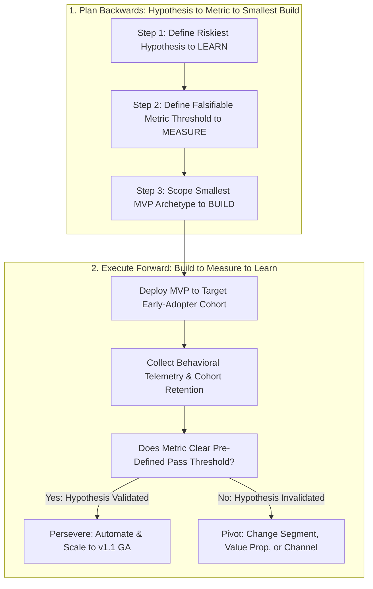

No three-letter acronym in technology is invoked more frequently—or misunderstood more destructively—than **MVP (Minimum Viable Product)**. In dysfunctional organizations, "MVP" is used either as an excuse by engineers and PMs to ship a buggy, half-finished interface that embarrasses users (all *Minimum*, zero *Viable*), or as a synonym for a bloated 9-month "Phase 1" waterfall release where stakeholders cram every pet feature into the spec because they know "Phase 2" will never get funded (zero *Minimum*).

Popularized by **Eric Ries** in [*The Lean Startup*](https://theleanstartup.com/principles) (building on concepts from Frank Robinson and Steve Blank), a **Minimum Viable Product** is defined strictly as **that version of a new product which allows a team to collect the maximum amount of validated learning about customers with the least effort**. As Strategyzer and Ries emphasize ([Don't Build When You Build-Measure-Learn](https://www.strategyzer.com/library/dont-build-when-you-build-measure-learn)), an MVP is not necessarily the smallest software code imaginable—it is the fastest, most capital-efficient experiment that tests your riskiest business hypothesis with real behavioral skin in the game. This guide clarifies the exact boundary between a Proof of Concept (PoC), a Prototype, an MVP, a Pilot, and a Beta release; catalogs six proven MVP archetypes; provides a step-by-step scope-cutting methodology; and demonstrates a quantitative cost-of-validation calculation.

## 1. Disambiguating the Terminology: PoC vs. Prototype vs. MVP vs. Pilot vs. Beta

Before scoping your next initiative, align your engineering and executive teams on what artifact you are actually building:

1. **Proof of Concept (PoC — Tests Isolated Technical Feasibility):** An internal engineering spike or script designed to answer a single binary question: *"Can our system technically do X?"* (e.g., *"Can a fine-tuned 8B open-weight model extract 50 invoice fields in under 600ms on a single L4 GPU?"*). A PoC has zero UI and is never shown to external customers.
2. **Prototype (Tests Design Usability & Conceptual Appeal):** A clickable [Figma](https://uichemy.com/blog/figma-pricing/) mockup or throwaway front-end shell tested with 5–10 users (**Article 14**) to answer: *"Can users understand the workflow?"* It does not persist production data or charge real money.
3. **Minimum Viable Product (MVP — Tests Market Value & Behavioral Viability in the Wild):** The smallest functional solution—whether powered by automated code, no-code glue, or human-in-the-loop operations behind the scenes—put into the hands of real target customers to test whether they **adopt, retain, or pay**.
4. **Pilot / Private Alpha (Tests Enterprise Integration & Real-World Workflow Fit):** A controlled deployment of the MVP with 3 to 10 contracted B2B design-partner companies to validate security, edge cases, and ROI case studies before broad marketing.
5. **Beta Release (Tests Scale, Performance & Edge-Case Reliability):** A feature-complete pre-GA release opened to a larger user cohort to stress-test server load, p99 latency, and cross-device bugs prior to 100% General Availability (**Article 19**).

## 2. Six Proven MVP Archetypes (Matching Effort to Your Riskiest Assumption)

A huge misconception is that every MVP requires three months of full-stack Kubernetes engineering. Depending on which hypothesis is riskiest, choose from six escalating MVP archetypes:

1. **The Search Demand & Smoke-Test / Fake-Door MVP (Pre-Build Demand Validation):** Before writing application logic, verify active buyer intent using search-demand telemetry (as detailed in Aniket Thakur's [*Why Market Validation Trumps Vibes: A Three-Step Query Framework*](https://07anishu12.github.io/learnings.html)) paired with a dedicated landing page or an in-app "Fake Door" button that measures actual click-to-signup or pre-order intent rate.
2. **The Concierge MVP (Visible Manual Service):** You deliver the exact end-to-end outcome to your first 10 customers **manually and visibly** before automating the software. For example, before building an automated B2B cloud-cost optimization SaaS, you log into 5 clients' AWS consoles manually every Friday, generate the savings report by hand, and charge \$500/month. This proves both willingness to pay and the exact rules your algorithm actually needs.
3. **The Wizard of Oz / "Flintstone" MVP (Front-End Automated UI, Back-End Human-in-the-Loop):** To the customer, the front-end web app looks like an automated self-serve product; behind the curtain, a founder or operations specialist fulfills the request manually (famously used by Zappos founder Nick Swinmurn, who photographed shoes at local malls and bought them at retail only when a user placed an online order).
4. **The Single-Feature / "Piecemeal" No-Code MVP:** Combines off-the-shelf APIs, Typeform, Stripe Checkout, Zapier, and a lightweight front-end to deliver **one razor-sharp workflow** rather than building custom billing, auth, and admin portals from scratch.
5. **The Shadow-Mode / Read-Only Analytics MVP (Ideal for Regulated Fintech & AI):** Connects to a customer's live data stream in **read-only mode** (zero write/mutation risk) to surface alerts, anomalies, or draft recommendations before building complex two-way execution engines.
6. **The Scoped Code MVP (Minimum Lovable / Marketable Slice):** A production-coded vertical slice that solves **one complete Job to Be Done** end-to-end with high reliability and polish, while omitting secondary settings, multi-role hierarchies, and edge integrations.

## 3. How to Cut MVP Scope Without Shipping Broken Junk ("Slice Vertically, Not Horizontally")

As Agile coach Henrik Kniberg illustrated in his famous "Skateboard $\rightarrow$ Scooter $\rightarrow$ Bicycle $\rightarrow$ Motorcycle $\rightarrow$ Car" analogy, a bad MVP builds a **single car wheel** in Month 1 (which transports nobody and generates zero learning). A true MVP builds a **skateboard** in Week 2—a narrow but **complete vertical slice** across all layers (UI + Core Logic + Value Delivery) that actually moves the user from Point A to Point B, even if it is not yet a luxury sedan.

To ruthlessly cut a 6-month specification down to a 4-week MVP without sacrificing quality on the core flow:
- **Cut Persona Breadth:** Build strictly for **1 single persona** (e.g., *Solo Account Admin*) in v1; defer multi-tiered RBAC permissions (`Viewer`, `Approver`, `Auditor`) until v2.
- **Cut Edge-Case Automation (Not Core Reliability):** Automate the **80% common format** (e.g., standard UTF-8 CSV uploads), and route the 20% weird legacy formats to a polite human support queue in v1.
- **Never Cut Core Trust, Security, or Data Integrity:** "Minimum" never means leaking user passwords, corrupting financial ledgers, or shipping a broken checkout button.

## Frameworks and Comparison Tables

### Table 15.1: Artifact Comparison — PoC vs. Prototype vs. MVP vs. Beta vs. GA

| Dimension | Proof of Concept (PoC) | UX Prototype | Minimum Viable Product (MVP) | Beta Release | General Availability (GA) |
| :--- | :--- | :--- | :--- | :--- | :--- |
| **Core Question Answered** | *"Is this technically possible?"* | *"Is this interface understandable?"* | *"Will real users adopt or pay for this core value?"* | *"Does it hold up under real scale and edge cases?"* | *"Can we scale this across our full market with SLAs?"* |
| **Target Audience** | Internal engineers & PM | 5–10 recruited test participants | Early-adopter beachhead customers | Opt-in beta cohort (5%–25% of base) | 100% of target market & sales pipeline |
| **Production Code Quality** | Throwaway script / notebook | Clickable Figma or mock frontend | Working vertical slice (code or Wizard of Oz) | Production code with monitoring flags | Hardened production code with full SLAs |
| **Primary Success Metric** | Binary feasibility / latency benchmark | Task completion rate ($\ge 80\%$) | Activation rate, retention, or paid conversion | Crash-free rate, p99 latency, guardrail stability | ARR, Net Revenue Retention, North Star lift |

### Table 15.2: Choosing the Right MVP Archetype by Risk Profile

| MVP Archetype | Engineering Time to Launch | Best Risk Tested | Real-World / Domain Use Case | When It Fails (Limitation) |
| :--- | :--- | :--- | :--- | :--- |
| **1. Search Query & Smoke-Test Page** | 1–3 Days | **Value / Demand Risk** (Do buyers actively search and click?) | Validating B2B SaaS keyword demand & signup intent before coding ([Query Framework](https://07anishu12.github.io/learnings.html)) | Tests initial curiosity/intent, not long-term product retention |
| **2. Concierge MVP** | 3–7 Days | **Solution Workflow Risk** (What exact steps deliver value?) | Manually auditing 10 clients' cloud bills or loan files for a monthly fee | Cannot scale past 10–20 accounts; high human labor cost |
| **3. Wizard of Oz MVP** | 1–2 Weeks | **Behavioral Usage Risk** (Will users submit tasks & trust outputs?) | Front-end upload portal where analysts verify complex PDF extractions behind the scenes | Latency is limited by human turnaround speed (hours vs seconds) |
| **4. Scoped Vertical-Slice Code MVP** | 3–6 Weeks | **End-to-End Self-Serve Activation & Retention** | Shipping 1-click GitHub PR bug checks for Python only before adding 12 other languages | Requires real engineering commitment; wasteful if demand was never tested first |

## Visualizing the Framework

The following architecture diagram illustrates the workflow and decision criteria:

## Practical Worked Example

**Scenario (Hypothetical B2B SaaS Startup — *ContractGuard AI*):**  
*ContractGuard AI* wants to build an automated procurement contract review platform for mid-market legal and finance teams. The founding team initially drafts a "Version 1.0 Specification" containing **8 modules totaling 26 engineering weeks (6.5 months)** at a loaded burn rate of **\$15,000/week (\$390,000 total capital commitment)**:

1. **Module 1 (4 wks):** Custom Word (`.docx`) & PDF ingestion + deterministic clause risk extraction for **Vendor MSAs & SaaS Order Forms** (highlighting uncapped liability, auto-renewal traps, and payment terms).
2. **Module 2 (5 wks):** Custom browser extension for Google Docs and Microsoft Word 365 desktop add-in.
3. **Module 3 (4 wks):** Multi-tier enterprise RBAC approval workflow builder (`Paralegal` $\rightarrow$ `General Counsel` $\rightarrow$ `CFO`).
4. **Module 4 (4 wks):** Bi-directional Salesforce, HubSpot, and Ironclad CLM integrations.
5. **Module 5 (3 wks):** Multi-language legal translation engine (German, Japanese, Spanish, French).
6. **Module 6 (2 wks):** Custom SOC2 audit log exporter and SAML SSO.
7. **Module 7 (2 wks):** Automated redline email negotiation bot that emails the vendor's lawyer directly.
8. **Module 8 (2 wks):** Executive analytics dashboard showing historical legal cycle times.

**Applying the MVP Risk-Scoping Audit:**
- **What is the #1 Riskiest Hypothesis right now?** *"Will mid-market finance/legal buyers trust an AI redline summary on their Vendor MSAs enough to upload real contracts weekly and pay \$500/month?"*
- Notice that Modules 2, 3, 4, 5, 6, 7, and 8 (**22 weeks of effort / \$330,000**) are completely useless if buyers do not trust the core clause extraction in **Module 1**! Worse, **Module 7 (Automated email bot to vendor lawyers)** triggers severe **Anxiety Force ($F_3$, Article 12)**—in discovery interviews, 9 out of 10 General Counsels stated they would never let a new AI tool email external counterparty counsel without human review.

**The 2-Stage MVP Scoping Plan (Cutting 26 Weeks / \$390k Down to 4 Weeks / \$60k):**
- **Week 1 (Wizard of Oz / Concierge Validation — \$15k):** Before building any web portal, offer 10 mid-market CFOs/GCs a "2-Hour Vendor MSA Risk Audit." They email a `.docx` contract to a secure inbox; your team runs the backend LLM prompt pipeline + a 15-minute human legal sanity check, returning an annotated `.docx` with redline comments. **Pass Criterion:** At least $6 / 10$ design partners upload a second contract within 14 days and sign a \$500/month pilot agreement.
- **Weeks 2–4 (Scoped Vertical-Slice Code MVP — Module 1 Only + Google OAuth = 3 Weeks / \$45k):** Having validated demand in Week 1, build **only Module 1**: a clean web upload portal accepting English `.docx` Vendor MSAs and outputting a downloadable redlined `.docx` with deterministic citation links to the exact contract paragraph. Defer CRM integrations, multi-language support, Word plugins, and RBAC builders to post-MVP iterations.

**Quantified Capital & Time Saved:**
- **Time-to-First-Paid-Customer:** Reduced from **26 weeks to 4 weeks** ($84.6\%$ faster learning cycle).
- **Capital Risk Exposure Before Market Proof:** Reduced from **\$390,000 to \$60,000** (saving **\$330,000** of seed runway while validating the exact core value proposition).

## Common Mistakes and Limitations

1. **Shipping a "Minimum Ugly Product" in a Crowded, Mature Category:** If you are launching a new project management tool or note-taking app in 2026 where users already have polished free tiers from [Linear](https://linear.app/pricing) and [Notion](https://www.notion.com/pricing), shipping a clunky, ugly interface will fail not because the core idea lacked value, but because switching costs demand **Minimum Lovable Quality** on the single workflow you choose to build. Make the scope **narrow**, never sloppy.
2. **Failing to Set a Falsifiable Pass/Fail Threshold Before Launching the MVP:** If you launch an MVP without writing down beforehand *"We need $\ge 15\%$ of sign-ups to upload a contract and $\ge 30\%$ of those to return in Week 2"*, your team will rationalize any mediocre result ($3\%$ activation) as "a promising start" and keep pouring money into a dead-end product.
3. **Enterprise Compliance Realities:** In regulated healthcare (HIPAA) or core banking infrastructure, you cannot ship a quick "no-code Zapier MVP" on live production patient or borrower PII. In those domains, use **synthetic datasets** or **Shadow-Mode Read-Only Pilots** within a compliant sandbox to validate the MVP safely.

## Practical Implementation Checklist

- [ ] **Riskiest Assumption Written Down:** Have we explicitly stated the single hypothesis that would kill this product if false?
- [ ] **Falsifiable Metric Threshold:** Have we committed in writing to the exact quantitative conversion or retention number that defines **Persevere vs. Pivot** *before* launching?
- [ ] **Vertical Slice Audit:** Does our MVP deliver one complete, end-to-end Job to Be Done for a single target persona rather than half-built horizontal infrastructure?
- [ ] **80% Scope Subtraction:** Have we deferred admin settings, secondary integrations, automated billing upgrades, and multi-role permissions until *after* core usage is proven?
- [ ] **Non-Code Alternative Check:** Could we validate this exact hypothesis in 5 days using a Search Query Audit ([Why Market Validation Trumps Vibes](https://07anishu12.github.io/learnings.html)), Smoke Test, or Concierge/Wizard of Oz workflow before writing production code?

## Frequently Asked Questions

### 1. What is the difference between an MVP, an MLP (Minimum Lovable Product), and an MMP (Minimum Marketable Product)?
While these acronyms are often used as stylistic variations, they emphasize different stages of maturity: an **MVP** is optimized strictly for **validated learning** on your riskiest assumption; an **MLP (Minimum Lovable Product)** emphasizes that in competitive categories, the narrow vertical slice you ship must possess high UX craft and emotional delight so early adopters advocate for it; an **MMP (Minimum Marketable Product)** is the version ready for broad commercial go-to-market monetization (**Article 19**) once initial MVP hypotheses have been proven.

### 2. Is it ethical to run a "Fake Door" (Smoke Test) or "Wizard of Oz" MVP?
Yes, **when executed transparently and respectfully without deceiving users about privacy or charging for non-existent goods**. In a **Fake Door test** (e.g., an in-app button for a proposed feature like `Export to NetSuite`), clicking the button should immediately open a polite, transparent modal: *"We are currently building native NetSuite sync! You're on the priority beta list—tell us in 1 sentence which fields you need synced first."* In a **Wizard of Oz MVP**, the customer receives the genuine, real outcome they paid for—they simply do not care whether a script or a human analyst verified the edge cases behind the API as long as data privacy and SLAs are honored.

### 3. How long should it take to build an MVP?
A true MVP should take **between 2 days (for a Smoke Test / Concierge MVP) and 4 to 6 weeks (for a Scoped Vertical-Slice Code MVP)**. If your engineering estimate for an "MVP" exceeds 3 months, you are no longer scoping a Minimum Viable Product—you are building a traditional waterfall release and need to slice the scope further using MoSCoW (**Article 08**).

### 4. What are the main types of "Pivots" if an MVP fails to validate its hypothesis?
In [*The Lean Startup*](https://theleanstartup.com/principles) (summarized in [Koji Lean Startup Guide](https://www.koji.so/docs/lean-startup-methodology)), Eric Ries catalogs 10 classic pivot archetypes, including:
- **Zoom-In Pivot:** What was previously a single small feature inside the product becomes the entire product (famously how Instagram pivoted from the cluttered check-in app *Burbn* to focus solely on photo filters and sharing).
- **Zoom-Out Pivot:** A single feature is insufficient on its own and becomes one component of a broader platform.
- **Customer Segment Pivot:** The product solves a real problem, but for a completely different buyer persona than originally planned.
- **Customer Need Pivot:** Deep discovery with your target segment reveals a much more urgent problem than the one your original MVP targeted.

### 5. Should we throw away MVP code once the hypothesis is validated, or build on top of it?
Treat early MVP code as **disposable validation scaffolding** unless proven otherwise. If you built a quick prototype script to validate user demand in 2 weeks, attempting to scale that unindexed prototype directly to 100,000 users will strangle your engineering team in technical debt. Once the MVP proves high retention and willingness to pay, intentionally schedule an architectural hardening sprint to build the scalable production version.

### 6. How do established enterprises (Post-PMF companies) use MVPs without damaging their brand reputation?
Established companies protect their core brand while running rapid MVP experiments by using **Feature Flags / Opt-In "Labs" Betas** (exposing the rough v0.1 capability only to 2% of opted-in power users labeled *"Experimental Labs Preview"*), **Design Partner Programs** (co-developing with 8 trusted enterprise clients under NDA), or launching zero-to-one experiments under a separate sandbox domain.

## Next Steps and Recommended Reading

An MVP is not a cheapened version of your product—it is the smartest, fastest path to truth. By distinguishing between technical Proofs of Concept, usability Prototypes, and market-validating MVPs, and by cutting 80% of premature peripheral scope to test your single riskiest assumption first, you preserve your team's capital and momentum for what customers genuinely value.

**Practical Next Step:** Look at the biggest new initiative on your roadmap right now and ask: *"If we were forced to test whether customers actually want this in **5 business days** with zero backend database changes, what Concierge, Wizard of Oz, or Fake-Door experiment would we run?"* Run that 5-day test before starting the multi-sprint build.

**Recommended Follow-Up Reading:** With Pillar C (Discovery, Customers and Product Design) complete, advance to Pillar D (Execution, Analytics and Growth) starting with **Article 16: Agile Product Management: Scrum, Kanban, Backlogs and Sprints** (`/blog/product/agile-product-management-scrum-kanban/` — *Planned Destination*) to learn how to execute iterative delivery once your MVP scope is locked.

## About this guide

Aniket Thakur prepared this comprehensive Product Management guide based on continuous discovery frameworks, operational research, and practitioner benchmarks checked on 24 October 2026. All quantitative scenarios in Section G are explicitly labelled hypothetical worked examples illustrating decision math.
