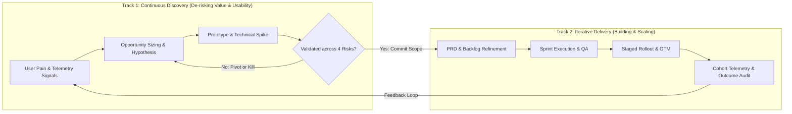

Product management is the organizational discipline of identifying valuable customer problems, defining software or hardware solutions that are technically feasible to build, and guiding cross-functional teams to deliver measurable business outcomes.

Most introductory guides reduce product management to a cliché Venn diagram placing the product manager at the center of "Business, Technology, and User Experience." While visually tidy, that description fails to explain what actually happens on a Tuesday morning when engineering bandwidth is cut by 30%, customer churn spikes in a core cohort, and sales demands a custom enterprise feature. At its core, product management is applied capital allocation and risk management. Every engineering sprint represents finite capital and opportunity cost. The discipline exists to ensure a company does not build high-quality software that nobody wants to use or pay for.

In this guide, we break down how modern product management operates across the product lifecycle, how to separate feature outputs from business outcomes, the four core risks every product team must manage, and a complete worked example of a product decision from initial hypothesis to post-launch evaluation.

## The Core Mechanism: Aligning User Value and Business Viability

A product is not merely a collection of code, screens, or APIs; it is a repeatable mechanism that delivers value to a specific group of users in exchange for direct revenue, data, retention, or strategic leverage.

When an organization lacks structured product management, it typically falls into one of two traps:

1. **The Sales-Driven Custom Shop:** The team builds whatever the loudest prospect requests during a sales call. Over 18 months, the product becomes a bloated patchwork of single-tenant toggles that is impossible to maintain or scale.
2. **The Engineering-Driven Lab:** The team builds technically impressive architectures—such as custom model-serving pipelines or intricate UI animations—that solve no urgent problem for the end buyer.

Product management resolves this tension by enforcing a continuous translation loop between user problems (what blocks the customer from achieving their goal) and business objectives (revenue growth, cost reduction, margin expansion, or risk mitigation).

## The Four Product Risks Framework

Popularized by Marty Cagan and the Silicon Valley Product Group (SVPG), effective product management evaluates every initiative against four distinct risks before committing full engineering resources:

- **Value Risk:** Will the customer actually buy this, or choose to use it over their current workaround (which is often a spreadsheet or manual email)?
- **Usability Risk:** Can the user figure out how to complete the workflow without hand-holding, given their real-world context and cognitive load?
- **Feasibility Risk:** Can our engineering team build, scale, and maintain this with the time, infrastructure, and skills we currently have?
- **Business Viability Risk:** Does this solution work within our legal, regulatory, financial, sales, and unit-economic constraints?

## Outputs vs. Outcomes vs. Impact

Beginners frequently measure success by **outputs**—the number of features shipped, story points completed, or releases deployed. Experienced practitioners manage toward **outcomes**—observable, quantifiable changes in human behavior that drive long-term business impact.

- **Output:** *"We launched an automated document-upload OCR scanner on October 15."*
- **Outcome:** *"The percentage of applicants completing identity verification within 3 minutes increased from 42% to 68%, and manual back-office review tickets dropped by 35%."*
- **Impact:** *"Customer acquisition cost (CAC) payback decreased by 1.4 months, saving ₹18,00,000 annually in operations overhead."*

> [!IMPORTANT]
> If you ship the OCR scanner (output) and verification completion remains stuck at 42% because users have poor lighting on budget smartphone cameras (no outcome), the product initiative has not succeeded—regardless of whether it shipped on time and on budget.

## The End-to-End Product Management Lifecycle

Rather than a linear waterfall where teams spend six months writing specifications and six months coding, modern product management operates as a dual-track, iterative lifecycle across six interconnected phases:

1. **Problem Discovery & Opportunity Sizing:** Analyzing support tickets, product telemetry, search demand, and user interviews to isolate high-friction problems worth solving.
2. **Strategy & Prioritisation:** Deciding which problems align with company OKRs and ranking competing opportunities against engineering constraints.
3. **Solution Definition & Validation:** Collaborating with product design and engineering to test low-fidelity prototypes, validate technical schemas, and write clear Product Requirements Documents (PRDs).
4. **Iterative Delivery & Execution:** Working alongside engineers in Agile sprints or Kanban flows to unblock edge cases, manage scope trade-offs, and ensure quality assurance.
5. **Go-to-Market (GTM) & Launch:** Coordinating staged rollouts, feature flags, pricing tiers, sales enablement, and user onboarding flows.
6. **Post-Launch Measurement & Iteration:** Auditing cohort retention, funnel conversion, and guardrail metrics to decide whether to double down, iterate, or sunset the feature.

## Feature Factory vs. Outcome-Driven Product Management

| Dimension | Feature Factory (Output-Driven) | Outcome-Driven Product Team |
|---|---|---|
| **Source of Roadmap** | Executive wishlists, competitor copying, and raw sales requests. | Validated user pain points mapped to strategic business KPIs. |
| **Definition of "Done"** | Code is merged to production and QA sign-off is complete. | Target user behavior change is verified via production telemetry. |
| **Role of Engineering** | Handed rigid specifications at the end of design; treated as ticket executors. | Brought into discovery early to propose faster, higher-leverage technical solutions. |
| **Handling Failure** | Blame shifts between "engineering missed the date" and "sales didn't sell it." | Post-launch review examines which underlying hypothesis failed and iterates or kills the feature. |
| **Primary Metric Tracked** | Sprint velocity, story points burned, on-time release percentage. | Activation rate, cohort retention, task completion time, net revenue retention. |

## Responsibilities Across the Cross-Functional Product Trio

| Lifecycle Stage | Product Manager (Viability & Value) | Product Designer (Usability) | Tech Lead / Engineering (Feasibility) |
|---|---|---|---|
| **1. Discovery** | Sizes market/cohort impact; interviews users; defines target success metrics. | Observes user workflows; maps mental models and friction points. | Audits existing architecture, API limits, data availability, and latency bounds. |
| **2. Definition** | Writes the PRD, defines acceptance criteria, non-goals, and rollout tiers. | Builds wireframes, interactive prototypes, and edge-case UI states. | Designs system architecture, database schemas, and effort estimations. |
| **3. Execution** | Unblocks scope trade-offs; clarifies business rules; prepares GTM readiness. | Conducts design QA; refines micro-interactions and accessibility compliance. | Writes, reviews, tests, and deploys production code behind feature flags. |
| **4. Post-Launch** | Analyzes funnel conversion, A/B test significance, and unit-economic impact. | Reviews session replays and usability drop-offs for UI refinement. | Monitors error rates, p95 latency, server costs, and infrastructure stability. |

## Visualizing the Product Lifecycle

The following architecture diagram illustrates the dual-track lifecycle connecting continuous customer discovery with iterative technical delivery:

## Practical Worked Example: Reducing Drop-Off in B2B SaaS Onboarding

To see how product management works in practice, consider a hypothetical B2B invoicing platform serving small merchants.

### The Observation
Product analytics show that 10,000 new merchants sign up each month, but only 1,800 (18%) generate and send their first compliant invoice within 7 days (the platform's core Activation Metric).

### Step 1 — Problem Diagnosis
Instead of immediately redesigning the dashboard UI, the PM segments the onboarding funnel:

- **Account Created:** 10,000 (100%)
- **Business Tax ID Entered:** 8,200 (82%)
- **First Customer Added:** 7,500 (75%)
- **Line-Item Tax Rate Configured:** 2,100 (21%) *(72% drop-off between Step 3 and Step 4)*
- **First Invoice Sent:** 1,800 (18%)

### Step 2 — Qualitative Discovery
The PM watches 20 session recordings and interviews 8 dropped-off merchants. They discover that merchants do not know their exact 8-digit harmonized tax classification code (HSN/SAC) by heart and leave the app to search government PDFs—never returning.

### Step 3 — Evaluating Solutions Across the Product Trio
- **Option A (Heavy AI Feature):** Train a custom classifier to auto-predict tax codes from uploaded inventory photos. Engineering estimates 6 weeks; inference cost is high.
- **Option B (Pragmatic Search Lookup):** Embed a lightweight, keyword-searchable JSON index of the top 500 common merchant categories mapped to default tax rates, plus a "Skip for now / Use standard rate" draft mode. Engineering estimates 4 days.

### Step 4 — Execution & Outcome Measurement
The team builds Option B in one sprint and runs a 14-day rollout.

**Resulting Outcome:** Step 4 completion rises from 21% to 54%, lifting overall 7-day merchant activation from 18% to 41% ($10,000 \times 0.41 = 4,100$ activated merchants/month) with zero ongoing inference cost.

## Common Mistakes and Limitations

- **Confusing the PM with the "CEO of the Product":** While popular in early blog posts, this phrase is operationally false. Product managers have zero direct hire-or-fire authority over engineers, designers, or marketers. Acting like a boss who dictates orders destroys team trust; PMs lead through crisp data, clear problem framing, and context sharing.
- **Treating Discovery as a One-Time Phase:** Teams often run two weeks of interviews in January and spend the next eleven months executing blindly. Market conditions, competitor pricing, and user behavior shift continuously.
- **When Structured Product Management Is Overkill:** If a product is an internal single-script utility used by three engineers, or a regulatory compliance patch where the exact legal specification is mandated by a central bank with zero room for scope trade-offs, heavy discovery frameworks add bureaucracy without value. In pure compliance mandates, project execution takes precedence over product discovery.

## Practical Checklist for New Product Initiatives

- [ ] **Problem Clarity:** Can you state the user problem in two sentences without mentioning your proposed feature?
- [ ] **Baseline Metric:** Do you know the exact current baseline number (e.g., current conversion rate, latency, or ticket volume) that this work aims to improve?
- [ ] **Four-Risk Audit:** Have Value, Usability, Feasibility, and Viability been explicitly checked with Design, Engineering, and Legal/Business?
- [ ] **Smallest Testable Scope:** Could we achieve 80% of the learning or outcome with 20% of the engineering build effort?
- [ ] **Kill/Success Criteria:** Have you documented what metric threshold 30 days post-launch will determine whether to scale or sunset the feature?

## Frequently Asked Questions

### Do you need a computer science degree to practice product management?
No, you do not need to write production code daily, except in specialized infrastructure, API, or ML-platform PM roles. However, you must be technically literate: you should understand how databases store state, how client-server APIs communicate, what latency trade-offs exist, and why technical debt slows down future feature velocity.

### How is product management different in B2B vs. B2C companies?
In B2C (consumer products), the user and the buyer are usually the same person, samples sizes are large (enabling rapid A/B testing), and emotional engagement or habit loops drive retention. In B2B (enterprise software), the economic buyer (e.g., VP of Finance) is often different from the daily end user (e.g., accounts payable clerk), sales cycles are longer, and workflow integration, permissions, and ROI drive purchasing decisions.

### What is the difference between Product Management and Product Marketing?
Product Management focuses predominantly on discovering problems, prioritizing the roadmap, and working with engineering/design to build the right product. Product Marketing focuses on positioning, messaging, competitive battlecards, sales enablement, and driving external market adoption once the capability exists.

### Why do some companies have Product Owners instead of Product Managers?
"Product Owner" is a tactical role defined within the Scrum Agile framework responsible for managing the team backlog and maximizing the value of the development team's work. In mature tech companies, the Product Manager handles both strategic discovery and backlog ownership; in traditional enterprises adopting Scrum, a PO may focus strictly on writing user stories while a separate PM handles market strategy.

### Can a startup succeed without a dedicated Product Manager?
Yes—in early-stage startups (1 to 15 employees), one of the co-founders almost always performs the product management function. Dedicated PM hires typically become necessary when the founders can no longer attend every sprint planning session, customer interview, and architecture review themselves.

## Next Steps and Recommended Reading

Product management is not about generating the flashiest feature ideas or managing Gantt charts; it is the rigorous practice of connecting verified user friction to sustainable business outcomes through cross-functional collaboration. Before you write a single requirement or prioritize a backlog, anchor your work on the problem you are solving and the measurable behavior change you expect to see.

To deepen your understanding of product execution and career progression:

- Review the [daily responsibilities and deliverables of a Product Manager](/blog/product/what-does-a-product-manager-do/) in our companion operating guide.
- Read our detailed comparison on [Product Managers vs Project Managers vs Business Analysts](/blog/product/product-manager-vs-project-manager-vs-business-analyst/) to understand team boundaries.
- Follow the step-by-step career roadmap in [How to Become a Product Manager](/blog/product/how-to-become-a-product-manager/) to build your proof-of-work portfolio.
- Explore how to [validate buyer intent and search demand before committing engineering capital](/learnings.html) in our quantitative research notes.

## About this guide

Aniket Thakur prepared this foundational Product Management guide based on continuous discovery frameworks, Agile software delivery principles, and primary practitioner literature checked on 24 October 2026. The B2B SaaS onboarding funnel and tax code lookup figures in Section G are explicitly labelled as a hypothetical worked example illustrating diagnostic conversion math.
