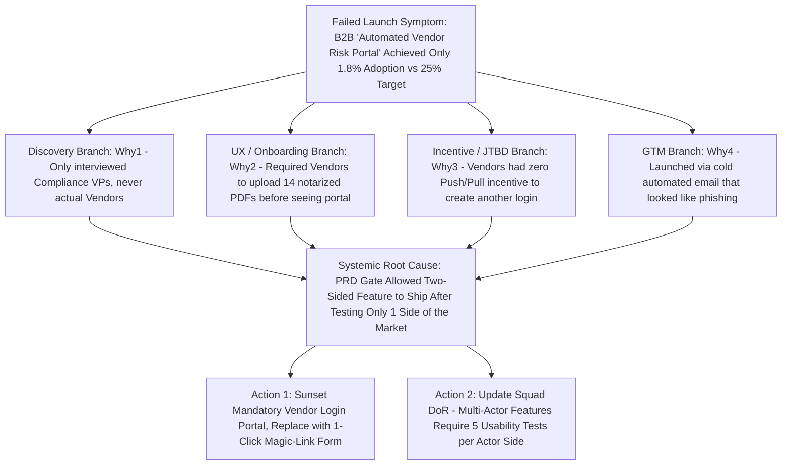

Most post-launch product failures do not happen because software engineers wrote bad syntax; they happen because organizations spent six months executing a flawed strategic, discovery, or distribution assumption without intermediate kill-gates. In empirical analyses of hundreds of startup failure postmortems compiled by [CB Insights](https://s3-us-west-2.amazonaws.com/cbi-content/research-reports/The-20-Reasons-Startups-Fail.pdf) (and summarized in [XBN's 442 Post-Mortem Breakdown](https://xbn.news/why-startups-fail-442-startup-failure-post-mortems/)), the #1 cause of failure—cited in **35% to 42% of all cases**—is **tackling problems that are interesting to build rather than serving a verified market need**.

Yet even inside established technology companies, when a major feature or product line misses its adoption target by 80%, teams rarely conduct a structured root-cause investigation. Instead, they either sweep the failure under the rug and jump to the next item on the Gantt chart (guaranteeing they repeat the exact same mistake next quarter) or engage in finger-pointing between Product, Engineering, and Sales. High-performing product organizations institutionalize two complementary practices: **Prospective Pre-Mortems** *before* committing engineering capital, and **Blameless Product Postmortems** (using the **5 Whys** and **Ishikawa Fishbone Analysis**) *after* a launch underperforms. This guide examines the five structural archetypes of product failure, provides a reusable Blameless Product Postmortem template, and walks through a complete forensic root-cause analysis of a failed B2B product module.

## 1. The Five Structural Archetypes of Product Failure (Synthesizing CB Insights & SVPG)

Cross-referencing [CB Insights' empirical postmortem dataset](https://s3-us-west-2.amazonaws.com/cbi-content/research-reports/The-20-Reasons-Startups-Fail.pdf) with Marty Cagan's [Four Risks at SVPG](https://www.svpg.com/product-management-start-here/) reveals that product failures cluster into five predictable root-cause categories:

1. **Archetype 1 — Problem–Solution Mismatch / Zero Market Need (35%–42% of Failures — *Value Risk*):** Building a Vitamin instead of a Painkiller. The team skips story-based customer discovery (**Article 11**) and search-demand validation ([Why Market Validation Trumps Vibes](https://07anishu12.github.io/learnings.html)), building a solution for a problem that customers only encounter once a year or already solve effortlessly in Excel.
2. **Archetype 2 — Broken Unit Economics & Cost Structure (18%–29% of Failures — *Business Viability Risk*):** The product attracts users, but Customer Acquisition Cost (CAC) exceeds Lifetime Value (LTV), or variable Cost of Goods Sold (such as unoptimized multi-LLM token inference or manual operations) results in negative gross margins (a dynamic examined in Aniket Thakur's [Public Market Listings as the Ultimate Stress Test for AI Valuations](https://07anishu12.github.io/learnings.html)).
3. **Archetype 3 — Onboarding Friction & Excessive Cognitive Load (14%–17% of Failures — *Usability Risk*):** The underlying capability is valuable, but new users hit an empty state requiring a 4-hour manual data migration or complex configuration before seeing their first insight (**Time-to-Value > User Patience Threshold**).
4. **Archetype 4 — Go-to-Market & Distribution Starvation (14%–20% of Failures — *GTM Execution Gap*):** "Build it and they will come" syndrome. The product works well, but the team has no repeatable distribution channel, prices it for the wrong buyer persona, or fails to enable sales and in-product discovery triggers (**Article 19**).
5. **Archetype 5 — Reliability, Latency & Trust Collapse (7%–13% of Failures — *Feasibility & Safety Risk*):** In fintech, enterprise SaaS, or AI workflows, early bugs that corrupt data, exceed latency budgets (>5 seconds), or hallucinate unverified outputs destroy user trust permanently on Day 1.

## 2. Running a Gary Klein "Pre-Mortem" Before Committing Engineering Sprints

Why wait six months for a product to fail in production when your own engineers and designers already secretly know why it might fail today? In classical project kickoff meetings, team members suppress their doubts to avoid looking "negative" (**Groupthink**).

Developed by cognitive psychologist **Gary Klein** (1989 / 2007 *Harvard Business Review*), the **Pre-Mortem ("Prospective Hindsight")** flips the psychological frame from *predicting* whether a project might fail to *explaining* why it **already failed**:
1. **Step 1 — Set the Time-Travel Prompt (5 mins):** Gather the Product Trio, QA, and GTM leads before finalizing the PRD (**Article 09**). Say: *"Imagine it is 6 months from today. We launched this product on schedule, and it was a complete, unmitigated disaster—adoption was under 3% and executives shut it down. Spend 6 minutes silently writing down every exact reason why it failed."*
2. **Step 2 — Independent Round-Robin Readout (15 mins):** Every participant reads one failure reason at a time onto a shared FigJam/[Notion](https://www.notion.com/pricing) board (preventing senior voices from anchoring the room).
3. **Step 3 — Score by Probability $\times$ Lethal Impact (10 mins):** Group the failure modes and identify the top 3 existential threats (e.g., *"Sales reps won't pitch it because it doesn't count toward their core quota"* or *"Users won't upload CSVs because their ERP exports merged header cells"*).
4. **Step 4 — Convert Top Threats into Pre-Launch Discovery Gates (10 mins):** Modify the MVP scope (**Article 15**) and PRD acceptance criteria immediately to neutralize those exact threats *before* Sprint 1 starts.

## 3. Conducting a Blameless Product Postmortem: The 5 Whys & Fishbone Method

Adapted from aviation safety and Site Reliability Engineering (SRE) culture, a **Blameless Product Postmortem** investigates not just technical outages, but also **strategic and behavioral product misses** (e.g., when a 2-month roadmap initiative finishes with $0.15$ on its quarterly OKR, **Article 10**).

"Blameless" does not mean "accountability-free"—it means assuming that every individual acted with good intentions using the information and incentives available at the time, and focusing 100% of the inquiry on **fixing the systemic process flaw that allowed an invalid assumption to consume two months of R&D before being caught**. Use Taiichi Ohno's **5 Whys** paired with Kaoru Ishikawa's **Fishbone Diagram** to trace surface symptoms down to systemic discovery or governance gaps.

## Frameworks and Comparison Tables

### Table 22.1: Empirical Product Failure Categories, Early Warning Signals & Preventive Guardrails

| Failure Archetype ([CB Insights](https://s3-us-west-2.amazonaws.com/cbi-content/research-reports/The-20-Reasons-Startups-Fail.pdf) / [SVPG](https://www.svpg.com/product-management-start-here/)) | Pre-Launch Red Flag (Ignored During Build) | Post-Launch Telemetry Signature | Preventive Process Guardrail |
| :--- | :--- | :--- | :--- |
| **1. No Market Need (35%–42%)** | Zero users in discovery interviews had an active workaround; idea came from an internal brainstorm | High landing-page views, **<2% trial initiation** and **<5% Day-30 retention** | Mandatory search-demand validation ([Query Framework](https://07anishu12.github.io/learnings.html)) + Fake-Door / Concierge MVP |
| **2. Broken Unit Economics (18%–29%)** | No COGS / token inference or CAC payback spreadsheet modeled in the Strategy/PRD | High free usage, **<1% paid conversion** or negative gross margin per active user | Mandatory LTV:CAC ($\ge 3\times$) and Gross Margin ($\ge 70\%$) gate in Strategy (**Article 06**) |
| **3. Onboarding / UX Complexity (14%–17%)** | Prototype usability tests skipped or moderator "helped" users complete the task | High signup rate, **>75% drop-off on Step 1 setup screen** within 5 minutes | Mandatory 2-round 5-user unassisted usability test ($\ge 80\%$ pass rate, **Article 14**) |
| **4. Poor GTM & Distribution (14%–20%)** | Feature buried in settings menu; zero in-app trigger or sales enablement planned | **<5% of active accounts ever discover/click** the feature; high retention among the few who do | Mandatory Tier 1–3 GTM Readiness Gate + inline contextual trigger (**Article 19**) |
| **5. Technical Latency / Unreliability (7%–13%)** | Load testing and deterministic schema validation skipped to hit an arbitrary date | Spike in p99 timeouts, rage-clicks, and immediate revert to manual legacy flow | Strict Definition of Done (DoD) latency SLAs and deterministic output schemas (**Article 23**) |

### Table 22.2: Reusable Blameless Product Postmortem Template (For Failed Features or Missed OKRs)

| Postmortem Section | Required Content & Analytical Rigor |
| :--- | :--- |
| **1. Executive Summary & Investment Cost** | Initiative name, dates, total engineering/design person-weeks invested (e.g., $18\text{ person-weeks} \approx \$54,000$), and 2-sentence summary of the outcome miss. |
| **2. Target Hypothesis vs. Actual Telemetry** | Side-by-side table of **Expected RICE / OKR Metrics** (e.g., *Projected Day-30 Adoption: 25%*) vs. **Actual 30-Day Telemetry** (*Actual: 2.1%*). |
| **3. Chronological Timeline of Decisions** | Dated timeline from initial pitch $\rightarrow$ discovery notes $\rightarrow$ PRD sign-off $\rightarrow$ beta feedback $\rightarrow$ GA launch, highlighting where warning signals appeared. |
| **4. Five-Whys & Fishbone Root-Cause Analysis** | Trace the causal chain across Discovery, UX, Engineering, and GTM until reaching the systemic process gap (never stopping at *"Users didn't click it"*). |
| **5. Product Disposition Decision** | Explicit decision: **Option A — Iterate** (if one fixable UX/GTM bottleneck blocks high latent demand), **Option B — Pivot Segment**, or **Option C — Sunset & Delete Code** (to remove maintenance debt). |
| **6. Systemic Action Items (With Owners & Dates)** | 2–3 concrete changes to the squad's future Discovery or PRD gates so this exact failure mode cannot recur. |

## Visualizing the Framework

The following architecture diagram illustrates the workflow and decision criteria:

## Practical Worked Example

**Scenario (Hypothetical B2B Accounting SaaS — *BooksPro* Postmortem on "Client Self-Serve Tax Vault"):**  
In Q2, *BooksPro* invested **20 engineering person-weeks (\$60,000 loaded R&D cost)** building a two-sided *Client Self-Serve Tax Vault* where accountants could invite their small-business clients to create an account, set up 2FA, and categorize their own quarterly tax deductions.
- **Pre-Launch Target (OKR):** $30\%$ of accounting firms invite clients, and $\ge 40\%$ of invited clients complete tax categorization (Net target = **$12.0\%$ end-to-end completion** across $5,000$ firms = $600\text{ active vaults}$).
- **Actual Day-45 Telemetry:** $34\%$ of accounting firms sent invitations ($1,700\text{ firms}$ — *exceeding the firm-side target!*), **BUT only $3.2\%$ of invited small-business clients completed signup and categorization** (Net result = **$1.08\%$ end-to-end completion** = $54\text{ vaults}$, an **$91\%$ miss** against target).

## Step 1: Running the 5-Whys Root-Cause Chain
- **Why 1:** Why did only $3.2\%$ of invited small-business clients complete tax categorization?  
  $\rightarrow$ *Telemetry shows $84\%$ of invited clients dropped off on the mandatory Account Creation + Authenticator App 2FA screen, and $78\%$ of the remaining $16\%$ abandoned the 18-category tax code dropdown table.*
- **Why 2:** Why did small-business clients refuse to set up 2FA and select tax codes?  
  $\rightarrow$ *Post-launch interviews with 8 clients revealed two facts: (a) they hire an accountant specifically so they **do not** have to know tax codes (violating their core Job to Be Done, **Article 12**), and (b) they only send documents on their phone via WhatsApp/Email once a quarter and refuse to remember a new password/2FA app.*
- **Why 3:** Why did we build a password/2FA login and a 18-category tax dropdown for end-clients?  
  $\rightarrow$ *Because during Discovery and Usability Testing, we interviewed 12 **Accountants** (our paying buyers), who told us "It would save me so much time if my clients categorized their own tax codes!" We interviewed **zero end-clients** of those accountants.*
- **Why 4:** Why did the PRD pass Trio Review without any usability tests on the end-client persona?  
  $\rightarrow$ *Our discovery checklist only required "5 user interviews," without specifying that **two-sided workflows require testing both the Sender (Accountant) and the Recipient (End-Client)**.*
- **Why 5 (Systemic Root Cause):** We confused the **Buyer's wishful offloading of work** with the **End-User's willingness and ability to perform that work**.

## Step 2: Quantitative Disposition Decision (Sunset Legacy Code vs. Lightweight Pivot)
Maintaining the full two-sided Client Portal + 2FA auth service costs **1.5 engineering weeks per quarter (\$18,000/year)** in security patching and support for only 54 active vaults (**\$333/year maintenance cost per active vault** — negative unit economics).
- **Decision:** **Sunset and delete the Client Account/2FA Portal & Tax Dropdown UI**, and replace it in a **1-week iteration** with a **Passwordless WhatsApp/SMS Magic-Link Photo Upload** (where the client simply snaps a photo of the receipt with zero login and zero tax-code dropdowns, and *BooksPro*'s OCR auto-categorizes the tax code for the accountant).
- **Result 30 Days After Pivot:** End-client upload completion jumps from **$3.2\%$ to $61.5\%$**, lifting end-to-end active vaults from $54$ to **$1,045\text{ firms}$** ($+1,835\%$ increase) while deleting 4,000 lines of auth maintenance debt!

## Common Mistakes and Limitations

1. **Turning a Postmortem into a Public Execution ("Who Approved This?"):** The single fastest way to ensure your Product Managers and Engineers hide bad data, fudge OKR definitions, and never take innovative risks again is to humiliate the PM whose bet missed in front of the company. Senior leaders must model psychological safety by sharing their own past invalidated hypotheses openly.
2. **The Sunk-Cost Fallacy ("We Already Spent 6 Months on It, So We Have to Keep Building Phase 2"):** The \$60,000 spent in Q2 is gone forever whether you delete the feature or spend another \$60,000 in Q3 trying to force users to like it. Base your **Iterate vs. Sunset** decision strictly on forward-looking marginal ROI and empirical root-cause fixability.
3. **Leaving Zombies in the Product Navigation Forever ("Feature Hoarding"):** When a failed feature used by $0.8\%$ of accounts is left permanently in the primary sidebar because nobody has the courage to sunset it, after three years the product looks like a cockpit of 40 broken buttons, slowing down onboarding for 100% of new users and taxing every future frontend refactor.

## Practical Implementation Checklist

- [ ] **Pre-Mortem Before Multi-Sprint Commitments:** For any initiative $> 4\text{ engineering weeks}$, did the Product Trio run a 30-minute Gary Klein Pre-Mortem (*"It is 6 months from now and this launch failed—why?"*) before locking the PRD?
- [ ] **Pre-Defined Kill/Pivot Metric:** Does the PRD state the exact 30-day post-launch adoption floor below which a formal Postmortem is automatically triggered?
- [ ] **Two-Sided Actor Verification:** If the workflow involves both a Sender/Admin and a Recipient/End-User, did we test usability and incentives with *both* sides before coding?
- [ ] **Systemic 5-Whys Depth:** Does our Postmortem trace the failure past human blame down to a specific missing gate in our Discovery, UX, Engineering, or GTM process?
- [ ] **Explicit Code Sunset:** When an initiative is invalidated and abandoned, did we schedule a ticket to deprecate and remove the dead code rather than leaving it as permanent technical debt?

## Frequently Asked Questions

### 1. When should a Product Manager decide to iterate on an underperforming feature versus sunsetting (killing) it completely?
Use the **Problem-Valid vs. Execution-Flawed Diagnostic**:
- **Iterate (Fix Execution):** If telemetry and post-launch interviews show **high intent and acute problem pain** (e.g., $40\%$ of users click the feature or try to initiate the workflow, as the accountants did in Section G), *but* they drop off at a specific usability, latency, or onboarding friction point.
- **Sunset / Kill (Invalid Problem):** If awareness is high (users saw the contextual prompt), onboarding is frictionless, and users who tried it once had zero bugs—yet **$<5\%$ ever bother to use it a second time** because the underlying problem simply does not matter to them. No amount of UI polish will fix a non-existent problem.

### 2. According to CB Insights' empirical data, what are the top 5 reasons startups and new products fail?
Across [CB Insights' analysis of startup failure postmortems](https://s3-us-west-2.amazonaws.com/cbi-content/research-reports/The-20-Reasons-Startups-Fail.pdf) (and updated multi-year cohorts in [XBN's 442 Post-Mortem Review](https://xbn.news/why-startups-fail-442-startup-failure-post-mortems/)), the top recurring causes are:
1. **No Market Need / Problem-Solution Mismatch (35%–42%)**
2. **Ran Out of Cash / Failed to Raise Follow-On Capital Due to Weak Traction (29%–38%)**
3. **Not the Right Team / Missing Cross-Functional Skills (14%–23%)**
4. **Got Outcompeted / Ignored Market Alternatives (19%–20%)**
5. **Pricing / Cost Issues & Broken Unit Economics (15%–18%)**  
Notice that at least four of these five top causes sit directly inside the Product Manager's core domain of discovery, positioning, unit economics, and roadmap execution.

### 3. What is the difference between a "5 Whys" analysis and a "Fishbone (Ishikawa) Diagram," and when should you use each?
A **5 Whys** analysis follows a **single linear causal chain** ($A \leftarrow B \leftarrow C \leftarrow D \leftarrow E$), which is fast for simple incidents but carries a limitation: complex product failures rarely have just *one* single linear cause! A **Fishbone (Ishikawa) Diagram** branches outward into **4 to 6 parallel categories simultaneously** (e.g., *Discovery/Value*, *UX/Usability*, *Engineering/Latency*, *GTM/Distribution*, *Pricing/Incentives*), ensuring you don't fixate on a marketing email when the onboarding flow was also broken. Best practice is to map the **Fishbone branches first**, then run **3–5 Whys down the dominant branches**.

### 4. How do you overcome stakeholder resistance to sunsetting a legacy feature that 1% of customers still use?
Stakeholders fear sunsetting features because they worry the 1% of users will churn loudly. Neutralize this fear with a **3-Step Sunset Protocol**: (1) Quantify the **hidden maintenance tax** (e.g., *"Keeping Legacy Module X alive costs 8 engineering weeks/year and blocks our new mobile architecture for 99% of customers"*); (2) Check the **ARR and renewal health** of the 1% active users; and (3) Offer those specific users a 1-on-1 migration script or alternative workflow 60 days ahead of deprecation (**Article 19**).

### 5. Should a Product Manager include a "Failed Product / Postmortem" story in their portfolio or job interviews?
**Yes—absolutely.** Hiring managers for Senior PM and Group PM roles are deeply skeptical of candidates who claim every single project they ever touched was a $300\%$ runaway success. Including a rigorous, intellectually honest case study where you **identified that an early hypothesis was failing via telemetry, ran a structured 5-Whys diagnosis, and executed a decisive pivot or saved the company 4 months of wasted engineering effort** is one of the strongest signals of senior product maturity (**Article 24**).

### 6. How often should a product team run Postmortems?
Run an **immediate Incident Postmortem within 48 hours** of any P0 production outage or severe metric cliff (**Article 21**), and run a scheduled **Quarterly Portfolio Retrospective / Postmortem** at the end of every 12-week OKR cycle (**Article 10**) on any roadmap bet that scored $< 0.40$ on its primary Key Result.

## Next Steps and Recommended Reading

Products rarely fail from a lack of hard work—they fail when teams treat unvalidated assumptions as facts and lack the psychological safety or telemetry discipline to course-correct early. By running **Gary Klein Pre-Mortems** before writing code and **Blameless 5-Whys / Fishbone Postmortems** whenever a launch misses its mark, your team compounds institutional wisdom with every single release.

**Practical Next Step:** Schedule a 30-minute **Pre-Mortem** on your squad's largest upcoming Q4 roadmap bet this week: ask every member of the Product Trio to write down three concrete reasons why the feature could fail to hit $20\%$ adoption, and update your PRD right away to address the #1 risk.

**Recommended Follow-Up Reading:** Continue to **Article 23: AI Product Management: LLMs, Evaluation, Costs and Product Safety** (`/blog/product/ai-product-management-llms-evaluation-costs-safety/` — *Planned Destination*) to see how evaluation datasets, latency budgets, unit economics, and deterministic guardrails prevent failure in modern AI products.

## About this guide

Aniket Thakur prepared this comprehensive Product Management guide based on continuous discovery frameworks, operational research, and practitioner benchmarks checked on 24 October 2026. All quantitative scenarios in Section G are explicitly labelled hypothetical worked examples illustrating decision math.
