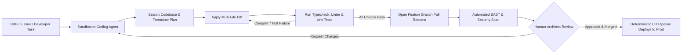

## 1. Introduction and Current Context

Software engineering workflows have undergone a structural split between inline IDE autocomplete and asynchronous or terminal-driven agentic coding. Early coding assistants operated as low-latency next-token predictors inside an editor buffer, helping developers type boilerplate faster one line at a time. By October 2026, developer workflows increasingly rely on repository-aware coding agents—exemplified by `anthropics/claude-code`, `openai/codex`, and `google-gemini/gemini-cli`—that traverse entire directory trees, execute local test suites, inspect stack traces, and submit pull requests via GitHub Actions.

## 2. Direct Answer and Key Takeaway

> **Key Takeaway:** In 2026, AI coding agents can autonomously scaffold, implement, test, and package well-scoped features or bug fixes inside sandboxed environments, but they cannot safely own end-to-end production deployment without human architectural governance. While terminal-native agents such as Claude Code, OpenAI Codex CLI, and Gemini CLI execute multi-file edits and iterate against compiler and test-runner feedback, production reliability still depends on deterministic CI/CD gates, branch protection rules, security scanning, and human code review.

## 3. Definitions and Technical Background

Before evaluating architectural trade-offs or writing production code for **AI coding agents**, it is essential to establish precise engineering definitions for the core components involved:

- **Inline Autocomplete Assistant:** An editor-integrated model that predicts the next several lines of code based on the active cursor context and open tabs, without executing shell commands or verifying whether the suggested code compiles.
- **Autonomous Coding Agent:** A terminal- or CI-hosted agent equipped with file-system read/write tools, AST/grep search utilities, and shell execution capabilities that iteratively edits multiple files and runs build/test commands until verification checks pass.
- **Closed-Loop Verification:** An engineering workflow in which a coding agent is required to run static type checkers (`tsc`, `mypy`), linters, and automated test runners (`vitest`, `pytest`, `playwright`) after every code modification to ground its next action in compiler output.
- **Execution Sandbox:** An isolated container, microVM, or restricted OS process profile (such as macOS Seatbelt or Linux bubblewrap/Docker) that restricts an agent's file-system write paths and blocks unauthorized outbound network egress during code execution.

## 4. Technical Architecture and Deep Dive

The core architectural advantage of an agentic coding workflow is its ability to close the feedback loop between code generation and execution. When a developer prompts a chat interface to refactor a database migration, the model predicts plausible syntax in a vacuum. When an agentic CLI such as `openai/codex` or `anthropics/claude-code` receives the same task, it first searches the repository using ripgrep, inspects the existing ORM schema, writes the migration file, executes the migration against an ephemeral local database container, and runs the integration test suite.

Despite this closed-loop capability, asking whether an AI agent can build, test, and deploy an entire application requires separating greenfield scaffolding from long-term systems engineering. On greenfield prototypes or self-contained CRUD microservices, coding agents routinely generate functional frontend components, API routes, database schemas, and container configurations within minutes.

Permission boundaries represent the most critical operational control in 2026 agentic development. Leading terminal agents implement tiered execution policies: read-only file navigation and grep searches run automatically; file edits within the workspace working tree may run auto-approved in local branches; and arbitrary shell commands or network calls require explicit operator confirmation unless executed inside a disposable container.

Furthermore, automated test generation by the same agent that wrote the implementation introduces a subtle tautology risk. If an agent misunderstands a business requirement, it will write both defective application logic and a unit test suite that asserts the defective behavior.

## 5. Comparative Analysis: Comparison of Software Development Paradigms: Inline AI Assistance vs. Agentic Coding Workflows

The following table compares the key engineering trade-offs, operational boundaries, and implementation choices for **AI coding agents**:

| Workflow Phase | Inline IDE Autocomplete | Interactive Terminal Agent | Asynchronous CI/CD Background Agent |
| --- | --- | --- | --- |
| Context Scope | Current file + open editor tabs | Full local repository + git history + local shell | Cloned repo in ephemeral runner + issue/PR thread |
| Execution Authority | None (developer manually saves & runs) | Tiered local shell & file permissions with prompts | Sandboxed container with branch-scoped credentials |
| Verification Loop | Visual inspection & IDE language server | Iterative compiler, linter, and local test execution | Full CI pipeline execution (unit, E2E, SAST scans) |
| Best-Fit Tasks | Boilerplate, single-function completion, syntax | Multi-file refactoring, debugging, test authoring | Automated bug triage, dependency upgrades, PR fixes |
| Deployment Role | Zero involvement in deployment | Can draft Dockerfiles/Terraform; blocked from prod push | Opens reviewed PRs; CD pipeline deploys only after human merge |

## 6. System Architecture and Execution Flow

The diagram below illustrates the end-to-end control flow, verification boundaries, and state transitions for **AI coding agents** in a production environment:

*Figure 2.1: Safe production architecture for agentic software development, isolating agent code generation and testing from human-gated deployment.*

## 7. Practical Implementation Steps and Engineering Checklist

To implement **AI coding agents** reliably in production systems, follow these sequential engineering steps:

1. Maintain a concise repository instruction file (such as `CLAUDE.md` or `AGENTS.md`) at the root of your repository documenting exact build commands, test runners, architectural boundaries, and forbidden directories.
2. Enforce fast, deterministic feedback loops—including strict TypeScript (`strict: true`) or Python (`ruff`, `mypy`) checks—so coding agents receive immediate, unambiguous compiler errors when they hallucinate APIs.
3. Run autonomous coding sessions inside container sandboxes or OS-restricted profiles with zero access to production `.env` secrets, SSH keys, or cloud provider admin credentials.
4. Configure GitHub branch protection rules requiring passing status checks, automated security scans (such as `openai/codex-security`), and at least one human code owner approval before any agent-authored pull request can merge.
5. Require human engineers to review the test suite diff first during code review to verify that the agent tested actual business invariants rather than mocking away the core logic.

## 8. Limitations, Operational Risks, and Trade-Offs

Even well-architected deployments of **AI coding agents** face concrete engineering constraints that teams must mitigate proactively:

- Tautological test suites: an autonomous agent tasked with both writing a feature and writing its tests can codify its own flawed assumptions into passing assertions.
- Architectural drift and code duplication: without human curation, agents often solve localized bugs by adding defensive patches or duplicate helper functions rather than addressing root architectural abstractions.
- Supply-chain and dependency hazards: agents may attempt to install outdated, unmaintained, or typosquatted packages from public registries if dependency installation is not locked behind an approved allowlist.

## 9. Frequently Asked Questions (FAQs)

### Can an AI coding agent deploy code directly to production?

While an agent is technically capable of invoking a deployment CLI if given credentials, granting an autonomous model direct production deployment privileges violates core DevSecOps principles.

### How do terminal agents like Claude Code and OpenAI Codex CLI differ from IDE extensions?

Terminal agents operate directly inside the developer's shell environment and git workspace.

### What is the role of AGENTS.md or CLAUDE.md in a repository?

These markdown configuration files provide repository-specific operational context—such as how to run a single unit test, database migration conventions, and code style rules—so the coding agent does not waste tokens guessing build commands.

## 10. Conclusion

Agentic coding tools have transformed software implementation from line-by-line typing into supervisory orchestration. Teams that pair terminal and CI coding agents with strict type systems, container sandboxes, automated security checks, and rigorous human pull-request reviews capture substantial velocity gains without sacrificing production stability.

### GitHub Repositories & Technical References

- **anthropics/claude-code** — Anthropic's official terminal-native agentic coding tool that navigates codebases, edits files, runs tests, and manages Git workflows. Verified GitHub URL: https://github.com/anthropics/claude-code
- **openai/codex** — OpenAI's official lightweight coding agent CLI that runs locally in the terminal to read, edit, and test code within sandboxed permissions. Verified GitHub URL: https://github.com/openai/codex
- **google-gemini/gemini-cli** — Google's official open-source terminal AI agent bringing Gemini models directly into command-line development workflows. Verified GitHub URL: https://github.com/google-gemini/gemini-cli
- **openai/codex-security** — OpenAI's official security CLI and SDK for discovering, validating, and patching software vulnerabilities in agent-assisted repositories. Verified GitHub URL: https://github.com/openai/codex-security
