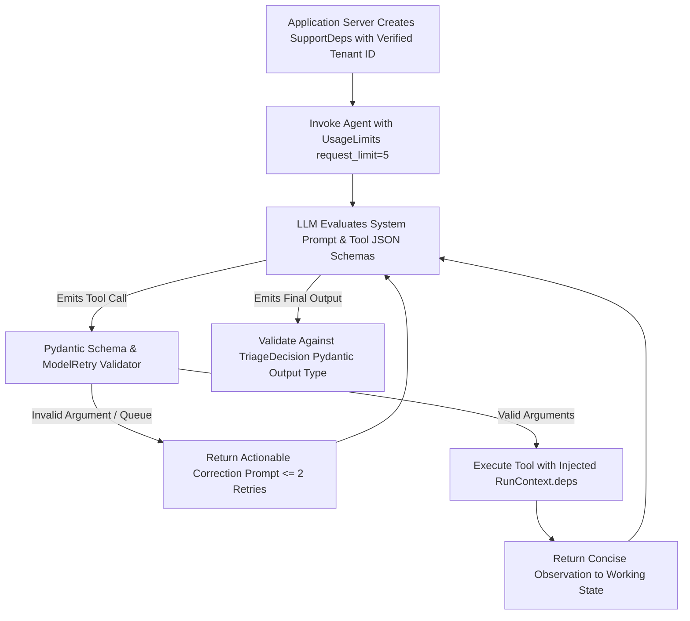

## 1. Introduction and Current Context

When developers build their first agent, they typically dump 20 raw Python functions into an LLM's `tools` list and run an unconstrained loop. In production, that agent quickly fails: it picks the wrong tool when two tool descriptions overlap, passes a malformed date string that crashes the function with an unhandled traceback, or loops 15 times calling the exact same search query when 0 results are returned. Mastering agent development requires treating tools as **ergonomic APIs designed for an LLM consumer** and orchestrating state transitions explicitly.

## 2. Direct Answer and Key Takeaway

> **Key Takeaway:** Core AI agent development skills in 2026 center on **constraining probabilistic reasoning inside deterministic software contracts**. Rather than writing sprawling text prompts with 30 tools attached, skilled agent engineers design narrow, strongly typed tool schemas (`pydantic/pydantic-ai`), inject security/tenant dependencies out-of-band (`RunContext`), model multi-step control flow as explicit state graphs (`langchain-ai/langgraph`), bound execution with step and token budgets, and test every tool transition deterministically using mock models (`TestModel`).

## 3. Definitions and Technical Background

Before evaluating architectural trade-offs or writing production code for **AI agent development**, it is essential to establish precise engineering definitions for the core components involved:

- **LLM-Ergonomic Tool Design:** Crafting tool names, docstrings, parameter types, and concise, actionable return payloads specifically optimized for an LLM's attention and token budget.
- **Out-of-Band Dependency Injection (`RunContext[Deps]`):** Passing database connections, authenticated `user_id`, and API clients directly from the host application into tool functions without exposing them as LLM-generated arguments.
- **Self-Correcting Validation Retry (`ModelRetry`):** Returning a concise validation error message back into the agent's next turn when the LLM passes arguments that violate a business invariant, allowing the model to fix its call within a capped retry count.

## 4. Technical Architecture and Deep Dive

**Prerequisites & Required Tools:** Python $\ge 3.11$, `pydantic/pydantic-ai`, `langchain-ai/langgraph`, and `pytest`.

**Step-by-Step Learning Path:**
1. **Beginner — Typed Tools & Structured Results:** Build a single-agent workflow in `pydantic/pydantic-ai` with a typed `output_type` Pydantic model, 2–3 tools with strict `Literal`/`Enum` arguments, and out-of-band `RunContext` dependency injection.
2. **Intermediate — Validation Retries & Bounded Loops:** Add `ModelRetry` inside tool functions to guide the model when it passes invalid domain filters, enforce `UsageLimits`, and test the agent offline using `pydantic_ai.models.test.TestModel`.
3.

**Minimal Production Code Example (Typed Agent with Out-of-Band Auth Dependencies, Validation Retry & Offline Test):**

```python
# File: agent_ticket_triage.py
# Prerequisites: pip install pydantic-ai pytest
from dataclasses import dataclass
from typing import Literal
from pydantic import BaseModel, Field
from pydantic_ai import Agent, ModelRetry, RunContext
from pydantic_ai.models.test import TestModel
from pydantic_ai.usage import UsageLimits

@dataclass
class SupportDeps:
    authenticated_tenant_id: str  # Injected by server, NEVER controlled by LLM
    allowed_queues: set[str]

class TriageDecision(BaseModel):
    ticket_id: str
    assigned_queue: Literal["billing", "infra", "security"]
    priority: Literal["P1", "P2", "P3"]
    summary: str = Field(..., max_length=280)

triage_agent = Agent(
    model=TestModel(),  # Swap to 'openai:gpt-4o-mini' or 'anthropic:claude-3-5-sonnet' in prod
    deps_type=SupportDeps,
    output_type=TriageDecision,
    system_prompt="Triage incoming support tickets using the lookup_ticket tool.",
)

@triage_agent.tool
async def lookup_ticket(ctx: RunContext[SupportDeps], ticket_id: str, queue_hint: str) -> dict:
    """Fetch ticket metadata scoped strictly to the authenticated tenant."""
    if queue_hint not in ctx.deps.allowed_queues:
        raise ModelRetry(
            f"Invalid queue_hint '{queue_hint}'. Must be one of: {sorted(ctx.deps.allowed_queues)}"
        )
    # Tenant isolation enforced deterministically via ctx.deps.authenticated_tenant_id
    return {
        "tenant_id": ctx.deps.authenticated_tenant_id,
        "ticket_id": ticket_id,
        "subject": "Production database connection pool exhausted",
        "verified_queue": queue_hint,
    }

# Deterministic offline verification test using TestModel (zero API calls)
if __name__ == "__main__":
    deps = SupportDeps(authenticated_tenant_id="org_india_01", allowed_queues={"billing", "infra", "security"})
    result = triage_agent.run_sync(
        "Triage ticket TKT-901 for infra",
        deps=deps,
        usage_limits=UsageLimits(request_limit=4, total_tokens_limit=2000),
    )
    assert isinstance(result.output, TriageDecision)
    print("Verified Output:", result.output.model_dump_json())
```

**Testing & Verification Steps:** Run `python3 agent_ticket_triage.py` or `pytest`.

## 5. Comparative Analysis: Agent Design Patterns: Fragile Prompt-Only Agents vs. Production Typed Agents

The following table compares the key engineering trade-offs, operational boundaries, and implementation choices for **AI agent development**:

| Agent Layer | Fragile Beginner Pattern (Avoid) | Production Engineering Pattern (2026) | Framework Primitive |
| --- | --- | --- | --- |
| Tool Argument Types | `def search(query: str, filter: str)` (vague strings) | Strict `Literal`, `Enum`, `Annotated` bounds + clear docstrings | `pydantic` `BaseModel` / `Field` |
| Tenant & Auth Context | Passing `user_id` in prompt and asking LLM to include it in tool calls | Out-of-band dependency injection invisible to LLM schema | `RunContext[Deps]` in `pydantic-ai` |
| Tool Output Size | Returning raw 50KB JSON API dumps into message history | Return curated, token-efficient dict (<500 tokens) + pagination | Custom tool serialization wrapper |
| Tool Error Recovery | Raising unhandled `ValueError` (crashes agent run) | Raising `ModelRetry('Actionable hint...')` capped at `retries=2` | `pydantic_ai.ModelRetry` |
| Loop & Cost Guardrails | Unbounded loop until model decides to stop | Hard `UsageLimits(request_limit=5, total_tokens_limit=4000)` | `UsageLimits` / LangGraph `recursion_limit` |

## 6. System Architecture and Execution Flow

The diagram below illustrates the end-to-end control flow, verification boundaries, and state transitions for **AI agent development** in a production environment:



*Figure 53.1: Execution lifecycle of a typed `pydantic-ai` agent using out-of-band `RunContext` dependencies, `ModelRetry` self-correction, and `UsageLimits`.*

## 7. Practical Implementation Steps and Engineering Checklist

To implement **AI agent development** reliably in production systems, follow these sequential engineering steps:

1. Keep an agent's active toolset under **5 to 8 distinct, well-typed tools** per node; if your system requires 30 tools across billing, DevOps, and HR, use a router node to dispatch to focused specialist nodes.
2. Replace generic `str` parameters in tool definitions with `Literal['option_a', 'option_b']` or `Enum` types wherever the set of valid inputs is finite—this eliminates 90% of parameter hallucinations at the schema level.
3. Format tool return values for **LLM readability and token economy**: strip internal database UUIDs, base64 blobs, and null columns before returning observations to the agent context.
4. Always pass a `UsageLimits` object or `recursion_limit` on every production execution.

## 8. Limitations, Operational Risks, and Trade-Offs

Even well-architected deployments of **AI agent development** face concrete engineering constraints that teams must mitigate proactively:

- Overlapping tool descriptions causing oscillation: if you register both `search_articles(query)` and `find_documentation(topic)` with vague descriptions, the agent will waste turns calling both or alternating between them.
- Returning silent empty lists `[]` without explanation: when a search tool returns `[]`, an agent often assumes its query syntax was wrong and retries 5 times—return `{"results": [], "note": "0 matching records exist for this user; do not retry with similar terms."}` instead.
- Using an autonomous agent loop for a fixed 3-step pipeline: if Step A is always followed by Step B and Step C, write a sequential `async def` function calling three structured outputs rather than paying the latency tax of an autonomous agent loop.

## 9. Frequently Asked Questions (FAQs)

### When should I use `pydantic-ai` vs `langgraph`?

`pydantic/pydantic-ai` is ideal for building strongly typed, single-agent tool loops, dependency-injected functions, and validated structured outputs with minimal boilerplate. `langchain-ai/langgraph` shines when you need complex cyclic state machines, durable PostgreSQL checkpointing across multi-hour pauses, and explicit multi-agent graph routing.

### How many tools can an LLM reliably choose between in a single turn?

Accuracy is highest when a model chooses among **3 to 8 clearly differentiated tools**.

### Why should I return a descriptive hint when a tool returns zero results?

If a database tool simply returns `[]`, the LLM cannot tell whether the database is empty or whether its search keyword was slightly misspelled, so it repeatedly calls the tool with synonyms.

## 10. Conclusion

Effective AI agent development is the art of designing crystal-clear tool interfaces and bounded state machines. By mastering `pydantic/pydantic-ai` for type-safe tools and dependency injection alongside `langchain-ai/langgraph` for stateful orchestration, developers build agents that behave predictably in production.

### GitHub Repositories & Technical References

- **pydantic/pydantic-ai** — Official Python agent framework providing `RunContext` dependency injection, `ModelRetry` loops, `UsageLimits`, and `TestModel` verification. Verified GitHub URL: https://github.com/pydantic/pydantic-ai
- **langchain-ai/langgraph** — Official framework for building stateful, multi-step agent graphs with durable checkpointing and conditional edges. Verified GitHub URL: https://github.com/langchain-ai/langgraph
- **modelcontextprotocol/python-sdk** — Official Python SDK for exposing agent tools and resources via the standardized Model Context Protocol. Verified GitHub URL: https://github.com/modelcontextprotocol/python-sdk
