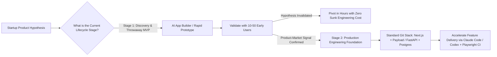

## 1. Introduction and Current Context

In 2026, a non-technical founder can type three paragraphs into a browser-based AI app builder and receive a deployed full-stack web application with authentication, a database, and Stripe checkout in under ten minutes. This workflow—popularly dubbed 'vibe coding' (generating software purely by prompting high-level outcomes without inspecting the underlying code)—has dramatically lowered the cost of experimentation. However, technical founders and CTOs face a recurring architectural crisis six months post-launch: when a vibe-coded codebase reaches 25,000 lines of uncurated, agent-stacked patches, fixing one bug breaks three unrelated pages. Knowing when to use an AI app builder and when to enforce traditional software engineering discipline determines whether a startup scales or stalls.

## 2. Direct Answer and Key Takeaway

> **Key Takeaway:** For startups in 2026, prompt-to-app builders ('vibe coding' platforms) are unbeatable for validating user demand, building clickable MVPs, and shipping internal admin tools in hours—but they routinely hit a 'complexity wall' when an application requires custom multi-tenant authorization, complex state synchronization, regulatory compliance, or deterministic unit economics. The winning startup engineering playbook uses AI app builders to validate product-market hypotheses, then transitions core intellectual property to a standard, version-controlled open-source stack (such as `vercel/next.js`, `payloadcms/payload`, or `fastapi/fastapi`) accelerated by terminal coding agents.

## 3. Definitions and Technical Background

Before evaluating architectural trade-offs or writing production code for **AI app builders**, it is essential to establish precise engineering definitions for the core components involved:

- **AI App Builder (Prompt-to-App Platform):** A hosted browser environment that translates natural-language prompts into full-stack application code, manages database provisioning and cloud deployment automatically, and abstracts away manual Git and infrastructure workflows.
- **Vibe Coding:** A development practice where the operator directs an AI to write and modify code entirely via conversational prompts and visual UI inspection, without reading, structuring, or manually reviewing the underlying source code diffs.
- **The Complexity Wall (Architectural Entropy):** The inflection point in an uncurated AI-generated codebase where tightly coupled components, duplicated state logic, and missing domain abstractions cause each new prompt edit to introduce regressions faster than they can be fixed.
- **AI-Accelerated Traditional Engineering:** A disciplined engineering workflow where experienced developers own a standard open-source codebase in Git and use terminal coding agents under strict type-checking, automated tests, and human code review.

## 4. Technical Architecture and Deep Dive

Why do AI app builders feel magical in Week 1 and painful in Month 6? In Week 1, a greenfield prototype has low state complexity: five database tables, standard CRUD screens, and zero legacy data migrations. Because standard CRUD patterns appear millions of times in open-source training corpora, an AI app builder synthesizes them effortlessly.

When an operator practices pure 'vibe coding' without inspecting code structure, the AI resolves every bug report by applying localized band-aids. Instead of refactoring a flawed data model, it adds client-side state workarounds, duplicates API routes, or weakens Row-Level Security (RLS) rules to make a permission error disappear.

Does this mean startups should shun AI app builders? Not at all. The most expensive mistake an early-stage startup can make is spending three months hand-crafting a Kubernetes cluster and clean hexagonal architecture for a product nobody wants to buy.

Once a workflow is validated and becomes core to the business, smart teams avoid binary extremes by adopting **AI-Accelerated Traditional Engineering**.

## 5. Comparative Analysis: Strategic Comparison: Hosted AI App Builders vs. AI-Accelerated Traditional Engineering

The following table compares the key engineering trade-offs, operational boundaries, and implementation choices for **AI app builders**:

| Decision Dimension | Hosted AI App Builders ('Vibe Coding') | AI-Accelerated Traditional Dev (Next.js / FastAPI + CLI Agents) | Startup Stage Recommendation |
| --- | --- | --- | --- |
| Time to First Prototype | Minutes to hours (zero local setup) | 1 – 3 days (repo setup, schema design, CI) | Use App Builders for pre-seed user validation |
| Code Ownership & Portability | Varies; often coupled to proprietary BaaS/hosting | 100% portable Git repo on open-source standards | Require clean Git export before building core IP |
| Security & Multi-Tenancy | High risk of permissive RLS or client-side auth leaks | Explicit server-side RBAC, SAST (`codex-security`), audit logs | Mandatory traditional engineering for B2B/fintech/health |
| Maintainability at >20k LoC | Degrades rapidly without human refactoring | Scales cleanly via modular packages, strict types, and PR review | Transition before onboarding multiple engineers |
| Unit Economics at Scale | High platform markup on compute, DB, and AI tokens | Direct cloud/VPC pricing with custom caching & optimization | Migrate high-traffic production workloads to owned infra |

## 6. System Architecture and Execution Flow

The diagram below illustrates the end-to-end control flow, verification boundaries, and state transitions for **AI app builders** in a production environment:

*Figure 21.1: Two-stage startup engineering lifecycle transitioning from rapid AI app builder validation to owned, agent-accelerated production architecture.*

## 7. Practical Implementation Steps and Engineering Checklist

To implement **AI app builders** reliably in production systems, follow these sequential engineering steps:

1. Treat pure prompt-generated MVPs as disposable discovery prototypes: validate whether customers will pay for the workflow first, and budget a deliberate engineering sprint to establish a clean production schema once validated.
2. If you export code from an AI app builder into GitHub to continue development, immediately run a comprehensive security audit checking for hardcoded secrets, missing server-side route authentication, and overly permissive database Row-Level Security policies.
3. Adopt batteries-included open-source frameworks so your coding agents don't have to reinvent authentication, admin panels, and CRUD APIs from scratch.
4. Enforce TypeScript `strict: true`, Zod/Pydantic runtime schema validation at every API boundary, and automated `microsoft/playwright` smoke tests on your core user sign-up and billing flows.

## 8. Limitations, Operational Risks, and Trade-Offs

Even well-architected deployments of **AI app builders** face concrete engineering constraints that teams must mitigate proactively:

- Silent authorization bypasses in vibe-coded apps: when an AI app builder encounters a 403 Forbidden error during a user's prompt session, it frequently fixes the symptom by changing the database policy to `allow read, write: if true;` unless audited by an engineer.
- Vendor lock-in on proprietary backend primitives: some prompt-to-app platforms bind generated frontend code tightly to proprietary database or auth wrappers that require a complete rewrite to self-host.
- Sunk-cost fallacy on prototypes: attempting to scale a sprawling, untested 40,000-line prompt-generated prototype into an enterprise SOC-2 compliant product often takes longer than rebuilding the core data model cleanly.

## 9. Frequently Asked Questions (FAQs)

### What is 'vibe coding' and when is it safe to use?

Vibe coding refers to building software by prompting an AI in natural language and judging the result purely by whether the UI looks right, without reading or reviewing the code.

### Can a non-technical founder launch a commercial SaaS using only an AI app builder?

A founder can launch an initial MVP to test customer demand and collect early feedback.

### How does using Claude Code or Codex CLI differ from using a browser AI app builder?

Terminal agents like `anthropics/claude-code` and `openai/codex` operate inside your own standard Git repository (`vercel/next.js`, `fastapi/fastapi`), allowing you to enforce modular architecture, run local unit/E2E tests (`playwright`), and review every line of a pull request before merging.

## 10. Conclusion

AI app builders and traditional software engineering are complementary stages of the modern startup journey, not mutually exclusive religions. Use prompt-to-app builders to test ideas ruthlessly in hours, and transition validated products onto an owned, test-backed open-source stack where coding agents multiply engineering velocity safely.

### GitHub Repositories & Technical References

- **vercel/next.js** — Official repository for the Next.js React framework, the standard full-stack foundation for modern web and AI applications. Verified GitHub URL: https://github.com/vercel/next.js/
- **payloadcms/payload** — Open-source Next.js native headless CMS and application framework providing instant TypeScript backend, auth, and admin UI. Verified GitHub URL: https://github.com/payloadcms/payload
- **fastapi/fastapi** — Modern, high-performance Python web framework for building typed production APIs with automatic OpenAPI validation. Verified GitHub URL: https://github.com/fastapi/fastapi
- **microsoft/playwright** — End-to-end browser testing framework essential for verifying critical user flows in rapidly iterated startup applications. Verified GitHub URL: https://github.com/microsoft/playwright
