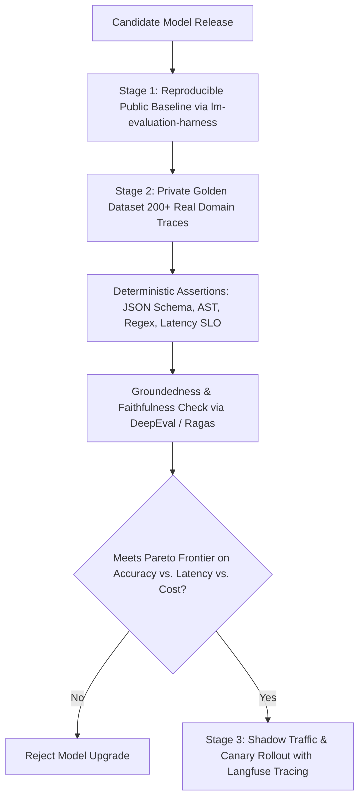

## 1. Introduction and Current Context

Every week, model release announcements feature bar charts showing a new checkpoint beating competitors by 1.4 percentage points on MMLU-Pro, AIME, or SWE-bench. Yet when engineering teams swap that 'top-ranked' model into their production customer-support agent or financial extraction pipeline, they frequently encounter broken JSON tool calls, verbose formatting refusals, or higher hallucination rates on their proprietary documents. Understanding why public benchmark scores diverge from production reality is a core competency for every AI engineer in 2026.

## 2. Direct Answer and Key Takeaway

> **Key Takeaway:** A higher score on public academic leaderboards (such as MMLU, GSM8K, or HumanEval) does not guarantee better performance in your production application because static public benchmarks suffer from training data contamination, narrow post-training overfitting (Goodhart's Law), prompt-template sensitivity, and disconnect from real-world latency and tool-calling constraints. In 2026, mature engineering teams treat public benchmarks only as a coarse pre-filter and rely on private, domain-specific regression suites built with open-source frameworks like `EleutherAI/lm-evaluation-harness`, `promptfoo/promptfoo`, and `confident-ai/deepeval`.

## 3. Definitions and Technical Background

Before evaluating architectural trade-offs or writing production code for **AI model benchmarks**, it is essential to establish precise engineering definitions for the core components involved:

- **Benchmark Contamination (Data Leakage):** The inclusion of public benchmark test questions—or semantically identical paraphrases and synthetic variations of those questions—inside a model's pretraining or post-training datasets, inflating scores via memorization rather than generalization.
- **Goodhart's Law in LLM Post-Training:** The principle that when a specific benchmark metric becomes the primary marketing target for model releases, post-training teams optimize synthetic data mixtures specifically for that test format (e.g., competition math puzzles) at the expense of general instruction adherence.
- **Prompt Sensitivity & Harness Variance:** The phenomenon where changing a few formatting characters, system prompt prefixes, or log-probability normalization rules in an evaluation script shifts a model's benchmark score by 5 to 15 percentage points without any change to the model weights.
- **LLM-as-a-Judge Bias:** Systematic scoring distortions exhibited when an LLM evaluates another model's outputs—including verbosity bias (preferring longer answers regardless of factual density), position bias (preferring the first option presented), and self-enhancement bias (preferring outputs matching its own stylistic distribution).

## 4. Technical Architecture and Deep Dive

Why do static public benchmarks saturate and lose predictive power so quickly? Once a benchmark dataset is published on GitHub or Hugging Face, its questions are discussed in blog posts, copied into notebooks, and rewritten into synthetic training corpora across the web.

Second, evaluation methodology details regularly distort headline comparisons. As the maintainers of `EleutherAI/lm-evaluation-harness` document extensively, evaluating a multiple-choice benchmark can be done by comparing the log-probabilities of tokens `'A'`, `'B'`, `'C'`, and `'D'`, or by generating a free-form text response and running a regex parser to extract the final letter.

Third, public benchmarks rarely measure the operational failure modes that break production software. A model that scores 88% on Olympiad math may still fail 12% of the time when asked to emit a strictly typed MCP tool call over a 25,000-token noisy codebase, or it may take 35 seconds of thinking time when your API gateway enforces a 5-second timeout.

To overcome benchmark theater, production engineering teams build **private golden evaluation suites** (`promptfoo/promptfoo`, `confident-ai/deepeval`, `explodinggradients/ragas`) directly from their own application logs.

## 5. Comparative Analysis: Public Leaderboard Benchmarks vs. Production Engineering Evaluation Suites

The following table compares the key engineering trade-offs, operational boundaries, and implementation choices for **AI model benchmarks**:

| Evaluation Dimension | Public Academic / Marketing Benchmarks | Private Production Evaluation Suite | Actionable Engineering Mitigation |
| --- | --- | --- | --- |
| Data Integrity | High risk of exact or synthetic contamination | Zero contamination (proprietary internal logs) | Store golden datasets in private repos with encryption |
| Task Relevance | Generic trivia, Olympiad math, isolated functions | Exact company schemas, messy inputs, multi-turn state | Sample 100–300 real production traces including edge cases |
| Scoring Mechanism | Logprob choice or uncalibrated LLM-as-judge | Deterministic code assertions + groundedness rubrics | Prioritize AST/schema/regex checks before LLM judges |
| Operational Constraints | Ignores TTFT, P99 latency, and cost per pass | Measures accuracy jointly with P95 latency & token cost | Enforce latency and cost assertions inside CI eval runs |
| Reproducibility | Often varies by prompt template & unpublished scripts | Pinned harness (`lm-eval` / `promptfoo`) with fixed seeds | Commit exact eval YAML/Python configs to version control |

## 6. System Architecture and Execution Flow

The diagram below illustrates the end-to-end control flow, verification boundaries, and state transitions for **AI model benchmarks** in a production environment:

*Figure 15.1: Three-stage model evaluation pipeline replacing marketing leaderboard reliance with private deterministic assertions and shadow traffic.*

## 7. Practical Implementation Steps and Engineering Checklist

To implement **AI model benchmarks** reliably in production systems, follow these sequential engineering steps:

1. Never select or swap a production model based solely on a vendor's release blog chart; verify reproducible baseline scores using `EleutherAI/lm-evaluation-harness` with identical prompt templates and quantization settings.
2. Curate a private 'Golden Dataset' of 100 to 300 real input-output pairs representing your application's core workflows, hard edge cases, and historical bugs—and never publish this dataset to public websites where crawlers can ingest it into future training runs.
3. Prefer deterministic programmatic assertions (validating JSON schemas with Pydantic, executing generated SQL against a test SQLite fixture, checking exact citation spans) over LLM-as-a-judge whenever possible.
4. When you must use an LLM-as-a-judge for semantic grading (`confident-ai/deepeval` or `promptfoo/promptfoo`), force binary (`0` or `1`) criteria checks rather than vague `1-to-10` scales, swap candidate answer positions to cancel position bias, and measure agreement against 50 human-labeled examples.
5. Evaluate every candidate model on a 3D Pareto frontier—plotting **Task Accuracy** vs. **P95 Latency** vs. **Cost per 1,000 Successful Tasks**—rather than accuracy in isolation.

## 8. Limitations, Operational Risks, and Trade-Offs

Even well-architected deployments of **AI model benchmarks** face concrete engineering constraints that teams must mitigate proactively:

- Static private eval saturation: if your internal golden dataset never changes over 12 months while your product features evolve, your private eval can also become stale—refresh 10%–20% of cases quarterly from production error traces.
- Self-preference bias in LLM judges: using Model Family A as the judge to compare Model Family A against Model Family B systematically favors Model Family A's phrasing and formatting habits.
- Ignoring multi-turn state drift: evaluating only single-turn prompt-response pairs misses failures that emerge when an agent must recover from a failed tool call on turn 4 of a conversation.

## 9. Frequently Asked Questions (FAQs)

### What is benchmark contamination and how does it happen?

Benchmark contamination occurs when questions from a public test set (such as MMLU or HumanEval)—or synthetic rewrites of those questions—end up in a model's training corpus.

### Why do two different leaderboards often report different scores for the exact same open-weight model?

Small differences in evaluation harnesses—such as whether few-shot examples are separated by single or double newlines, whether chat templates are applied, how quantized weights are loaded, or how answers are parsed—can swing benchmark scores by 5% to 15%.

### How many test cases do I need to build a useful private evaluation suite?

You do not need 10,000 examples to start.

## 10. Conclusion

Public AI benchmarks are useful thermometers for tracking macro research progress, but they are poor compasses for production engineering decisions. By pairing reproducible open-source harnesses like `lm-evaluation-harness` with private, deterministic test suites in `promptfoo` and `DeepEval`, teams can cut through marketing noise and deploy models that demonstrably improve their users' workflows.

### GitHub Repositories & Technical References

- **EleutherAI/lm-evaluation-harness** — Standard open-source framework for reproducible few-shot and zero-shot evaluation of language models across hundreds of standardized tasks. Verified GitHub URL: https://github.com/eleutherai/lm-evaluation-harness
- **promptfoo/promptfoo** — Open-source CLI and library for declarative YAML-based evaluation of prompts, models, agents, and RAG pipelines with deterministic assertions. Verified GitHub URL: https://github.com/promptfoo/promptfoo
- **confident-ai/deepeval** — Open-source LLM evaluation framework providing pytest-style unit testing, groundedness checks, and G-Eval rubric scoring. Verified GitHub URL: https://github.com/confident-ai/deepeval
- **openai/evals** — Framework and open-source registry for evaluating LLMs and building custom private evaluation suites. Verified GitHub URL: https://github.com/openai/evals
