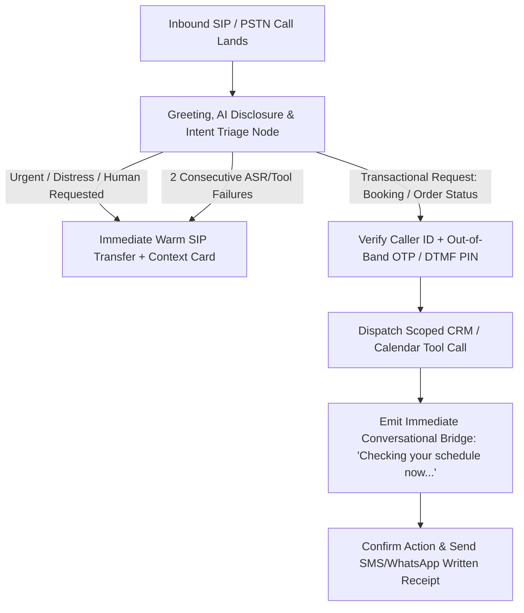

## 1. Introduction and Current Context

Everybody hates traditional Interactive Voice Response (IVR) menus that force callers through four nested numeric menus, ask them to key in their 12-digit account number, and then connect them to a human representative who immediately asks, *'Can I have your account number and how can I help you today?'* By October 2026, low-latency voice orchestration over SIP and WebRTC allows a virtual receptionist to answer on the first ring, verify caller identity, execute read/write CRM tools via strict schemas, and resolve routine requests.

## 2. Direct Answer and Key Takeaway

> **Key Takeaway:** In 2026, enterprise AI call centres and virtual receptionists are replacing rigid DTMF trees (*'Press 1 for Billing, Press 2 for Support'*) with stateful, tool-connected voice agents built on frameworks like `livekit/agents`, `pipecat-ai/pipecat`, and `bolna-ai/bolna`. However, the metric that separates a successful deployment from a customer-service disaster is not **Raw Containment Rate** (trapping frustrated callers in an AI loop to save BPO costs), but **Verified First-Contact Resolution (vFCR)** paired with **Zero-Repeat Warm Escalation**—where routine tier-1 bookings and lookups resolve autonomously in under 90 seconds, and complex or emotional calls transfer immediately to a human specialist with a structured screen-pop summary.

## 3. Definitions and Technical Background

Before evaluating architectural trade-offs or writing production code for **AI call centre**, it is essential to establish precise engineering definitions for the core components involved:

- **Verified First-Contact Resolution (vFCR) vs. Naive Containment Rate:** **Naive Containment Rate** simply measures the percentage of calls that ended without speaking to a human; **Verified First-Contact Resolution (vFCR)** measures calls where a concrete backend goal state was achieved and the caller did not call back within 24 hours.
- **Asynchronous Tool Filler (Conversational Bridging):** A voice-agent design pattern where, before invoking an external CRM or booking API that takes 1.5–3.0 seconds, the agent immediately emits a natural bridge phrase so the caller never experiences dead silence.
- **Zero-Repeat Warm Handoff (SIP Refer + Context Packet):** Transferring an active call to a human agent queue while simultaneously pushing a structured JSON/screen-pop card to the human agent's desktop.

## 4. Technical Architecture and Deep Dive

**Architecting the Call Lifecycle: Greeting, Auth, Execution, and Handoff.** A production AI receptionist is not a single unconstrained system prompt; it is a **state-machine workflow**. When an inbound SIP call lands, **Node 1** answers within 1 second, identifies the business, discloses that the caller is speaking with an AI assistant, and asks an open question.

**Solving the 'Dead Air' Problem During CRM Tool Calls:** In text chat, if an agent takes 2.5 seconds to query Salesforce, Zendesk, or an internal PostgreSQL booking table, a subtle typing indicator suffices. On a phone call, 2.5 seconds of total silence after the user finishes speaking feels like a dropped line—causing the caller to say *'Hello? Are you there?'*, which triggers a barge-in interrupt and resets the LLM turn!

**Strict Guardrails Against Policy Hallucination and Social Engineering:** Call centre agents are prime targets for verbal prompt injection. Therefore, the voice agent must never authenticate a caller based on verbal claims alone.

**Measuring Operational ROI Honestly:** Track five paired metrics in your observability dashboard: (1) **P90 Turn-Around Latency** (<700ms), (2) **Verified First-Contact Resolution (vFCR)**, (3) **Abandonment / Hang-Up Rate During AI Turn**, (4) **Warm Escalation Precision**, and (5) **24-Hour Repeat Call Rate**.

## 5. Comparative Analysis: Operational Evolution: Legacy DTMF IVR vs. Unconstrained Voice Bot vs. Stateful Enterprise Voice Agent (2026)

The following table compares the key engineering trade-offs, operational boundaries, and implementation choices for **AI call centre**:

| Operational Dimension | Legacy Touch-Tone (DTMF) IVR | Naive Unconstrained LLM Voice Bot | Stateful Enterprise Voice Agent (2026 Standard) |
| --- | --- | --- | --- |
| Caller Experience | Rigid 'Press 1, Press 2' menus; high drop-off | Natural voice, but rambles or traps caller in loops | Concise (<2 sentence turns), natural barge-in, instant routing |
| CRM & Booking Execution | Limited to rigid pre-scripted numeric lookups | Risks hallucinating appointment slots or policies | Strict schema tools + deterministic availability verification |
| Handling API Latency (2–3s) | Plays repetitive hold music | Awkward dead silence (caller thinks call dropped) | Immediate conversational bridging + async tool execution |
| Human Escalation | Cold transfer; human asks caller to repeat everything | Often resists transfer to inflate 'containment' KPI | 1-request or 2-failure warm SIP transfer + screen-pop summary |
| Primary Success KPI | IVR Containment Rate (often hides hang-ups) | Average call duration | Verified First-Contact Resolution (vFCR) & CSAT |

## 6. System Architecture and Execution Flow

The diagram below illustrates the end-to-end control flow, verification boundaries, and state transitions for **AI call centre** in a production environment:

*Figure 50.1: Enterprise AI call centre call-flow architecture featuring out-of-band authentication, conversational latency bridging, SMS confirmation receipts, and warm human handoffs.*

## 7. Practical Implementation Steps and Engineering Checklist

To implement **AI call centre** reliably in production systems, follow these sequential engineering steps:

1. Enforce a **2-Sentence Maximum Spoken Turn Rule** in your voice system prompt: phone callers cannot visually scan a 5-bullet list over audio; instruct the agent to speak in concise 1-to-2 sentence turns and pause for confirmation.
2. Always pair spoken transactional confirmations with an **automatic SMS or WhatsApp written receipt** sent via tool call before hanging up.
3. Never measure your engineering team on raw 'Containment Rate' alone—penalize any call where the user hung up mid-flow or called back within 24 hours, and reward **Verified First-Contact Resolution (vFCR)**.
4. Wire an unconditional **Human Escape Hatch**: if the caller asks for a human representative, if sentiment/frustration rises, or if two consecutive turns fail validation, trigger an immediate warm SIP transfer with a structured JSON summary for the human agent.

## 8. Limitations, Operational Risks, and Trade-Offs

Even well-architected deployments of **AI call centre** face concrete engineering constraints that teams must mitigate proactively:

- Verbose text prompts copied into voice pipelines: pasting a 300-word chatbot prompt output into a TTS engine forces the caller to listen to a 90-second monologue, driving immediate hang-ups.
- Trapping callers to game containment KPIs: configuring a voice agent to refuse human transfer requests destroys customer trust and creates regulatory complaints.
- Spoken homophone and date ambiguity: over audio, *'Tuesday the 13th'* and *'Thursday the 30th'* are easily confused—always confirm day-of-week + date + month explicitly and send an SMS confirmation.

## 9. Frequently Asked Questions (FAQs)

### Why is 'Containment Rate' a dangerous metric for AI call centres?

Containment Rate simply counts what percentage of calls did not reach a human agent.

### How do you stop a voice agent from going silent for 3 seconds while waiting for a CRM API?

In frameworks like `livekit/agents`, `pipecat-ai/pipecat`, and `bolna-ai/bolna`, configure an immediate pre-tool spoken acknowledgment (e.g., *'One moment while I check your account...'*) that plays concurrently while the asynchronous HTTP request to the CRM executes.

### How should an AI receptionist handle credit card numbers or sensitive PINs?

Never ask a caller to speak a 16-digit credit card number or secret PIN aloud where bystander eavesdropping or ASR transcription logs could expose it.

## 10. Conclusion

AI call centres and virtual receptionists succeed when they respect the caller's time and agency. By building on low-latency frameworks like `livekit/agents`, `pipecat-ai/pipecat`, and `bolna-ai/bolna`, keeping spoken turns brief, bridging tool latency gracefully, sending written SMS/WhatsApp receipts, and executing zero-repeat warm handoffs to human specialists, businesses transform customer operations.

### GitHub Repositories & Technical References

- **livekit/agents** — Official framework for building real-time programmable voice and telephony AI agents with WebRTC and SIP integration. Verified GitHub URL: https://github.com/livekit/agents
- **pipecat-ai/pipecat** — Open-source framework for real-time voice and multimodal conversational pipelines. Verified GitHub URL: https://github.com/pipecat-ai/pipecat
- **bolna-ai/bolna** — Open-source conversational voice AI orchestration platform for telephony and contact-centre workflows. Verified GitHub URL: https://github.com/bolna-ai/bolna
- **langfuse/langfuse** — Open-source observability and evaluation platform for tracking voice turn latencies, tool success rates, and vFCR metrics. Verified GitHub URL: https://github.com/langfuse/langfuse
