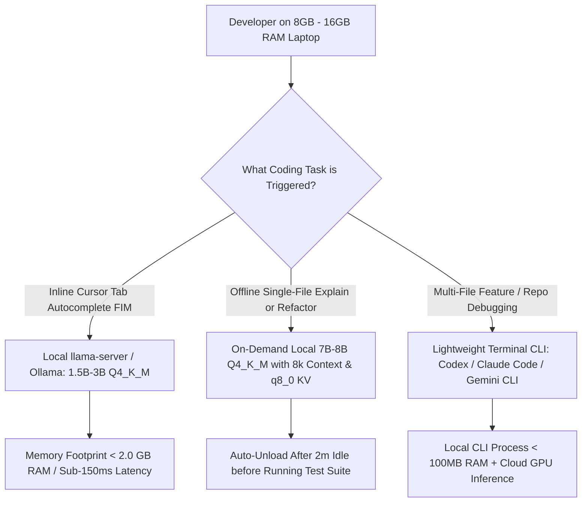

## 1. Introduction and Current Context

A large segment of global software developers, computer science students, and open-source contributors work on laptops equipped with 8GB or 16GB of system memory and integrated graphics. When a developer on a 16GB laptop already has VS Code, a browser with 15 tabs, a local Node.js or Python dev server, and a Docker container running, less than 4GB to 6GB of free RAM remains. Attempting to load a 14B or 32B local LLM alongside a full IDE immediately triggers operating-system swap thrashing, freezing the cursor and grinding compilation to a halt. Engineering a smooth AI coding setup on constrained hardware requires matching the exact task to the right memory footprint.

## 2. Direct Answer and Key Takeaway

> **Key Takeaway:** Developers working on 8GB or 16GB RAM laptops do not need a $4,000 workstation to use modern AI coding workflows in 2026. By separating **Fill-in-the-Middle (FIM) inline autocomplete** (which runs fast locally on a 1.5B-to-3B `Q4_K_M` model consuming under 2.2GB of RAM via `llama.cpp` or `Ollama`) from **multi-file agentic reasoning** (offloaded to lightweight terminal agents like `openai/codex`, `google-gemini/gemini-cli`, or `anthropics/claude-code` that run inference in the cloud), developers achieve snappy local responsiveness with zero swap-thrashing.

## 3. Definitions and Technical Background

Before evaluating architectural trade-offs or writing production code for **local coding LLM**, it is essential to establish precise engineering definitions for the core components involved:

- **Fill-in-the-Middle (FIM) Autocomplete:** A specialized code-completion training objective where a compact model receives the code prefix before the cursor and the code suffix after the cursor and predicts the missing middle snippet in under 150ms.
- **OS Swap Thrashing:** A catastrophic performance cliff that occurs when a local LLM's weights plus KV cache exceed physical free RAM, forcing the operating system to page memory blocks continuously to and from the SSD during every token decode step.
- **KV Cache Quantization (`-ctk q8_0 -ctv q8_0`):** Compressing the runtime key and value attention cache in `llama.cpp` or `Ollama` from 16-bit floats to 8-bit integers, cutting context memory consumption in half with negligible impact on code generation quality.

## 4. Technical Architecture and Deep Dive

To avoid running out of memory on an 8GB or 16GB laptop, developers must first audit how much RAM their development tools actually consume. A heavy Electron-based IDE, a Chromium browser instance, and a Docker Desktop VM easily consume 8GB to 10GB before any AI model loads. If you attempt to run an 8B model, your system crosses its physical memory limit.

The key insight for low-RAM local coding is that **inline tab autocomplete (FIM) and multi-file chat reasoning are two completely different workloads**. Inline FIM autocomplete only needs a 1,024-to-2,048 token window around your active cursor and only generates 1 to 5 lines of code.

When you need to run a 7B or 8B model locally on a 16GB laptop for offline chat or single-file refactoring, strict `llama.cpp` / `Ollama` flags keep memory bounded: (1) use `Q4_K_M` quantization (~4.8GB), (2) enable Flash Attention, (3) quantize the KV cache to 8-bit, (4) cap the context window to `4096` or `8192` tokens instead of the default 32k+, and (5) configure a short keep-alive timeout so the daemon unloads weights from RAM the moment you switch back to running heavy unit tests.

Finally, for multi-file agentic coding across a large repository, low-RAM laptops actually have an advantage when using terminal-native cloud agents.

## 5. Comparative Analysis: Practical AI Coding Configurations by Laptop RAM Tier (8GB vs. 16GB vs. 32GB)

The following table compares the key engineering trade-offs, operational boundaries, and implementation choices for **local coding LLM**:

| Laptop RAM Tier | Free RAM Budget for AI | Recommended Local Model Setup | Recommended llama.cpp / Ollama Flags | Multi-File Agent Strategy |
| --- | --- | --- | --- | --- |
| 8 GB Total RAM | 1.5 GB – 2.2 GB max | 1.5B – 3B Q4_K_M (FIM Autocomplete only) | `num_ctx=2048`, `kv_cache=q8_0`, `keep_alive=1m` | Use cloud CLI (`gemini-cli`, `codex`, `claude-code`) |
| 16 GB Total RAM | 4.5 GB – 6.5 GB max | 3B Q5_K_M for FIM + 7B/8B Q4_K_M for single-file chat | `num_ctx=8192`, `flash_attn=1`, `kv_cache=q8_0` | Hybrid: local 7B for quick diffs; cloud CLI for repo tasks |
| 24 GB – 32 GB RAM | 12 GB – 18 GB max | 14B dense Q4_K_M or 30B-A3B MoE Q4_K_M | `num_ctx=16384`, `flash_attn=1`, `kv_cache=q8_0` | Can run local agent loops or cloud CLI interchangeably |

## 6. System Architecture and Execution Flow

The diagram below illustrates the end-to-end control flow, verification boundaries, and state transitions for **local coding LLM** in a production environment:

*Figure 22.1: Memory-aware hybrid coding workflow for 8GB–16GB laptops preventing swap thrashing while preserving both offline FIM and multi-file agent capabilities.*

## 7. Practical Implementation Steps and Engineering Checklist

To implement **local coding LLM** reliably in production systems, follow these sequential engineering steps:

1. Never run two local models in memory simultaneously on a 16GB laptop; if you use a local 1.5B–3B model for continuous FIM tab completion, route multi-file chat/agent tasks to a cloud API or unload the chat model immediately after use.
2. Set `OLLAMA_FLASH_ATTENTION=1` and `OLLAMA_KV_CACHE_TYPE=q8_0` in your shell environment to cut KV-cache memory overhead by nearly 50%.
3. Explicitly cap `num_ctx` to `2048` for FIM autocomplete models and `8192` for local chat models—never leave a local model at its default 64k or 128k context limit on a low-RAM machine.
4. Use `ggml-org/llama.cpp`'s `llama-server` directly when every megabyte counts: `llama-server` is a lightweight C++ binary that avoids extra daemon layers and exposes a native `/infill` endpoint for IDE FIM plugins.

## 8. Limitations, Operational Risks, and Trade-Offs

Even well-architected deployments of **local coding LLM** face concrete engineering constraints that teams must mitigate proactively:

- Running multi-step agent loops against a 3B local model: while 1.5B–3B models excel at 5-line FIM autocomplete, they frequently hallucinate tool-call arguments or lose track of state when given a 15,000-token multi-file agent prompt.
- Thermal and battery drain on laptops: keeping a local 8B model continuously generating tokens on a laptop CPU/iGPU drains battery rapidly and heats the chassis, slowing down subsequent compilation steps.
- Sub-4-bit quantization traps: attempting to squeeze a 14B model into 6GB of RAM using `Q2_K` quantization degrades syntax accuracy so severely that a `Q4_K_M` 7B model will write better code in the same memory footprint.

## 9. Frequently Asked Questions (FAQs)

### Can I run a useful coding model locally on an 8GB RAM laptop?

Yes, for inline Fill-in-the-Middle (FIM) code completion and short shell/regex helpers. A 1.5B to 3B parameter model quantized to `Q4_K_M` uses only 1.1GB to 2.0GB of RAM and runs briskly via `llama.cpp` or `Ollama`.

### Why does my 7B local model become extremely slow when I increase the context length to 32k?

Two reasons: first, prefilling 32,000 tokens is heavily compute-bound on laptop processors; second, the 32k KV cache adds gigabytes of memory overhead, pushing your system over its physical RAM ceiling and forcing the OS to swap memory to the SSD.

### Should I use a 14B model at 2-bit quantization (`Q2_K`) or a 7B model at 4-bit (`Q4_K_M`)?

Always choose the 7B model at 4-bit (`Q4_K_M`).

## 10. Conclusion

Constrained laptop hardware is not a barrier to top-tier AI-assisted software engineering. By running compact 1.5B–3B `Q4_K_M` models with quantized KV caches for instant local autocomplete and delegating heavy repository-wide reasoning to low-memory terminal CLI agents, developers on 8GB and 16GB machines get a fast, responsive workflow.

### GitHub Repositories & Technical References

- **ggml-org/llama.cpp** — Official C/C++ inference engine including `llama-server` with native `/infill` FIM endpoints, Flash Attention, and quantized KV caches for low-RAM hardware. Verified GitHub URL: https://github.com/ggml-org/llama.cpp
- **ollama/ollama** — Local model runner supporting `OLLAMA_FLASH_ATTENTION`, `OLLAMA_KV_CACHE_TYPE=q8_0`, and configurable memory keep-alive timeouts. Verified GitHub URL: https://github.com/ollama/ollama
- **QwenLM/Qwen3** — Official repository for the Qwen3 model family, providing compact 0.6B, 1.7B, 4B, and 8B checkpoints well-suited for local laptop coding. Verified GitHub URL: https://github.com/qwenLM/qwen3
- **google-gemini/gemini-cli** — Lightweight open-source terminal agent that offloads large-context repository reasoning to cloud GPUs while using minimal local RAM. Verified GitHub URL: https://github.com/google-gemini/gemini-cli
