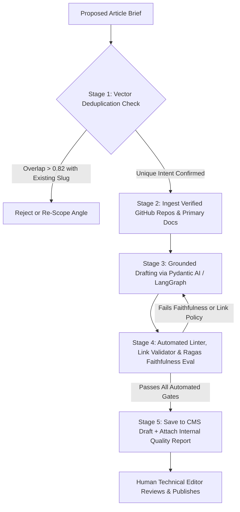

## 1. Introduction and Current Context

Between 2023 and 2026, thousands of domains attempted to game organic search by running bulk Python scripts that fed 5,000 CSV keywords into an LLM API and auto-published the resulting articles. Both traditional search engines (via Scaled Content Abuse policies) and generative AI answer engines rapidly learned to demote or ignore these domains because zero-shot bulk articles repeat the same generic consensus tropes, hallucinate citations, cannibalize one another's search intent, and contain zero original evidence. Automating research and drafting responsibly requires building a rigorous verification pipeline.

## 2. Direct Answer and Key Takeaway

> **Key Takeaway:** The difference between a high-value AI content pipeline and an automated spam cannon is **evidence-first architecture**. Spam pipelines map a list of keywords directly to zero-shot LLM completions and push unverified text live; engineering-grade content pipelines enforce five mandatory stages before human review: (1) semantic deduplication against the existing site index, (2) primary-source retrieval (`GitHub` repos, official specs), (3) claim-grounded drafting via typed schemas (`pydantic/pydantic-ai`), (4) automated faithfulness and link-validity testing (`explodinggradients/ragas`, `promptfoo/promptfoo`), and (5) a human subject-matter expert sign-off gate.

## 3. Definitions and Technical Background

Before evaluating architectural trade-offs or writing production code for **AI content workflow**, it is essential to establish precise engineering definitions for the core components involved:

- **Scaled Content Abuse (Programmatic Spam):** Generating many pages primarily to manipulate search rankings rather than helping users, characterized by low information gain, unverified claims, and absence of original data or human editorial curation.
- **Information Gain & Semantic Differentiation:** The measurable degree to which a new article contributes unique technical specifications, verified code examples, architectural comparisons, or empirical findings not already present in existing pages on the site or top search results.
- **Claim-to-Source Groundedness (Faithfulness):** An evaluation metric that decomposes generated prose into atomic factual statements and verifies whether each statement is directly entailed by the retrieved primary source text.
- **Editorial Quarantine (`draft` Gate):** A hard pipeline invariant where automated workflows can never transition a document's publication status to `published`, routing all passing drafts to a human review queue alongside an automated verification report.

## 4. Technical Architecture and Deep Dive

Why do naive 'Prompt → Publish' scripts inevitably produce spam? When an LLM is prompted with only a title and target keyword—without verified primary documentation injected into its context window—it samples from the statistical average of its pretraining corpus. It writes vague, hedging sentences, invents plausible-sounding benchmark numbers, and fabricates URLs.

An engineering-grade AI content pipeline inverts this process by treating the LLM as a **grounded synthesizer**, never an oracle. **Stage 1** queries your existing CMS vector index to compute the cosine similarity between the proposed topic and every existing article.

**Stage 2** fetches verbatim technical documentation: cloning or reading official GitHub repository READMEs, release notes, config schemas, and API signatures.

**Stage 4** runs deterministic and model-based checks before a human editor ever sees the draft: verifying word counts, checking every URL for HTTP 200 status and domain policy compliance, validating JSON-LD syntax, and scoring faithfulness against the Stage 2 evidence packet.

## 5. Comparative Analysis: Architectural Comparison: Bulk AI Spam Generators vs. Evidence-Grounded Editorial Pipelines

The following table compares the key engineering trade-offs, operational boundaries, and implementation choices for **AI content workflow**:

| Pipeline Stage | Bulk AI Spam Generator (Anti-Pattern) | Evidence-Grounded Editorial Pipeline (2026 Standard) | Verification Tool / Mechanism |
| --- | --- | --- | --- |
| Topic Selection | Blind CSV list of 1,000 scraped keywords | Cosine similarity deduplication + distinct reader intent | `pgvector` / `qdrant` similarity check |
| Knowledge Source | Unconstrained LLM parametric memory (hallucinates) | Curated Evidence Packet (official GitHub repos, specs) | GitHub API / verified document loaders |
| Drafting Control | Single zero-shot prompt ('Write 1500 words on X') | Typed schema nodes (`Pydantic AI`) + banned-phrase linter | `pydantic/pydantic-ai`, `langchain-ai/langgraph` |
| Fact & Link Checking | None (ships dead 404 URLs & invented stats) | Automated HTTP 200 link check + Ragas faithfulness score | `explodinggradients/ragas`, `promptfoo` |
| Publishing Authority | Auto-posts directly to live production URLs | Writes strictly to CMS `draft` state with QA report | `payloadcms/payload` RBAC + human editor sign-off |

## 6. System Architecture and Execution Flow

The diagram below illustrates the end-to-end control flow, verification boundaries, and state transitions for **AI content workflow** in a production environment:

*Figure 31.1: Five-stage anti-spam AI content pipeline enforcing deduplication, primary-source grounding, Ragas faithfulness verification, and human editorial approval.*

## 7. Practical Implementation Steps and Engineering Checklist

To implement **AI content workflow** reliably in production systems, follow these sequential engineering steps:

1. Never allow an automated pipeline to draft an article from a title alone; require an input `EvidencePacket` containing verified repository URLs, documentation excerpts, and explicit uncertainty notes.
2. Maintain a deterministic regex and AST linter in your pipeline that fails the build if the draft contains banned AI clichés ('In today's rapidly evolving landscape', 'delve into', 'testament to'), placeholder tokens (`[TBD]`, `[Insert URL]`), or fabricated first-person experiments.
3. Run an automated link-policy verifier on every generated Markdown body to confirm that all external links resolve and match your editorial source policy (such as verified GitHub repositories).
4. Score every draft with `explodinggradients/ragas` (`Faithfulness` metric) or `confident-ai/deepeval` (`HallucinationMetric`) against the retrieved source packet, rejecting any section that introduces ungrounded numerical claims.
5. Attach an machine-readable **Internal Quality Report** to every CMS draft listing exact word count, source verification status, and remaining uncertainties so the human editor knows exactly what to scrutinize.

## 8. Limitations, Operational Risks, and Trade-Offs

Even well-architected deployments of **AI content workflow** face concrete engineering constraints that teams must mitigate proactively:

- Structural monotony across articles: if every article in a 60-article collection uses the exact same opening sentence pattern or identical FAQ phrasing, readers and search algorithms detect template repetition—vary section depth and comparison structures to match each topic.
- Passing bad sources into the Evidence Packet: groundedness metrics (`Ragas`) only verify that the draft matches the provided context; if the input context itself contains a blog rumor, the pipeline will faithfully reproduce the rumor unless sources are restricted to primary repositories and official releases.
- Editor rubber-stamping: if human editors are measured purely on how many AI drafts they click 'Publish' on per hour, the human gate becomes theatrical rather than substantive.

## 9. Frequently Asked Questions (FAQs)

### Do search engines penalize articles simply because AI assisted in drafting them?

Search engines focus on content quality, originality, and user value rather than how the text was produced.

### How do I stop an AI content pipeline from inventing fake statistics or fake case studies?

Use a two-part defense: (1) instruct the drafting agent via system prompt and schema constraints to use only figures explicitly present in the provided source packet and to use qualitative descriptions when numbers are unavailable, and (2) run an automated `Ragas` or `DeepEval` faithfulness check that flags any claim not entailed by the source text.

### How do I prevent 50 automated articles on related topics from cannibalizing each other?

Before drafting, embed all proposed article titles, primary keywords, and outlines into a vector store (`qdrant` or `pgvector`) and compute pairwise similarity matrices.

## 10. Conclusion

Automating research synthesis and structured drafting does not mean compromising editorial integrity. By anchoring pipelines in primary GitHub documentation, enforcing deterministic link and faithfulness checks (`ragas`, `promptfoo`, `deepeval`), and preserving human editorial authority over publication, teams scale technical content that genuinely serves developers.

### GitHub Repositories & Technical References

- **explodinggradients/ragas** — Open-source evaluation framework providing objective Faithfulness, Answer Relevance, and Context Precision metrics to detect hallucinations in grounded text. Verified GitHub URL: https://github.com/explodinggradients/ragas
- **promptfoo/promptfoo** — Declarative evaluation CLI for running deterministic regex, JSON schema, link policy, and rubric assertions on generated content pipelines. Verified GitHub URL: https://github.com/promptfoo/promptfoo
- **confident-ai/deepeval** — Open-source LLM evaluation framework for unit-testing groundedness and hallucination rates in CI pipelines. Verified GitHub URL: https://github.com/confident-ai/deepeval
- **pydantic/pydantic-ai** — Typed Python agent framework for enforcing strict structural schemas on multi-stage research and drafting workflows. Verified GitHub URL: https://github.com/pydantic/pydantic-ai
