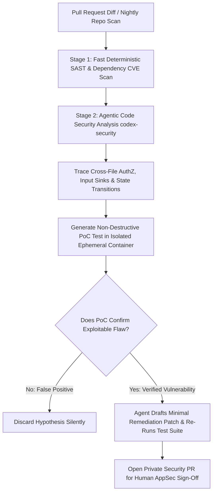

## 1. Introduction and Current Context

Traditional SAST scanners excel at matching known syntactic signatures (like `eval(req.body.input)` or outdated CVE package versions), yet they drown developers in false positives while completely missing multi-file business-logic bugs—such as a controller in `orders.ts` checking user authentication while forgetting to verify whether `order.organization_id === current_user.organization_id`. By October 2026, security teams combine repository-aware coding agents (`openai/codex-security`, `anthropics/claude-code`, `google-gemini/gemini-cli` Security Extension) with deterministic fuzzers and container sandboxes to transform defensive Application Security (AppSec).

## 2. Direct Answer and Key Takeaway

> **Key Takeaway:** In 2026, autonomous security agents—such as OpenAI's `openai/codex-security` CLI/SDK and LLM red-teaming suites like `NVIDIA/garak`—can reliably discover, validate via Proof-of-Concept (PoC) tests in isolated sandboxes, and patch complex business-logic vulnerabilities (such as IDOR, broken authorization, SSRF, and injection chains) that traditional regex/AST Static Application Security Testing (SAST) tools miss. However, because unvalidated LLM security reports suffer from high false-positive rates and live exploitation carries severe legal and operational risks, defensive engineering teams restrict autonomous agents to **ephemeral local/CI sandboxes** and enforce strict **authorized scope boundaries**.

## 3. Definitions and Technical Background

Before evaluating architectural trade-offs or writing production code for **AI cybersecurity**, it is essential to establish precise engineering definitions for the core components involved:

- **Agentic SAST + Dynamic Validation:** An automated security workflow where an AI agent traces data flow across files to hypothesize a vulnerability, then writes and runs a self-contained Proof-of-Concept (PoC) unit/integration test inside an isolated container to confirm whether the bug is genuinely exploitable before alerting a human.
- **False-Positive Filtering via Execution:** Eliminating hallucinated security warnings by requiring the agent to prove that an untrusted input actually reaches a sensitive sink and violates a security assertion in a local test environment.
- **Authorized Testing Boundary (Rules of Engagement):** The strict legal and technical boundary ensuring that automated vulnerability discovery runs exclusively against owned source repositories or isolated ephemeral containers—never against unauthorized third-party systems or live production databases.
- **LLM Vulnerability Scanner (`NVIDIA/garak`):** An open-source probe framework analogous to `nmap` or `metasploit` for language models that tests AI endpoints against prompt injection, jailbreaks, data leakage, and encoding bypasses.

## 4. Technical Architecture and Deep Dive

**Why Agentic Vulnerability Discovery Outperforms Static Regex Rules on Business Logic:** Consider a classic Insecure Direct Object Reference (IDOR) or multi-step race condition distributed across three files: an Express/FastAPI router, a service layer, and an ORM repository. A traditional SAST rule inspects one AST file at a time and cannot easily infer whether a specific route is meant to be public or tenant-scoped.

**Closing the Loop: Validate First, Patch Second, Human Review Always.** The single biggest complaint security engineers had with first-generation LLM code scanners in 2024 was noise: asking an LLM 'Find vulnerabilities in this file' caused the model to invent theoretical risks on every file. In 2026, production pipelines enforce a **Verification Gate**. When the agent hypothesizes a flaw, it must run a non-destructive assertion against a local ephemeral container. If the assertion fails to trigger the bug, the hypothesis is discarded silently.

**Securing the AI Layer Itself:** Beyond scanning traditional web code, 2026 AppSec teams must also scan their own LLM and agent endpoints.

**Strict Legal and Operational Guardrails:** Autonomous vulnerability discovery tools must never be pointed at external domains without explicit written authorization, nor should they run against live production databases where fuzzing payloads could corrupt customer records or trigger denial-of-service outages.

## 5. Comparative Analysis: Comparison of Application Security Testing Approaches in 2026

The following table compares the key engineering trade-offs, operational boundaries, and implementation choices for **AI cybersecurity**:

| Security Testing Layer | Strengths | Blind Spots | 2026 Best-Practice Integration |
| --- | --- | --- | --- |
| Deterministic SAST / Linters (Semgrep / CodeQL) | Fast, deterministic, zero token cost, catches known syntax patterns | High false positives; misses complex cross-file business-logic & auth flaws | Run on every commit as fast Stage-1 pre-filter |
| Software Composition Analysis (Dependabot / Trivy) | Identifies known CVEs in third-party `npm`/`pip` lockfiles | Cannot detect zero-day flaws in custom first-party application code | Automate lockfile PRs with CI test verification |
| Agentic Vulnerability Discovery (`codex-security`) | Reasons across multi-file auth/logic flows; validates via PoC tests & drafts patches | Higher compute cost; requires sandbox isolation to validate safely | Run on PR diffs & nightly against ephemeral local containers |
| AI Endpoint Red-Teaming (`NVIDIA/garak` / `promptfoo`) | Probes LLMs/agents for prompt injection, jailbreaks, and tool abuse | Does not scan traditional SQL/memory-safety bugs in C++/Rust | Run in CI before deploying any new agent or system prompt |

## 6. System Architecture and Execution Flow

The diagram below illustrates the end-to-end control flow, verification boundaries, and state transitions for **AI cybersecurity** in a production environment:

*Figure 46.1: Defensive agentic AppSec pipeline combining deterministic SAST with sandboxed Proof-of-Concept validation and automated patch generation.*

## 7. Practical Implementation Steps and Engineering Checklist

To implement **AI cybersecurity** reliably in production systems, follow these sequential engineering steps:

1. Integrate `openai/codex-security` or the Gemini CLI Security Extension into your pull-request workflow to audit high-risk paths.
2. Execute all agentic security validation and fuzzing strictly inside **network-isolated ephemeral Docker containers** seeded with synthetic dummy fixtures—never against staging or production databases containing real user data.
3. Require every AI-reported vulnerability to include a **reproducible failing unit or integration test** before opening a ticket for engineering teams, eliminating false-positive alert fatigue.
4. Audit your own AI agents and LLM endpoints using `NVIDIA/garak` and `promptfoo/promptfoo` red-team scans to verify that adversarial inputs cannot trigger unauthorized tool calls.

## 8. Limitations, Operational Risks, and Trade-Offs

Even well-architected deployments of **AI cybersecurity** face concrete engineering constraints that teams must mitigate proactively:

- High false-positive noise without execution verification: running a raw LLM prompt over code without a sandboxed test-validation step floods developers with speculative warnings they quickly ignore.
- Incomplete patch fixes (whack-a-mole): an agent might fix a SQL injection or IDOR on one specific line by adding an ad-hoc check while missing three sibling endpoints in the same controller—human AppSec engineers must review for systemic root causes.
- Sandbox escape risks if scanning untrusted repositories: running automated build/test loops on untrusted external open-source repos requires hardened microVM or gVisor isolation so malicious build scripts (`setup.py`, `postinstall`) cannot compromise the CI host.

## 9. Frequently Asked Questions (FAQs)

### Can AI agents find zero-day vulnerabilities that traditional SAST tools miss?

Yes, particularly in multi-file application logic—such as broken multi-tenant authorization (IDOR), missing state-machine checks in checkout flows, and complex Server-Side Request Forgery (SSRF) chains—because agents reason over semantic intent across files rather than matching single-line regexes.

### What is OpenAI Codex Security (`openai/codex-security`)?

`openai/codex-security` is OpenAI's official CLI and TypeScript SDK designed to find, validate, and fix security vulnerabilities in codebases by combining agentic code analysis with automated validation and patch generation.

### How do security teams prevent AI scanners from overwhelming developers with false positives?

By requiring **Proof-of-Concept (PoC) test validation**: the security agent must write a unit or integration test that triggers the vulnerability in an isolated container and then verify that its proposed code patch makes the test pass.

## 10. Conclusion

Autonomous AI security agents have tipped the scale toward defenders who pair semantic code reasoning with deterministic sandbox validation. By combining `openai/codex-security` for application code, `NVIDIA/garak` for AI model endpoints, and strict human review gates, engineering teams find and fix deep logic flaws before they ever reach production.

### GitHub Repositories & Technical References

- **openai/codex-security** — OpenAI's official Codex Security CLI and TypeScript SDK for finding, validating, and fixing software security vulnerabilities. Verified GitHub URL: https://github.com/openai/codex-security
- **NVIDIA/garak** — Official open-source LLM vulnerability scanner for probing models and agents against prompt injection, jailbreaks, and data leakage. Verified GitHub URL: https://github.com/NVIDIA/garak
- **promptfoo/promptfoo** — Open-source CLI providing automated red-teaming and vulnerability scanning for LLM applications and RAG pipelines. Verified GitHub URL: https://github.com/promptfoo/promptfoo
- **protectai/llm-guard** — Runtime security toolkit for sanitizing LLM inputs and outputs against injection and sensitive data exfiltration. Verified GitHub URL: https://github.com/protectai/llm-guard
