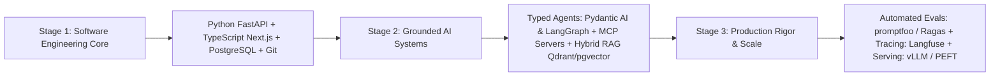

## 1. Introduction and Current Context

Three years ago, a resume listing 'Prompt Engineering' and a weekend LangChain chatbot tutorial was enough to secure interviews. By October 2026, the Indian AI job market has matured into distinct, rigorous engineering tracks. Enterprise GCCs modernizing global banking and retail platforms, Indian B2B SaaS unicorns, and sovereign AI startups (such as Sarvam AI, Krutrim, and voice/fintech innovators) evaluate candidates on whether they can take a probabilistic model and make it behave like reliable production software. Note that because compensation varies widely by city, company stage, and equity structure, this guide focuses strictly on verified technical competencies and portfolio evidence rather than inventing speculative salary brackets.

## 2. Direct Answer and Key Takeaway

> **Key Takeaway:** In 2026, hiring across India's technology hubs—spanning Global Capability Centres (GCCs), SaaS startups, fintechs, and digital engineering firms in Bengaluru, Hyderabad, Pune, Gurugram, and Chennai—has pivoted sharply from academic notebook data science toward **Production AI Systems Engineering**. While India ranks as the second-largest contributor to GitHub AI projects globally (per the Stanford Global AI Vibrancy Report cited by MeitY in August 2026), employers consistently report a wide gap between candidates who can call an API in a Jupyter notebook and engineers who can ship **observable, evaluated, cost-bounded RAG, agentic, and voice systems** in Python (`fastapi`, `pydantic-ai`, `langgraph`) and TypeScript (`next.js`, `vercel/ai`).

## 3. Definitions and Technical Background

Before evaluating architectural trade-offs or writing production code for **AI jobs India**, it is essential to establish precise engineering definitions for the core components involved:

- **AI Systems Engineer (Application / Full-Stack Track):** A software engineer proficient in Python and TypeScript who builds, evaluates, and monitors stateful RAG, agentic, and voice applications using foundation models.
- **ML / Inference Infrastructure Engineer (Systems Track):** An engineer focused on model post-training, quantization, and high-throughput GPU cluster serving.
- **Evaluation-Driven Development (EvalOps):** The mandatory production competency of building golden test datasets, deterministic schema assertions, and automated CI regression pipelines before deploying prompt or model changes.
- **Indic & Multimodal Localization Competency:** Engineering familiarity with Indian language tokenization, transliteration, code-switching, and low-latency speech pipelines.

## 4. Technical Architecture and Deep Dive

**Why 'Notebook-Only' Resumes Fail Technical Interviews in 2026:** Hiring managers across Indian GCCs and startups point to the same pattern: thousands of applicants submit identical portfolio projects—a Streamlit wrapper around a single PDF using default chunk sizes and zero evaluation metrics. When interviewers ask, *'What happens to your RAG app when 50 concurrent users upload a 100-page scanned financial table with multi-tenant permissions, and how do you measure whether your chunk size improved recall?'*, notebook-only candidates struggle.

**The Five Core Technical Pillars Employers Screen For:**
1. **Structured Outputs & Typed Orchestration:** Mastery of `pydantic/pydantic-ai`, `dottxt-ai/outlines`, and `langchain-ai/langgraph` to guarantee that LLM steps adhere to strict schemas, recover from tool errors, and persist checkpointed state in PostgreSQL.
2. **Production Hybrid RAG:** Building ingestion pipelines that parse complex tables, combine dense embeddings with sparse BM25 keyword search in `qdrant/qdrant` or `pgvector/pgvector`, enforce row-level security filters, and apply cross-encoder reranking.
3. **Automated Evals & Observability:** Writing CI-integrated evaluations and instrumenting OpenTelemetry traces in `langfuse/langfuse` or `Arize-ai/phoenix`.
4. **Inference Economics & Serving:** Understanding KV-cache memory math, prefix caching, 4-bit/FP8 quantization, and serving open-weight models via `vllm-project/vllm`.
5.

**India-Specific Differentiators:** Candidates interviewing for India-focused consumer, fintech, or voice roles gain a massive edge by demonstrating hands-on competence with **Indic language and voice pipelines**—understanding why Devanagari or Tamil scripts inflate byte-pair encoding (BPE) token counts on English-centric models, how to evaluate translation with `AI4Bharat/IndicTrans2` and `AI4Bharat/MILU`, and how to build low-latency telephony voice agents.

## 5. Comparative Analysis: 2026 India AI Engineering Role Tracks: Core Tech Stack and Portfolio Proof Required

The following table compares the key engineering trade-offs, operational boundaries, and implementation choices for **AI jobs India**:

| Role Track | Primary Employer Segments in India | Core Open-Source Tech Stack | High-Signal Portfolio Proof for Interviews |
| --- | --- | --- | --- |
| Full-Stack AI / Agent Engineer | B2B SaaS startups, product companies, consumer apps | Next.js, `vercel/ai`, FastAPI, `pydantic-ai`, `langgraph`, MCP | Deployed app with streaming UI, Postgres checkpoints, MCP tools, and `promptfoo` CI evals |
| RAG & Knowledge Engineer | Enterprise GCCs (banking, legal, healthcare, retail) | `llama_index`, `qdrant` / `pgvector`, `ragas`, `deepeval` | Hybrid BM25+vector pipeline over messy PDFs with ACL filtering & measured Recall/Faithfulness |
| LLM Inference & MLOps Engineer | AI cloud providers, sovereign labs, high-scale startups | `vllm`, `sglang`, `peft`, `trl`, Docker, Kubernetes, FP8 | Reproducible benchmark comparing vLLM FP8 vs BF16 TTFT/ITL + LoRA fine-tuning pipeline |
| Voice & Indic AI Engineer | Fintech, customer ops automation, Bharat voice startups | `livekit/agents`, `pipecat`, `bolna-ai/bolna`, `AI4Bharat` | WebRTC/telephony voice agent handling barge-in, Hinglish code-switching, and <600ms latency |

## 6. System Architecture and Execution Flow

The diagram below illustrates the end-to-end control flow, verification boundaries, and state transitions for **AI jobs India** in a production environment:

*Figure 37.1: Competency progression roadmap for AI Engineers in India transitioning from software fundamentals to production AI systems.*

## 7. Practical Implementation Steps and Engineering Checklist

To implement **AI jobs India** reliably in production systems, follow these sequential engineering steps:

1. Replace generic 'chat with a PDF' resume projects with a **production-grade vertical system** that includes an `evals/` folder (`promptfoo` or `deepeval` YAML/pytest files) showing quantitative before-and-after metrics when you changed chunking strategies or models.
2. Master both **Python** (`fastapi/fastapi`, `pydantic/pydantic-ai`, `langchain-ai/langgraph`) for backend AI orchestration and **TypeScript** (`vercel/next.js`, `vercel/ai`) for streaming interfaces and MCP servers.
3. Include a clear architecture diagram, latency breakdown, cost-per-1,000-queries calculation, and failure-recovery explanation in your GitHub portfolio repository's `README.md`.
4. Contribute meaningful bug fixes, MCP server implementations, or Indic evaluation tasks to verified open-source repositories—India's #2 global ranking in GitHub AI contributions means interviewers value real upstream PRs over certificates.
5. Prepare for system-design interviews by practicing how to enforce tenant isolation, idempotency keys on agent tools, and PII redaction for DPDP Act compliance.

## 8. Limitations, Operational Risks, and Trade-Offs

Even well-architected deployments of **AI jobs India** face concrete engineering constraints that teams must mitigate proactively:

- Chasing certificates over shipping code: employers increasingly discount generic multiple-choice 'Prompt Engineering Certificates' if the candidate cannot write a clean async FastAPI endpoint or debug a failing unit test live.
- Ignoring core software engineering fundamentals: an AI engineer who understands attention matrices on paper but writes SQL injection vulnerabilities, blocks the Python `asyncio` event loop with synchronous I/O, or commits `.env` secrets to Git will fail production code reviews.
- Over-indexing on a single ephemeral framework syntax: framework APIs evolve every six months; anchor your learning in durable fundamentals (HTTP SSE streaming, JSON-RPC, vector indexing math, precision/recall evaluation, and distributed state).

## 9. Frequently Asked Questions (FAQs)

### Do I need a PhD or advanced calculus to get an AI Engineer job in India in 2026?

For research scientist roles pretraining foundation models from scratch, strong mathematical foundations and research publications matter.

### What is the single biggest red flag hiring managers see on AI engineering resumes?

Listing 20 buzzwords (LangChain, AutoGen, CrewAI, LlamaIndex, Pinecone, Chroma) without a single measurable engineering metric or evaluation suite.

### Should Indian developers learn Python or TypeScript for AI engineering?

Both play vital roles. Python (`fastapi`, `pydantic-ai`, `langgraph`, `vllm`, `peft`) dominates model serving, evaluation, data pipelines, and backend orchestration.

## 10. Conclusion

The AI engineering job market in India rewards builders who bridge the gap between probabilistic models and deterministic software engineering. By grounding your skill set in typed orchestration (`pydantic-ai`, `langgraph`), hybrid RAG (`qdrant`, `pgvector`), reproducible evaluations (`promptfoo`, `ragas`), and efficient serving (`vllm`), you position yourself at the forefront of India's technology ecosystem.

### GitHub Repositories & Technical References

- **pydantic/pydantic-ai** — Official typed Python agent framework widely used for production-grade LLM orchestration and structured validation. Verified GitHub URL: https://github.com/pydantic/pydantic-ai
- **langchain-ai/langgraph** — Industry-standard stateful agent workflow framework with durable checkpointing and human-in-the-loop controls. Verified GitHub URL: https://github.com/langchain-ai/langgraph
- **promptfoo/promptfoo** — Open-source evaluation and red-teaming CLI essential for demonstrating EvalOps rigor in engineering portfolios. Verified GitHub URL: https://github.com/promptfoo/promptfoo
- **AI4Bharat/IndicLLMSuite** — Open-source Indic LLM dataset and evaluation ecosystem from IIT Madras for developers building Indian-language AI. Verified GitHub URL: https://github.com/AI4Bharat/IndicLLMSuite
