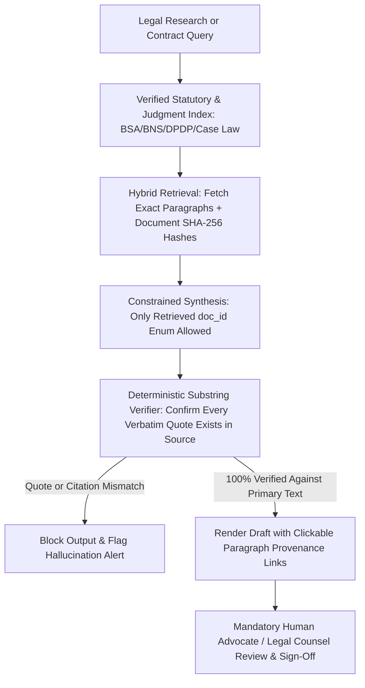

## 1. Introduction and Current Context

Across courts and arbitration panels worldwide—including documented judicial reprimands in Indian courts and tribunals—litigants and practitioners who used general-purpose chatbots to draft legal briefs have submitted non-existent Supreme Court or High Court judgments with fabricated case citations, bench names, and paragraph quotes. Simultaneously, the proliferation of voice cloning and image editing models has forced enterprises and courts to scrutinize the chain of custody and cryptographic integrity of every electronic record submitted in evidence.

## 2. Direct Answer and Key Takeaway

> **Key Takeaway:** In legal practice, corporate compliance, and dispute resolution in India in 2026, two AI risks carry severe professional and legal consequences: (1) **Hallucinated Case Law & Statutory Citations** generated by unconstrained LLMs, and (2) **Unverified or Manipulated Digital Evidence** (synthetic audio, altered PDFs, or unauthenticated logs).

## 3. Definitions and Technical Background

Before evaluating architectural trade-offs or writing production code for **AI legal compliance India**, it is essential to establish precise engineering definitions for the core components involved:

- **Hallucinated Precedent (Fabricated Case Citation):** When an autoregressive language model predicts a plausible-sounding case title, citation string 14 SCC ...`), and verbatim quote by blending statistical token patterns from its training data rather than retrieving an actual judgment from a verified database.
- **Electronic Record Admissibility (Section 63, Bharatiya Sakshya Adhiniyam, 2023):** The statutory framework in India requiring a formal certificate and cryptographic hash verification confirming the integrity of the computer system and electronic record.
- **Cryptographic Provenance & Hash Chaining (`SHA-256` / C2PA):** Computing and logging an immutable cryptographic digest and signed timestamp at the exact moment a digital document, call recording, or system log is created, proving that it was not synthetically generated or altered downstream.

## 4. Technical Architecture and Deep Dive

**Why Unconstrained LLMs Invent Fake Case Law:** To a general-purpose LLM without retrieval grounding, a case citation like *`AIR 2019 SC 4421`* is not a database primary key—it is just a sequence of tokens that statistically follows a legal principle. When a user prompts a chatbot for *'three High Court judgments supporting clause X,'* the model optimizes for helpfulness and stylistic plausibility: it combines real judge names, real statutory sections, and a realistic citation format to synthesize a case that never happened.

**Engineering Zero-Hallucination Legal Research Systems:** For legal-tech engineers and enterprise legal operations teams, the cure is architectural: **never allow parametric citation generation**. In a production Legal RAG pipeline, every judgment, statute, and contract clause is indexed with immutable metadata.

**Synthetic Evidence, Deepfakes, and BSA Section 63 Provenance:** The second half of the challenge is defending against synthetic evidence while ensuring your own company's digital logs are admissible in disputes. Under **Section 63 of the Bharatiya Sakshya Adhiniyam (BSA), 2023**, electronic records submitted as secondary evidence require structured certification detailing device integrity and cryptographic hash digests.

## 5. Comparative Analysis: Technical Controls for Legal Drafting and Digital Evidence Integrity in India (2026)

The following table compares the key engineering trade-offs, operational boundaries, and implementation choices for **AI legal compliance India**:

| Risk Scenario | Failure Mode of Uncontrolled AI | Required Engineering Control | Applicable Indian Legal / Policy Context |
| --- | --- | --- | --- |
| Case Law & Statutory Research | LLM invents fake SCC/AIR citations or cites repealed sections | Closed-world RAG + enum-constrained citation IDs + exact quote verification | Judicial sanctions / professional ethics duties |
| Statute Version Confusion | LLM cites old IPC/CrPC/IEA sections instead of BNS/BNSS/BSA 2023 | Metadata date filtering + statutory cross-walk mapping tables in RAG | BNS, BNSS, and BSA 2023 statutory transitions |
| Digital Evidence Integrity | Opposing party challenges log/audio as AI-manipulated | Capture-time `SHA-256` hash logging, NTP sync, and immutable WORM storage | Section 63 of Bharatiya Sakshya Adhiniyam (BSA), 2023 |
| Synthetic Media Disclosure | Unlabeled AI-generated audio/video causes deception or liability | Embed C2PA/active watermarks + visible disclosure labels | IT Rules Amendment (In Force Feb 20, 2026) |
| Contract Review & Drafting | LLM silently drops an indemnity cap while summarizing | Side-by-side span pointers + mandatory human lawyer sign-off | Contractual liability & internal governance |

## 6. System Architecture and Execution Flow

The diagram below illustrates the end-to-end control flow, verification boundaries, and state transitions for **AI legal compliance India** in a production environment:

*Figure 44.1: Zero-hallucination legal RAG pipeline enforcing enum-constrained document citations, deterministic quote verification, and human legal sign-off.*

## 7. Practical Implementation Steps and Engineering Checklist

To implement **AI legal compliance India** reliably in production systems, follow these sequential engineering steps:

1. Configure legal and compliance RAG systems in **Closed-World Grounding Mode**: restrict `citation_id` fields in your Pydantic/Outlines output schema to the exact list of `doc_id` strings returned by the retriever in that request, making it impossible for the LLM to invent an external case citation.
2. Write a deterministic Python post-processor that checks every `> blockquote` or statutory quote in the generated response against the raw retrieved judgment text and strips or flags any quote that does not match.
3. Maintain explicit statutory cross-walk tables in your knowledge base mapping legacy Indian statutes to their current replacements so pretraining priors do not cite repealed section numbers.
4. For enterprise call recordings, KYC videos, and transaction logs that may serve as legal evidence under **Section 63 of the BSA, 2023**, compute and record a `SHA-256` hash and server timestamp immediately upon ingestion in an immutable audit log.

## 8. Limitations, Operational Risks, and Trade-Offs

Even well-architected deployments of **AI legal compliance India** face concrete engineering constraints that teams must mitigate proactively:

- Pretraining cutoff blindness on recent statutory amendments: foundation models have millions of pretraining tokens referencing 'Section 65B of the Indian Evidence Act' or 'Section 420 IPC'; without explicit RAG grounding and system prompt rules, models default to legacy section numbers.
- False confidence in passive 'AI Deepfake Detectors': relying on a black-box classifier to prove in court whether an audio clip or PDF is fake is scientifically fragile—proactive capture-time cryptographic hashing (`SHA-256`) and chain-of-custody logs are far stronger.
- Confidential privilege waiver: uploading privileged client litigation strategy or M&A drafts to consumer web chatbots without enterprise zero-data-retention agreements risks waiving confidentiality and violating DPDP duties.

## 9. Frequently Asked Questions (FAQs)

### Why do AI chatbots invent fake court cases with realistic-looking citations?

Standard language models are trained to predict the next most likely token based on statistical patterns, not to query a verified database of court judgments.

### How can legal tech developers make it impossible for an LLM to cite a non-existent case?

Pass the retrieved judgments into the prompt with unique IDs (`[DOC_1]`, `[DOC_2]`), constrain the output JSON schema (`dottxt-ai/outlines` or `pydantic-ai`) so the `cited_doc_id` field only accepts those exact enum values, and verify quotes programmatically against the source text.

### What does Section 63 of the Bharatiya Sakshya Adhiniyam (BSA), 2023 require for electronic records?

Section 63 of the BSA, 2023 (which succeeded Section 65B of the Indian Evidence Act) governs the admissibility of electronic records and emphasizes structured certification of the operating state of the computer/device and the cryptographic hash value (`SHA-256`) of the electronic record.

## 10. Conclusion

In legal and compliance workflows, '95% accurate and plausible-sounding' is not good enough—every citation and piece of digital evidence must be 100% verifiable. By combining closed-world legal RAG, deterministic quote verification, capture-time `SHA-256` hash provenance aligned with BSA Section 63, and human legal review, organizations harness AI efficiency without compromising evidentiary integrity.

### GitHub Repositories & Technical References

- **run-llama/llama_index** — Document indexing and RAG framework supporting node-level citation tracking and metadata filtering for legal corpora. Verified GitHub URL: https://github.com/run-llama/llama_index
- **dottxt-ai/outlines** — Structured generation library capable of constraining model citations strictly to retrieved document ID enums. Verified GitHub URL: https://github.com/dottxt-ai/outlines
- **explodinggradients/ragas** — Evaluation toolkit for measuring faithfulness and detecting ungrounded claims in legal RAG outputs. Verified GitHub URL: https://github.com/explodinggradients/ragas
- **pydantic/pydantic-ai** — Typed agent framework for running deterministic post-generation validators that verify quoted spans against source documents. Verified GitHub URL: https://github.com/pydantic/pydantic-ai
