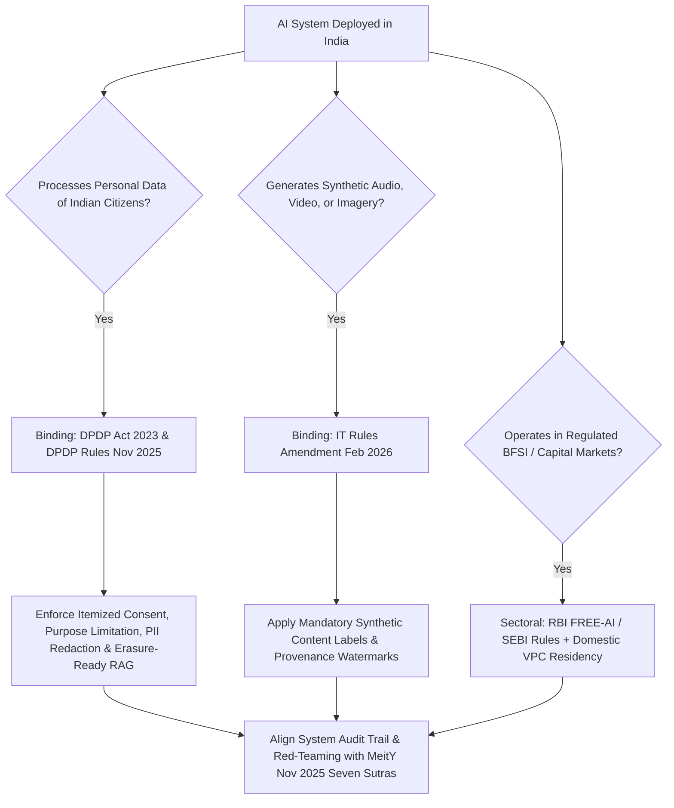

## 1. Introduction and Current Context

Founders, general counsels, and engineering leaders operating in India frequently encounter confusing compliance advice—ranging from false rumors of an 'Indian AI Licensing Act' to the equally dangerous assumption that 'India has zero AI laws.' Neither is true. To build compliant software without paralyzing product velocity, engineering teams must map exact legal obligations across data protection, synthetic content labeling, sectoral regulation, and MeitY's whole-of-government governance framework.

## 2. Direct Answer and Key Takeaway

> **Key Takeaway:** As of October 2026, India does **not** have a single standalone horizontal statute like the EU AI Act; instead, AI governance in India operates through a layered architecture that strictly separates **binding statutory law** from **non-binding policy guidelines**. On the binding statutory side, businesses must comply with the **Digital Personal Data Protection (DPDP) Act, 2023** and the **DPDP Rules (notified November 13, 2025)**, the **Information Technology (IT) Act, 2000** including the **IT Rules Amendment, 2026 (in force February 20, 2026, mandating synthetic media labeling and platform duties)**, and sectoral rules like the **RBI FREE-AI framework (August 2025)**. On the policy guidance side, MeitY's **India AI Governance Guidelines (unveiled November 5, 2025)** establish seven foundational principles ('Seven Sutras') and institutional bodies like the IndiaAI Safety Institute.

## 3. Definitions and Technical Background

Before evaluating architectural trade-offs or writing production code for **AI regulation India**, it is essential to establish precise engineering definitions for the core components involved:

- **Binding Statutory Law vs. Executive Policy Guidelines:** The critical legal distinction between enforceable statutes/rules carrying statutory penalties—specifically the **DPDP Act 2023 & DPDP Rules 2025** and **IT Act / IT Rules Amendment 2026**—versus policy frameworks like MeitY's **India AI Governance Guidelines** that guide standards and institutional oversight.
- **DPDP Act, 2023 & DPDP Rules (Notified Nov 13, 2025):** India's primary personal data protection law governing Data Fiduciaries, establishing strict requirements for verifiable itemized consent notices, purpose limitation, rights of Data Principals, and breach reporting across an 18-month phased compliance timeline.
- **IT Rules Amendment, 2026 (In Force Feb 20, 2026):** Binding amendments under the Information Technology Act establishing India's first explicit AI-specific intermediary and platform obligations, including mandatory provenance/labeling of synthetically generated information and due-diligence duties.

## 4. Technical Architecture and Deep Dive

**1. Binding Personal Data Obligations:** Whenever an AI system ingests, fine-tunes on, indexes into a RAG vector store, or logs personal data of individuals in India, the **DPDP Act, 2023** applies.

**2. Binding Synthetic Media & Platform Obligations:** Brought into force on **February 20, 2026**, the IT Rules Amendment created binding obligations regarding synthetically generated information.

**3. Whole-of-Government Policy Framework:** Unveiled by MeitY on **November 5, 2025**, the *India AI Governance Guidelines* consciously avoided imposing a heavy horizontal pre-approval bureaucracy on general software development.

**4.

## 5. Comparative Analysis: 2026 India AI Legal & Regulatory Matrix: Binding Law vs. Policy Guidelines & Engineering Controls

The following table compares the key engineering trade-offs, operational boundaries, and implementation choices for **AI regulation India**:

| Instrument & Verified Date | Legal Status | Core Scope for AI Systems | Required Engineering Implementation |
| --- | --- | --- | --- |
| DPDP Act 2023 & DPDP Rules (Notified Nov 13, 2025) | Binding Statute & Rules (Phased Compliance) | Personal data collection, AI training/RAG consent, erasure rights, breach notice | Keep PII in deletable RAG (`pgvector`/`qdrant`) + `llm-guard` scrubbing; multi-language consent UI |
| IT Act 2000 & IT Rules Amendment (In Force Feb 20, 2026) | Binding Statutory Rules | Labelling of synthetically generated info, deepfake takedowns, intermediary duties | Embed C2PA/metadata watermarks & visible labels on generated audio/video/images |
| RBI FREE-AI Framework (Aug 13, 2025) & SEBI Circulars | Sectoral Regulatory Mandate (BFSI) | Model risk governance, explainability, domestic data residency, audit trails | Domestic VPC serving (`vLLM`), explainable scorecards, immutable `Langfuse` logs |
| MeitY India AI Governance Guidelines (Nov 5, 2025) | Official Policy Framework (Non-Statutory) | Seven Sutras (ethical principles), six governance pillars, IndiaAI Safety Institute | Align internal AI risk assessments, red-teaming (`garak`), and documentation to the 7 Sutras |

## 6. System Architecture and Execution Flow

The diagram below illustrates the end-to-end control flow, verification boundaries, and state transitions for **AI regulation India** in a production environment:

*Figure 43.1: Compliance routing map for businesses in India distinguishing binding DPDP Act and IT Rules obligations from sectoral and MeitY governance guidelines.*

## 7. Practical Implementation Steps and Engineering Checklist

To implement **AI regulation India** reliably in production systems, follow these sequential engineering steps:

1. Audit your AI data architecture for **DPDP Act Right to Erasure**: never fine-tune a foundation model's weights directly on raw customer support tickets or personal identifiers, because you cannot selectively delete one user's data from neural weights when they withdraw consent; store user data in a relational database or vector store where `DELETE WHERE user_id = $1` executes deterministically.
2. Implement inline PII sanitization to strip unconsented personal identifiers from prompts and logs before model processing.
3. If your product generates synthetic voice, images, or video, implement both **visible user disclosures** and **cryptographic/acoustic watermarking** to comply with the February 20, 2026 IT Rules Amendment.
4. Maintain an internal **AI System Inventory & Risk Register** aligned with MeitY's November 2025 India AI Governance Guidelines, documenting each model's base checkpoint, license, evaluation score, and human escalation path.

## 8. Limitations, Operational Risks, and Trade-Offs

Even well-architected deployments of **AI regulation India** face concrete engineering constraints that teams must mitigate proactively:

- Irreversible PII memorization in model weights: fine-tuning an LLM on unredacted customer databases creates a permanent compliance liability under the DPDP Act if a Data Principal requests erasure or if the model regurgitates another user's PII.
- Unlabeled synthetic voice calls or deepfake media: deploying synthetic voice clones or generative video in marketing or customer ops without clear disclosure violates the February 2026 IT Rules Amendment and erodes user trust.
- Cross-border shadow AI: employees pasting confidential Indian customer records into unapproved consumer web chatbots violates corporate DPDP Data Fiduciary duties—provide approved enterprise VPC endpoints instead.

## 9. Frequently Asked Questions (FAQs)

### Does India have a single AI Act like the European Union's EU AI Act?

No. As of October 2026, India does not have a single standalone horizontal AI Act.

### How does the DPDP Act affect training or fine-tuning AI models in India?

If your training dataset contains personal data relating to identifiable individuals (and is not covered by a narrow statutory exemption), you must comply with Data Fiduciary obligations under the DPDP Act and Nov 2025 Rules—including itemized consent notices, purpose limitation, security safeguards, and honoring erasure requests.

### What did the February 20, 2026 IT Rules Amendment change for AI applications?

It introduced binding obligations requiring clear labeling and provenance disclosures on synthetically generated information (such as AI-generated audio, video, and deepfakes) and imposed stricter due-diligence and takedown timelines on platforms.

## 10. Conclusion

Navigating AI governance in India in 2026 requires precision rather than panic. By separating binding obligations under the DPDP Act (and Nov 2025 Rules), the Feb 2026 IT Rules Amendment, and RBI's FREE-AI framework from MeitY's November 2025 policy guidelines—and enforcing erasure-ready RAG, PII redaction, and synthetic media labeling in code—businesses build durable regulatory trust.

### GitHub Repositories & Technical References

- **protectai/llm-guard** — Open-source security toolkit for PII anonymization, data-leakage prevention, and input/output compliance filtering. Verified GitHub URL: https://github.com/protectai/llm-guard
- **NVIDIA/garak** — Open-source LLM vulnerability and red-teaming scanner for safety and resilience auditing. Verified GitHub URL: https://github.com/NVIDIA/garak
- **promptfoo/promptfoo** — Declarative evaluation and red-teaming framework for generating reproducible pre-deployment compliance audit reports. Verified GitHub URL: https://github.com/promptfoo/promptfoo
- **langfuse/langfuse** — Self-hostable open-source observability platform for maintaining immutable audit trails of AI model inputs, outputs, and versions. Verified GitHub URL: https://github.com/langfuse/langfuse
