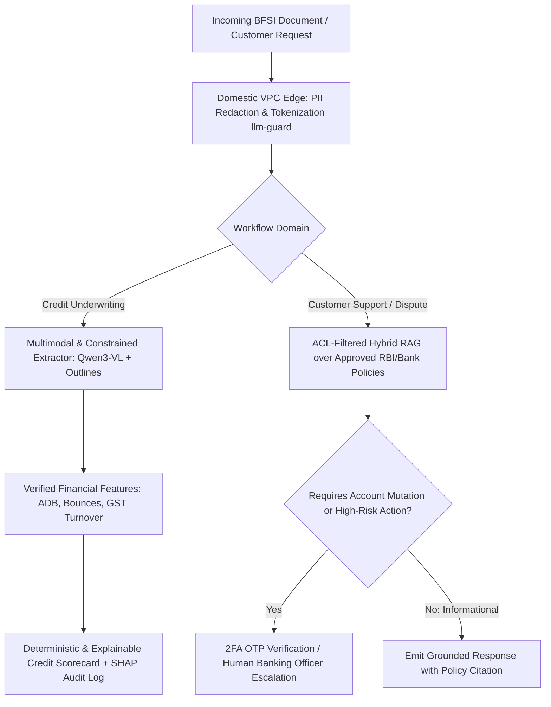

## 1. Introduction and Current Context

India's financial sector operates at a transaction velocity unmatched almost anywhere on Earth: billions of monthly real-time UPI payments, instant MSME digital lending across Tier-2 and Tier-3 towns, and multilingual customer operations serving hundreds of millions of account holders. At the same time, banking is a heavily regulated trust business.

## 2. Direct Answer and Key Takeaway

> **Key Takeaway:** In Indian banking, NBFCs, and fintechs in 2026, production AI architectures split sharply by latency, explainability, and regulatory risk under the Reserve Bank of India's **FREE-AI (Framework for Responsible and Ethical Enablement of AI, released August 2025)** and DPDP Act rules. **Real-time UPI/payment fraud scoring** runs on sub-15ms tabular gradient-boosted trees and graph models—never slow autoregressive LLMs; **credit underwriting** uses multimodal and structured extractors (`Qwen3-VL`, `dottxt-ai/outlines`) to parse Account Aggregator, GST, and bank statements into deterministic, explainable risk features; and **customer support** uses RAG and voice agents with strict PII redaction (`protectai/llm-guard`) and human escalation gates.

## 3. Definitions and Technical Background

Before evaluating architectural trade-offs or writing production code for **AI in fintech India**, it is essential to establish precise engineering definitions for the core components involved:

- **RBI FREE-AI Framework:** The Reserve Bank of India's *Framework for Responsible and Ethical Enablement of Artificial Intelligence* in the financial sector, establishing governance principles, risk categorization, auditability, bias mitigation, and human-oversight standards for Regulated Entities.
- **Split Extraction-Scoring Underwriting Pipeline:** An architecture where multimodal/structured AI models are used *strictly* to extract verifiable fields from messy PDF bank statements or GST filings, while the actual credit approval/pricing decision is computed by a deterministic rule engine and explainable scorecard.
- **Sub-20ms Inline Payment Fraud Engine:** A low-latency machine learning pipeline running feature stores and tabular/graph models that scores UPI or card transactions before authorization completes, paired with asynchronous LLM agents for post-incident fraud analyst investigation.

## 4. Technical Architecture and Deep Dive

**Use Case 1: Fraud Detection and AML Triage.** A common misconception in generic AI blogs is suggesting that banks call an LLM API inside the live UPI payment authorization loop. A UPI payment must clear end-to-end in milliseconds; an autoregressive LLM taking 800ms would collapse payment throughput. In production Indian fintechs, **inline fraud scoring** runs on ultra-fast tabular gradient-boosted trees and Graph Neural Networks detecting mule-account rings in under 15 milliseconds.

**Use Case 2: MSME & Consumer Underwriting via Account Aggregator and Multimodal Extraction.** Millions of Indian MSMEs have thin traditional credit bureau histories but rich cash-flow footprints across GST returns, Account Aggregator (AA) JSON streams, and scanned PDF bank statements or vernacular invoices. However, passing a borrower's file directly to an LLM and asking *'Should we approve a ₹5 lakh loan?'* violates core regulatory explainability and fairness standards: an LLM's decision can flip if the applicant's name or address changes slightly, and it cannot produce mathematically true adverse-action reason codes.

**Use Case 3: Multilingual Customer Support & Dispute Resolution.** In customer operations, banks deploy RAG assistants and regional-language voice agents to handle card blocking, transaction status checks, and FAQ resolution.

## 5. Comparative Analysis: Production AI Architecture in Indian BFSI: Matching Model Type to RBI FREE-AI Governance Requirements

The following table compares the key engineering trade-offs, operational boundaries, and implementation choices for **AI in fintech India**:

| BFSI Workflow | Correct Model Architecture | Why Unconstrained Generative LLMs Fail Here | Mandatory Governance & RBI FREE-AI Control |
| --- | --- | --- | --- |
| Inline UPI / Card Fraud Blocking | Tabular GBDT / Graph ML (<15ms latency) | LLMs are 50x too slow & non-deterministic for live payment rails | Continuous false-positive monitoring & deterministic fallback rules |
| Fraud / AML Alert Investigation | Agentic RAG (`LangGraph`) assembling case dossiers | Autonomous account freezing without review risks wrongful lockout | Human compliance analyst makes final SAR/freeze decision |
| Credit Underwriting & Pricing | VLM/Constrained Extraction → Explainable Scorecard (SHAP) | Direct LLM credit scoring lacks adverse-action explainability & fairness | Separate extraction from scoring; log exact feature provenance |
| Customer Support & Grievance Bot | VPC-hosted RAG + Indic Voice (`Bolna` / `vLLM`) | Hallucinated interest rates or fees create regulatory liability | Zero-hallucination RAG (`Ragas`), PII scrubbing (`llm-guard`), human handoff |

## 6. System Architecture and Execution Flow

The diagram below illustrates the end-to-end control flow, verification boundaries, and state transitions for **AI in fintech India** in a production environment:

*Figure 41.1: RBI FREE-AI aligned banking architecture separating multimodal feature extraction from explainable credit scoring and guarding customer support with PII tokenization.*

## 7. Practical Implementation Steps and Engineering Checklist

To implement **AI in fintech India** reliably in production systems, follow these sequential engineering steps:

1. Never allow a generative LLM to directly output an approve/reject credit underwriting decision or interest rate; use LLMs/VLMs strictly to extract structured, verifiable financial fields into Python, and execute all arithmetic and credit scoring in deterministic, explainable code.
2. Deploy `protectai/llm-guard` or deterministic regex/NER tokenizers at your API gateway to mask Aadhaar numbers, PAN cards, bank account numbers, and mobile numbers before any payload enters an LLM context window or observability trace.
3. Host all BFSI inference and vector storage inside Indian data-centre regions with strict network egress locks to satisfy RBI data-localization rules.
4. Maintain an immutable model registry and decision audit log recording the exact model checkpoint hash, prompt version, retrieved policy passage IDs, and human reviewer ID for every customer-impacting workflow.

## 8. Limitations, Operational Risks, and Trade-Offs

Even well-architected deployments of **AI in fintech India** face concrete engineering constraints that teams must mitigate proactively:

- LLM arithmetic errors on financial statements: asking an LLM to sum 90 rows of bank transactions in prose frequently produces rounding or addition errors—extract the rows as a typed JSON array and sum them in Python `Decimal`.
- Proxy bias in unstructured underwriting: if an LLM summarizes a borrower's profile without strict feature filtering, subtle demographic or geographic proxies in text can bias downstream decisions.
- Third-party vendor concentration risk: the RBI FREE-AI report explicitly highlights outsourcing and third-party model concentration risk—banks must maintain fallback procedures if an external AI vendor experiences an outage.

## 9. Frequently Asked Questions (FAQs)

### What is the RBI FREE-AI framework and is it mandatory for Indian fintechs?

Published by the Reserve Bank of India on August 13, 2025, the *Framework for Responsible and Ethical Enablement of Artificial Intelligence (FREE-AI)* establishes governance principles, risk-tiering, explainability, data privacy, and auditability guidelines for Regulated Entities (banks, NBFCs, payment system operators) and their fintech partners.

### Can Indian banks use LLMs for loan underwriting?

Banks can use Vision-Language Models and LLMs to *extract and structure* messy documents (such as scanned bank statements, invoices, and property deeds) with span citations.

### Why shouldn't an LLM perform arithmetic on financial tables directly?

Language models predict tokens probabilistically rather than executing hardware ALU arithmetic; on long tables of Indian numbering formats (lakhs and crores), token-level addition is error-prone.

## 10. Conclusion

In Indian banking and fintech, trust and regulatory compliance are the ultimate product features. By combining sub-15ms tabular models for live fraud, multimodal structured extraction (`Qwen3-VL`, `Outlines`) feeding explainable credit scorecards, and VPC-hosted RAG with PII protection (`llm-guard`), engineering teams deliver massive operational efficiency in full alignment with the RBI FREE-AI framework.

### GitHub Repositories & Technical References

- **dottxt-ai/outlines** — Open-source structured generation library for guaranteeing schema-compliant extraction from financial documents. Verified GitHub URL: https://github.com/dottxt-ai/outlines
- **protectai/llm-guard** — Security toolkit for sanitizing PII, preventing data leakage, and blocking prompt injections in regulated LLM pipelines. Verified GitHub URL: https://github.com/protectai/llm-guard
- **QwenLM/Qwen3-VL** — Open-weight Vision-Language Model capable of self-hosted VPC deployment for parsing complex financial tables and scanned statements. Verified GitHub URL: https://github.com/qwenlm/qwen3-vl
- **explodinggradients/ragas** — Evaluation framework for auditing faithfulness and preventing policy hallucinations in banking RAG systems. Verified GitHub URL: https://github.com/explodinggradients/ragas
