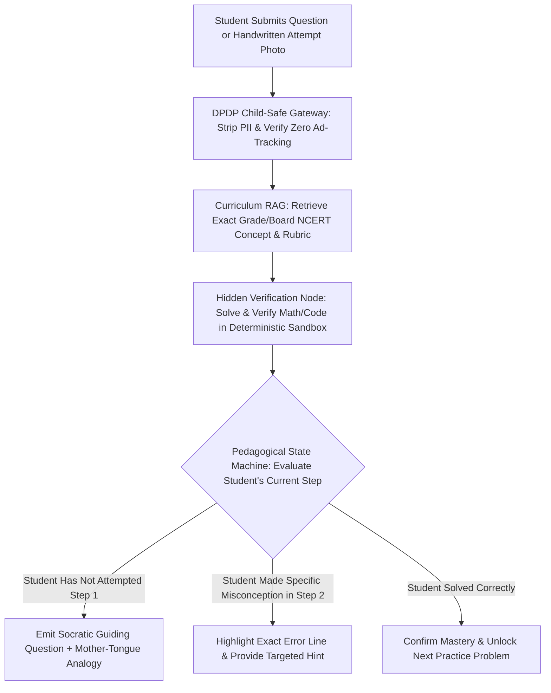

## 1. Introduction and Current Context

Indian classrooms often have 40 to 60 students per teacher, and millions of first-generation learners transition between regional-language schooling (in Hindi, Marathi, Tamil, Telugu, Bengali, or Kannada) and English-medium higher technical education. A personalized AI tutor that can explain Faraday's Law or dynamic programming in a student's mother tongue at 10 PM on a budget Android phone is genuinely transformative. Yet early deployments of generic chatbots in education revealed a troubling pattern: when students use an AI simply to generate completed homework assignments, homework scores go up while actual exam comprehension drops.

## 2. Direct Answer and Key Takeaway

> **Key Takeaway:** In Indian education in 2026, AI's highest-impact contribution is bridging the language and personalized-feedback gap—translating STEM concepts across India's 22 scheduled languages (`AI4Bharat/IndicTrans2`), grounding tutoring in official NCERT/state-board syllabi via RAG, and providing step-by-step diagnostic hints on low-cost smartphones. However, edtech platforms face two acute failure modes: **Cognitive Offloading (the 'Answer Machine' trap)**, where students copy direct LLM solutions without developing problem-solving skills, and **DPDP Act Minor Data Compliance** (which strictly requires verifiable parental consent and bans behavioral tracking or targeted advertising for users under 18).

## 3. Definitions and Technical Background

Before evaluating architectural trade-offs or writing production code for **AI in education India**, it is essential to establish precise engineering definitions for the core components involved:

- **Socratic Pedagogical State Machine:** An agent workflow programmed to diagnose a student's misconception, ask a guiding question, and verify intermediate steps rather than revealing the final homework answer on Turn 1.
- **Cognitive Offloading (Illusion of Competence):** The learning risk where a student relies on an AI to generate essays or solve math proofs, mistaking the fluency of the AI's explanation for their own ability to solve the problem independently under exam conditions.
- **Rubric-Grounded Formative Assessment:** Using multimodal models and structured rubrics to evaluate handwritten or typed student work and generate line-by-line diagnostic feedback for teacher review—never unappealable automated high-stakes grading.

## 4. Technical Architecture and Deep Dive

**Solving the 'Answer Machine' Trap with Socratic State Machines:** If a Class 11 student uploads a photo of a physics kinematics problem to a generic chatbot, the chatbot prints the complete 6-line derivation and final numeric answer. The student copies it down and learns nothing. In a well-engineered AI Tutor built with `langchain-ai/langgraph` and `pydantic/pydantic-ai`, the system first solves the problem silently inside a private verification step, stores the verified solution steps in hidden graph state, and responds to the student with **Step 1 Scaffolding**: *'I see this is a projectile motion problem.

**Multilingual Mother-Tongue Bridge for Indian Students:** Millions of talented students in Tier-2, Tier-3, and rural India struggle in first-year engineering or medical courses not because they lack analytical aptitude, but because instruction abruptly shifts from regional languages to dense English terminology.

**Automated Assessment: Formative Co-Pilot vs. Summative Judge:** Using Vision-Language Models to digitize handwritten student worksheets and score them against a teacher's explicit rubric saves teachers hours of repetitive grading.

**Mandatory Child Privacy Engineering under India's DPDP Act:** Edtech engineers building for K-12 students in India must treat **Section 9 of the DPDP Act, 2023** as a hard architectural constraint. Under Indian law, a 'child' is any individual under the age of 18.

## 5. Comparative Analysis: Educational AI Architecture Matrix: Pedagogical Design, Assessment Boundaries, and DPDP Compliance

The following table compares the key engineering trade-offs, operational boundaries, and implementation choices for **AI in education India**:

| EdTech Capability | Unhelpful / Risky Implementation | Pedagogically Sound 2026 Architecture | Technical & Regulatory Safeguard |
| --- | --- | --- | --- |
| Homework & Problem Solving | Dumping the final answer on Turn 1 ('Answer Machine') | Socratic state machine (`LangGraph`) giving step-by-step hints | Verify hidden math solution in Python sandbox before hinting |
| Curriculum Alignment | Zero-shot generation from general web pretraining | RAG grounded strictly in official NCERT / State Board / NPTEL chapters | `run-llama/llama_index` + chapter/grade metadata filtering |
| Language Accessibility | English-only or unnatural literal dictionary translation | Bilingual code-switched explanation (Mother tongue + English STEM terms) | `AI4Bharat/IndicTrans2` + bilingual glossary retention |
| Student Assessment | Unappealable black-box AI grading on high-stakes exams | Rubric-based formative feedback (`Qwen3-VL`) + teacher review dashboard | Human teacher approves final grades; log rubric breakdown |
| Student Data & Privacy (<18) | Behavioral ad pixels + training on student PII | Verifiable parental consent + zero ad-tracking + local PII redaction | DPDP Act Section 9 compliance + `protectai/llm-guard` |

## 6. System Architecture and Execution Flow

The diagram below illustrates the end-to-end control flow, verification boundaries, and state transitions for **AI in education India** in a production environment:

*Figure 45.1: Socratic AI tutor architecture combining DPDP child-privacy safeguards, NCERT curriculum RAG, deterministic sandbox verification, and step-by-step hint state machines.*

## 7. Practical Implementation Steps and Engineering Checklist

To implement **AI in education India** reliably in production systems, follow these sequential engineering steps:

1. Architect student-facing math and science tutors so the model first verifies the ground-truth answer using a deterministic Python tool or symbolic solver before generating a Socratic hint—preventing the tutor from gaslighting a student who actually got the right answer.
2. Implement an explicit **Hint Escalation Ladder** in `langchain-ai/langgraph` rather than outputting full homework solutions immediately.
3. Index official syllabus textbooks with grade-level and chapter metadata in `qdrant/qdrant` or `pgvector/pgvector` so a Class 7 student asking about 'atomic structure' receives an age-appropriate explanation rather than graduate quantum mechanics.
4. Enforce strict **DPDP Act Section 9** controls in your codebase: require verifiable parental consent for users under 18, strip all third-party marketing/behavioral tracking scripts from student views, and anonymize student identifiers via `protectai/llm-guard`.

## 8. Limitations, Operational Risks, and Trade-Offs

Even well-architected deployments of **AI in education India** face concrete engineering constraints that teams must mitigate proactively:

- Math and diagram hallucinations in unverified models: if a tutor attempts to grade a geometry proof or chemistry equation purely via text prediction without a deterministic verification tool, it may mark a valid alternative solution method as wrong.
- Over-reliance eroding independent exam stamina: students who practice exclusively with an always-on AI hint button often freeze during offline competitive or board exams where no intermediate feedback exists—include 'Unassisted Timed Mock Mode' regularly.
- Bias against non-standard regional phrasing: automated essay graders calibrated only on elite urban English writing styles may unfairly penalize grammatically valid Indian English or regional expressions unless calibrated on diverse local samples (`confident-ai/deepeval`).

## 9. Frequently Asked Questions (FAQs)

### How do you stop an AI tutor from just doing a student's homework for them?

Do not use a stateless single-pass chat prompt.

### What does India's DPDP Act require for edtech apps used by students under 18?

Under Section 9 of the Digital Personal Data Protection Act, 2023 (and the November 2025 Rules), any user under 18 is legally a child.

### Can Vision-Language Models grade handwritten Indian student exam sheets accurately?

VLMs like `QwenLM/Qwen3-VL` are effective at transcribing handwritten steps and generating draft rubric feedback for a teacher to review (formative co-pilot).

## 10. Conclusion

AI in Indian education holds extraordinary promise when engineered as a Socratic scaffold rather than a shortcut machine. By combining curriculum-grounded RAG, bilingual mother-tongue explanations (`AI4Bharat`), deterministic verification sandboxes, teacher-in-the-loop assessment, and strict DPDP child-privacy protections, developers can build educational tools that genuinely deepen human learning.

### GitHub Repositories & Technical References

- **langchain-ai/langgraph** — Stateful orchestration framework ideal for building multi-step Socratic tutoring state machines and hint ladders. Verified GitHub URL: https://github.com/langchain-ai/langgraph
- **AI4Bharat/IndicTrans2** — Open-source translation models for making STEM and curriculum content accessible across all 22 scheduled Indian languages. Verified GitHub URL: https://github.com/ai4bharat/IndicTrans2
- **QwenLM/Qwen3-VL** — Multimodal Vision-Language Model for reading handwritten student math steps, diagrams, and textbook pages. Verified GitHub URL: https://github.com/qwenlm/qwen3-vl
- **protectai/llm-guard** — Security and privacy toolkit for anonymizing student PII in compliance with DPDP Act child-protection rules. Verified GitHub URL: https://github.com/protectai/llm-guard
