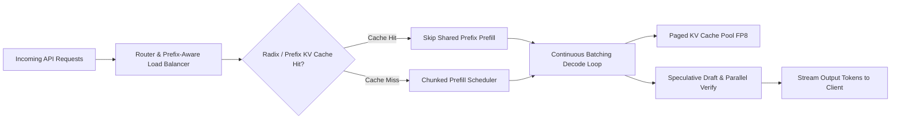

## 1. Introduction and Current Context

Training a foundation model is a capital-intensive one-time event, but serving that model to millions of concurrent requests is a relentless operational expense. In 2026, a single user click in an AI-powered IDE or enterprise workflow routinely triggers 10 to 30 internal model calls across long system prompts and retrieved documents. Naive PyTorch inference loops leave expensive datacenter GPUs underutilized because autoregressive decoding stalls waiting on High-Bandwidth Memory (HBM) transfers. Modern serving engines such as `vllm-project/vllm`, `sgl-project/sglang`, and `deepseek-ai/DeepInfer` re-architect memory allocation, scheduling, and kernel execution to maximize throughput per dollar.

## 2. Direct Answer and Key Takeaway

> **Key Takeaway:** By 2026, inference compute accounts for the overwhelming majority of production AI infrastructure expenditure because agentic workflows, reasoning chains, and long-context RAG multiply token volume per user request. Serving LLMs faster and cheaper requires eliminating GPU memory fragmentation and idle compute cycles through five core systems techniques: continuous iteration-level batching, PagedAttention and RadixAttention KV-cache reuse, hardware-native FP8/FP4 quantization, speculative decoding, and prefill-decode disaggregation.

## 3. Definitions and Technical Background

Before evaluating architectural trade-offs or writing production code for **LLM inference optimization**, it is essential to establish precise engineering definitions for the core components involved:

- **Time to First Token (TTFT):** The latency elapsed from the moment a request arrives at the inference server until the first output token is emitted, dominated by the compute-bound prefill phase.
- **Inter-Token Latency (ITL) / TPOT:** The average time required to generate each subsequent output token during the memory-bandwidth-bound decode phase, governing perceived streaming speed.
- **PagedAttention & RadixAttention:** Memory management algorithms (introduced in vLLM and SGLang respectively) that partition the KV cache into non-contiguous fixed-size blocks or radix trees, eliminating internal fragmentation and enabling automatic prefix reuse across requests.
- **Prefill-Decode Disaggregation:** A cluster architecture that separates compute-heavy prompt prefill onto one pool of GPU nodes and transfers the resulting KV cache over high-speed interconnects (NVLink/RDMA) to a separate pool of decode-optimized GPU nodes.

## 4. Technical Architecture and Deep Dive

To optimize LLM serving, engineers must balance the fundamental tension between throughput (total tokens generated per second across all concurrent users) and latency (TTFT and ITL experienced by a single user). During the prefill phase, all tokens in the input prompt are known simultaneously, allowing the GPU to execute massive matrix-matrix multiplications (`GEMM`) that saturate tensor cores. During the decode phase, each sequence generates only one token per step, turning the operation into a matrix-vector multiplication (`GEMV`) where the GPU spends most of its time loading model weights from HBM.

Continuous iteration-level batching solves the GPU utilization problem during decoding. Instead of waiting for every sequence in a static batch to finish generating before accepting new requests, engines like `vllm-project/vllm` evaluate scheduling decisions at every single token step.

Consequently, KV-cache capacity is the true ceiling on concurrent batch size. For a 70B model with 80 layers, storing uncompressed FP16 keys and values for a 32,768-token context consumes gigabytes of memory per request. PagedAttention in `vllm` eliminates contiguous memory waste by allocating KV blocks dynamically on demand, while RadixAttention in `sgl-project/sglang` maintains cached KV blocks in a radix tree structure.

Finally, speculative decoding (such as EAGLE, multi-token prediction heads, or n-gram drafting) accelerates inter-token latency without altering the target model's output distribution.

## 5. Comparative Analysis: Production LLM Inference Optimization Techniques and Their Latency/Throughput Impact

The following table compares the key engineering trade-offs, operational boundaries, and implementation choices for **LLM inference optimization**:

| Optimization Technique | Primary Target Bottleneck | Impact on TTFT (Prefill) | Impact on ITL (Decode) & Throughput | Reference Open-Source Implementation |
| --- | --- | --- | --- | --- |
| Continuous Batching & Chunked Prefill | GPU compute idle time & head-of-line blocking | Stabilizes P99 TTFT under mixed load | 5x–15x higher total cluster throughput | vllm-project/vllm, sgl-project/sglang |
| PagedAttention & Prefix Caching | KV-cache VRAM fragmentation & redundant prefill | Reduces TTFT by 50%–90% on shared prefixes | Enables 2x–4x larger concurrent batch sizes | sgl-project/sglang (RadixAttention), vLLM |
| FP8 / INT4 Weight & KV Quantization | HBM capacity & memory bandwidth saturation | Faster GEMM execution on FP8 Tensor Cores | 1.5x–2.5x faster ITL and double batch capacity | vllm-project/vllm (FP8/AWQ/GPTQ/Marlin) |
| Speculative Decoding (EAGLE / MTP) | Sequential autoregressive decode dependency | Neutral (applies post-prefill) | 1.5x–2.8x reduction in per-user ITL | vllm-project/vllm, deepseek-ai/DeepInfer |
| Prefill-Decode Disaggregation | Interference between long prefills & active decodes | Dedicated compute scaling for TTFT SLOs | Eliminates decode jitter during long prompt arrivals | vllm-project/vllm, sgl-project/sglang |

## 6. System Architecture and Execution Flow

The diagram below illustrates the end-to-end control flow, verification boundaries, and state transitions for **LLM inference optimization** in a production environment:

*Figure 5.1: High-throughput LLM serving pipeline combining prefix-aware routing, chunked prefill, PagedAttention KV management, and speculative decoding.*

## 7. Practical Implementation Steps and Engineering Checklist

To implement **LLM inference optimization** reliably in production systems, follow these sequential engineering steps:

1. Structure all prompts and agent requests so static content (system instructions, tool schemas, few-shot examples, and reference documents) appears at the very beginning of the message array, maximizing automatic prefix-cache hit rates.
2. Enable chunked prefill (`--enable-chunked-prefill` in vLLM) when serving mixed workloads so a newly arriving 32,000-token RAG prompt is split into smaller chunks rather than stalling active streaming responses for other users.
3. Deploy FP8 weight and KV-cache quantization on Hopper/Blackwell-class GPUs (or AWQ/Marlin INT4 on older architectures) to cut memory bandwidth pressure in half with negligible accuracy loss.
4. Benchmark your serving stack under realistic arrival distributions (Poisson request arrivals with varying prompt/output lengths) rather than synthetic fixed-length batches, tracking P95 TTFT and P95 ITL against strict service-level objectives (SLOs).
5. Use prefix-aware load balancing across multiple replica nodes so requests sharing the same tenant document or agent session route to the GPU replica that already holds their KV cache in memory.

## 8. Limitations, Operational Risks, and Trade-Offs

Even well-architected deployments of **LLM inference optimization** face concrete engineering constraints that teams must mitigate proactively:

- Speculative decoding diminishing returns at high batch sizes: when GPU compute is already saturated by a large concurrent batch, verifying extra speculative draft tokens can contend for compute and reduce aggregate throughput.
- Prefix cache eviction thrashing: if a multi-tenant router distributes requests randomly across replicas without cache affinity, KV blocks are constantly evicted and recomputed, negating prefix caching benefits.
- Quantization sensitivity on long-context attention: quantizing the KV cache aggressively to 4-bit without calibration can degrade needle-in-a-haystack retrieval accuracy over very long sequences.

## 9. Frequently Asked Questions (FAQs)

### Why is LLM decoding memory-bandwidth bound rather than compute bound?

During autoregressive decoding, the model generates one token at a time per sequence.

### What is the difference between vLLM's PagedAttention and SGLang's RadixAttention?

PagedAttention manages KV-cache memory in fixed-size non-contiguous blocks like operating-system virtual memory pages.

### How does chunked prefill prevent latency spikes in production?

Without chunked prefill, a huge incoming prompt monopolizes the GPU for hundreds of milliseconds during prefill, freezing token generation for all other streaming users.

## 10. Conclusion

Optimizing AI inference is the highest-leverage engineering discipline for controlling production AI unit economics in 2026. By combining continuous batching, prefix-aware KV-cache management, hardware-native quantization, and speculative decoding in engines like vLLM and SGLang, teams can deliver sub-second responsiveness at a fraction of baseline GPU costs.

### GitHub Repositories & Technical References

- **vllm-project/vllm** — Official high-throughput LLM serving engine implementing PagedAttention, continuous batching, chunked prefill, FP8/INT4 quantization, and speculative decoding. Verified GitHub URL: https://github.com/vllm-project/vllm
- **sgl-project/sglang** — High-performance serving framework for LLMs and multimodal models featuring RadixAttention prefix caching and fast constrained structured decoding. Verified GitHub URL: https://github.com/sgl-project/sglang
- **deepseek-ai/DeepInfer** — DeepSeek's open-source high-performance inference framework featuring FlashMLA, DeepGEMM, DeepEP, and confidence-scheduled speculative verification. Verified GitHub URL: https://github.com/deepseek-ai/deepinfer
- **ggml-org/llama.cpp** — Lightweight C/C++ inference engine providing quantized GGUF execution, flash attention, and speculative decoding for edge and workstation hardware. Verified GitHub URL: https://github.com/ggml-org/llama.cpp
