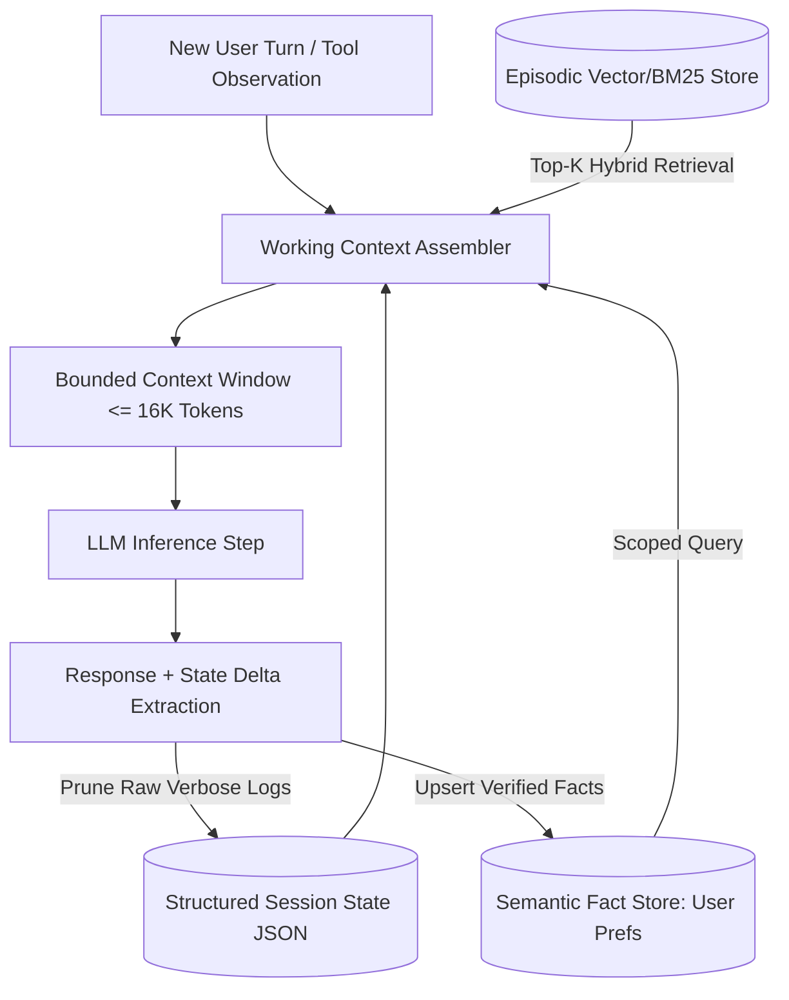

## 1. Introduction and Current Context

Whenever a model provider announces a 200,000-token or 1,000,000-token context window, a wave of commentary proclaims that Retrieval-Augmented Generation (RAG) and external memory databases are obsolete. Yet any developer who has run an autonomous coding agent for 40 turns or built a multi-week customer assistant knows what happens in practice: as the conversation crosses 40,000 to 80,000 tokens, the model begins ignoring instructions from turn 3, resurrects buggy code that was deleted in turn 12, slows to a crawl, and burns massive token budgets on every turn. Solving this requires distinguishing raw context length from engineered AI memory.

## 2. Direct Answer and Key Takeaway

> **Key Takeaway:** A large context window (128k to 1M+ tokens) is volatile scratchpad buffer, not persistent memory. Long conversations and multi-step agent sessions still fail in 2026 because stuffing an ever-growing transcript into a single context window triggers attention dilution ('lost in the middle'), reasoning degradation over contradicting historical states ('context rot'), quadratic prefill compute costs, and KV-cache exhaustion. Reliable AI applications separate ephemeral working context from structured episodic, semantic, and procedural memory stores managed by deterministic state architectures.

## 3. Definitions and Technical Background

Before evaluating architectural trade-offs or writing production code for **AI memory**, it is essential to establish precise engineering definitions for the core components involved:

- **Context Window (Working Memory):** The finite array of tokens passed into a Transformer during a single forward pass—analogous to CPU cache or RAM scratchpad—which disappears the moment the request completes unless re-sent on the next turn.
- **Attention Dilution & Lost-in-the-Middle:** The empirical phenomenon where softmax self-attention scores spread thin across tens of thousands of tokens, causing models to recall information at the very beginning (primacy) and very end (recency) of a prompt far more reliably than facts buried in the middle.
- **Context Rot (State Pollution):** The degradation of reasoning accuracy caused by accumulating stale, superseded, or failed intermediate attempts inside a linear chat transcript.
- **Episodic, Semantic, and Procedural Memory:** The three persistent memory tiers in agent architectures: Semantic memory stores structured user facts/entities; Episodic memory stores timestamped summaries or vector-indexed past interactions; and Procedural memory stores learned workflow rules and system instructions.

## 4. Technical Architecture and Deep Dive

To understand why long conversations fail even when they fit comfortably inside a model's maximum token limit, engineers must separate **claimed context length** from **effective reasoning context length**. A model may pass a simple synthetic 'Needle in a Haystack' (NIAH) test—finding a single random passkey hidden inside 500,000 tokens of unrelated essays—while failing miserably at multi-hop reasoning when 50 different relevant facts, code diffs, and conflicting user corrections are scattered across 60,000 tokens.

Even more damaging than attention dilution is **context rot**. In a natural software debugging session or project planning chat, the user and assistant explore dead ends: 'Try approach A' → 'Approach A failed with error X, switch to approach B.' If the entire raw transcript remains in the context window, 70% of the tokens describe approach A and its error traces.

From a systems engineering standpoint, treating the context window as a database is also economically unsustainable. Even with prefix caching, appending new turns to a 100,000-token conversation requires holding huge KV-cache blocks in GPU memory and computing cross-attention over all 100,000 cached keys and values at every decode step.

Production AI systems in 2026—built with frameworks like `langchain-ai/langgraph` and `run-llama/llama_index`—replace append-only transcripts with explicit memory hierarchy management: rolling window truncation, background state compaction, and external vector/relational retrieval.

## 5. Comparative Analysis: Architectural Comparison of AI Context and Memory Tiers in Production Systems

The following table compares the key engineering trade-offs, operational boundaries, and implementation choices for **AI memory**:

| Memory Tier | Storage Medium | Lifecycle & Persistence | Primary Engineering Mechanism | Typical Token / Latency Cost |
| --- | --- | --- | --- | --- |
| Active Working Context | LLM Prompt & GPU KV Cache | Single turn / active session minutes | Rolling window of last $N$ turns + current tool outputs | High per-token attention cost; fast with prefix cache |
| Compacted Session State | Checkpointed Graph State (Postgres/Redis) | Full task or multi-hour workflow | Structured JSON schema updated at each node (`LangGraph`) | Compact (500–2,000 tokens); prevents context rot |
| Semantic Fact Store | Relational / Key-Value / Graph DB | Cross-session permanent (months/years) | Explicit `upsert_memory` / `delete_memory` tool calls | Zero cost until queried; high precision on user prefs |
| Episodic Knowledge Store | Vector + BM25 Hybrid Index (`Qdrant`/`pgvector`) | Cross-session historical archive | Chunked, timestamp-filtered top-$k$ retrieval with reranking | Constant O(k) prompt overhead regardless of archive size |

## 6. System Architecture and Execution Flow

The diagram below illustrates the end-to-end control flow, verification boundaries, and state transitions for **AI memory** in a production environment:

*Figure 12.1: Multi-tier memory architecture that prevents context rot by assembling a bounded working context from structured state and external stores.*

## 7. Practical Implementation Steps and Engineering Checklist

To implement **AI memory** reliably in production systems, follow these sequential engineering steps:

1. Never append raw, unbounded tool outputs directly into a permanent chat history array; summarize or extract the relevant error lines before committing to session state.
2. Maintain an explicit, typed state object that records current confirmed decisions, active file paths, and open tasks—overwriting stale fields rather than appending contradictory prose.
3. Implement a sub-agent or isolated execution frame for noisy exploratory subtasks: let the sub-agent run 10 search/grep steps in its own disposable context window and return only a 300-word verified finding to the parent agent.
4. Provide explicit memory mutation tools backed by PostgreSQL or `qdrant/qdrant` with timestamps so outdated user facts can be cleanly superseded rather than duplicated.
5. Place critical invariant instructions and current state summaries at the very top and very bottom of the assembled prompt to counter lost-in-the-middle attention decay.

## 8. Limitations, Operational Risks, and Trade-Offs

Even well-architected deployments of **AI memory** face concrete engineering constraints that teams must mitigate proactively:

- Lossy summarization compression: if an automated background summarizer condenses a conversation too aggressively, it may strip out an exact UUID, file path, or error code needed 10 turns later—keep exact identifiers in structured JSON fields rather than prose summaries.
- Memory poisoning and stale facts: if an agent automatically writes unverified model inferences into its long-term semantic memory store, a single hallucination becomes permanent 'ground truth' across future sessions.
- Cross-tenant memory leakage: failing to partition vector and key-value memory indexes strictly by authenticated `user_id` and `tenant_id` metadata filters can expose private facts across users.

## 9. Frequently Asked Questions (FAQs)

### Do 1-million-token context windows make RAG and external memory obsolete?

No. Passing 1 million tokens on every conversational turn incurs massive compute latency, high per-turn token costs, and severe attention dilution ('lost in the middle').

### What is 'context rot' in long LLM conversations?

Context rot occurs when an append-only conversation transcript accumulates failed attempts, outdated assumptions, and verbose tool logs.

### How should an AI agent handle a tool output that is 50,000 tokens long?

The runtime should intercept oversized tool outputs, store the raw payload in an ephemeral artifact file or database record, and pass only a truncated preview, schema summary, or targeted search slice into the agent's active context window.

## 10. Conclusion

Long context windows are a powerful tool for single-pass document analysis, but they are not a substitute for software state management. By separating volatile working context from structured session state and persistent semantic/episodic stores, developers build AI systems that remain fast, accurate, and coherent across hundreds of interactions.

### GitHub Repositories & Technical References

- **langchain-ai/langgraph** — Official agent orchestration framework providing built-in state reducers, thread-level checkpointers, and cross-thread persistent memory stores. Verified GitHub URL: https://github.com/langchain-ai/langgraph
- **run-llama/llama_index** — Data and memory framework for indexing, chunking, and retrieving episodic and document knowledge for LLM applications. Verified GitHub URL: https://github.com/run-llama/llama_index
- **qdrant/qdrant** — High-performance open-source vector and hybrid search database supporting strict tenant metadata filtering for long-term AI memory. Verified GitHub URL: https://github.com/qdrant/qdrant
- **pgvector/pgvector** — Open-source vector similarity search extension for PostgreSQL, enabling unified relational state and semantic memory storage. Verified GitHub URL: https://github.com/pgvector/pgvector
