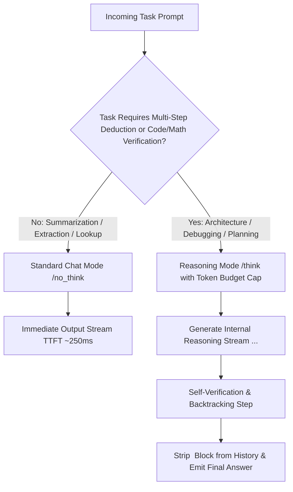

## 1. Introduction and Current Context

For years, scaling AI performance meant scaling pretraining compute: training larger models on more trillions of tokens so they could answer questions immediately in a single instinctive pass. Beginning with OpenAI's o-series and democratized globally by the open-source release of `deepseek-ai/DeepSeek-R1` and hybrid thinking models like `QwenLM/Qwen3`, a second scaling axis emerged: **inference-time compute** (test-time scaling). By October 2026, developers must routinely decide whether a request warrants a standard zero-thinking completion or an extended reasoning budget.

## 2. Direct Answer and Key Takeaway

> **Key Takeaway:** AI reasoning models do not use a fundamentally different neural network block than standard Transformer chat models; what differs is their post-training regime and inference-time compute allocation. Trained via large-scale Reinforcement Learning with Verifiable Rewards (RLVR—as open-sourced in `deepseek-ai/DeepSeek-R1`), reasoning models learn to generate hundreds or thousands of internal 'thinking' tokens before emitting a final answer, enabling hypothesis testing, backtracking, and self-verification at the cost of higher latency and 3x-to-15x higher output token consumption.

## 3. Definitions and Technical Background

Before evaluating architectural trade-offs or writing production code for **reasoning models**, it is essential to establish precise engineering definitions for the core components involved:

- **Inference-Time Compute (Test-Time Scaling):** Allocating additional sequential generation tokens (`<think>...</think>`) or parallel sampling passes at inference time so the model can decompose a complex problem, verify intermediate calculations, and backtrack from dead ends before committing to a final response.
- **Reinforcement Learning with Verifiable Rewards (RLVR / GRPO):** A post-training methodology (such as Group Relative Policy Optimization used in DeepSeek-R1) where a model is rewarded based on deterministic, objective verifiers—such as whether generated code passes a unit test suite or a mathematical proof yields the exact ground-truth answer—rather than human preference aesthetics alone.
- **Hybrid Thinking / Reasoning Budget:** A model capability allowing developers to toggle thinking mode on or off or specify a maximum thinking-token budget per API call.
- **Overthinking (Reasoning Loops):** A failure mode where a reasoning model spends thousands of thinking tokens second-guessing a straightforward question, driving up latency and cost without improving—and sometimes degrading—final answer accuracy.

## 4. Technical Architecture and Deep Dive

Why can't a standard chat model solve a complex 10-step algorithmic puzzle in a single immediate response? In an autoregressive Transformer, the amount of computation (FLOPs) performed per generated token is fixed by the model's layer depth and parameter count. If a standard chat model is instructed to 'state the final answer immediately,' it must compress the entire multi-step deduction into the forward pass of the very first output token.

Reasoning models—such as `deepseek-ai/DeepSeek-R1`—solve this by externalizing intermediate computation into the token stream inside a dedicated reasoning block (`<think>...</think>`). Crucially, this is not merely a prompt-engineered 'let's think step by step' instruction. During large-scale Reinforcement Learning with Verifiable Rewards (RLVR) using algorithms like Group Relative Policy Optimization (`GRPO`, supported in `huggingface/trl`), the model explores multiple solution paths against executable code sandboxes and symbolic math verifiers.

In 2026, the distinction between 'reasoning model' and 'standard chat model' has increasingly merged into **hybrid reasoning models** such as `QwenLM/Qwen3`.

However, reasoning tokens are not a magic wand. Because every thinking token is billed as an output token and generated sequentially during the memory-bound decode phase, a reasoning call that emits 4,000 internal thinking tokens before producing a 200-token JSON response costs 21x more output tokens and adds seconds of Time-to-Visible-Answer latency.

## 5. Comparative Analysis: Engineering Comparison: Standard Instruct/Chat Models vs. Inference-Time Reasoning Models

The following table compares the key engineering trade-offs, operational boundaries, and implementation choices for **reasoning models**:

| Dimension | Standard Chat / Instruct Model | Inference-Time Reasoning Model (RLVR) | Hybrid Budget-Controlled Model (2026 Pattern) |
| --- | --- | --- | --- |
| Training Objective | SFT + RLHF/DPO for helpfulness & style | RLVR (GRPO) against code/math/logic verifiers | Unified SFT + RLVR with mode-switching control tokens |
| Time to Visible Response | Low (200 ms – 600 ms TTFT) | High (2 s – 60+ s while `<think>` tokens generate) | Dynamic: 250 ms in `/no_think` mode; scaled in `/think` mode |
| Output Token Consumption | 1x (only visible response tokens) | 4x – 20x (hidden/visible thinking tokens + response) | Capped by developer-configured `reasoning_effort` / budget |
| Ideal Workloads | Summarization, translation, classification, simple RAG | Algorithmic coding, root-cause debugging, system planning | Agentic loops that think on planning turns & act fast on routine turns |
| Failure Mode | Commits to an early wrong token and rationalizes it | Overthinking simple queries; latency timeouts | Requires accurate routing to set appropriate token budget |

## 6. System Architecture and Execution Flow

The diagram below illustrates the end-to-end control flow, verification boundaries, and state transitions for **reasoning models** in a production environment:

*Figure 14.1: Execution comparison and context management between standard chat mode and RLVR reasoning mode.*

## 7. Practical Implementation Steps and Engineering Checklist

To implement **reasoning models** reliably in production systems, follow these sequential engineering steps:

1. Never preserve raw `<think>...</think>` blocks from previous turns in your multi-turn conversation history array: as documented in the official `deepseek-ai/DeepSeek-R1` and `QwenLM/Qwen3` guidelines, only the visible final assistant responses should be retained in subsequent turn histories to avoid context bloat and reasoning contamination.
2. Set explicit thinking-token caps (`max_thinking_tokens` or `reasoning_effort`) in production API calls so an ambiguous prompt cannot trigger a 32,000-token runaway reasoning loop.
3. Stream progress indicators or summarized reasoning status updates to the frontend UI (using `vercel/ai` reasoning stream parts) whenever a call takes more than 1.5 seconds so users know the application has not frozen.
4. Avoid using heavy system-prompt few-shot chain-of-thought templates with RLVR reasoning models: official DeepSeek-R1 benchmarks show that forcing rigid human-written step templates onto an RL-trained reasoning model actually degrades its accuracy compared to clear zero-shot problem specifications.
5. In agentic workflows, enable reasoning mode on the initial planning or error-recovery step, and switch to fast non-reasoning mode for routine schema formatting and tool summarization steps.

## 8. Limitations, Operational Risks, and Trade-Offs

Even well-architected deployments of **reasoning models** face concrete engineering constraints that teams must mitigate proactively:

- Severe latency mismatch for synchronous UX: making a user wait 18 seconds of thinking time for a simple customer-support greeting or FAQ lookup destroys conversion rates.
- Unfaithful reasoning traces: while `<think>` blocks provide helpful debugging signal for engineers, research shows that a model's verbalized chain of thought does not always faithfully reflect every internal weight activation that caused the final output.
- Hallucinated deduction when facts are missing: reasoning models can construct internally consistent, multi-paragraph logical chains built on a false premise if they are not grounded in RAG or search tools.

## 9. Frequently Asked Questions (FAQs)

### Do reasoning models like DeepSeek-R1 use a different neural architecture than standard LLMs?

No. Under the hood, DeepSeek-R1 uses the exact same Transformer Mixture-of-Experts architecture as DeepSeek-V3.

### Should I include previous `<think>` tokens when sending multi-turn chat history back to the model?

No.

### Why can an AI reasoning model perform worse on simple classification tasks?

On simple intuitive classification or creative writing tasks, extended step-by-step deliberation ('overthinking') can cause the model to second-guess obvious patterns or over-complicate straightforward instructions, while costing 10x more tokens.

## 10. Conclusion

AI reasoning models have unlocked a powerful new dimension of compute scaling: trading inference time and output tokens for deeper verification on hard problems. By stripping historical thinking blocks from context, enforcing token budgets, and selectively enabling reasoning only where multi-step deduction is required, engineers get the best of both worlds.

### GitHub Repositories & Technical References

- **deepseek-ai/DeepSeek-R1** — Official repository for DeepSeek-R1 and DeepSeek-R1-Zero, detailing large-scale reinforcement learning (GRPO) for emergent reasoning and distilled checkpoints. Verified GitHub URL: https://github.com/deepseek-ai/deepseek-r1
- **QwenLM/Qwen3** — Official repository for Qwen3, featuring hybrid thinking and non-thinking execution modes with configurable reasoning token budgets. Verified GitHub URL: https://github.com/qwenLM/qwen3
- **huggingface/trl** — Official Hugging Face library implementing `GRPOTrainer` for training reasoning models with verifiable reward functions. Verified GitHub URL: https://github.com/huggingface/trl
