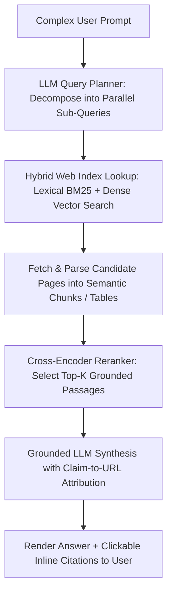

## 1. Introduction and Current Context

For two decades, information discovery on the web followed a predictable two-step contract: a user condensed their problem into three or four keywords (`nextjs stream timeout fix`), scanned ten blue links on a Search Engine Results Page (SERP), opened five tabs, and pieced together the answer themselves. By October 2026, discovery splits across traditional SERPs, integrated generative search summaries (such as Google AI Overviews), standalone conversational answer engines (Perplexity, ChatGPT Search, Claude web search), and terminal/IDE agent search tools. Understanding the retrieval mechanics behind both paradigms is essential for engineers and publishers.

## 2. Direct Answer and Key Takeaway

> **Key Takeaway:** AI search does not replace traditional web search indexes; rather, it adds a multi-query retrieval, passage-reranking, and LLM synthesis layer on top of inverted and vector indexes. Where traditional search maps a short keyword query to a ranked list of 10 document URLs that the user must click and synthesize manually, 2026 AI search engines decompose complex conversational questions into multiple sub-queries ('query fan-out'), retrieve specific high-density passages across documents, synthesize a unified answer, and attach inline source citations—shifting publisher value from shallow top-of-funnel glossary traffic toward deep, verifiable technical evidence and interactive tools.

## 3. Definitions and Technical Background

Before evaluating architectural trade-offs or writing production code for **AI search**, it is essential to establish precise engineering definitions for the core components involved:

- **Lexical Inverted Index (BM25) + PageRank:** The foundational retrieval architecture of traditional web search, mapping exact terms and n-grams to document IDs and scoring pages by term frequency, document structure, and domain link authority.
- **Query Fan-Out (Multi-Query Decomposition):** The AI search process where a user's multi-part conversational prompt is decomposed by an LLM planner into 3 to 8 targeted search queries executed in parallel to gather comprehensive evidence.
- **Passage-Level Hybrid Retrieval & Cross-Encoder Reranking:** Extracting specific self-contained paragraphs or tables from candidate web pages and scoring their exact semantic relevance to the user's question before passing the top-scoring passages into the LLM's context window.
- **Zero-Click Synthesis vs. High-Intent Citation Click:** The user behavior shift where simple definitional queries are resolved directly inside the AI answer interface, while users who click through on an inline citation arrive with much higher technical or commercial intent.

## 4. Technical Architecture and Deep Dive

A common misconception is that AI search engines 'search inside an LLM's training weights.' Relying purely on static model weights fails for anything published after the pretraining cutoff and hallucinates URLs. Instead, every production AI search system in 2026 is a large-scale **Retrieval-Augmented Generation (RAG)** pipeline layered over a real-time web index.

Next comes **document-level vs. passage-level selection**. In traditional search, a 4,000-word article on a high-authority domain might rank #1 on the SERP even if the actual technical answer is buried under 1,200 words of generic introductory fluff. In AI search, the retrieval pipeline parses the rendered DOM into semantic chunks (headings, paragraphs, Markdown/HTML tables) and runs a cross-encoder reranker over those chunks.

Once the top passages are assembled into the grounding prompt, the synthesis model generates a direct answer with inline citation links`). This changes how users interact with websites. Shallow informational queries increasingly resolve without a click.

Crucially, traditional search and AI search remain deeply intertwined. Standalone AI answer engines and LLM browsing tools frequently query underlying web search APIs or rely on the same robots.txt, canonical tag, and HTML rendering fundamentals as traditional search crawlers.

## 5. Comparative Analysis: Technical Mechanics: Traditional Keyword Search vs. 2026 Generative AI Search Engines

The following table compares the key engineering trade-offs, operational boundaries, and implementation choices for **AI search**:

| Retrieval Stage | Traditional Web Search Engine | Generative AI Search / Answer Engine | Implication for Technical Content Architecture |
| --- | --- | --- | --- |
| Typical User Input | 2 – 5 fragmented keywords | 15 – 80 word conversational or multi-constraint prompt | Address specific multi-constraint engineering scenarios |
| Query Processing | Query expansion & synonym matching | LLM Query Fan-Out into multiple parallel sub-queries | Cover related architectural sub-questions cohesively |
| Primary Ranking Unit | Whole URL / Web Document | Self-contained semantic passage, table, or code block | Make every H2/H3 section independently understandable |
| Output Format | Ranked list of 10 document links & snippets | Synthesized multi-source response with inline citations | Include verifiable facts, tables, and concrete specifications |
| User Click Profile | High volume of exploratory/definitional clicks | Lower volume on basics; higher intent on cited deep dives | Avoid generic filler; prioritize original analysis & tools |

## 6. System Architecture and Execution Flow

The diagram below illustrates the end-to-end control flow, verification boundaries, and state transitions for **AI search** in a production environment:

*Figure 26.1: End-to-end retrieval and synthesis pipeline of a modern AI search engine using query fan-out and passage-level reranking.*

## 7. Practical Implementation Steps and Engineering Checklist

To implement **AI search** reliably in production systems, follow these sequential engineering steps:

1. Structure technical articles using the **Direct Answer First** pattern: place a clear, self-contained 50-to-80-word takeaway immediately below the main heading and each major H2 so passage retrievers can extract complete answers without surrounding fluff.
2. Use semantic HTML (`
