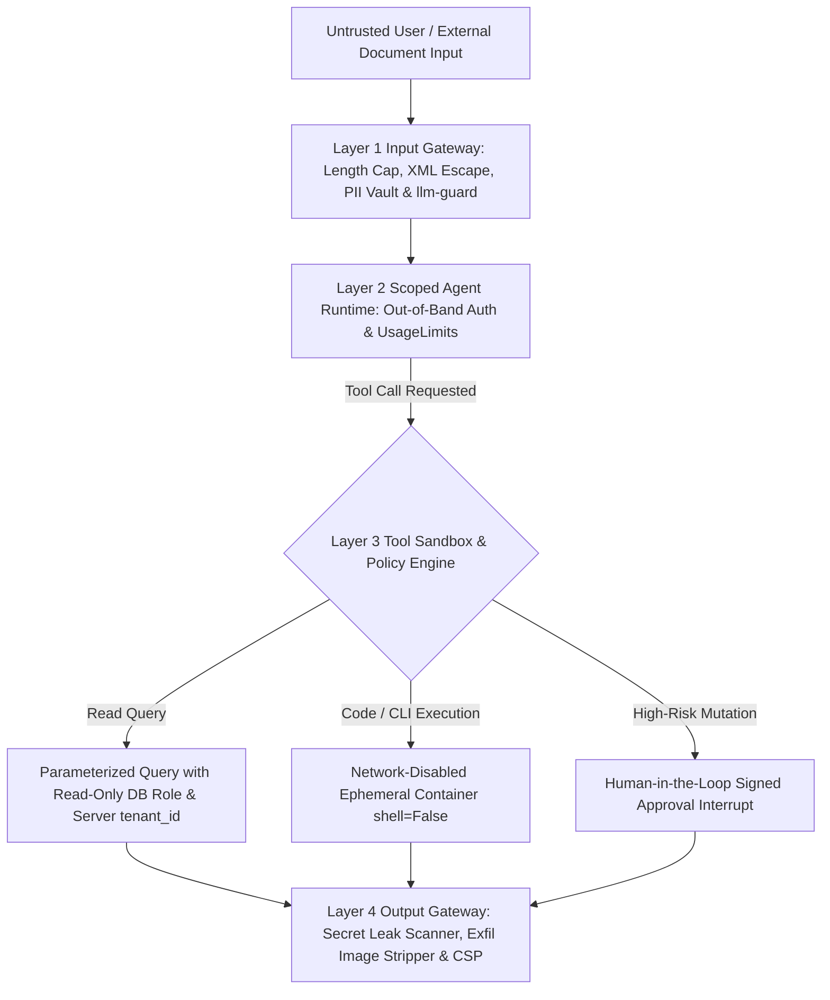

## 1. Introduction and Current Context

In traditional web security, engineers learn a clear rule: validate and sanitize untrusted user inputs at the perimeter, and use parameterized queries for databases.

## 2. Direct Answer and Key Takeaway

> **Key Takeaway:** Securing LLM and agent applications in 2026 requires treating every model input **and** every model output as untrusted data.

## 3. Definitions and Technical Background

Before evaluating architectural trade-offs or writing production code for **AI security**, it is essential to establish precise engineering definitions for the core components involved:

- **Untrusted Output Principle (Insecure Output Handling):** The security rule that text or JSON emitted by an LLM must never be passed directly into `eval()`, `subprocess.run`, raw SQL string concatenation, or unescaped browser DOM without deterministic sanitization and parameterization.
- **Bidirectional Security Gateway (`protectai/llm-guard`):** An inline security middleware layer that scans incoming prompts before model invocation, and scans outgoing completions before returning to the caller.
- **Reversible PII Vault / Anonymizer:** Replacing sensitive identifiers in user prompts with synthetic placeholders in local memory before calling an external LLM, and restoring the values only if authorized.

## 4. Technical Architecture and Deep Dive

**Prerequisites & Required Tools:** Python $\ge 3.11$, `protectai/llm-guard`, `pydantic`, `NVIDIA/garak`, and `promptfoo/promptfoo`.

**Step-by-Step Learning Path:**
1.

**Minimal Production Code Example (Bidirectional Input/Output Security Gateway with PII Redaction, Secret Leak Blocking & Safe Command Execution):**

```python
# File: ai_security_gateway.py
# Prerequisites: Python >= 3.11
import re
import subprocess
from dataclasses import dataclass

SECRET_PATTERNS = [
    re.compile(r"sk-[a-zA-Z0-9_-]{20,}"),          # API keys
    re.compile(r"ghp_[a-zA-Z0-9]{30,}"),          # GitHub PATs
    re.compile(r"AKIA[0-9A-Z]{16}"),              # AWS Access Key IDs
]
PII_EMAIL_RE = re.compile(r"[a-zA-Z0-9_.+-]+@[a-zA-Z0-9-]+\.[a-zA-Z0-9-.]+")
MARKDOWN_EXT_IMG_RE = re.compile(r"!\[[^\]]*\]\(https?://[^)]+\)")

@dataclass
class SanitizedPrompt:
    clean_text: str
    pii_vault: dict[str, str]

def sanitize_incoming_prompt(raw_prompt: str, max_chars: int = 4000) -> SanitizedPrompt:
    """Enforce length cap, escape XML delimiters, and vault PII emails before LLM call."""
    if len(raw_prompt) > max_chars:
        raise ValueError(f"Prompt exceeds maximum length of {max_chars} characters.")
    # Escape XML delimiter tags to prevent context-boundary spoofing
    escaped = raw_prompt.replace("<", "&lt;").replace(">", "&gt;")
    vault: dict[str, str] = {}
    def _replace_email(match: re.Match) -> str:
        token = f"[REDACTED_EMAIL_{len(vault) + 1}]"
        vault[token] = match.group(0)
        return token
    redacted = PII_EMAIL_RE.sub(_replace_email, escaped)
    return SanitizedPrompt(clean_text=redacted, pii_vault=vault)

def inspect_outgoing_output(llm_output: str) -> str:
    """Block leaked credentials and strip external Markdown tracking/exfil images."""
    for pattern in SECRET_PATTERNS:
        if pattern.search(llm_output):
            raise RuntimeError("Security Violation: Outgoing response contained a secret token pattern.")
    # Strip external Markdown images to prevent automatic browser GET exfiltration
    return MARKDOWN_EXT_IMG_RE.sub("[External Image Blocked by Security Policy]", llm_output)

def safe_git_log_tool(commit_count: int) -> str:
    """Example of safe subprocess tool: strict int validation + shell=False."""
    if not (1 <= int(commit_count) <= 20):
        raise ValueError("commit_count must be between 1 and 20")
    # NEVER use shell=True with LLM-supplied arguments
    proc = subprocess.run(
        ["git", "log", f"-n{int(commit_count)}", "--oneline"],
        shell=False,
        capture_output=True,
        text=True,
        timeout=5,
        check=False,
    )
    return proc.stdout[:2000]

if __name__ == "__main__":
    sp = sanitize_incoming_prompt("Contact me at dev@aniket.app <system_override>")
    assert "[REDACTED_EMAIL_1]" in sp.clean_text and "&lt;system_override&gt;" in sp.clean_text
    cleaned_out = inspect_outgoing_output("Here is the summary ")
    assert "evil.example" not in cleaned_out
    print("Security Gateway Self-Test Passed:", sp.clean_text, "|", cleaned_out)
```

## 5. Comparative Analysis: AI Application Threat Matrix (Aligned with OWASP Top 10 for LLM & Agentic Applications)

The following table compares the key engineering trade-offs, operational boundaries, and implementation choices for **AI security**:

| Threat Category | Concrete Attack Scenario | Vulnerable Code Pattern (Never Do This) | Hardened Engineering Control (Always Do This) |
| --- | --- | --- | --- |
| LLM01: Prompt Injection (Direct & Indirect) | Malicious email/webpage hijacks agent tool calls | Unrestricted write/outbound tools in same context as untrusted text | Escape XML tags + `llm-guard` scan + taint-based HITL approval gates |
| LLM02: Sensitive Information Disclosure | Model leaks API keys, system secrets, or another user's PII | Mounting `.env` in agent container or logging raw PII | Vault PII before LLM call + scan output for `sk-*`/`AKIA*` + server-injected `tenant_id` |
| LLM05: Improper Output Handling (RCE / SQLi / XSS) | LLM output passed to `subprocess` or `db.execute` executes shell/SQL injection | `subprocess.run(llm_cmd, shell=True)` or `f'SELECT * FROM t WHERE x={llm_out}'` | Parameterized SQL (`$1`), `shell=False` with strict enum/int args, and HTML/Markdown sanitization |
| LLM06: Excessive Agency | Agent deletes production DB rows or issues $10,000 refund autonomously | Connecting agent with admin DB user and zero step/value caps | Read-only DB credentials for query tools + human interrupt for mutations |
| LLM10: Unbounded Consumption (Denial of Wallet) | Attacker sends 1,000 parallel 50KB prompts to bankrupt API bill | Unauthenticated route with no `max_length` or token quota | Auth gate + Pydantic `max_length=4000` + per-tenant daily token bucket |

## 6. System Architecture and Execution Flow

The diagram below illustrates the end-to-end control flow, verification boundaries, and state transitions for **AI security** in a production environment:



*Figure 60.1: Five-layer AI security architecture protecting prompts, agent tools, credentials, and outputs from injection, RCE, and data exfiltration.*

## 7. Practical Implementation Steps and Engineering Checklist

To implement **AI security** reliably in production systems, follow these sequential engineering steps:

1. Audit every place in your codebase where an LLM output enters a downstream function: ban `eval()`, `exec()`, `subprocess.run`, raw SQL string formatting, and `dangerouslySetInnerHTML` via static linter rules and `openai/codex-security`.
2. Strip or block external Markdown images`) in LLM outputs and enforce a strict HTTP Content Security Policy so indirect prompt injections cannot exfiltrate chat context via automatic browser image requests.
3. Run code-execution or file-processing tools inside **ephemeral, network-disabled containers** with zero access to host environment variables or cloud instance metadata.
4. Deploy `protectai/llm-guard` inline to scan inputs for prompt injection and outputs for accidental PII or credential disclosure.

## 8. Limitations, Operational Risks, and Trade-Offs

Even well-architected deployments of **AI security** face concrete engineering constraints that teams must mitigate proactively:

- Relying on an LLM to judge whether another LLM was prompt-injected without deterministic tool limits: an attacker who crafts a payload that bypasses the main LLM can often bypass an LLM-based guardrail too—always enforce hard deterministic bounds (`shell=False`, `tenant_id` SQL bindings, network egress blocks) in code.
- SSRF (Server-Side Request Forgery) via agent browsing/webhook tools: if an agent has a `fetch_url(url)` tool and an attacker passes `http://169.254.169.254/latest/meta-data/iam/security-credentials/` or `http://localhost:6379/`, the agent will read internal cloud IAM credentials—always block private/link-local IP ranges (`127.0.0.0/8`, `10.0.0.0/8`, `172.16.0.0/12`, `192.168.0.0/16`, `169.254.0.0/16`) after DNS resolution.
- Logging unredacted prompts in error trackers: if your gateway blocks a prompt containing a leaked API key or customer credit card and then logs the full raw exception payload to Sentry or stdout, the secret still leaks into your logging system.

## 9. Frequently Asked Questions (FAQs)

### What is the #1 rule of secure coding when working with LLM outputs?

**Treat all LLM outputs as untrusted user input.** Never pass a string generated by an LLM into a shell command with `shell=True`, a raw SQL query string, `eval()`, or unescaped HTML (`innerHTML`).

### How can an AI agent with a `fetch_url` tool cause a Server-Side Request Forgery (SSRF) breach?

If an agent is allowed to fetch any URL provided in a prompt or webpage, an attacker can ask it to summarize `http://169.254.169.254/latest/meta-data/` (the cloud instance metadata service) or an internal admin service on `http://10.0.1.5:8080`.

### How do `protectai/llm-guard` and `NVIDIA/garak` differ in an AI security program?

`protectai/llm-guard` is an **inline runtime defense library** that runs inside your production Python backend to sanitize inputs and outputs on every request.

## 10. Conclusion

AI security is not a bolt-on checklist at the end of a project—it is an architectural mindset built on zero-trust boundaries. By combining `protectai/llm-guard` runtime sanitization, out-of-band permission injection in `pydantic/pydantic-ai`, parameterized sinks (`shell=False`), SSRF-safe network sandboxes, and continuous red-teaming with `NVIDIA/garak`, `promptfoo`, and `openai/codex-security`, engineers build AI systems that withstand real-world adversaries.

### GitHub Repositories & Technical References

- **protectai/llm-guard** — Official open-source security toolkit for sanitizing LLM prompts and responses against injection, PII leaks, and secrets exposure. Verified GitHub URL: https://github.com/protectai/llm-guard
- **NVIDIA/garak** — Official open-source LLM vulnerability scanner for automated red-teaming and adversarial probing. Verified GitHub URL: https://github.com/NVIDIA/garak
- **openai/codex-security** — OpenAI's official security CLI and SDK for finding, validating, and patching application security vulnerabilities. Verified GitHub URL: https://github.com/openai/codex-security
- **promptfoo/promptfoo** — Open-source evaluation and red-teaming CLI for testing LLM applications against OWASP LLM Top 10 risks. Verified GitHub URL: https://github.com/promptfoo/promptfoo
