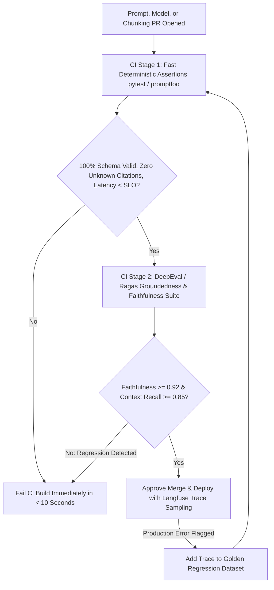

## 1. Introduction and Current Context

In traditional software engineering, nobody deploys a database refactoring to production after manually typing two inputs into a terminal and saying 'looks good to me.' Yet teams routinely tweak system prompts, swap embedding models, or upgrade LLM checkpoints based on 'vibe checks' over three happy-path prompts—only to discover in production that fixing one edge case quietly broke JSON formatting on 15% of other queries.

## 2. Direct Answer and Key Takeaway

> **Key Takeaway:** The single most important engineering skill separating fragile AI demos from production software is **Evaluation-Driven Development (EvalOps)**.

## 3. Definitions and Technical Background

Before evaluating architectural trade-offs or writing production code for **AI testing**, it is essential to establish precise engineering definitions for the core components involved:

- **Golden Evaluation Dataset:** A version-controlled collection of 100 to 500 representative inputs, retrieved contexts, and expected ground-truth assertions stratified across typical user queries, hard edge cases, adversarial attacks, and historical bugs.
- **Tier-1 Deterministic Code Assertions:** Zero-cost, 100%-reproducible checks executed in Python or TypeScript that run before any LLM-as-a-judge metric.
- **Faithfulness vs. Answer Relevancy (`Ragas` / `DeepEval`):** Two orthogonal RAG evaluation metrics: **Faithfulness** measures whether every factual claim in the response is strictly supported by the retrieved context, whereas **Answer Relevancy** measures whether the response actually addressed the user's question.

## 4. Technical Architecture and Deep Dive

**Prerequisites & Required Tools:** Python $\ge 3.11$ and Node.js $\ge 20$, `confident-ai/deepeval`, `promptfoo/promptfoo`, and `explodinggradients/ragas`.

**Step-by-Step Learning Path:**
1. **Beginner — Deterministic Assertion Suite:** Write 30 test cases in `promptfoo` or `pytest` verifying that your AI endpoint always outputs valid JSON matching your Pydantic/JSON Schema, never leaks banned strings, cites only provided source IDs, and finishes under your latency budget.
2.

**Minimal Production Code Example (Deterministic + Groundedness Evaluation Suite in Python):**

```python
# File: test_ai_evals.py
# Prerequisites: pip install pytest pydantic
import json
import re
from pydantic import BaseModel, ValidationError

class SupportReplySchema(BaseModel):
    answer: str
    cited_source_ids: list[str]
    escalate_to_human: bool

def deterministic_eval_gate(
    raw_output: str,
    allowed_source_ids: set[str],
    source_corpus_text: str,
    latency_ms: float,
) -> dict[str, bool | str]:
    """Tier-1 deterministic evaluation gate verifying schema, citations, and latency."""
    # 1. JSON & Pydantic Schema Assertion
    try:
        parsed = SupportReplySchema.model_validate_json(raw_output)
    except ValidationError as exc:
        return {"passed": False, "reason": f"Schema validation failed: {exc.errors()[0]['msg']}"}

    # 2. Closed-World Citation Attribution Assertion (Zero Hallucinated IDs)
    unknown_ids = set(parsed.cited_source_ids) - allowed_source_ids
    if unknown_ids:
        return {"passed": False, "reason": f"Hallucinated source IDs cited: {sorted(unknown_ids)}"}

    # 3. Numeric Groundedness Check (Every number in answer must appear in source corpus)
    answer_numbers = set(re.findall(r"\b\d+(?:\.\d+)?\b", parsed.answer))
    source_numbers = set(re.findall(r"\b\d+(?:\.\d+)?\b", source_corpus_text))
    ungrounded_numbers = answer_numbers - source_numbers
    if ungrounded_numbers:
        return {"passed": False, "reason": f"Ungrounded numbers in answer: {sorted(ungrounded_numbers)}"}

    # 4. Latency SLO Assertion
    if latency_ms > 2500.0:
        return {"passed": False, "reason": f"Latency SLO breached: {latency_ms}ms > 2500ms"}

    return {"passed": True, "reason": "All deterministic checks passed"}

def test_deterministic_eval_gate():
    corpus = "Policy DOC-101: Standard refund window is 14 days for unused subscriptions."
    valid_json = json.dumps({
        "answer": "You can request a refund within 14 days for unused subscriptions.",
        "cited_source_ids": ["DOC-101"],
        "escalate_to_human": False,
    })
    res = deterministic_eval_gate(valid_json, {"DOC-101"}, corpus, latency_ms=420.0)
    assert res["passed"] is True

    hallucinated_json = json.dumps({
        "answer": "You can request a refund within 30 days.",
        "cited_source_ids": ["DOC-101"],
        "escalate_to_human": False,
    })
    bad = deterministic_eval_gate(hallucinated_json, {"DOC-101"}, corpus, latency_ms=420.0)
    assert bad["passed"] is False and "30" in str(bad["reason"])
```

**Testing & Verification Steps:** Run `pytest test_ai_evals.py`. Notice how the **Numeric Groundedness Check** catches the hallucinated `'30 days'` number in under 1 millisecond with zero LLM judge cost!

## 5. Comparative Analysis: The Three-Tier AI Evaluation Pyramid for Software Engineers

The following table compares the key engineering trade-offs, operational boundaries, and implementation choices for **AI testing**:

| Evaluation Tier | What It Measures | Execution Speed & Cost | Primary Open-Source Tools |
| --- | --- | --- | --- |
| Tier 1: Deterministic Code Assertions | JSON schema validity, enum bounds, cited ID existence, numeric grounding, latency/cost ceilings | < 5 ms per case / $0.00 cost | `pytest`, `pydantic`, `promptfoo/promptfoo` (`is-json`, `javascript`) |
| Tier 2: Semantic & RAG Triad Metrics | Faithfulness (hallucination check), Answer Relevancy, Context Recall, binary G-Eval rubrics | 500 ms – 2 s per case / low judge API cost | `confident-ai/deepeval`, `explodinggradients/ragas` |
| Tier 3: Reproducible Model Benchmarks & Red-Teaming | Quantization perplexity/task retention & adversarial security probes | Minutes per batch run (pre-release gate) | `EleutherAI/lm-evaluation-harness`, `NVIDIA/garak`, `promptfoo redteam` |

## 6. System Architecture and Execution Flow

The diagram below illustrates the end-to-end control flow, verification boundaries, and state transitions for **AI testing** in a production environment:



*Figure 56.1: Continuous AI evaluation flywheel gating pull requests with fast deterministic assertions and Ragas/DeepEval groundedness metrics while feeding production failures back into the golden dataset.*

## 7. Practical Implementation Steps and Engineering Checklist

To implement **AI testing** reliably in production systems, follow these sequential engineering steps:

1. Write **Tier-1 Deterministic Assertions first** before reaching for an LLM-as-a-judge: checking whether JSON parses, whether cited document IDs exist in the retrieved context, and whether numbers in the output appear in the source text catches 70% of regressions at zero cost.
2. When configuring LLM-as-a-judge rubrics in `confident-ai/deepeval` or `promptfoo/promptfoo`, replace subjective 1-to-10 rating scales with **binary atomic checklists**.
3. Pin the exact `temperature=0` and model version of your evaluation judge so your CI test scores do not drift randomly over time.
4. Stratify your Golden Dataset across four categories: (1) Happy-path common queries, (2) Multi-hop / complex reasoning queries, (3) Out-of-scope queries where the correct behavior is **abstention**, and (4) Adversarial prompt-injection probes.

## 8. Limitations, Operational Risks, and Trade-Offs

Even well-architected deployments of **AI testing** face concrete engineering constraints that teams must mitigate proactively:

- Using `exact-match` or `BLEU`/`ROUGE` on free-form generative prose: two differently worded sentences can be 100% factually identical while scoring poorly on lexical overlap—use deterministic checks on structured fields and semantic faithfulness (`ragas`/`deepeval`) on prose.
- Testing only positive answer cases and omitting abstention tests: if your golden dataset never tests questions whose answers are *missing* from the knowledge base, you will accidentally reward prompts that guess and hallucinate when retrieval returns nothing.
- Running 500 expensive LLM-as-a-judge evaluations on every trivial CSS commit: run fast deterministic assertions on every commit, and trigger full LLM-judge suites only when files in `prompts/`, `rag/`, or `agents/` change.

## 9. Frequently Asked Questions (FAQs)

### How do I start building an evaluation suite if I have zero labeled data today?

Start with 25 to 50 test cases: write 15 representative real questions by hand, generate 15 synthetic edge-case questions from your documentation using `explodinggradients/ragas` or `deepeval` synthesizer, and add 10 'abstention/adversarial' questions where the system must refuse or say it doesn't know.

### What is the difference between `promptfoo`, `DeepEval`, and `Ragas`?

`promptfoo/promptfoo` is a fast, declarative YAML CLI ideal for comparing prompts/models side-by-side and running red-team security scans. `confident-ai/deepeval` provides a Python `pytest`-native unit-testing experience with G-Eval and hallucination metrics.

### Why shouldLLM-as-a-judge rubrics use binary Yes/No criteria instead of a 1–10 score?

LLMs have no consistent internal calibration between a '6 out of 10' and a '7 out of 10' across runs.

## 10. Conclusion

AI testing and evaluation turn prompt tweaking from guesswork into rigorous engineering. By combining zero-cost deterministic assertions in Python, RAG faithfulness checks in `ragas` and `deepeval`, declarative matrices in `promptfoo`, and a continuous feedback loop from `langfuse` production traces, developers ship AI updates with complete confidence.

### GitHub Repositories & Technical References

- **promptfoo/promptfoo** — Open-source declarative CLI for testing prompts, agents, and RAG pipelines with deterministic and rubric assertions. Verified GitHub URL: https://github.com/promptfoo/promptfoo
- **confident-ai/deepeval** — Open-source pytest-style evaluation framework for unit-testing LLM outputs, groundedness, and G-Eval rubrics. Verified GitHub URL: https://github.com/confident-ai/deepeval
- **explodinggradients/ragas** — Standard evaluation toolkit for scoring RAG Faithfulness, Answer Relevancy, Context Precision, and Context Recall. Verified GitHub URL: https://github.com/explodinggradients/ragas
- **EleutherAI/lm-evaluation-harness** — Standardized evaluation framework for benchmarking open-weight and quantized language model checkpoints. Verified GitHub URL: https://github.com/eleutherai/lm-evaluation-harness
