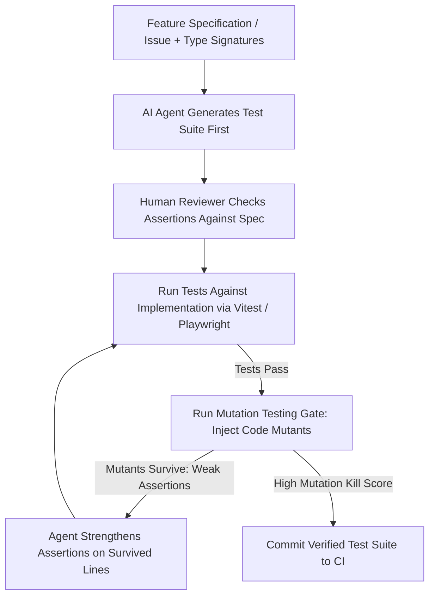

## 1. Introduction and Current Context

Writing comprehensive test suites—covering boundary conditions, malformed inputs, database rollbacks, and cross-browser UI flows—is one of the most time-consuming duties in software engineering. Naturally, teams have turned to AI coding agents (`anthropics/claude-code`, `openai/codex`, `google-gemini/gemini-cli`) to automate test authoring. Yet many teams discover that jumping from 40% to 95% line coverage using naive AI test generation does not reduce their production incident rate at all. Understanding the difference between **specification-grounded tests** and **implementation-mirroring tests** is essential for getting real value out of AI testing tools.

## 2. Direct Answer and Key Takeaway

> **Key Takeaway:** LLMs and coding agents in 2026 are highly effective at generating test scaffolding, edge-case input matrices, property-based fuzzing harnesses, and end-to-end browser tests (`microsoft/playwright`), but they fail when asked to generate unit tests solely by reading an existing implementation file in isolation. When an LLM generates tests from implementation code alone, it mirrors the implementation's bugs into passing assertions ('tautological tests'). Useful AI test generation grounds assertions in external specifications, executes tests in a closed feedback loop (`vitest-dev/vitest`, `playwright-mcp`), and validates test quality via mutation testing.

## 3. Definitions and Technical Background

Before evaluating architectural trade-offs or writing production code for **AI testing tools**, it is essential to establish precise engineering definitions for the core components involved:

- **Tautological (Mirror) Test:** A test generated by an LLM after reading a function's source code that simply asserts whatever output the function currently produces—meaning if the function has an off-by-one bug, the generated test asserts the buggy value as 'expected'.
- **Over-Mocking (Mock-Heavy Fragility):** An anti-pattern where an AI-generated test mocks every internal helper class and database call and asserts only that `mockHelper.wasCalledWith(...)`, coupling the test tightly to internal implementation details rather than observable behavior.
- **Mutation Testing (Mutation Score):** A verification technique (using tools like Stryker or `mutmut`) that deliberately injects small bugs ('mutants', such as changing `>` to `>=` or `+` to `-`) into production code and checks whether the test suite fails; survived mutants reveal weak or meaningless test assertions.
- **Agentic Browser Verification (`playwright-mcp`):** Connecting an AI coding agent to a live headless browser via `microsoft/playwright-mcp` so the agent inspects the actual accessibility tree (`aria-snapshot`), interacts with real DOM elements, and writes resilient E2E tests (`microsoft/playwright`).

## 4. Technical Architecture and Deep Dive

Why does prompting an LLM with *'Write unit tests for `calculateDiscount.ts`'* often produce useless tests? Because the LLM has no access to your product requirements document—its only source of truth is the code inside `calculateDiscount.ts`. If the developer who wrote `calculateDiscount.ts` accidentally applied a 20% discount to expired coupons instead of rejecting them, the LLM reads that `if` branch and dutifully generates a test named `should apply 20% discount when coupon is expired`. The test passes, coverage hits 100%, and the bug ships to production.

To generate high-value unit and integration tests, engineers must change the input context provided to the AI. Instead of generating tests from the implementation file alone, provide the **specification, OpenAPI contract, or issue description alongside the function signature (or before the implementation is written, in Specification-Driven TDD)**. When an agent generates tests from the specification first, any discrepancy between the specification and the implementation surfaces immediately as a failing test.

Second, LLMs are extraordinarily effective at **combinatorial edge-case expansion and property-based testing**. Humans get bored after writing two happy-path test cases.

Third, for integration and end-to-end (E2E) testing, static LLM code generation historically failed because the model guessed CSS selectors (`div.btn-primary-v2`) that did not exist in the rendered DOM, producing flaky tests.

## 5. Comparative Analysis: Where AI Test Generation Excels vs. Where It Fails Across the Testing Pyramid

The following table compares the key engineering trade-offs, operational boundaries, and implementation choices for **AI testing tools**:

| Test Layer | High-Value AI Generation Use Case | Common AI Testing Failure Mode | Engineering Guardrail & Verification |
| --- | --- | --- | --- |
| Unit Tests (`Vitest` / `pytest`) | Edge-case parameter matrices, boundary conditions, pure functions | Tautological assertions mirroring bugs; mocking internal methods | Generate from spec/types first; verify with mutation testing |
| Property-Based / Fuzz Tests | Writing `Hypothesis` or `fast-check` invariant generators | Asserting trivial properties (e.g., `result is not None`) | Require round-trip or mathematical invariant assertions |
| Integration Tests (API + DB) | Scaffolding testcontainers, seed fixtures, RBAC permission matrices | Mocking the ORM/DB instead of testing real SQL constraints | Ban DB mocks in integration tests; run against ephemeral Postgres |
| End-to-End UI (`Playwright`) | Recording user journeys via `playwright-mcp` accessibility tree | Guessed CSS selectors & hardcoded `waitForTimeout(3000)` sleeps | Enforce `getByRole` locators & web-first `expect(locator)` assertions |

## 6. System Architecture and Execution Flow

The diagram below illustrates the end-to-end control flow, verification boundaries, and state transitions for **AI testing tools** in a production environment:

*Figure 24.1: Specification-driven AI test generation workflow using mutation testing to eliminate tautological assertions.*

## 7. Practical Implementation Steps and Engineering Checklist

To implement **AI testing tools** reliably in production systems, follow these sequential engineering steps:

1. Practice **Spec-to-Test Prompting**: give the AI coding agent the business requirements and function type signatures *without* the implementation body first, so the generated assertions reflect intended behavior rather than accidental bugs.
2. Ban hard-coded sleep timers (`page.waitForTimeout`, `time.sleep`) and brittle XPath/CSS class selectors in your `AGENTS.md` testing rules; require `microsoft/playwright` user-facing locators (`getByRole`, `getByLabel`, `getByTestId`) and auto-retrying assertions.
3. Use real ephemeral databases (such as SQLite in-memory or Dockerized PostgreSQL test fixtures) rather than `unittest.mock` / `vi.mock` for database integration tests so AI-generated tests verify actual SQL queries and foreign-key constraints.
4. Connect your coding agent to `microsoft/playwright-mcp` when authoring E2E tests so the agent verifies every click and assertion against the live rendered DOM before saving the `.spec.ts` file.
5. Run a mutation testing tool (such as Stryker for TypeScript/Vitest or `mutmut` for Python) on AI-generated unit test files to prove that breaking a conditional operator in the source code actually causes a test to fail.

## 8. Limitations, Operational Risks, and Trade-Offs

Even well-architected deployments of **AI testing tools** face concrete engineering constraints that teams must mitigate proactively:

- False confidence from 100% line coverage: an AI can generate a test that calls a 100-line function and asserts only `expect(result).toBeDefined()`, achieving 100% line execution coverage while checking zero business correctness.
- Flaky E2E test suites in CI: if an LLM generates browser tests that rely on network timing or shared mutable database state across parallel workers, CI pipelines become unreliable and developers start ignoring red builds.
- Maintenance burden of verbose mock setups: AI-generated tests that include 80 lines of mock wiring per test break every time an internal private helper is refactored, even when external behavior is unchanged.

## 9. Frequently Asked Questions (FAQs)

### Can AI-generated unit tests replace human test planning?

No.

### How do I stop an LLM from writing flaky Playwright E2E tests?

First, connect the agent to `microsoft/playwright-mcp` so it inspects the real DOM rather than guessing selectors.

### Why is mutation testing so useful for evaluating AI-generated tests?

Line coverage only measures whether a line of code ran during a test, not whether the test actually checked its output.

## 10. Conclusion

LLMs are formidable force multipliers for software testing when guided by specifications, real runtime execution, and mutation verification. By anchoring AI test generation in `vitest-dev/vitest` and `microsoft/playwright` with `playwright-mcp`—and outlawing over-mocking and tautological assertions—teams achieve both high test velocity and genuine defect detection.

### GitHub Repositories & Technical References

- **microsoft/playwright** — Official cross-browser end-to-end testing framework providing auto-retrying web assertions, browser isolation, and trace viewers. Verified GitHub URL: https://github.com/microsoft/playwright
- **microsoft/playwright-mcp** — Official Model Context Protocol server enabling AI agents to interact with live web pages via Playwright's accessibility tree. Verified GitHub URL: https://github.com/microsoft/playwright-mcp
- **vitest-dev/vitest** — Next-generation Vite-powered unit and component testing framework for TypeScript and JavaScript. Verified GitHub URL: https://github.com/vitest-dev/vitest/blob/main/AGENTS.md
- **promptfoo/promptfoo** — Open-source testing and evaluation CLI for asserting deterministic quality gates on AI outputs and agent workflows. Verified GitHub URL: https://github.com/promptfoo/promptfoo
