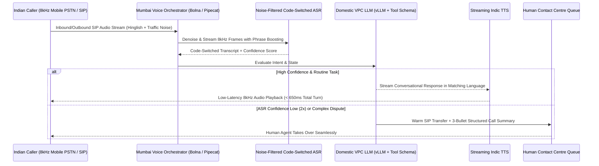

## 1. Introduction and Current Context

Anyone can record a pristine demo of a voice agent speaking English over a studio condenser microphone on gigabit Wi-Fi. When that same agent is deployed on real Indian mobile phone calls, three things happen within the first ten seconds: (1) an auto-rickshaw horn or ceiling fan in the background triggers the Voice Activity Detector (VAD) continuously so the agent stops talking mid-sentence, (2) the customer answers in rapid Hinglish (*'Bhaiya kal subah 10 baje ke baad delivery bhejna, abhi office mein hoon'*), and (3) cellular 8kHz μ-law audio compression garbles Indian proper nouns and pin codes.

## 2. Direct Answer and Key Takeaway

> **Key Takeaway:** In 2026, AI voice agents can reliably handle real inbound and outbound Indian business calls—such as COD e-commerce confirmation, appointment reminders, logistics coordination, and initial support triage—across Hindi, Hinglish, Tamil, Telugu, Marathi, Bengali, and Kannada, **provided** the engineering stack is built for Indian cellular realities rather than quiet Western studio demos.

## 3. Definitions and Technical Background

Before evaluating architectural trade-offs or writing production code for **AI calling agents India**, it is essential to establish precise engineering definitions for the core components involved:

- **PSTN / SIP Trunk Media Bridge:** The telephony gateway layer that converts traditional 8kHz cellular telephone audio into bidirectional WebSocket or WebRTC streams for the AI pipeline.
- **Intra-Sentential Code-Switching:** Switching between an Indian regional language and English multiple times within a single spoken breath—requiring an ASR model that handles bilingual phoneme sequences without resetting language state.
- **Far-Field & Ambient Noise Resilience:** Filtering non-speech environmental noise using neural denoising and semantic turn detection so background noise does not trigger false barge-in interruptions.

## 4. Technical Architecture and Deep Dive

**Challenge 1: Bridging 8kHz Cellular Telephony and Latency Physics.** While in-app mobile voice chats can use 24kHz wideband Opus over WebRTC, 80% of Indian business calls happen over standard PSTN mobile phone lines at **8kHz sample rates**. Many speech models pretrained exclusively on 16kHz or 24kHz clean studio audio suffer a sharp spike in Word Error Rate (WER) when fed 8kHz telephony audio, especially on high-frequency consonants when customers dictate 6-digit PIN codes or alphanumeric vehicle numbers. Furthermore, every millisecond of network transit matters: if your SIP gateway is in Mumbai, your ASR is in US-West, your LLM is in US-East, and your TTS is in Europe, submarine cable round-trips add 600ms+ of dead air before computation even starts.

**Challenge 2: Code-Switching, Proper Nouns, and Regional Accents.** An Indian caller rarely speaks either 100% textbook Hindi or 100% British/American English. Even when speaking Tamil, Telugu, or Marathi, callers embed English numbers, dates, product names, and email addresses. If an ASR engine is locked to a monolingual Devanagari output mode, it transliterates English brand names phonetically into Devanagari, breaking downstream database lookups; if locked to English, it mangles regional verbs.

**Challenge 3: Street Noise, Backchannels, and Barge-In Tuning.** In Indian outdoor or household environments, ambient noise floors are high.

**Challenge 4: Warm Human Escalation.** Voice agents excel at structured 60-to-120-second workflows.

## 5. Comparative Analysis: Engineering Requirements: Demo Web Voice Bot vs. Production Indian Telephony Voice Agent

The following table compares the key engineering trade-offs, operational boundaries, and implementation choices for **AI calling agents India**:

| System Layer | Western Studio / Web Demo Setup | Production Indian Telephony Setup (2026) | Recommended Engineering Implementation |
| --- | --- | --- | --- |
| Audio Transport & Sample Rate | 24kHz Browser WebRTC on quiet Wi-Fi | 8kHz PSTN/SIP Trunk (`G.711`) + variable 4G jitter | Co-locate `bolna-ai/bolna` or `pipecat` with Indian SIP trunks |
| Language & Script Mode | Monolingual English | Code-switched Hinglish/Tanglish + 10+ regional languages | Bilingual ASR mode + locality/brand phrase boosting |
| VAD & Interruption Logic | Simple energy/silence VAD (250ms) | Noise-suppressed VAD + semantic barge-in verification | Require verified speech tokens before cancelling TTS stream |
| Entity Confirmation (PIN/Phone) | Single pass transcription | Explicit chunked read-back confirmation for digits/names | Prompt agent to repeat 6-digit PIN/amount before tool execution |
| Regulatory & Escalation | None | TRAI DND/DLT compliance + 2-strike warm SIP transfer | Enforce calling windows & pass structured state to human queue |

## 6. System Architecture and Execution Flow

The diagram below illustrates the end-to-end control flow, verification boundaries, and state transitions for **AI calling agents India** in a production environment:

*Figure 42.1: Co-located Indian telephony voice agent architecture handling 8kHz SIP audio, code-switched ASR, and warm human escalation.*

## 7. Practical Implementation Steps and Engineering Checklist

To implement **AI calling agents India** reliably in production systems, follow these sequential engineering steps:

1. Deploy your voice orchestration server, LLM endpoint, and telephony SIP bridge in the **exact same Indian cloud region** to keep network transit under 20ms per hop.
2. Configure **custom vocabulary / keyword boosting** in your ASR adapter for Indian locality names, PIN codes, and your brand's product SKUs, and always force the agent to perform an explicit conversational read-back before executing mutations on dictated numbers.
3. Match the caller's linguistic register dynamically: if the caller speaks Hinglish, instruct the LLM to reply in natural conversational Hinglish rather than switching to impenetrable literary Sanskritized Hindi.
4. Implement a strict **Two-Strike Escalation Rule**: if the caller says *'Operator se baat karao'* or if the agent asks the caller to repeat an input twice in a row, trigger an immediate SIP transfer to a human agent with the captured context.

## 8. Limitations, Operational Risks, and Trade-Offs

Even well-architected deployments of **AI calling agents India** face concrete engineering constraints that teams must mitigate proactively:

- Digit and alphanumeric dictation errors over 8kHz cellular lines: letters like `'M'` and `'N'`, or `'B'` and `'P'`, sound nearly identical over compressed mobile codecs—never rely on voice dictation alone for critical passwords or complex email addresses; send a parallel WhatsApp/SMS link during the call when exact string entry is required.
- Latency compounding on multi-language switches: dynamically switching TTS voices mid-call when a user switches from English to Malayalam can incur model-loading cold starts unless voices are pre-warmed.
- Unlawful outbound spam dialing: deploying AI dialers for unsolicited cold calling without TRAI DLT registration and user consent results in immediate SIP trunk suspension by telecom operators.

## 9. Frequently Asked Questions (FAQs)

### Can AI voice agents understand Hinglish and regional Indian accents on regular phone calls?

Yes, when configured with code-switched ASR models and noise-robust endpointing.

### What open-source framework is purpose-built for Indian and telephony voice agents?

`bolna-ai/bolna` is an open-source voice agent orchestration framework widely used in the Indian ecosystem that integrates telephony providers (SIP/Twilio/Plivo), streaming ASR, LLMs, and TTS pipelines, alongside global frameworks like `pipecat-ai/pipecat` and `livekit/agents`.

### How do you handle complex inputs like email addresses or 12-digit reference numbers on a voice call?

For short digits (like a 6-digit PIN code), use chunked read-back confirmation.

## 10. Conclusion

AI voice agents are transforming customer operations across India, provided they are engineered for the physical and linguistic realities of Indian telephony. By co-locating `bolna-ai/bolna` or `pipecat` in domestic data centres, tuning for 8kHz acoustics and Hinglish code-switching, pairing voice with WhatsApp for complex inputs, and respecting TRAI/DPDP rules, businesses can deliver fast, accessible regional voice support at scale.

### GitHub Repositories & Technical References

- **bolna-ai/bolna** — Open-source end-to-end framework for building LLM-based conversational voice agents over telephony and WebSocket streams. Verified GitHub URL: https://github.com/bolna-ai/bolna
- **pipecat-ai/pipecat** — Open-source Python framework for real-time voice and multimodal conversational agents. Verified GitHub URL: https://github.com/pipecat-ai/pipecat
- **livekit/agents** — Framework for building programmable real-time voice and multimodal participants over WebRTC and SIP. Verified GitHub URL: https://github.com/livekit/agents
- **AI4Bharat/Indic-TTS** — Open-source Text-to-Speech synthesis models and tools for Indian languages. Verified GitHub URL: https://github.com/AI4Bharat/Indic-TTS
