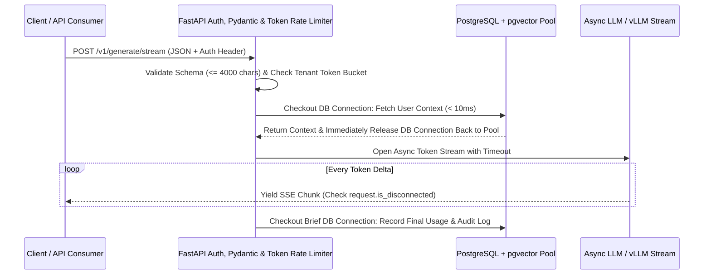

## 1. Introduction and Current Context

A traditional REST endpoint queries an indexed PostgreSQL table in 4 milliseconds and returns a 2KB JSON response; a single worker process can easily handle 1,000 requests per second.

## 2. Direct Answer and Key Takeaway

> **Key Takeaway:** Backend engineering for production AI systems differs fundamentally from standard CRUD APIs because LLM requests are **long-lived (2–60 seconds), memory- and token-metered, non-deterministic, and prone to upstream provider rate limits**.

## 3. Definitions and Technical Background

Before evaluating architectural trade-offs or writing production code for **backend engineering skills**, it is essential to establish precise engineering definitions for the core components involved:

- **Non-Blocking Event Loop (`asyncio` / `StreamingResponse`):** Executing all external LLM and vector-database I/O using asynchronous coroutines in `fastapi/fastapi` so a single worker process can multiplex hundreds of concurrent streaming connections without blocking health checks.
- **DB Connection Pool Starvation Anti-Pattern:** Holding an active SQLAlchemy/PostgreSQL database session or row lock open across an `await llm_client.generate()` network call—exhausting `max_connections` while waiting seconds for token generation.
- **Token-Bucket Rate Limiting (Requests + Tokens/Min):** Enforcing dual rate limits per authenticated tenant: capping both HTTP requests per minute AND estimated/actual input+output tokens per day so a single user cannot exhaust the organization's upstream provider quota.

## 4. Technical Architecture and Deep Dive

**Prerequisites & Required Tools:** Python $\ge 3.11$, `fastapi/fastapi`, `pydantic` v2, `uvicorn`, `httpx`, PostgreSQL, and `pytest` for verification.

**Step-by-Step Learning Path:**
1. **Beginner — Typed Async Endpoints & Strict Validation:** Build `async def` FastAPI routes using Pydantic `BaseModel` schemas with `Field` constraints, structured error handlers, and environment-validated settings.
2.

**Minimal Production Code Example (FastAPI Async Streaming Endpoint with DB Pool Discipline & Disconnect Cancellation):**

```python
# File: app/main.py
# Prerequisites: pip install fastapi uvicorn pydantic
import asyncio
import json
from typing import AsyncIterator
from fastapi import Depends, FastAPI, Header, HTTPException, Request
from fastapi.responses import StreamingResponse
from pydantic import BaseModel, Field

app = FastAPI(title="Production AI Backend")

class PromptRequest(BaseModel):
    prompt: str = Field(..., min_length=1, max_length=4000)
    max_tokens: int = Field(default=512, ge=16, le=2048)

async def verify_tenant_quota(x_api_key: str = Header(...)) -> str:
    # In production, verify HMAC/JWT and check Redis token bucket
    if not x_api_key.startswith("ak_live_"):
        raise HTTPException(status_code=401, detail="Invalid API key")
    return "tenant_verified_01"

async def simulated_llm_stream(prompt: str, request: Request) -> AsyncIterator[str]:
    tokens = ["Grounded ", "streaming ", "response ", "from ", "FastAPI."]
    for tok in tokens:
        if await request.is_disconnected():
            # Immediately abort upstream generation if client disconnects
            break
        payload = json.dumps({"delta": tok})
        yield f"data: {payload}\n\n"
        await asyncio.sleep(0.05)
    yield "data: [DONE]\n\n"

@app.post("/v1/generate/stream")
async def stream_generation(
    body: PromptRequest,
    request: Request,
    tenant_id: str = Depends(verify_tenant_quota),
) -> StreamingResponse:
    # CRITICAL: Fetch & close DB context BEFORE opening the long-lived LLM stream
    return StreamingResponse(
        simulated_llm_stream(body.prompt, request),
        media_type="text/event-stream",
        headers={"X-Accel-Buffering": "no", "Cache-Control": "no-cache"},
    )
```

## 5. Comparative Analysis: Backend Engineering Patterns: Traditional CRUD Microservice vs. Production AI Backend

The following table compares the key engineering trade-offs, operational boundaries, and implementation choices for **backend engineering skills**:

| Architectural Concern | Traditional CRUD Backend | Production AI Backend (2026) | Critical Pitfall to Avoid |
| --- | --- | --- | --- |
| Concurrency Model | Sync or async (5–20ms DB queries) | Strictly non-blocking `asyncio` for I/O-bound LLM calls | Calling synchronous `requests.post()` inside an `async def` FastAPI route |
| Database Connection Lifecycle | One DB session per HTTP request scope | Short-lived DB read → release connection → await LLM → short-lived DB write | Holding a DB transaction open during a 15s LLM stream (exhausts pool) |
| Reverse Proxy / Nginx Config | Standard response buffering enabled | Disable proxy buffering (`X-Accel-Buffering: no`, `Cache-Control: no-cache`) | Nginx buffers the entire SSE stream and dumps it all at the end |
| Rate Limiting | Requests per second per IP (`RPS`) | Dual limit: Requests/min + Input/Output Tokens per tenant/day | Allowing 10 RPS of 100k-token prompts to bankrupt token quota |
| Long-Running Tasks (>30s) | Rare | Common (document ingestion, multi-step agents) | Running 3-minute PDF indexing synchronously inside an HTTP POST |

## 6. System Architecture and Execution Flow

The diagram below illustrates the end-to-end control flow, verification boundaries, and state transitions for **backend engineering skills** in a production environment:



*Figure 52.1: Production AI backend sequence demonstrating database connection release prior to long-lived LLM streaming and disconnect detection.*

## 7. Practical Implementation Steps and Engineering Checklist

To implement **backend engineering skills** reliably in production systems, follow these sequential engineering steps:

1. Audit every `async def` route in your `fastapi/fastapi` codebase to ensure zero synchronous blocking calls run on the main event loop; use `httpx.AsyncClient` and offload CPU work to process workers.
2. Never wrap an external LLM call inside an open database session`): checkout a connection for 5ms to load context, release it back to the pool, await the 10-second LLM response, and checkout a fresh connection for 5ms to write the result.
3. Always include the HTTP response header `"X-Accel-Buffering": "no"` and `"Cache-Control": "no-cache"` on SSE streaming responses so Nginx, Cloudflare, and ingress proxies flush token chunks immediately rather than buffering them.
4. Enforce strict upstream timeouts`) and circuit-breaker fallbacks on all model API calls so a degraded provider region does not hang your backend workers indefinitely.

## 8. Limitations, Operational Risks, and Trade-Offs

Even well-architected deployments of **backend engineering skills** face concrete engineering constraints that teams must mitigate proactively:

- Blocking the Python event loop with a single sync library call: if one developer calls a synchronous SDK method inside `async def`, that single call freezes *every* concurrent user stream on that Uvicorn worker until it finishes.
- Proxy buffering killing streaming UX: deploying a working local SSE endpoint behind Nginx or AWS ALB without `X-Accel-Buffering: no` causes the client to wait 12 seconds and receive all tokens in a single burst.
- Unbounded memory growth from in-memory job state: storing pending job results in a Python global dictionary (`JOBS = {}`) leaks memory and fails across multi-worker Gunicorn/Uvicorn deployments—always use Redis or PostgreSQL.

## 9. Frequently Asked Questions (FAQs)

### Why did my FastAPI server stop responding to `/healthz` checks when 10 users called my AI endpoint?

Almost certainly because a synchronous blocking function (such as a synchronous LLM client, `requests.post`, or synchronous PDF parser) was called inside an `async def` route, freezing the single-threaded `asyncio` event loop for all requests on that worker.

### Why shouldn't I use FastAPI `Depends(get_db)` across the entire lifecycle of a streaming AI endpoint?

If `get_db` yields a database session before the route starts and closes it only after the `StreamingResponse` finishes 20 seconds later, every active streaming user ties up one PostgreSQL connection for 20 full seconds—rapidly exhausting your database connection pool.

### Why does my streaming endpoint stream token-by-token on `localhost` but arrive all at once in production?

Production reverse proxies (especially Nginx and some CDNs) buffer upstream HTTP responses by default.

## 10. Conclusion

Reliable AI backends are built on rock-solid asynchronous systems engineering. By combining `fastapi/fastapi` non-blocking streams, strict Pydantic validation, short-lived database checkout discipline, `X-Accel-Buffering: no` proxy headers, and token-aware rate limits, backend engineers build AI services that stay fast and resilient under heavy concurrency.

### GitHub Repositories & Technical References

- **fastapi/fastapi** — Official high-performance Python web framework for building typed, asynchronous REST and streaming AI APIs. Verified GitHub URL: https://github.com/fastapi/fastapi
- **pydantic/pydantic-ai** — Official Pydantic agent and validation framework for enforcing strict schemas across backend AI workflows. Verified GitHub URL: https://github.com/pydantic/pydantic-ai
- **pgvector/pgvector** — PostgreSQL extension enabling unified relational transaction state and vector similarity search. Verified GitHub URL: https://github.com/pgvector/pgvector
- **open-telemetry/opentelemetry-python** — Official OpenTelemetry Python SDK for tracing async API latencies, DB checkouts, and LLM spans. Verified GitHub URL: https://github.com/open-telemetry/opentelemetry-python
