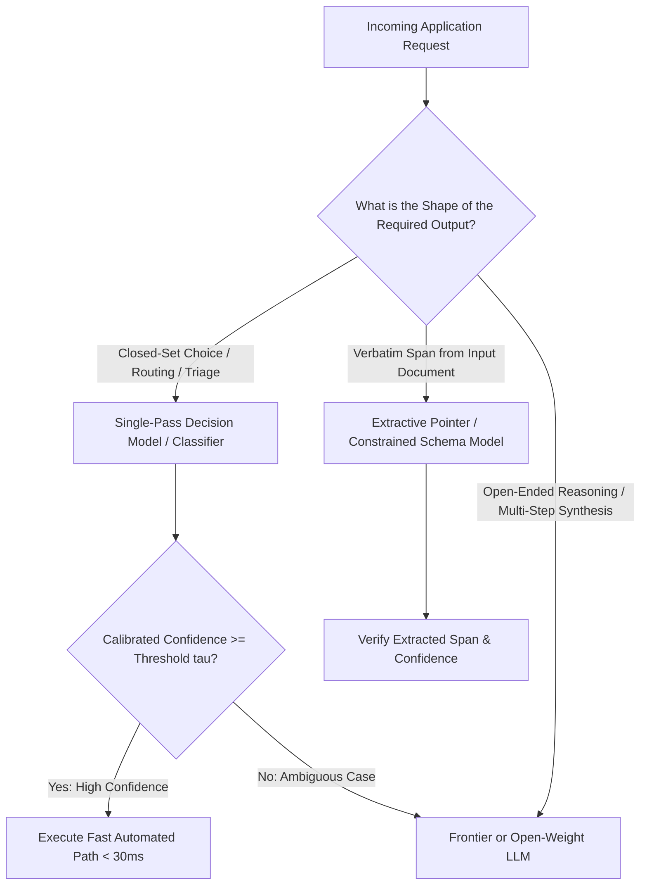

## 1. Introduction and Current Context

For nearly four years, the default pattern in AI engineering was to send every workload—even binary spam filtering, support ticket routing, and invoice date extraction—to a general-purpose autoregressive large language model. Asking an LLM to choose one category out of ten by generating tokens sequentially is like hiring a novelist to tick boxes on a form: it pays per output token, suffers from wording drift, can invent non-existent categories, and emits uncalibrated verbal confidence scores.

## 2. Direct Answer and Key Takeaway

> **Key Takeaway:** Neither 'JEV' nor 'CDM' is an established academic paradigm that replaces transformers; rather, both are commercial product launches from September and October 2026 targeting the inefficiency of using autoregressive LLMs for routine classification and extraction. Jev (released September 15, 2026 by TypeSafe AI) is a single-pass 'System One' decision model that returns calibrated probabilities over fixed choices without generating text, while CDMs (Constrained Decoding Models, launched October 13, 2026 by ScaleDown) are a suite of three task-specific models (Classify, Extract, Summarise).

## 3. Definitions and Technical Background

Before evaluating architectural trade-offs or writing production code for **JEV AI**, it is essential to establish precise engineering definitions for the core components involved:

- **Jev (TypeSafe AI Decision Model):** A commercial model launched on September 15, 2026 by TypeSafe AI that reads an input context and one or more typed multiple-choice questions in a single forward pass and returns a calibrated probability distribution over the provided options without generating free-form text.
- **CDMs (Constrained Decoding Models by ScaleDown):** A commercial family of three narrow, task-specific models launched on October 13, 2026 by ScaleDown—comprising `Classify`, `Extract`, and `Summarise`.
- **Grammar-Constrained Decoding:** An established inference-time technique—implemented in open-source libraries such as `dottxt-ai/outlines`, `guidance-ai/guidance`, and `sgl-project/sglang`—that masks invalid vocabulary logits at each decoding step using a finite-state automaton or context-free grammar so output strictly conforms to a regex or JSON Schema.

## 4. Technical Architecture and Deep Dive

To evaluate whether Jev and CDMs constitute a paradigm shift, engineers must separate the marketing terminology from the underlying mechanics. Standard LLMs operate via autoregressive token generation: to answer a routing question, the model predicts subword tokens one by one.

TypeSafe AI's **Jev** bypasses token generation entirely for closed-set choices. Given an input document and a set of typed questions with fixed options, Jev evaluates the options in parallel in a single pass and outputs a probability for each option. TypeSafe AI reports training Jev using 'Reinforcement Learning for Calibrated Decisions' on synthetic data so that its output probabilities are calibrated—enabling deterministic threshold rules such as: *if confidence $\ge 0.95$, execute the route automatically; otherwise, escalate to a frontier LLM or human operator*.

Four weeks after Jev, on October 13, 2026, ScaleDown launched **CDMs** alongside a LangChain integration. Unlike Jev's single decision primitive, ScaleDown packaged three distinct specialized models under the CDM banner: `Classify`, `Extract`, and `Summarise`.

First, 'Constrained Decoding Model' is a vendor product name, not a new foundational neural architecture: open-source libraries like `dottxt-ai/outlines` and `guidance-ai/guidance` have enforced regex and JSON Schema constraints on open-weight transformers for years. Second, not all three CDM endpoints skip text generation—while `Classify` selects labels and `Extract` points to input spans, `Summarise` still performs autoregressive text generation.

## 5. Comparative Analysis: Technical Comparison: Autoregressive LLMs vs. Jev, ScaleDown CDMs, and Open-Source Constrained Decoding

The following table compares the key engineering trade-offs, operational boundaries, and implementation choices for **JEV AI**:

| Capability / Attribute | Standard Autoregressive LLM | TypeSafe AI Jev (Sept 2026) | ScaleDown CDMs (Oct 2026) | Open-Source Constrained Decoding (Outlines / SGLang) |
| --- | --- | --- | --- | --- |
| Category & Origin | Foundational architecture (Open & Closed) | Commercial 'System One' decision API | Commercial 3-model suite (Classify, Extract, Summarise) | Open-source inference engine & logit-masking library |
| Output Mechanism | Token-by-token text generation | Single-pass calibrated option probabilities (zero text) | Label probabilities, span pointers, or generative summary | FSM/CFG logit masking over any open-weight model |
| Primary Workload Fit | Open-ended reasoning, coding, synthesis | Closed-set routing, triage, guardrails, classification | High-volume ticket routing, span extraction, summarization | Self-hosted typed JSON extraction & classification |
| Confidence Calibration | Poor when verbalized; requires logprob calibration | Explicitly trained for calibrated probabilities | Provides confidence scores per label/span | Depends on underlying base model logprobs & temperature |
| Verification Caveat | High latency/cost on simple choices | Vendor benchmarks self-reported; cannot write text | Summarise still generates text; small margin over OS on extraction | 100% valid syntax does not prevent semantic errors on small models |

## 6. System Architecture and Execution Flow

The diagram below illustrates the end-to-end control flow, verification boundaries, and state transitions for **JEV AI** in a production environment:

*Figure 6.1: Hybrid 'System 1 + System 2' routing architecture matching the model class to the structural shape of the required answer.*

## 7. Practical Implementation Steps and Engineering Checklist

To implement **JEV AI** reliably in production systems, follow these sequential engineering steps:

1. Audit your production LLM logs to measure what percentage of API calls are actually closed-set multiple-choice decisions.
2. Before adopting a proprietary decision API, benchmark open-weight small models (4B–8B) or encoder classifiers running locally with `dottxt-ai/outlines` or single-pass logprob inspection against your own labeled dataset.
3. Measure Expected Calibration Error (ECE) on a held-out validation slice of your own domain data: verify that when a decision model reports 0.90 probability, it is actually accurate ~90% of the time on your inputs before wiring automated escalation thresholds.
4. Implement a two-tier cascade so routine high-confidence cases resolve in milliseconds while ambiguous cases below your confidence threshold $\tau$ escalate safely.

## 8. Limitations, Operational Risks, and Trade-Offs

Even well-architected deployments of **JEV AI** face concrete engineering constraints that teams must mitigate proactively:

- Self-reported vendor benchmarks: headline speedups (such as 200x faster or 467x cheaper) compare specialized small models against large frontier LLMs rather than against well-tuned open-weight classifiers or modern BERT/DeBERTa encoders.
- The syntactic-semantic gap: constraining a model to pick from five valid enum labels guarantees it will never invent a sixth label, but it does not prevent the model from confidently selecting the wrong enum on complex inputs.
- Distribution shift on calibration gates: confidence thresholds calibrated on historical support tickets can degrade silently if user behavior or product terminology shifts over time, requiring continuous online monitoring.

## 9. Frequently Asked Questions (FAQs)

### Are JEV and CDM established academic model architectures that replace Transformers?

No. Jev is a commercial decision model launched by TypeSafe AI on September 15, 2026, and CDMs (Constrained Decoding Models) are a commercial suite of three narrow models (Classify, Extract, Summarise) launched by ScaleDown on October 13, 2026.

### Is 'constrained decoding' a new technology invented in 2026?

No.

### Why does probability calibration matter for decision models?

When an ordinary LLM writes 'I am 95% confident,' that number is just generated text with no statistical grounding.

## 10. Conclusion

The rise of Jev and CDMs in late 2026 reflects a healthy maturation in AI engineering: teams are finally stopping the wasteful practice of calling a massive text-generating LLM just to pick an item from a dropdown list. Whether you use a commercial decision API or self-host an open-weight model with Outlines and vLLM, the enduring engineering principle is to match the model architecture to the shape of the answer—and always verify semantic accuracy and calibration on your own data.

### GitHub Repositories & Technical References

- **dottxt-ai/outlines** — Official open-source structured generation library that compiles regular expressions, JSON Schemas, and Pydantic models into finite-state machines for guaranteed valid outputs across LLMs. Verified GitHub URL: https://github.com/dottxt-ai/outlines
- **guidance-ai/guidance** — Official steering language and constrained decoding library for controlling language model generation with context-free grammars and interleaved logic. Verified GitHub URL: https://github.com/guidance-ai/guidance
- **sgl-project/sglang** — High-performance serving framework implementing compressed finite-state machines for fast constrained JSON decoding alongside RadixAttention. Verified GitHub URL: https://github.com/sgl-project/sglang
- **vllm-project/vllm** — Production LLM inference engine supporting guided decoding backends, logprob inspection, and pooled classification/embedding models. Verified GitHub URL: https://github.com/vllm-project/vllm
