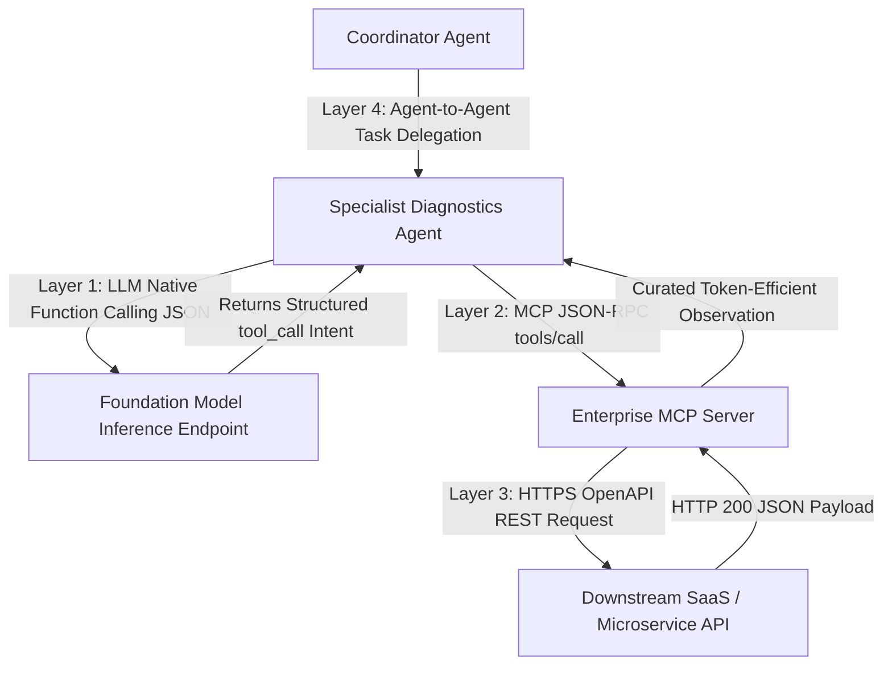

## 1. Introduction and Current Context

Architectural discussions in 2026 frequently suffer from protocol confusion: developers ask whether MCP replaces REST APIs, whether A2A replaces MCP, or whether native LLM tool calling makes both unnecessary. Conflating these layers leads to over-engineered systems—such as wrapping a simple internal function call in a multi-agent network protocol or exposing 200 raw REST endpoints directly to a language model. Mapping each protocol to its exact responsibility clarifies how modern AI systems are composed.

## 2. Direct Answer and Key Takeaway

> **Key Takeaway:** LLM function calling, REST/OpenAPI interfaces, the Model Context Protocol (MCP), and Agent-to-Agent (A2A) protocols are not competing replacements for one another—they operate at four distinct layers of the software stack. **Native Tool/Function Calling** is the inference-layer mechanism where an LLM emits a structured JSON intent; **MCP** (`modelcontextprotocol`) is the agent-to-tool runtime wire protocol that executes that intent against external tools and resources; **REST/OpenAPI** (`OAI/OpenAPI-Specification`) is the underlying service-to-service web contract; and **Agent-to-Agent (A2A)** protocols handle asynchronous task delegation between autonomous peer agents with opaque internal states.

## 3. Definitions and Technical Background

Before evaluating architectural trade-offs or writing production code for **AI tool calling**, it is essential to establish precise engineering definitions for the core components involved:

- **Inference-Layer Tool Calling (Function Calling):** The model-level capability where an LLM, given a list of JSON Schema tool declarations in its prompt, outputs a structured `tool_calls` array containing a function name and arguments instead of conversational prose. The model itself never executes the function.
- **Service-to-Service API Contract (OpenAPI / gRPC / GraphQL):** Deterministic application interfaces (`OAI/OpenAPI-Specification`) designed for machine-to-machine microservices, providing strict HTTP/RPC endpoints, status codes, pagination, and authentication.
- **Agent-to-Tool Protocol (Model Context Protocol - MCP):** A standardized client-server protocol (`modelcontextprotocol/modelcontextprotocol`) that bridges an AI host/agent to deterministic tools, context resources, and prompt templates over JSON-RPC 2.0.
- **Agent-to-Agent Protocol (e.g., A2A):** A peer-to-peer or supervisor-to-specialist communication specification (`google-a2a/A2A`) designed for delegating long-running, multi-turn tasks between opaque autonomous agents that maintain their own internal reasoning loops, memory, and tools.

## 4. Technical Architecture and Deep Dive

Let us trace a single user request across all four architectural layers to see how they collaborate rather than compete.

Inside the specialist agent, the runtime sends the current state and available tool schemas to its foundation model. The foundation model uses **Inference-Layer Tool Calling** to emit a structured JSON block: `{"name": "inspect_pg_stat_statements", "arguments": {"min_duration_ms": 500}}`.

The agent runtime intercepts that `tool_calls` JSON block and routes it over the **Model Context Protocol (MCP)** (`tools/call`) to a connected PostgreSQL MCP Server (`modelcontextprotocol/servers`). Similarly, when the agent needs to create the Jira ticket, its MCP client sends a `tools/call` request to a Jira MCP Server. Finally, how does the Jira MCP Server actually create the ticket in Atlassian's cloud?

Why shouldn't developers simply auto-convert every 500-endpoint OpenAPI specification directly into 500 MCP tools? Because REST APIs are designed for fine-grained programmatic CRUD (requiring multiple sequential calls to look up a user ID, fetch a project ID, check permissions, and post a payload), whereas LLMs perform best with **coarse-grained, intent-oriented tools**. A well-designed MCP server wraps 5 fine-grained REST API calls into a single high-level tool (`create_bug_report`) that returns clean, token-efficient context tailored for an LLM's context window.

## 5. Comparative Analysis: Architectural Layer Comparison: Function Calling vs. OpenAPI REST vs. MCP vs. Agent-to-Agent Protocols

The following table compares the key engineering trade-offs, operational boundaries, and implementation choices for **AI tool calling**:

| Protocol / Mechanism | Stack Layer | Communication Participants | Execution Semantics | When to Use Directly |
| --- | --- | --- | --- | --- |
| LLM Function / Tool Calling | Model Inference Layer | Agent Runtime ↔ LLM Endpoint | Synchronous JSON intent prediction (no execution) | Every time an LLM needs structured action output |
| OpenAPI / REST / gRPC | Microservice Application Layer | Backend Service ↔ Backend Service | Deterministic CRUD, pagination, high-QPS RPC | Standard software APIs, webhooks, and service meshes |
| Model Context Protocol (MCP) | Agent-to-Tool Adapter Layer | AI Host/Agent ↔ Tool/Resource Server | Stateful JSON-RPC discovery & execution of tools/resources | Exposing tools/data to CLI agents, IDEs, and LLM hosts |
| Agent-to-Agent (A2A / Graph Handoff) | Multi-Agent Orchestration Layer | Coordinator Agent ↔ Specialist Agent | Goal delegation, streaming task states, opaque internals | Cross-team or cross-vendor autonomous agent collaboration |

## 6. System Architecture and Execution Flow

The diagram below illustrates the end-to-end control flow, verification boundaries, and state transitions for **AI tool calling** in a production environment:

*Figure 19.1: Four-layer stack showing how Agent-to-Agent delegation, LLM Function Calling, MCP, and OpenAPI REST APIs operate together.*

## 7. Practical Implementation Steps and Engineering Checklist

To implement **AI tool calling** reliably in production systems, follow these sequential engineering steps:

1. Use direct in-process Python or TypeScript functions (via `pydantic/pydantic-ai` or `langchain-ai/langgraph`) when your tools live in the exact same codebase and container as your single agent—you do not need the network overhead of MCP or A2A for three local helper functions.
2. Adopt **MCP** (`modelcontextprotocol/python-sdk`) when you want a tool integration to be reusable across multiple agent hosts (such as Claude Code, Codex CLI, Gemini CLI, and your internal web platform) or isolated in its own security process.
3. Never run a blind 1:1 auto-generator from a massive `OpenAPI` spec into LLM tool definitions; curate an MCP adapter layer that merges chatty multi-step REST lookups into cohesive, token-efficient agent tools.
4. For multi-agent systems owned by a single engineering team, prefer shared-state graph handoffs in `langchain-ai/langgraph` before introducing cross-network Agent-to-Agent (A2A) HTTP protocols.
5. Reserve cross-network Agent-to-Agent protocols for scenarios where independent teams or organizations operate separate black-box agents that cannot share a database or codebase.

## 8. Limitations, Operational Risks, and Trade-Offs

Even well-architected deployments of **AI tool calling** face concrete engineering constraints that teams must mitigate proactively:

- Auto-generated OpenAPI-to-MCP anti-pattern: exposing raw enterprise REST responses (often containing 200 nested metadata fields and hypermedia links per item) directly to an LLM rapidly overflows the context window.
- Over-engineering single-app tools: adding JSON-RPC serialization, MCP server sidecars, and A2A discovery registries to a simple 2-tool internal script adds latency and failure points without architectural benefit.
- Protocol version and governance churn: while OpenAPI and MCP have mature SDKs, cross-vendor agent-to-agent standards continue to evolve—verify active repository maintenance before taking hard production dependencies.

## 9. Frequently Asked Questions (FAQs)

### Does the Model Context Protocol (MCP) replace LLM function calling?

No. MCP depends on LLM function calling.

### Should I replace my company's REST APIs with MCP servers?

No. Your core microservices should continue exposing standard REST (`OpenAPI`) or gRPC APIs for your web frontends, mobile apps, and partner integrations.

### What is the difference between MCP and Agent-to-Agent (A2A) protocols?

MCP connects an agent to deterministic **tools and resources** (where you pass structured arguments and get a predictable output).

## 10. Conclusion

Clear systems architecture requires using each protocol at the layer it was built for. Keep REST and OpenAPI as your microservice foundation, use native LLM tool calling at the model boundary, build curated MCP servers to expose reusable tools across AI hosts, and use graph handoffs or A2A protocols when orchestrating distinct autonomous agents.

### GitHub Repositories & Technical References

- **modelcontextprotocol/modelcontextprotocol** — Official specification for the Model Context Protocol connecting AI hosts to external tools and resources. Verified GitHub URL: https://github.com/modelcontextprotocol/modelcontextprotocol
- **OAI/OpenAPI-Specification** — Official repository for the OpenAPI Specification (OAS), the industry standard for defining HTTP/REST service APIs. Verified GitHub URL: https://github.com/OAI/OpenAPI-Specification
- **langchain-ai/langgraph** — Official framework for orchestrating single-agent tool loops and multi-agent supervisor/handoff architectures with shared checkpointed state. Verified GitHub URL: https://github.com/langchain-ai/langgraph
- **pydantic/pydantic-ai** — Official typed Python agent framework supporting native function calling, structured outputs, and MCP client integration. Verified GitHub URL: https://github.com/pydantic/pydantic-ai
