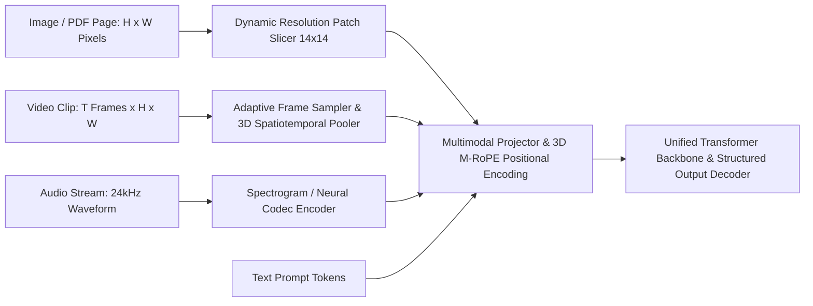

## 1. Introduction and Current Context

Most real-world enterprise data does not live in clean Markdown files. Financial analysts inspect scanned multi-column PDFs with embedded bar charts; field technicians upload smartphone photos of damaged circuit boards; QA engineers record screen-capture videos of browser bugs; and support centers receive voice notes in regional languages. Historically, handling these modalities required stitching together fragile multi-stage pipelines (OpenCV → Tesseract OCR → regex heuristics → text LLM) where layout geometry and visual context were lost at the first step. By October 2026, open-weight and frontier multimodal models—led by repositories such as `QwenLM/Qwen3-VL` and `meta-llama/llama-models`—process interleaved visual, audio, and text inputs directly.

## 2. Direct Answer and Key Takeaway

> **Key Takeaway:** In 2026, multimodal AI models unify text, high-resolution images, audio waveforms, and video streams inside a single shared token representation space. Whether built via dynamic-resolution Vision Transformers (ViT) with spatial-temporal adapters (such as `QwenLM/Qwen3-VL`) or native early-fusion tokenizers, modern Vision-Language Models (VLMs) outperform brittle legacy OCR pipelines on complex multi-column documents, charts, and UI grounding—provided engineers manage visual token budgets, image tiling resolutions, and spatial hallucination risks.

## 3. Definitions and Technical Background

Before evaluating architectural trade-offs or writing production code for **multimodal AI**, it is essential to establish precise engineering definitions for the core components involved:

- **Vision-Language Model (VLM):** A multimodal model combining a vision encoder (typically a Vision Transformer that slices images into patches) and a spatial-temporal projector with a language model backbone to reason jointly over visual and textual tokens.
- **Dynamic Resolution & Naive Dynamic Resolution (NaViT):** An image-processing mechanism (used in models like Qwen3-VL) that encodes images at their native aspect ratio and variable resolution into a proportional number of visual patch tokens, rather than squashing every image into a distorted fixed $224 \times 224$ square.
- **Visual Token Compression (Pixel Unshuffle / Spatial-Temporal Pooling):** Techniques that group adjacent visual patch embeddings into single compressed tokens before feeding them into the LLM backbone to prevent context-window explosion.
- **Multimodal Rotary Position Embedding (M-RoPE):** A positional encoding scheme that decomposes token positions into 1D (text), 2D, and 3D coordinates so the model understands spatial layout and temporal ordering.

## 4. Technical Architecture and Deep Dive

To build reliable multimodal systems, engineers must first understand how non-text inputs become tokens. For images, a Vision Transformer (ViT) divides an image into fixed-size pixel patches (commonly $14 \times 14$ or $16 \times 16$ pixels). A linear projection or MLP adapter maps those visual patch embeddings into the exact same hidden dimension as the language model's word embeddings, often merging $2 \times 2$ adjacent patches into a single visual token.

When extending from static images to video, the token arithmetic becomes acute. Sampling a 60-second video at just 2 frames per second produces 120 images; without temporal compression, 120 high-resolution frames would consume over 150,000 tokens.

Despite this compute cost, VLMs have revolutionized document intelligence and UI automation. Traditional OCR engines read text left-to-right blindly, scrambling two-column academic papers, nested financial tables, and flowcharts with arrows.

Additionally, 2026 VLMs incorporate grounded **2D bounding-box localization** (`[ymin, xmin, ymax, xmax]` normalized to `[0, 1000]`).

## 5. Comparative Analysis: Modality Encoding Mechanics, Token Costs, and Engineering Trade-Offs in Multimodal AI

The following table compares the key engineering trade-offs, operational boundaries, and implementation choices for **multimodal AI**:

| Input Modality | Tokenization Mechanism | Typical Token Budget Impact | Primary Production Use Cases | Key Engineering Pitfall |
| --- | --- | --- | --- | --- |
| Photographic Scenes & Objects | Dynamic ViT patches + $2 \times 2$ spatial merger | 256 – 1,024 tokens per image | Product cataloging, defect inspection, visual QA | Over-resolution wastes tokens when fine text isn't present |
| Dense Document PDFs & Charts | High-res native tiling + 2D M-RoPE coordinates | 1,200 – 3,500 tokens per page | Financial table extraction, handwritten forms, diagrams | Downscaling below 1000px blurs small numbers & footnotes |
| Video Streams | Keyframe sampling (0.5–2 FPS) + 3D spatiotemporal pooling | 5,000 – 50,000+ tokens per clip | Action recognition, UX session replay analysis, robotics | VRAM exhaustion from unbounded frame rate × resolution |
| Continuous Speech / Audio | Log-mel spectrogram encoder or neural codec (`Mimi`) | 12.5 – 50 tokens per second of audio | Full-duplex voice agents, emotion/accent-aware transcription | Acoustic noise & echo corrupting token stream without VAD |

## 6. System Architecture and Execution Flow

The diagram below illustrates the end-to-end control flow, verification boundaries, and state transitions for **multimodal AI** in a production environment:

*Figure 13.1: Unified multimodal architecture projecting dynamic-resolution images, sampled video frames, audio codecs, and text into a shared Transformer sequence with 3D M-RoPE.*

## 7. Practical Implementation Steps and Engineering Checklist

To implement **multimodal AI** reliably in production systems, follow these sequential engineering steps:

1. Right-size image resolution to the task before sending payloads: resize general object/scene photos to a maximum dimension of 768px–1024px to save 60% of visual tokens, while preserving 1500px–2048px resolution for dense financial tables or small-font OCR.
2. For multi-page PDF pipelines, use a fast deterministic heuristic (such as `pdfplumber` or `pypdfium2`) to extract clean native text pages directly, and route only scanned pages, complex tables, and embedded charts to a VLM (`QwenLM/Qwen3-VL`).
3. Control video token budgets explicitly by configuring frame-per-second (`fps`) sampling and maximum pixel caps (`max_pixels`)—for example, 1 FPS at $448 \times 448$ resolution for general activity summarization.
4. When extracting structured data from charts or invoices, pair the VLM with a strict JSON Schema (`dottxt-ai/outlines` or `pydantic`) and require the model to output both the visual label and the numeric value before performing downstream arithmetic in Python.
5. Verify spatial bounding-box outputs programmatically by drawing the returned `[ymin, xmin, ymax, xmax]` coordinates onto a debug copy of the image during testing to confirm coordinate normalization (0–1000 vs. 0.0–1.0 vs. raw pixels).

## 8. Limitations, Operational Risks, and Trade-Offs

Even well-architected deployments of **multimodal AI** face concrete engineering constraints that teams must mitigate proactively:

- Visual prior hallucination: if an image of a standard form or famous chart is slightly blurry, a VLM may fill in missing numbers from its parametric training memory rather than reporting that the digits are illegible.
- Precise spatial counting and geometry failures: while VLMs excel at semantic understanding, counting 47 overlapping items in a crowded warehouse photo or measuring exact pixel angles remains better suited to specialized computer-vision detectors (YOLO/SAM) than token-based VLMs.
- Prompt injection via visual text (typographic attacks): adversarial instructions rendered as tiny or low-contrast text inside an uploaded user image are read by the VLM's OCR capabilities and can hijack downstream tool calls.

## 9. Frequently Asked Questions (FAQs)

### How does a Vision-Language Model process an image alongside text?

A vision encoder (typically a Vision Transformer) splits the image into small pixel patches, computes visual embeddings, and passes them through a projection layer into the language model's embedding space.

### Should I replace all traditional OCR tools with a Vision-Language Model?

Not necessarily. For clean, single-column digital PDFs or high-volume barcode/receipt scanning at thousands of pages per second, lightweight traditional OCR or native PDF text extraction is far cheaper.

### Why do video inputs consume so many tokens and GPU memory?

Each video frame is an image containing hundreds of visual patches.

## 10. Conclusion

Multimodal AI has bridged the gap between unstructured visual/audio signals and structured software logic. By combining dynamic-resolution VLMs like Qwen3-VL with deliberate resolution sizing, frame-rate controls, and schema validation, engineering teams can automate document, chart, and media workflows that were previously unreachable by text-only models.

### GitHub Repositories & Technical References

- **QwenLM/Qwen3-VL** — Official repository for the Qwen3-VL multimodal vision-language model series supporting dynamic-resolution images, long video understanding, and 2D spatial grounding. Verified GitHub URL: https://github.com/qwenlm/qwen3-vl
- **vllm-project/vllm** — Production inference engine with native multimodal support for vision-language and audio-language models, including encoder caching. Verified GitHub URL: https://github.com/vllm-project/vllm
- **sgl-project/sglang** — High-performance serving framework supporting multimodal LLMs with RadixAttention and fast structured outputs. Verified GitHub URL: https://github.com/sgl-project/sglang
- **microsoft/playwright** — Browser automation and testing framework frequently paired with multimodal VLMs for visual UI verification and agent grounding. Verified GitHub URL: https://github.com/microsoft/playwright
