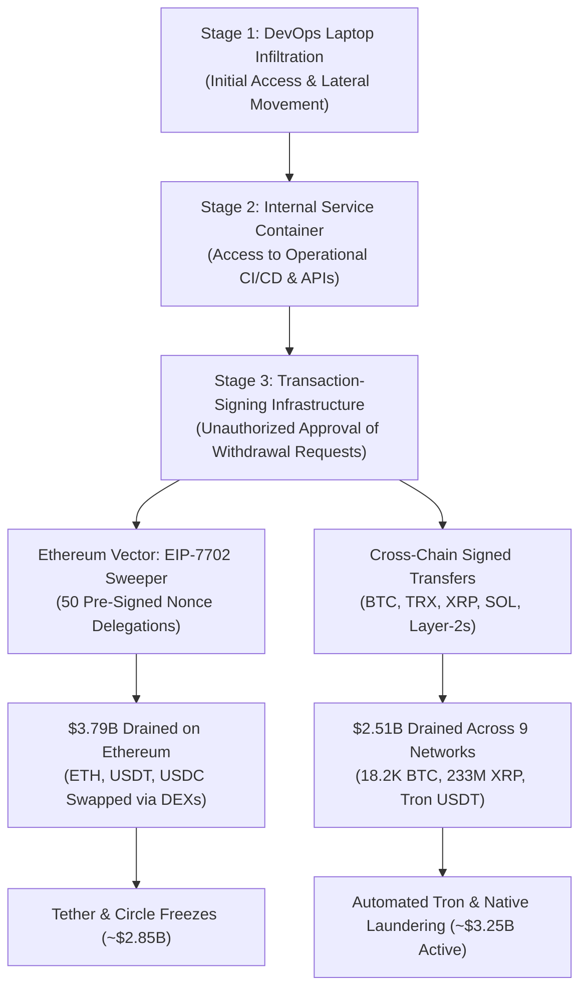

## The $6.3 Billion Question: How Was One of the World's Largest Cryptocurrency Exchanges Breached?

On October 29, 2026, approximately $6.3 billion worth of cryptocurrency was transferred out of Binance-controlled wallets in a coordinated cyberattack that unfolded across multiple blockchain networks.

The attackers did not simply steal a seed phrase, exploit an ordinary smart contract vulnerability, or gain access to a single customer account. The available blockchain evidence suggests something considerably more sophisticated: an attacker gained the ability to make Binance's transaction-signing infrastructure authorize withdrawals that should never have been approved.

The Federal Bureau of Investigation (FBI) subsequently attributed the attack to North Korea's state-sponsored cyber operation known as **TraderTraitor**.

Blockchain intelligence firms TRM Labs and Elliptic reconstructed the movement of billions of dollars across Ethereum, Bitcoin, Tron and other networks. Their findings revealed an operation that appears to have involved extensive preparation, unauthorized transaction authorization, automated fund transfers and a coordinated attempt to move assets beyond the reach of centralized issuers.

What makes this incident particularly important is that Binance initially reported no evidence that wallet private keys had been leaked. Instead, its preliminary investigation pointed towards a compromised DevOps engineer's laptop and an attacker gaining access to an internal service container.

This raises an important question for the entire financial technology industry:

**What happens when the systems responsible for authorizing financial transactions become the attack surface?**

This article examines the Binance security breach, its suspected technical mechanism, the role of EIP-7702, the North Korean attribution, the movement of stolen cryptocurrency, the response from stablecoin issuers and Binance's recovery strategy.

The analysis draws on official Binance announcements, the FBI's cyber alert, Reuters reporting, and investigations published by TRM Labs, Elliptic, CoinDesk and other blockchain intelligence researchers.

---

## Binance Hack 2026: Key Facts at a Glance

| Indicator | What the investigation found |
|---|---|
| Incident date | October 29, 2026 |
| Exchange | Binance |
| Estimated financial impact | Approximately $6.3–$6.43 billion |
| Suspected threat actor | North Korea's TraderTraitor |
| Official attribution | FBI, October 31, 2026 |
| Wallets affected | 17, according to TRM Labs |
| Blockchain networks | 10 counted by TRM Labs; Elliptic later tracked 11 |
| Primary attack window | Approximately 20 minutes for the bulk of the transfers |
| Overall transfer period | Approximately 20:05–23:56 UTC |
| Suspected initial access | Compromised DevOps engineer's laptop |
| Key technical finding | Compromise of transaction-signing infrastructure, according to blockchain analysis |
| Ethereum mechanism | EIP-7702 account delegation |
| Frozen or seized funds | Approximately $2.85 billion verified by Elliptic at its November 1 snapshot |
| Binance asset replacement | Approximately 95% of the affected amount, according to Binance on November 1 |
| Withdrawal restoration | Phased reopening began November 1 |

> [!IMPORTANT]
> The $6.3 billion figure is Binance's estimate. TRM Labs calculated approximately $6.36 billion, while Elliptic calculated approximately $6.43 billion using its own transaction attribution and valuation methodology. These are not three separate losses.

---

## 1. What Happened to Binance on October 29, 2026?

Binance confirmed that its hot-wallet infrastructure had been compromised on October 29, resulting in unauthorized withdrawals worth approximately $6.3 billion.

The exchange disclosed the incident in its first official security update on October 30.

According to Binance, its preliminary investigation suggested that an attacker may have compromised a DevOps engineer's laptop. This reportedly provided access to an internal service container that could submit withdrawal transactions.

Binance also stated that investigators had found no evidence of a wallet private-key leak at that stage.

This distinction matters.

A cryptocurrency exchange generally operates two broad categories of wallets:

- **Hot wallets:** Internet-connected wallets used to process deposits, withdrawals and operational transactions.
- **Cold wallets:** Wallets kept offline or in highly restricted environments to reduce exposure to online attacks.

Hot wallets are operationally necessary because exchanges must process transactions continuously. However, their connection to production infrastructure creates a significant security challenge.

An attacker who compromises the mechanisms responsible for authorizing hot-wallet transactions may be able to initiate transfers without physically obtaining the wallet's private-key material.

Binance's investigation later identified additional points of compromise. Co-CEO Richard Teng described the operation as a complex attack involving malicious software designed to erase evidence of its activity.

As of November 1, Binance had not published its complete forensic post-mortem.

---

## 2. Who Was Behind the Binance Hack?

On October 31, 2026, the FBI officially attributed the Binance theft to North Korea.

The agency identified the operation as **TraderTraitor**, a North Korean state-sponsored malicious cyber activity.

According to the FBI, the attackers were observed converting the stolen assets primarily into Ethereum. The agency also warned that the assets could undergo additional laundering through decentralized finance (DeFi) protocols and instant cryptocurrency swap services.

The attribution is significant because TraderTraitor has previously been associated with some of the cryptocurrency industry's largest security incidents.

### The connection to the Bybit hack

In February 2025, Bybit suffered a cryptocurrency theft involving approximately $1.5 billion.

The FBI attributed that operation to North Korean cyber actors and used the same TraderTraitor designation.

Investigations into the Bybit incident found that attackers compromised infrastructure associated with Safe{Wallet}, manipulating the transaction interface presented to Bybit's signers.

The attackers did not need to break Ethereum's underlying cryptography. They manipulated the trusted transaction workflow so that authorized personnel approved a malicious transaction.

The Binance incident appears to share a broader theme: compromising the infrastructure and authorization processes surrounding cryptocurrency wallets rather than simply attacking the blockchain itself.

There is, however, an important technical difference. The Bybit incident involved the manipulation of a multisignature wallet transaction workflow, while the Binance investigation points towards compromised exchange infrastructure and transaction-signing systems.

The two attacks should not be treated as technically identical.

---

## 3. How Did the Attackers Get Inside Binance?

This is the most important unresolved question in the incident.

Binance's initial explanation identified a potentially compromised DevOps engineer's laptop. However, the subsequent investigation revealed that the incident involved more than one breach point.

To understand the potential attack surface, it is necessary to understand what a DevOps engineer does.

A DevOps engineer works with the systems that allow software to be built, deployed, monitored and operated.

Their responsibilities can include:

- Cloud infrastructure management.
- Production deployment pipelines.
- Container orchestration.
- Infrastructure automation.
- Monitoring and observability.
- Access to internal operational services.

These systems are particularly sensitive because they often interact with production environments.

A compromised employee account with excessive privileges can create an opportunity to access systems that ordinary users cannot reach.

### Suspected Attack Chain Architecture

### The suspected attack chain

Based on Binance's preliminary statements and the subsequent blockchain investigations, the incident can be understood through the following high-level sequence.

**Stage 1: Compromised employee environment**

An attacker allegedly gained access to a DevOps engineer's work laptop. The exact initial compromise mechanism has not been publicly established. It would be premature to claim that this happened through phishing, stolen credentials, malicious software delivery or an insider.

**Stage 2: Access to internal infrastructure**

The compromised environment reportedly provided access to a service container. A container is an isolated execution environment used to run applications and services. Containers frequently communicate with other internal services through APIs, permissions, credentials and network connections.

**Stage 3: Unauthorized access to transaction execution**

The attacker apparently gained the ability to interact with withdrawal-related infrastructure. This is where the incident becomes particularly serious. Instead of simply attempting to compromise an external cryptocurrency wallet, the attacker appears to have gained access to a mechanism that could produce valid transaction authorizations.

**Stage 4: Unauthorized cryptocurrency transfers**

Blockchain records show that Binance-controlled wallets generated valid signatures for transactions that transferred assets to attacker-controlled addresses. TRM Labs believes the most likely explanation is that the attackers obtained control over Binance's hot-wallet signing infrastructure. This remains an investigative conclusion rather than a complete, independently verified technical post-mortem.

**Stage 5: Evidence destruction and continued execution**

Binance's co-CEO subsequently described the use of malicious software intended to destroy evidence and stated that the attack involved additional compromise points. This makes forensic reconstruction more difficult because investigators must reconstruct the incident from endpoint records, internal logs, cloud activity, transaction histories and blockchain evidence.

The critical lesson is that a secure wallet can still be exposed when the infrastructure surrounding its authorization process is compromised.

---

## 4. The Technical Breakthrough: How EIP-7702 Was Used Against Binance

One of the most technically interesting findings came from TRM Labs' Ethereum investigation.

The researchers identified the use of **EIP-7702**, an Ethereum protocol feature introduced as part of the Pectra upgrade. Pectra went live on Ethereum mainnet on May 7, 2025.

EIP-7702 allows an externally owned account (EOA), traditionally a wallet controlled directly by a private key, to delegate its execution behaviour to smart-contract code through a signed authorization.

In simple terms, a conventional Ethereum wallet can be given additional smart-contract functionality without being replaced entirely by a separate smart-contract wallet. This enables features such as transaction batching, sponsorship and more flexible account behaviour.

However, the feature introduces an important security requirement: the authorization process must be protected carefully because delegated code can execute operations using the authority of the wallet.

### What is a wallet delegation?

Under ordinary Ethereum transactions, an externally owned account generally signs a transaction to transfer assets or interact with a contract.

With EIP-7702, an authorized account can sign a delegation that allows its execution behaviour to be associated with code stored at another address. That code then executes in the context of the delegating account.

This is useful for legitimate wallet functionality, but it becomes dangerous when an attacker obtains an authorization that the wallet owner never intended to grant.

### How the Binance attacker reportedly abused the mechanism

TRM Labs reconstructed the Ethereum activity and reported the following:

1. The attackers prepared 50 pre-signed authorization records.
2. These authorizations were associated with Binance's Ethereum hot wallet.
3. The records pointed towards a sweeper contract controlled by the attacker.
4. The attackers used the account's transaction nonce mechanism to ensure that a valid authorization could be applied when the transaction was executed.
5. Once delegation was established, the malicious execution logic could transfer funds to the attacker's designated address.

A nonce is simply a counter associated with an Ethereum account. It prevents transactions from being replayed arbitrarily and ensures that transactions are executed in the correct sequence. Preparing multiple authorizations for consecutive nonce values meant the attacker had multiple opportunities to match the wallet's current state.

According to TRM Labs, this approach was used to establish the sweeper mechanism and execute unauthorized transfers.

### The $1.6 billion Ethereum transaction

The scale of the operation becomes clearer when examining the primary Ethereum transaction.

TRM Labs reported that one major transaction moved:

- 167,464 ETH.
- 63 additional tokens.
- Approximately $1.615 billion in USDT.

The wallet's delegated behaviour remained active. As new funds arrived in the hot wallet, further unauthorized sweeps occurred at several subsequent times.

The attacker reportedly repeated this process at approximately 20:41, 20:59, 21:04, 21:44, 22:39 and 23:56 UTC.

A separate transaction involving another Binance Ethereum wallet moved approximately $174 million worth of assets through an ordinary signed transaction, according to Elliptic.

These findings demonstrate that the attack was not limited to one transaction.

### Was EIP-7702 itself hacked?

No. There is an important distinction here.

EIP-7702 is a legitimate Ethereum protocol feature. The available findings do not demonstrate that Ethereum consensus or the EIP-7702 protocol itself was broken.

The apparent failure was in the authorization and signing environment surrounding Binance's wallet infrastructure. A legitimate protocol capability can become a security risk when an unauthorized party obtains the ability to make a wallet authorize its use.

The incident is therefore better described as an abuse of authorized execution functionality through compromised infrastructure, rather than an Ethereum protocol-level exploit.

---

## 5. Why the Other Blockchain Networks Matter

The Ethereum attack explains only part of the incident.

TRM Labs identified unauthorized transfers involving Binance wallets across ten blockchain networks.

Its investigation found that the affected wallets on the other nine networks sent funds through ordinary signed transfers rather than the same EIP-7702 delegation mechanism.

These networks included:

- Bitcoin.
- Tron.
- XRP Ledger.
- Solana.
- Arbitrum.
- Optimism.
- Base.
- Avalanche.
- Polygon.

Elliptic's later investigation also tracked activity on NEAR, which is one reason its network count differs from TRM's.

This distinction is important. If the attack had involved only one Ethereum wallet and an isolated EIP-7702 authorization, the problem could potentially have been much narrower.

However, multiple wallets using different blockchains, key types and signing mechanisms produced valid transactions for the attacker in a coordinated period. TRM Labs therefore assessed that the broader hot-wallet signing infrastructure was likely compromised.

The exact internal mechanism that allowed the attackers to obtain these signatures remains unknown.

### Estimated losses by blockchain

TRM Labs reconstructed the approximate value of the assets transferred from Binance-controlled wallets.

| Blockchain | Major assets involved | Approximate value |
|---|---|---:|
| Ethereum | ETH, USDT, USDC and other tokens | $3.79 billion |
| Bitcoin | 18,270 BTC | $1.47 billion |
| Tron | USDT and TRX | $628 million |
| XRP Ledger | 233.46 million XRP | $296 million |
| Solana | 970,500 SOL | $96 million |
| Arbitrum, Optimism and Base | Multiple assets | $39 million |
| Avalanche | Multiple assets | $28 million |
| Polygon | Multiple assets | $10 million |

These figures are rounded investigator estimates, valued around the time of the transfers. They should not be treated as a separate loss calculation from Binance's approximately $6.3 billion estimate.

The attack was not simply an isolated Ethereum smart-contract incident. It appears to have involved access to a broader financial authorization system capable of producing valid transfers across multiple networks.

---

## 6. The Four-Hour Operation: Reconstructing the Timeline

Although the entire operation unfolded over several hours, the bulk of the stolen funds moved in approximately 20 minutes.

According to TRM Labs, preparation began at least 36 hours before the major transfers.

### October 28: Preparation begins

The attacker's operational wallet received three small withdrawals from Tornado Cash, a cryptocurrency mixing service designed to obscure transaction relationships. Investigators subsequently observed code deployment and testing activity.

### October 29: Testing and execution

Before the major transfers, the attackers tested their code on three wallets and routed the test funds back. TRM Labs reported that the same code was installed on a Binance hot wallet approximately four hours after the final rehearsal.

### October 29, approximately 20:05 UTC: First major transfers

Five Binance wallets on the XRP Ledger sent approximately 233.46 million XRP to an attacker-controlled address. Wallets on other networks began sending funds shortly afterwards.

### Approximately 20:20 UTC: Bitcoin and Ethereum activity

An affected Binance Bitcoin hot wallet transferred approximately 18,270 BTC. Blockchain investigators also identified the Ethereum account-delegation activity. The attackers began moving assets into their own wallets, with the largest transactions occurring during the initial wave.

### Approximately 20:24 UTC onwards: Main Ethereum sweep

The large Ethereum transaction transferred 167,464 ETH and other tokens worth billions of dollars. Further transfers occurred as new funds became available in the affected wallet.

### Approximately 23:56 UTC: Last identified sweep in TRM's sequence

TRM's reconstruction records additional wallet-sweeping activity extending to approximately 23:56 UTC.

This is why the incident is often described as a theft completed in under four hours, even though most of the financial damage occurred much faster. The timeline shows that visible theft may happen quickly, but the preparation required to execute it can begin long before the first suspicious transaction appears.

---

## 7. Why Did the Attackers Convert USDT and USDC Into ETH and Other Assets?

After moving the cryptocurrency, the attackers faced another challenge: how could they prevent the assets from being frozen?

This is where the difference between centrally issued stablecoins and decentralized native cryptocurrencies becomes important.

### Stablecoins have centralized issuers

USDT is issued by Tether. USDC is issued by Circle.

These companies operate token contracts with administrative functions that allow certain addresses to be frozen or blacklisted. Consequently, if stolen USDT or USDC reaches an address identified as being controlled by a criminal operation, the issuer may be able to prevent that address from transferring the affected tokens.

This capability gives blockchain investigators and law enforcement an important intervention point.

### Bitcoin and Ethereum work differently

Native Bitcoin and ETH are not issued by a centralized company with an equivalent account-freezing function. There is no Tether-like administrator who can simply blacklist a native BTC or ETH wallet across the entire network.

That makes these assets considerably more difficult to immobilize. It does not make them anonymous or impossible to trace. Every transaction can still be analysed using blockchain data. If the attacker sends funds to a regulated exchange or a service capable of freezing the relevant assets, those funds may become vulnerable to intervention.

### The attacker's conversion strategy

According to Elliptic's analysis, approximately $3.46 billion of the stolen assets consisted of stablecoins.

Investigators reported that the attackers converted some of these assets into ETH and TRX before or during the freezing response. One notable transaction sequence involved approximately $434 million in USDT being converted into around 160,451 ETH through decentralized exchanges and market makers.

Elliptic estimated that some of these swaps occurred at a 12%–26% discount to the prevailing market price. The discount is significant because it suggests that the attacker was prioritizing speed and the ability to move assets over maximizing their market value.

The attackers also used DeFi lending infrastructure. Elliptic identified a wallet depositing approximately $59.9 million in USDT as collateral on Aave and borrowing approximately 19,762 ETH. Aave subsequently froze the affected markets, preventing further activity through the affected positions.

---

## 8. How Much of the Stolen Cryptocurrency Was Frozen?

The cryptocurrency industry's response was unusually rapid.

Tether, Circle, Ripple, World Liberty Financial and other participants coordinated with investigators to restrict the movement of identifiable stolen assets. Arbitrum's Security Council also took emergency action, and Optimism governance subsequently intervened in relation to assets on its network.

The amount frozen depends on the timing and methodology used by each investigator:

- As of its November 1 investigation update, **Elliptic had verified approximately $2.85 billion** in cryptocurrency frozen or seized on-chain.
- Binance's public updates cited a rounded figure of **approximately $3 billion** located or frozen with industry partners.
- TRM Labs had earlier reported **approximately $2.7 billion frozen** in its October 29–30 analysis.

### Why could investigators not freeze everything?

Because not every cryptocurrency has a centralized issuer. Stablecoin issuers can freeze their own tokens in specific circumstances, but they cannot directly freeze native Bitcoin or native ETH at the blockchain protocol level.

Elliptic's November 1 snapshot estimated that the attacker still controlled approximately $3.25 billion in assets outside the reach of issuer-level freezing mechanisms, including significant ETH, BTC and XRP balances.

### Frozen does not mean recovered

This distinction deserves particular attention. A frozen token is not necessarily returned to its original owner. Freezing prevents further movement through an issuer or protocol-level intervention.

There are three fundamentally distinct concepts:

1. **Tracked:** Investigators can identify and follow the assets.
2. **Frozen or seized:** The assets have been prevented from moving or transferred out of the attacker's control through an intervention.
3. **Recovered:** The assets have been returned to the rightful owner or their value has otherwise been restored.

---

## 9. How Was the Remaining Cryptocurrency Being Laundered?

Tracing stolen cryptocurrency is not the same as recovering it.

After the initial theft, investigators observed further activity designed to distribute funds across additional addresses and services.

Elliptic reported that the activity on Tron appeared highly automated. In its October 31 update, the company described a distribution wallet that continued making transactions at regular intervals, including overnight, sending funds to approximately 200 wallets.

Chainalysis also reported unusual patterns of repeated transactions and automated movements intended to obscure the transaction trail.

The broader laundering process involved several categories of activity:

- **Address distribution:** Moving assets through multiple wallets makes investigations more complex, although it does not erase their transaction history.
- **Token conversion:** Swapping stablecoins into native assets reduces the ability of a centralized issuer to freeze the funds.
- **Decentralized exchanges:** Trading through DEXs creates further transaction hops across public blockchain infrastructure.
- **Cross-chain infrastructure:** Bridges and cross-chain protocols move funds into other blockchain environments.
- **Market makers and lending protocols:** These services facilitate large asset conversions and borrowing arrangements, although risk controls may restrict suspicious transactions.

The FBI specifically warned that the stolen cryptocurrency could be laundered through DeFi and instant-swap services.

---

## 10. How Is Binance Covering the $6.3 Billion Loss?

One of the most important decisions Binance announced was that customers would not bear the financial impact of the incident.

The company said it would cover the losses through its Secure Asset Fund for Users (SAFU), its Futures Insurance Fund and corporate treasury resources.

On October 30, Binance reported that it had set aside more than $6.34 billion in company funds for the purpose. Initially, it said approximately $5 billion of those funds were held in the same types of tokens that had been stolen.

On October 31, Reuters reported that Binance had already covered approximately $6 billion of the estimated $6.3 billion impact. On November 1, Binance increased its stated replenishment coverage to approximately 95%.

### What is SAFU?

SAFU stands for Secure Asset Fund for Users. It is Binance's emergency protection reserve, designed to help protect customers in exceptional circumstances, including security incidents. Binance had previously maintained a target value of approximately $1 billion for this fund.

The exchange said that part of SAFU would be used for the recovery effort and committed to replenishing the reserve to approximately $1 billion.

### Why replacing the assets is different from recovering them

Imagine an exchange loses 100 BTC. It could purchase another 100 BTC using its corporate treasury and use those assets to restore its financial position. The original 100 BTC, however, might still be sitting in an attacker's wallets.

Binance's approximately 95% replenishment statement relates to the assets it has procured to cover the financial impact. It does not mean investigators recovered 95% of the stolen cryptocurrency.

---

## 11. What Is the Current Status of Binance? November 1, 2026 Update

Binance temporarily suspended withdrawals while its security teams investigated the incident and assessed the affected infrastructure. Deposits remained operational according to its subsequent announcements.

On November 1, Binance announced the phased restoration of withdrawals. The first phase included:

- Bitcoin
- Ethereum
- BNB
- USDT
- USDC
- XRP
- Solana
- Dogecoin

Reuters confirmed that Bitcoin withdrawals resumed shortly after 06:00 UTC on November 1, with Ethereum, BNB and certain USDT and USDC withdrawals also being restored.

Binance also reported that BTC, ETH, USDT, BNB, SOL, USDC, XRP, USD1, RLUSD and ZEC balances were backed at 100% in its published reserve information. The company says it has procured approximately 95% of the affected assets, with the remaining 5% consisting of less-liquid tokens that take longer to source.

A complete forensic incident report is still pending.

---

## 12. Binance vs Bybit: Is This a Repeating North Korean Cybersecurity Pattern?

The Binance incident is particularly concerning when considered alongside the February 2025 Bybit hack.

| Factor | Bybit, February 2025 | Binance, October 2026 |
|---|---|---|
| Approximate theft | $1.5 billion | $6.3–$6.43 billion |
| FBI attribution | TraderTraitor | TraderTraitor |
| Attack surface | Safe{Wallet} infrastructure | Binance internal and signing infrastructure |
| Key issue | Manipulated trusted transaction workflow | Unauthorized transaction authorization |
| Primary technique | Compromised transaction presentation and signing workflow | EIP-7702 delegation and broader signing compromise |
| Financial impact | Largest crypto theft at that time | Larger than the Bybit incident |

The common theme is **infrastructure trust**.

In the Bybit incident, attackers reportedly compromised a developer environment connected to the wallet provider and manipulated what transaction signers saw. In the Binance incident, investigators identified signs that the attacker could obtain valid transaction signatures from hot-wallet infrastructure.

These incidents show that cryptocurrency security is not solely about protecting cryptographic keys. It is also about protecting every system involved in deciding which transactions are allowed to be signed.

---

## 13. The Most Important Security Lessons for Cryptocurrency Exchanges

The Binance incident should trigger a comprehensive review of how cryptocurrency exchanges design and protect their transaction authorization systems.

### 13.1 Endpoint security must be treated as production security

Employee laptops that can access production infrastructure should be treated as critical assets. Appropriate controls include endpoint detection and response, hardened device configurations, restricted administrator access, rapid patching and continuous monitoring. A compromised developer device should not automatically become a gateway to financial transaction infrastructure.

### 13.2 Apply least-privilege access

Every employee, service and application should receive only the permissions required for its function. DevOps access should be segmented from transaction-signing privileges. High-impact permissions should be temporary, independently authorized and continuously audited.

### 13.3 Separate transaction creation from transaction authorization

A critical architectural principle is that creating a transaction should not automatically mean that the transaction can be authorized. The system that constructs a withdrawal request should be separate from the system that validates and signs it.

Transaction-signing infrastructure should independently verify:

- Recipient addresses.
- Transaction amounts.
- Asset types.
- Withdrawal velocity.
- Wallet balances.
- Authorization context.
- Network and contract interactions.

A request should be rejected when it violates policy, even when it originates from an authenticated internal service.

### 13.4 Establish independent withdrawal controls

Exchanges should implement additional approval requirements for unusually large or suspicious transactions, such as transaction limits, withdrawal allowlists, independent approvals, velocity monitoring and out-of-band verification.

### 13.5 Protect delegated account functionality

The EIP-7702 incident highlights the need for explicit authorization policies around account delegation. Organizations managing treasury wallets should monitor unexpected delegation changes and restrict signing systems from authorizing them unless they are specifically intended.

### 13.6 Make security monitoring cross-chain

Monitoring systems should not treat each blockchain as an isolated operational environment. An attacker capable of compromising a common signing service may be able to affect several networks simultaneously. Exchanges should monitor for coordinated withdrawal patterns across different blockchains.

### 13.7 Maintain tamper-resistant forensic evidence

The reported evidence-destruction mechanism is a reminder that production logs should not depend entirely on the systems being investigated. Critical audit records should be copied to isolated, access-controlled environments.

---

## 14. What Is Still Unknown About the Binance Hack?

Despite the extensive blockchain analysis, several critical questions remain unanswered:

- **What was the exact initial compromise mechanism?** Binance identified a potentially compromised DevOps laptop but has not published the complete method through which the attacker gained access.
- **How did the attackers obtain signing authorization across multiple networks?** TRM's analysis points towards broader compromise of Binance's hot-wallet signing infrastructure, but the internal mechanism has not been fully disclosed.
- **What were the additional breach points?** Binance said it found more than one point of compromise. The full scope and relationship between these points remain unknown.
- **Why did the normal security controls not stop the withdrawals?** The available reporting indicates that attackers were able to bypass normal approval controls in the Ethereum activity.
- **How much cryptocurrency will ultimately be recovered?** Frozen assets, traceable assets and replacement assets are different categories.
- **Will the attackers successfully launder the remaining funds?** The money continues to be monitored through blockchain intelligence systems.

---

## 15. Final Analysis: The Real Vulnerability Was the Infrastructure Around the Wallet

The Binance hack is a significant turning point in the way cryptocurrency security should be understood.

The incident demonstrates that blockchain security is not limited to consensus mechanisms, cryptographic algorithms or smart-contract code. A cryptocurrency exchange is a complex financial technology system involving employees, endpoints, applications, cloud infrastructure, APIs, authorization services, signing systems and multiple blockchain networks. Every one of those components can become an attack surface.

The most important finding from this incident is that an attacker appears to have gained the ability to make trusted transaction infrastructure authorize movements of assets at an extraordinary scale.

For cryptocurrency exchanges, banks, fintech companies and financial institutions, the message is clear:

**Protecting private keys is essential. Protecting the entire transaction authorization lifecycle is equally important.**

---

## Frequently Asked Questions (FAQs)

### 1. What happened in the Binance hack of October 2026?

On October 29, 2026, attackers transferred approximately $6.3 billion worth of cryptocurrency from Binance-controlled hot wallets. The incident affected multiple blockchain networks and involved unauthorized withdrawal transactions. The FBI subsequently attributed the attack to North Korea's TraderTraitor operation.

### 2. How much money was stolen from Binance?

Binance estimated the financial impact at approximately $6.3 billion. TRM Labs estimated $6.36 billion, while Elliptic calculated approximately $6.43 billion based on its blockchain investigation. Differences reflect the respective valuation and transaction-tracking methodologies.

### 3. Who hacked Binance in October 2026?

The FBI attributed the attack to North Korea's state-sponsored TraderTraitor cyber operation on October 31, 2026. TRM Labs and Elliptic had independently identified indicators consistent with previous North Korean-linked cryptocurrency thefts.

### 4. How did hackers access Binance's systems?

Binance's preliminary investigation suggested a compromised DevOps engineer's laptop allowed an attacker to access an internal service container and submit unauthorized withdrawals. Subsequent statements identified additional breach points and malicious software designed to erase evidence. The complete initial-access mechanism has not yet been disclosed.

### 5. Was Binance's private key stolen?

Binance initially stated that it had found no evidence of a wallet private-key leak. The available blockchain analysis instead suggests that attackers compromised transaction authorization and hot-wallet signing infrastructure. A complete independent forensic report has not yet been published.

### 6. What is EIP-7702, and how was it used in the Binance hack?

EIP-7702 is an Ethereum feature that allows an externally owned account to delegate its execution behaviour to smart-contract code through signed authorization. TRM Labs reported that attackers abused this mechanism to establish a sweeper contract associated with a Binance hot wallet, enabling unauthorized transfers. The incident does not establish that EIP-7702 itself contains a protocol vulnerability.

### 7. How much of the stolen Binance cryptocurrency was frozen?

Elliptic verified approximately $2.85 billion in frozen or seized funds in its November 1, 2026 snapshot. Binance had reported approximately $3 billion located or frozen with industry partners. These amounts can differ according to measurement time and which interventions are included.

### 8. Why did the hackers convert USDT into Ethereum?

USDT is issued by Tether, which can freeze certain addresses holding its tokens. Native ETH does not have a central issuer capable of freezing accounts in the same way. Converting stablecoins into ETH can therefore reduce the possibility of issuer-level intervention, although the resulting assets remain publicly traceable.

### 9. Did Binance reimburse its users?

Binance stated that it would absorb the financial impact rather than pass the loss to its users. By November 1, 2026, the company reported that it had procured approximately 95% of the affected assets through SAFU and company resources. This represents asset replacement, not equivalent recovery of the original stolen cryptocurrency.

### 10. Is Binance working normally after the hack?

Binance began resuming withdrawals in phases on November 1, 2026. Bitcoin, Ethereum, BNB and some stablecoin withdrawals were restored in the first phase. Availability still depends on the relevant asset and network, and Binance said other services would return progressively after security checks.

### 11. Is the Binance hack bigger than the Bybit hack?

Yes. The Binance incident involved an estimated $6.3–$6.43 billion in losses, compared with approximately $1.5 billion in the February 2025 Bybit theft. The Binance incident is more than four times larger by the commonly reported estimates.

### 12. Can stolen Bitcoin and Ethereum be frozen?

Not directly by a centralized token issuer in the way USDT or USDC can be frozen. However, exchanges, custodians, brokers and other services can identify and restrict suspicious deposits or transfers. Law enforcement may also be able to recover assets through legal action or control of relevant keys.

### 13. Was Ethereum itself hacked?

There is no evidence from the published investigation that Ethereum's consensus protocol was compromised. The reported EIP-7702 activity involved unauthorized use of a legitimate Ethereum account feature through compromised transaction authorization infrastructure.

### 14. What is the TraderTraitor hacking group?

TraderTraitor is a designation used by the FBI for North Korean malicious cyber activity associated with cryptocurrency theft and subsequent laundering. The FBI linked the group to the Bybit theft in February 2025 and attributed the Binance theft to the same operation in October 2026.

### 15. What is the biggest cybersecurity lesson from the Binance breach?

Securing wallet private keys alone is insufficient. Cryptocurrency exchanges must also protect employee devices, cloud infrastructure, internal services, transaction-signing systems, authorization controls and withdrawal workflows. Security must extend across the entire transaction lifecycle.

---

> [!NOTE]
> **Editorial note:** Financial figures, blockchain balances and laundering estimates are time-sensitive. This article distinguishes Binance's official statements from independent blockchain analytics and law-enforcement attribution. The complete forensic post-mortem has not yet been published. This article is for informational and cybersecurity research purposes, not investment advice.
